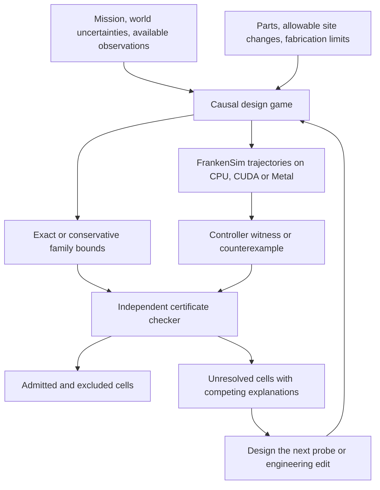

# Franken Robotics

## Comprehensive design and implementation plan · Astra edition

**Research objective · 21 November 2026.** Give the studio a mission, a catalog of parts, a controller
class and a description of what the robot can observe. Ask it for the *set* of designs that can do
the job. It should return a body and controller that work over a stated region, a checkable reason
some alternatives cannot work, and the cheapest experiment that could settle the remaining region.
An engineer should be able to change the mission from “deliver on a dry floor” to “also deliver with
a wet left wheel and an occluded camera” and see precisely which conclusions survive.

**The 10× target** is a tenfold reduction in elapsed time to an independently accepted engineering
answer at matched accuracy, scope, resources and evidence. The comparator may combine leading
simulators, an optimizer, analytic bounds, a verifier and the same AI agent. A second target is a
new query that an independent checker can adjudicate over a continuous family of designs.
These are funding and acceptance criteria. The planning experiments below isolate mechanisms.
The integrated product still has to beat a working competitor on a sealed suite.

**First 10× research bet.** Derive the physical conditions under which an accepted design decision
survives an edit. If a new gearbox changes traction at the rear axle or shifts the arrival of a
camera packet, identify the exact obligation that must be solved again. If the edit leaves those
conditions within a proved range, return the earlier result with a checkable justification.
Existing solvers already match several small family queries when given the same conditions.
W32/W40 therefore measure the cost of *deriving* them, including the engineering time on both
sides. §§19–20 specify when to fund the larger system and when to use a conventional solver.

**One result the studio should be able to explain.** A three-tick docking robot can move to
learn which of two fixed actuator gains, 1 or 2, it has before committing to its final approach.
With command limit 3/4,
a fixed probe tolerates a sensor error below 1/8. Designing the probe and feedback together moves
that threshold to 5/16. At the boundary two physically different robots can report the same
velocity and require incompatible next commands. The agent can return the two commands, the
shared reading, and the threshold a changed specification must clear to restore feasibility. §18.10
derives the continuous sensor–actuator boundary and checks 561 actuator/error grid cells against
an independently formulated LP comparator. Each group of 33 error levels shares one actuator bound.
Adding a third plausible gain, 33/32, defeats exact docking on every formerly feasible row of the
native benchmark. For a continuous gain anywhere in [1,2], a read error of at most 1/64 and the same 3/4 command limit, the smallest guaranteed final position tolerance at exact rest is about 2.41624 cm. An agent must return the amended guarantee when the factory updates its tolerance.

**Flagship commission.** Hand the studio an incomplete survey of a working facility, a parts
catalog and a delivery brief. Ask it to price a legged or wheeled carrier, a two-robot handoff,
and a small facility change under the same payload, power and scheduling constraints. Its deliverable
is a set of feasible repairs with witnesses, exclusions for alternatives that cannot work, and
the particular site or material measurement that would decide between the survivors. §18.9
specifies the smallest facility where all three engineering answers can compete.

**Foundation.** A design agent should be able to build two robots, give them the
same job, and discover why one fails at a particular doorway. It should be able to change a wheel,
a foot, a transmission, a sensor mount, or a controller and measure the consequence. Its answer should
include the contact event, the physical assumptions behind it, and the experiment that could overturn
the design decision.

The proposed product is a headless robot design studio and a vectorized reinforcement-learning gym.
FrankenSim supplies the mechanics. A typed algebra of assemblies, frames, power ports, observations,
and hybrid state transitions describes each experiment. A compiler specializes that description into
a CPU reference and native CUDA or Metal execution plans. The agent works against one CLI/MCP service.
A person can open the same run as a synchronized 3D replay, plots and a design diff.

**First forward-physics decision.** Can increasing the drive-wheel radius help a small indoor delivery robot
cross a raised threshold when the motor, chassis envelope, battery, payload, and current limit stay
fixed? Success requires the entire loaded cart to clear the lip under the limits in §13.2.
A larger wheel improves approach geometry and reduces available tangential force for a given
axle torque. Either design can lose. This makes a much better first experiment than a robot that
moves forward whenever a controller requests forward velocity.

**First legged decision.** Can a dog-like quadruped keep its footing on a landing when the left
feet encounter a different material from the right feet? Use a symmetric controller on a symmetric
test first. Expose the exact step at which the physical experiment breaks the symmetry. Test the
predicted ranking of two designs on a held-out landing and under a higher-fidelity contact law.

**Reading order.** Sections 1–3 establish scope, provenance and ownership. Sections 4–8 specify the
design language, the mathematical compiler, dynamics, worlds and sensing. Sections 9–12 cover
control, learning, the studio and execution. Sections 13 onward define the evidence, development
program, experiments and delivery gates. All commands, types and results described as contracts are
proposed interfaces. Source observations below identify existing code. Numeric gates are design targets. Sections 9.1, 11.2, 11.6 and 18–20 also report measured pilot results,
analytic answers and scoped conclusions from the planning experiments.

### Direct navigation

For the frontier design, start with [inverse mission design and its scientific instruments](#18-inverse-mission-design),
then [the competitive trials](#19-the-tenfold-test) and [the research delivery graph](#20-frontier-delivery).

| Product and foundations | Execution and evidence | Delivery |
|---|---|---|
| [Source study and reuse](#2-what-the-four-example-plans-change-here) | [Sensing and time](#8-sensing-and-time) | [Verification and first A/B experiment](#13-verification-evidence-classes-and-decisive-experiments) |
| [Architecture](#3-architecture-and-data-flow) | [Controllers and gym](#9-controllers-tasks-and-the-gym) | [Ranked ideas and frontier experiments](#14-idea-wizard-selection-and-frontier-experiments) |
| [Design calculus](#4-robot-design-calculus) | [CLI and MCP](#10-studio-cli-mcp-and-agent-operation) | [Work packages and milestones](#15-delivery-program-and-dependency-graph) |
| [Mathematical compiler](#5-geometry-dynamics-and-compilation-into-numerical-work) | [CUDA and Metal](#11-native-hardware-execution) | [Risks and release rubric](#16-operating-risks-and-the-experiments-that-resolve-them) |
| [Contact](#6-contact-terrain-interaction-and-solver-orchestration) · [Worlds](#7-worlds-assets-and-collision-ready-interiors) | [Telemetry and validation](#12-telemetry-replay-and-physical-evidence) | [Implementation decisions and glossary](#17-bounded-engineering-decisions-and-handoff) |

## 1. What a user can do

| User | Input | Decision | Durable output |
|---|---|---|---|
| Design agent | Part library, task distribution, envelope and compute budget | Which physical change improves the mission? | Parent and candidate designs, paired trials, feasible Pareto set |
| Controls engineer | Fixed design, sensor suite and actuator limits | Where does the controller lose stability or authority? | First diverging event, estimator trace, command versus delivered effort |
| RL researcher | Vector environments, episode schema, randomization and split | Does the learned policy generalize better than a geometric baseline? | Weights, training budget, frozen evaluation and failure episodes |
| Environment author | Measured or procedural geometry, scale, material and light | Which physics and sensor workloads can this scene support? | Scene pack, collision/visual registration report, unsupported properties |
| Simulation engineer | Known-answer case or recorded physical experiment | Which model, tolerances and backend preserve the decision? | Residuals, convergence study, backend placement, evidence scope |

The studio edits dimensioned designs, compiles and estimates their cost, executes bounded studies,
and answers questions about physics and telemetry. A short CPU run should work on a fresh install
with a bundled synthetic robot and room. A local study can be handed to a GPU worker by digest.
All results returned by a worker reference the same portable experiment description.

### Product boundaries and release vocabulary

A *design* contains intrinsic properties and connections. A *world* contains geometry, material
fields, lights, moving objects and their behavior. A *task* specifies initial states, available
observations and actions, goals, terminal events and metrics. A *study* binds versions of these
objects to controllers, random streams, numerical settings, hardware profiles and an analysis rule.
Training weights and model parameters each have an identity. A frozen design can be evaluated with
several controllers without changing its identity.

Each release identifies the supported combinations of morphology, contact regime, scene geometry,
sensor suite, controller and backend. A walker that balances on a primitive plane earns that particular cell.
Synthetic credibility, agreement with another engine, validation against measurements, throughput
and proof checking have their own evidence fields. Every failed episode occupies a row.

The product ends at simulation, export, replay and analysis of independently acquired measurements.
Real motor interfaces, an autonomous physical deployment service and certification of hardware
would require different product contracts. Design exports include actuator maps, frames, units,
validity domains and empirical uncertainty so a separate engineering process can use them.

## 2. What the four example plans change here

| Reference plan and sections | Finding from the plan | Consequence for robotics |
|---|---|---|
| FrankenSim §§2–3, 7–11, 13–16 | Geometry conversions, derivative validity, error budgets and cancellation travel through the computation. The agent interface makes units, seeds, budgets, versions and capabilities explicit. | Every contact query carries a representation and error bound. Task compilation fixes clocks and budgets. A failed conversion invalidates an affected metric. |
| FrankenTextiles §§3–4, 11, 17, 19, 25.1 | Material substitution has to reach all relevant consumers. Oracle parity, physics, actual fit, and speed answer different questions. A new garment material can invalidate a previous conclusion. | Changing tread material invalidates contact response and its cached comparison. A floor texture describes appearance. Measured friction conditions govern traction. |
| FrankenMining §§0.1–0.7, 2, 20, 27, 33–39, apps. C and F | The plan identifies each sibling's role, tracks data acquisition, scores predictions against later observations, and gives bets falsifiers. | Keep simulation predictions frozen before physical comparison. Make upstream dependency admission and access to test data explicit work packages. |
| FrankenThreeD §§4, 6, 8, 10, 13–16, 21 | Semantic state, pass dependencies and device execution have different lifetimes. Its browser backend specializes admitted work. Its plan tests observation order and measures packing costs. | Scene edits invalidate only their dependents. A viewer consumes committed snapshots. Native step throughput includes packing, synchronization and sensor readout. |

The textiles project lives in `franken_textiles`. The local FrankenThreeD checkout at
`~/projects/franken_threed` matches the cited revision `bf7abe16367e`. Its manifest contains
`f3d-core`, `f3d-graph`, `f3d-math` and `f3d-runtime`. Plan the browser replay adapter against
a versioned snapshot package first. This keeps its Three.js/WebGPU work useful without making
headless physics depend on a browser or a planned scene crate.

The four source plans are pinned to the revisions inspected.

- [FrankenSim architecture](https://github.com/Dicklesworthstone/frankensim/blob/483d09c682f24947008f2df43f53e6c3e1291c1e/COMPREHENSIVE_PLAN_FOR_FRANKENSIM.md)
- [FrankenTextiles design](https://github.com/Dicklesworthstone/franken_textiles/blob/ecb13277aa02c67e3d19799442a301c57b18bb11/COMPREHENSIVE_PLAN_FOR_THE_DESIGN_OF_FRANKENTEXTILES.md)
- [FrankenMining design](https://github.com/Dicklesworthstone/franken_mining/blob/a0d692222863d8d00f1181524b87f5ac53364d8b/COMPREHENSIVE_PLAN_FOR_THE_DESIGN_OF_FRANKENMINING.md)
- [FrankenThreeD design](https://github.com/Dicklesworthstone/franken_threed/blob/bf7abe16367e0f2ea3194ff40c59a6e80dcb77e2/COMPREHENSIVE_PLAN_FOR_THE_DESIGN_OF_FRANKENTHREED.md)

### 2.1 Source inventory for the implementation team

Paths in the following table are relative to the named owner. The pins are inspection baselines.
Admission requires compiling and exercising the actual consumer closure. Earlier research plans
can guide a probe. The files below determine what the probe should call.

| Owner and inspected HEAD | Source anchor | What to reuse and first admission test |
|---|---|---|
| frankensim · `483d09c682f2` | `crates/fs-ga/src/lie.rs`, `lie_differential.rs`, `lie_opt.rs` | Group façades over PGA motors, twist and wrench conventions. Transform a moving link and verify power and a finite-difference Jacobian. |
| same | `crates/fs-mbd/src/articulated.rs`, `articulated/generalized.rs`, `crates/fs-mbd/src/articulated/point_motion.rs`, `crates/fs-mbd/src/point_motion.rs` | Tree kinematics, recursive Newton–Euler, articulated-body solve, floating-base maps and rigid-point motion. Compare a two-joint arm against independent energy derivatives and an offset IMU against §8.1. |
| same | `crates/fs-mbd/src/articulated_contacts.rs`, `articulated_contacts/step.rs`, `crates/fs-contact/src/broad_phase.rs` | Use coupled impulses and admitted contact steps. Supply persistent geometry and swept-path admission. A thin step between two clear endpoints must be detected. |
| same | `crates/fs-mbd/src/robot_models.rs`, `planar_drive.rs` | G1 29-actuator and KUKA iiwa7 catalog builders, prescribed-speed SE(2) drive. The builders transcribe selected source records. Check welded attachment mass and preserved frames against the G1 source (§4.3). Qualify the planar rolling model against an independently evaluated SE(2) exponential before using it as an oracle. See §5.1. |
| same | `crates/fs-cmaes-viz-wasm/src/g1_walking.rs`, `manipulation.rs`, `crates/fs-g1-train/src/{ppo,standin_env}.rs` | Existing owner-composed walking objective, manipulation example, policy/observation lineage and historical PPO implementation. Three update failures and a joint action-sampling failure are reproduced in §9.3. Require a qualified sampler, corrected update and a real mechanics rollout before admitting it as a learning baseline. |
| same | `crates/fs-scene/src/lib.rs`, `crates/fs-query/src/convex.rs` | Role-tagged support/keep-out boxes, half-spaces and convex support queries. A mesh-backed interior needs additional cooking and swept geometry cases. |
| same | `crates/fs-phs/src/interconnection.rs`, `crates/fs-tribo/src/lib.rs`, `crates/fs-matdb/src/lib.rs` | Compose effort/flow ports, select a friction law and resolve material data. Check power transfer and record the provenance of each pair parameter. |
| same | `crates/fs-symmetry/src/lib.rs`, `crates/fs-ad/src/{ift,gradcheck}.rs` | Cyclic/circulant reference cases and implicit sensitivities. A general morphology representation or a contact-event derivative requires new admission. |
| same | `crates/fs-tilelang/src/lib.rs`, `apps/instrument-lab/render-gpu-piano/src/{cuda,metal}.rs` | Scalar and lane-shaped kernels, plus application-specific native backend precedents. Factor reusable scheduling/driver ownership where warranted. Robotics kernels need their own implementation and qualification. |
| franken_threed · `bf7abe16367e` | `crates/f3d-math/src/ray.rs` | Reuse normalized ray transforms under a world-distance adapter. Test differently scaled instances against analytic foreground and range-gate results (§7.1). |
| frankensympy · `29f847c14428` | `crates/fsym-calculus/src/{sparse_jacobian,compile}.rs`, `crates/fsym-formal/src/{checker,envelope}.rs` | Generate sparse analytic formulas offline, preserve assumptions and check supported projections. First compile the planar arm Jacobian and independently test singular and regular configurations. |
| franken_lean · `4426f8ea745a` | `crates/fln-checker/src/{admit,policy}.rs`, `crates/fln-kernel/src/lib.rs`, `SUITE.lock` | Isolated checker for a small formal profile. Admit a true port identity, reject a sign-mutated proof, list axioms and coverage. README explicitly describes a target state. |
| franken_numpy · `e8cb85f4e5ac` | `crates/fnp-{ndarray,linalg,io}/src/lib.rs` | Host tensor layouts, independent-style dense checks and numeric NPY/NPZ exchange. Test shape/stride, endianness, units and round trip with independent fixture bytes. |
| frankentorch · `8165d6a18028` | `crates/ft-{core,nn,optim,autograd}/src/lib.rs`, `crates/ft-kernel-metal/src/compute.rs` | Policy execution, gradients, optimization and a safe gateway to custom MSL. Prove resident-buffer lifetime and dispatch placement. A CUDA device tag alone earns zero GPU operator coverage. |

### 2.2 Integration order and supply of revisions

1. Capture source trees, requested crate features, compiler channels, lock files and the constraints
   of direct and transitive siblings in one resolution receipt. Check actual source bytes when the
   tree is dirty. Derive stable project identities independently of absolute machine paths.
2. FrankenSim's inspected `constellation.lock` names different Torch and NumPy revisions from the
   local inspection heads. Its toolchain specifies `nightly-2026-07-06`, SymPy specifies
   `nightly-2026-08-20`, and Lean, NumPy and Torch specify `nightly-2026-08-31`. Run the consumer
   fixture at the resolved revision before relying on an API observed in another checkout.
3. Prefer a single direct Rust dependency closure for the stepping process. If incompatible, run
   one pinned FrankenSim worker per device/process and exchange whole jobs and bounded chunks.
   Keep the solver and its working set together. Avoid per-link, per-ray or per-tick RPC.
4. Run symbolic derivation and proof checking in separately pinned build jobs. Cache outputs by
   expression, assumptions, checker and compiler profile. Offline releases may ship checked,
   serialized formulas plus the numeric implementation. An unavailable checker leaves a proof pending.
5. Extend the owner when a missing capability is a physics primitive with other consumers. Keep
   agent edits, sensor timing, episode semantics, experiment scheduling and ranking here. Queue an
   upstream ask with one reproducible failing fixture and a description of the needed argument/result.
6. A reference implementation outside the Franken suite may generate fixtures at development time.
   Record its release, options, units and independently captured inputs. The release worker declares
   every library and backend it loads. A simulator comparison with a shared solver has correlated error.

## 3. Architecture and data flow

The inverse studio in §18 sits above the ordinary forward execution graph. A mission compiler
constructs a causal design game, dispatches exact family kernels and counterexample searches, and
uses the existing rollout path for unresolved cells. Every proof obligation and episode shares a
versioned design, world and observation contract. §20 specifies the work dependencies.

```text
Studio CLI / MCP / Gym binding
          │ immutable design, scene, task, policy, experiment
          ▼
 Validate dimensions, frame graph, physical realizability, clocks and capabilities
          │               │                 │
          │               ├── symbolic expressions → checked formulas and obligations
          │               └── scene cooker → collision, optical and semantic representations
          ▼
 Compile assembly + task → typed hybrid system → scheduled kernels + resource plan
          │                         │
          │                         └── CPU f64 reference / native CUDA / native Metal
          ▼
 Run independent worlds → sensor buffers → estimator → controller → actuator ports
          │                                                    │
          ├──────────────────── next physics interval ◀─────────┘
          ▼
 Trace chunks + checkpoints → comparisons / counterexamples / viewer / next edit
```

A validated object is immutable. The study compiler may schedule by shape and contact capacity and
choose a different storage layout on each device. External names, measurable quantities, action
order and clocks retain the same meaning. A compiled object records exactly which source fields
influenced it. This makes design iteration cheaper. Moving a camera changes extrinsics, imagery,
occlusion and any fitted cable/mount mass, while a change to a display label need not rebuild a BVH.

### Proposed workspace boundaries

| Proposed package or module | Owns | Depends on |
|---|---|---|
| `fr-robot-model` | Design/part/port/parameter schema, dimensions, identities, patches, task and observation descriptors | Small serialization and identity boundary |
| `fr-robot-compile` | Graph validation, local charts, block sparsity, lowering and artifact invalidation | Model, admitted symbolic artifacts, Sim type adapters |
| `fr-robot-world` | Asset ingestion/cooking, material and sensor channels, world and clock descriptors | Model, scene/query interfaces |
| `fr-robot-runtime` | FrankenSim adapter, hybrid step, actuator/sensor schedule, checkpoints, gym operations | Compile, world, selected executor |
| `fr-robot-device` | Portable kernel signatures, device residency, tracing and platform leaf modules | Frozen kernel ABI, CUDA driver or Torch Metal gateway |
| `fr-robot-study` | Rollout allocation, learning, metrics, evidence, experiments and comparison | Runtime interface, NumPy/Torch adapters |
| `fr-robot-cli` | Typed operations over JSON/NDJSON and MCP stdio, plus the host-side job and artifact store | Study, public schemas |
| `fr-robot-lab` | Independent goldens, performance harness, calibration imports and viewer export | Public surfaces, reference tools isolated from shipping worker |

Start as modules where the boundaries share a toolchain. Split a crate for a distinct dependency,
device target, or proof boundary. The dependency direction goes from transport to study to runtime
to model. The core neither opens a terminal nor starts a browser. A worker with no display can
qualify a camera via retained sensor arrays.

### Serialization and state boundaries

Use a versioned manifest for human-readable authoring, canonical typed bytes for identity, and
packed arrays for hot state. SI is canonical. An authored field contains a quantity, unit and
source. Conversion happens once. Persist semantic field names with numeric channel order and link
IDs. A zero-valued missing field loses information. Optional measurements carry an explicit state.
Reject nonfinite inputs, duplicate IDs, overflow on shape products and unresolved references.

An artifact envelope holds schema major/minor, type, canonicalization revision, payload digest,
parent digests, generator pin, unit/frame profile, validity region, byte length and source/license.
Validate raw object members before building a map or computing its digest. Reject duplicate names after
escape decoding at every nesting level. A radius entered twice, as `wheel_radius_mm` and
`wheel_radius_\u006dm`, can yield 60 mm in a first-value reader and 75 mm in a last-value reader.
Both the CLI and MCP must refuse this input before planning or charging a job. Canonicalize maps in key order, normalize signed zero for physical scalar content and specify
endianness. Define the CLI and MCP wire encoding for exact 64-bit IDs, absolute nanoseconds and rational
components. Use canonical decimal strings for unbounded or wide integers, rejecting ambiguous
numeric encodings. A binary64 client parses integer literals 9007199254740992 and 9007199254740993
as the same number. Keep bounded counts such as `limit_rows` numeric. Test a JS client round trip
and byte-for-byte equality with the native artifact decoder. Retain raw source bytes beside the normalized hash. [I-JSON numeric interoperability](https://www.rfc-editor.org/rfc/rfc7493.txt) A schema migration reads the old
object, produces a new one with migration provenance, and keeps old replay possible with its worker.

A public study uses logical world IDs, agent IDs, tick IDs, part IDs and sensor sample IDs. Dense
device indices are private permutations. Emit a map at compilation. A load-balanced rollout may
change its physical slot at an episode boundary. Its random streams and returned channel order must
survive that change.

## 4. Robot design calculus

### 4.1 Assemblies are typed open systems

A part has an inertial frame, spatial inertia about a stated point, geometry variants, and named
ports. Each port specifies a frame, admissible connections, state space, conjugate effort/flow
variables and units. Mechanical power is wrench paired with twist. Electrical power is voltage
times current. A gearbox maps two shafts, a motor maps electrical to mechanical power, a foot maps
link motion to contact with the world, and a sensor maps a physical state history to sampled data.

Use a symmetric monoidal category of typed interfaces for the *assembly description*. Objects
are finite ordered interfaces. A component morphism relates its boundary variables and internal
state trajectory subject to constitutive laws. Tensor places components side by side. Composition
identifies a compatible port pair, applies its junction law, and hides the internal connection.
A rigid mechanical junction identifies twists in a common frame and balances signed wrenches.
An electrical node identifies voltages and balances signed currents. A read-only signal has a
producer, typed consumers and a fan-out rule. Exercise all three with a battery, motor, encoder
and reversed gearbox frame. Symmetry exchanges factors and carries an explicit
channel permutation. A wire is an identity only with its direction, frame and units specified.
Feedback introduces algebraic constraints. The compiler must resolve causality or return a singular
algebraic-loop diagnostic. The semantics allow a relation with several admissible solutions.

This gives an agent consequential algebraic edits. Substituting a leg module preserves compatible
ports and invalidates inertia, reachable sets, collision, control and power estimates through a
known graph. Parallel composition constructs replicated limbs. Associativity up to canonical
renaming becomes a metamorphic test. Copying a read-only encoder signal is legal. Copying a
physical power port would double delivered energy and fails the connection law.

### From an assembly to a stochastic control system

Give each compiled assembly state, action and observation spaces $X,U,Y$. A well-posed stochastic
profile also supplies a normalized transition kernel $K(dx'\mid x,u)$. Where contact admits
multiple physical continuations, retain a transition relation or set of kernels until a declared
selector or empirically justified probability law resolves them. Robust queries cover all admitted
continuations. A solver's choice of pivot or contact order cannot supply the probability law. Extend $X$ with noise-process memory, clocks and packet queues
so the next step is conditionally determined by the present state and new randomness. A sensor
kernel $O(dy\mid x')$ on that extended state can implement delayed or partial observations. A
policy is a causal kernel on its available history or belief. Closing the loop composes these
kernels by integration. Preserve uncertainty shared across time. A fixed unknown gain of 1 or 2
applied to commands +1 then −1 gives net displacement zero in either world. Redrawing the gain
at each stage adds spurious final offsets of −1 and +1 in this normalized translation fixture.
A failure on such an added path can leave the physical mission unresolved. This defines what must agree when replacing a model expression with a
symbolic specialization, fusing a device pipeline, or sharing data between symmetric limbs.

For a candidate symmetry $g$ with state/action maps $g_X,g_U$, test the pushforward identity
$K(\cdot\mid g_X x,g_U u)=(g_X)_*K(\cdot\mid x,u)$ and the corresponding law for observations.
Check pathwise equality under coupled exogenous noise when such a coupling is defined. Otherwise
use held-out distributional tests on declared observables. Changing a foot material can preserve
an encoder permutation while invalidating transition symmetry. The compiler records those two
results separately. The numerical meaning of a proposed device lowering is likewise explicit:
decode its state and compare stepping before versus after lowering, with a prescribed metric,
time horizon, event tolerance and error estimator. Equality of program shapes carries no
implication about agreement of the physical trajectories.

### 4.2 Parameters, topology and manufacturable alternatives

| Part family | Required fields | First rejection fixture |
|---|---|---|
| Rigid link | Positive mass, COM, inertia about COM, collision/visual frames, geometry source | Principal moments violate the triangle inequalities |
| Joint | Parent/child frames, screw axis and pitch or constraint type, travel, velocity, strength limits | Prismatic millimetres interpreted as radians |
| Transmission | Gear ratio with signed convention, efficiency or loss law, rotor inertia, backlash/deadband profile | Reverse drive produces free electrical energy |
| Actuator | Command mode, current/torque/speed envelope, lag, saturation, thermal parameters | Stall torque available indefinitely at high speed |
| Drive wheel | Loaded radius, tread material, width, axle, suspension, permissible load | Changed wheel intersects body at its nominal mounting pose |
| Track | Sprocket, idler, belt path, tension, patch widths, slip/shear profile and permitted fidelity | Turning in place at zero scrub work on a frictional floor |
| Foot | Sole geometry/material, compliance, joint transform, load and impulse limits | A point foot silently acquires torsional support |
| Sensor | Intrinsic calibration, lever arm, noise family, clock, range/rate, visibility layer | Measurements have no timestamp or an unknown frame |
| Power source | Usable energy, voltage/impedance curve, current limits, thermal/cutoff policy | An empty battery continues to supply commanded power |
| Passive part | Fastening pose, mass law, exceptions for massless reference markers | Swapping a payload leaves the assembly inertia unchanged |

A design variable declares dimension, bounds, prior, allowed edits and dependent derived values.
Use a positive parameterization for mass and lengths. Carry pseudo-inertia consistency checks when
searching mass moments. Treat a discrete part swap as a topology edit with a separate compile key.
An agent can lock the outer envelope, part availability, sensor budget, mass or electric power.
An infeasible candidate receives a witness naming the violated inequality and affected part.

A part whose mass lies in a prescribed sphere of center $o$ and radius $R$ must satisfy
$\|c-o\|^2+\operatorname{tr}(I_C)/(2m)\le R^2$. The left side is its mass-weighted mean
squared distance from $o$. A centered 1 kg part with three principal moments of 0.008 kg·m²
passes the triangle and pseudo-inertia tests, yet requires 0.012 m² inside a 0.10 m sphere
that permits at most 0.010 m². An isotropic thin shell with moments of 1/150 kg·m² reaches
equality. Apply this necessary bound to the declared physical mass support. An unrelated collision
proxy supplies no premise about where material lies.

Parts may provide measured geometry, parametric solids or a finite catalog of alternatives.
Derive mass/inertia from density and volume when material and watertight geometry justify it.
Store transformed inertia with the parallel-axis convention. If a catalog gives independent mass
properties, preserve that evidence and compare to the geometric estimate. When optimized parameters
cross an assembly, interference or material limit, mark the design infeasible before training.

### 4.3 Import and export

Support a documented URDF subset first (tree of rigid links, inertials, joint limits, fixed,
revolute and prismatic joints, primitive and resolved mesh collision). Echo every unsupported
element or extension with file location. Compile macro-based sources externally in a pinned import
tool, retain the expanded document, and prohibit script execution inside the studio. Admit MJCF and
SDF through feature matrices later. Each export includes a loss report for closed loops, sensor
latency, transmissions, mimic joints, contact law, covariance and controller assumptions.
A round trip compares physical meaning and mapped IDs. Folding a fixed joint must preserve mass,
first moment, spatial inertia about a common frame, and named sensor and collision attachments.
The pinned FrankenSim G1 builder retains 30 links with total mass 31.96314202 kg. Four welded
source links (head, logo and two hands) add 1.377 kg. The full 38-link URDF weighs 33.34014202 kg.
At 9.81 m/s² a hypothetical 320 N static support clears the reduced model's weight of 313.5584 N
and fails the source assembly's 327.0668 N. Give the reduction its own profile and use a
transform-and-sum inertia test to qualify a full-source importer. [Pinned Unitree G1 source model](https://github.com/unitreerobotics/unitree_ros/blob/7d6075f7f58588b189b940130e3edab3c839b2df/robots/g1_description/g1_29dof_mode_11.urdf)

### 4.4 Worked mechanical substitution

Consider a nominal 8 kg cart, 0.06 m loaded wheel radius and 1.2 N·m positive torque at each of two
independently driven front wheel shafts on one vehicle axle. The ideal combined force limit at the tread is 40 N before traction, normal load and
motor speed limits. With radius 0.075 m the same calculation gives 32 N. At a 0.012 m vertical lip
the geometry improves. The test must determine which effect dominates once weight distribution,
motor lag, compliance, collision and chassis clearance are included.

```yaml
# Proposed design patch against a specific parent. Values are illustrative.
parent: cart-a@sha256:<parent>
operations:
  - {op: set, path: /families/drive-wheel/loaded_radius, value: 75, unit: mm}
  - {op: derive, target: /families/drive-wheel/inertia, from: tread_and_hub_geometry}
constraints:
  locked: [motor_part, battery_part, chassis_envelope, payload, task]
  require: [axle_clearance, current_limit, mounting_fit]
```

Choose whether changing the radius lifts an axle or changes suspension preload from the actual mount
geometry. The initial equilibrium is recomputed for each design. Comparing one settled robot to
another initialized with wheels inside the floor invalidates the paired comparison. A buildable
cart that stalls at its torque limit remains a failed trial in the comparison.

An independent quasi-static oracle distinguishes the load paths. For an ideal rigid wheel of
radius $r$, a sharp lip of height $h<r$, and vertical axle load $W$, the horizontal lever arm
about the corner at lift-off is $x=\sqrt{2rh-h^2}$. With sufficient grip, a pure axle couple
must supply $Wx$. A pure horizontal axle push must supply $Wx/(r-h)$. In this example the
couple arm rises from 36.0 to 40.7 mm while the push/load ratio falls from 0.750 to 0.646.
Use both limiting fixtures before interpreting a driven cart with mixed load paths. At lift-off
also test the contact cone. Write $a=\sqrt{2rh-h^2}$ and $b=r-h$ for a sharp corner, with
$a,b>0$. A forward horizontal axle push $P$, clockwise drive couple $M$ and downward axle load $W$
satisfy $bP+M=Wa$. The corner reaction must also satisfy $aP+bW\ge0$ and
$|M|\le\mu(aP+bW)$. With pure couple, $\mu\ge a/b$ is necessary. For $W=25$ N, $h=12$ mm,
μ = 0.70 and a 1.2 N·m torque cap, both wheel sizes clear the torque check, but only 75 mm clears
the friction check. With μ = 0.80 and a 0.95 N·m cap, only 60 mm clears both. These are local
quasi-static admissions for the single wheel.


## 5. Geometry, dynamics and compilation into numerical work

### 5.1 Conventions and the state space

For a free-base mechanism with revolute and prismatic joints, a useful ambient configuration is
$Q=SE(3)\times\prod_i Q_i$, where each factor is a circle, interval, line or another admitted
joint group. Joint limits cut out a feasible subset. Loop closures define level sets within it.
The regular part is a manifold when the constraint Jacobian has constant rank. Singular poses,
unilateral contacts and changing contact modes require a stratified description. The state at a
regular configuration is a tangent vector or a cotangent momentum with its base point attached.
A state also contains internal motor, battery, thermal, contact-memory, estimator and controller
coordinates. A log-map coordinate is local to its stated reference pose. Use a circle-valued joint
only where every relevant law is periodic, or store the missing turn state explicitly. A joint with
a linear torsion spring of 0.5 N·m/rad has identical link poses and zero velocity at rest angle 0
and after one full turn held stationary. The latter stores π² J and exerts −π N·m. Bind the lifted
angle or turn count to compilation, snapshot and replay. A periodic encoder alone leaves that
state ambiguous to the controller.

Write $T_{AB}$ for the pose mapping coordinates in B into A. Then $T_{AC}=T_{AB}T_{BC}$.
A public derivative query needs to distinguish a chart singularity from an owner's numerical
limit. The pinned `Se3::exp` accepts a pure translation of 33 m. At that input its left and
right Jacobian calls return `IllConditioned` with a series limit of 32. For pure translation
$\operatorname{ad}_\xi^2=0$, so the Jacobians are exactly $I\pm\operatorname{ad}_\xi/2$ and
both have determinant one. For translation along +x, a unit +z rotation produces linear y
components −16.5 m and +16.5 m respectively. Exercise the public paths at 1 m and 33 m.
Use a qualified closed form or local chart when available. Report an unsupported derivative
without excluding a physically regular pose in a long warehouse aisle.

Use body perturbations on the right. Spatial twists use angular then linear components and wrenches
use torque then force. If $V_A=\operatorname{Ad}_{T_{AB}}V_B$, dual coordinates transform as
$F_A=\operatorname{Ad}_{T_{AB}}^{-T}F_B$. Thus $F_A^TV_A=F_B^TV_B$. Persist component order,
action side, reference point and body/space convention. Gravity is a vector field expressed in the
world frame. A passive basis change rotates gravity and every extrinsic consistently.

Use `fs-ga::Se3` and its owner operations for the reference group. A device struct of arrays is
a storage layout with a specified lift/project map to that type. Check inversion, composition,
exp/log on the injective chart, adjoints, wrench transforms and moment-arm signs. Sample tiny angles,
translations near the origin, rotations approaching π from both sides and sign-equivalent quaternion
representatives. Resolve the chart ambiguity explicitly. A derivative query at a chart cut can
request another chart or receive a typed refusal.

The pinned `fs-mbd` planar drive has a reproducible near-straight integration defect. Starting at
heading 32 rad, set wheel ground speeds to 1 and $1+6\cdot10^{-13}$ m/s, track width to 0.5 m,
and take 400 steps of 1/400 s. Both wheels advance, but the pinned owner produces zero translation.
The one-second limit gives approximately (0.83422336, 0.55142668) m. Tiny heading increments
can round away before subtraction of trigonometric values. For independent pose checks use
$\Delta p=v\Delta t\,\mathrm{sinc}(\delta/2)(\cos(\theta+\delta/2),\sin(\theta+\delta/2))$,
where $\delta=\omega\Delta t$, $\mathrm{sinc}(x)=\sin(x)/x$ for $x\ne0$, and $\mathrm{sinc}(0)=1$.
A unit-speed half turn through $+\pi$ from heading zero in one second gives the chord $(0,2/\pi)$ m. Track small accumulated rotations at a
precision appropriate to the reference. W04 tests exact straight travel, near-zero curvature,
wrapped/unwrapped headings and incremental versus one-shot integration before admitting this owner cell.

### 5.2 Lie algebra as executable mechanics

For joint screws $S_i$ expressed in a common space reference, forward kinematics of a serial chain
is $T(q)=\prod_i\exp(\widehat S_i q_i) M$, with zero pose $M$. Tree evaluation shares prefix
transforms. Jacobian columns are transported screws. Its transpose maps a wrench to joint effort by
virtual work. This is the common language for scene pose updates, link motion, inverse kinematics,
sensor lever arms and gradients. A single reversed adjoint should fail at least three independent
fixtures. [Lynch and Park, Modern Robotics](https://modernrobotics.northwestern.edu/nu-gm-book-resource/)

For smooth free motion write the reduced equations in consistent generalized velocity coordinates,

$$
 M(q)\dot v + h(q,v) = B(q)u + J(q)^T f + f_{ext},
 \qquad \dot q = \mathcal{T}(q)v .
$$

Here $h$ includes the velocity-basis terms and gravity for the chosen convention. In production,
ask the articulated-body algorithm for inverse-mass actions and recursive Newton–Euler for inverse
dynamics. A small dense mass matrix is valuable for independent checks, conditioning and debugging.
Generate it from kinetic energy or inverse-dynamics probes for small mechanisms. Do not materialize
one per world when a tree operator suffices. At a state with valid inertia, test positive kinetic
energy, symmetry and the forward/inverse round trip with nonzero base, Coriolis and gravity terms.

In an ideal closed lossless subsystem, use a Lie-group variational step or the admitted FrankenSim
owner step appropriate to that subsystem. Group structure keeps rotations on the manifold. Symplectic
structure concerns a discrete map on phase space and needs its own test. Active drives supply
work, and friction and inelastic impacts can dissipate energy. Track defects due to changed step
sizes in the numerical residual and qualify symplecticity for the actual stepping rule. Claims of conservation
name the quantity, symmetry, boundary conditions, integrator and tolerance.

### 5.3 A numerical witness an implementer can reproduce on paper

Use a planar 2R chain with lengths 0.4 m and 0.3 m, joint angles 0 and π/2, axes along +z.
The tool point is (0.4, 0.3) m. For column order shoulder, elbow, the world translational Jacobian is

```text
J = [ -0.3  -0.3 ] m/rad
    [  0.4   0.0 ]
```

A tool force (10, 0) N produces both joint torques −3 N·m. Joint rates (0.2, −0.1) rad/s give
tool velocity (−0.03, 0.08) m/s and both power calculations yield −0.3 W. Compile this same part
graph into a symbolic expression, a CPU operator and a device kernel. Perturb either joint in a
body chart, recompute the world tool displacement and compare to the corresponding column. A
transposed transform, changed component order or missing distal joint contribution has a visible
physical consequence in this fixture.

For a space screw column $(\omega_i,v_i)$ the point-velocity column at world position $p$ is
$v_i+\omega_i\times p$. Pair the space screw Jacobian with the wrench about the world origin,
$[p\times F,F]$, and the point Jacobian with the tool force $F$. Both must recover the two
−3 N·m torques. Taking the lower three rows of a space screw Jacobian fails this fixture.

### 5.4 Port-Hamiltonian composition and where energy goes

For a smooth energy-storing component use the local model

$$
 \dot x=(J(x)-R(x))\nabla H(x)+G(x)u,\qquad y=G(x)^T\nabla H(x),
 \qquad J=-J^T,\ R\succeq0 .
$$

Its energy rate is $u^Ty-\nabla H^TR\nabla H$. Interconnection through a Dirac structure
implements a power-neutral constraint on port flows and efforts. Use a transformer port for gearing
and a dissipative law for copper loss or damping. A passive component must specify storage and
any energy supplied by its moving boundary. Sum power over each physical edge once. This supplies
an algebraic reason to detect energy appearing when a frame transform or gear ratio is wrong.
Also test driven direction. With two unit scalar stores, efforts (2,3) and coefficient 4,
the pinned `fs_phs::transformer` gives rates (12,−8), while `interconnect_mapped` gives
(−12,8). Both conserve power. Using −4 in the second convention recovers the first response.
Bind the authored shaft direction to the labeled ports and require a signed motion witness.

For a DC actuator, store $L\dot i=V-Ri-k_e\omega$, $\tau=k_t i$, rotor inertia, a driver
current limit, and a thermal capacity/resistance pair. Check $k_e,k_t$ under the declared SI
and winding conventions. Separate motoring from regenerative and dissipative braking modes.
The driver determines whether recovered energy reaches the battery, heats a shunt, or is clipped.
For a series elastic actuator add spring energy and measure shaft and output positions separately.
Expose command latency, zero-order hold, torque-speed envelope, backlash and gearbox efficiency.
Version lower-order torque-lag surrogates for large training runs and validate their design rankings.

For coupled transmissions let $C(q)$ map joint rates into motor rates. Virtual work maps motor
efforts back by $C^T$. One base-mounted rotor with $\theta=10(q_1+q_2)$ and torque limit 0.1 N·m
delivers joint pairs $(t,t)$ with $|t|\le1$ N·m. The two marginal limits admit the impossible
command $(1,-1)$ N·m. Pull rotor inertia back as $C^TJ_rC$ exactly once and derive the inertial
bias when $C$ varies with configuration. For $J_r=0.01$ kg·m², joint rates $(1,-1)$ and $(1,1)$
rad/s give rotor energies of zero and two joules. A diagonal approximation gives one joule
in each case. Share the coupled map across dynamics, allocation and feasibility checks.

The discrete energy residual accounts for stored change, supplied electrical and boundary work,
and losses leaving the chosen system. Heat stored in a modeled thermal capacity belongs to stored
energy. Counting it again as a loss creates a false defect. For an impact use impulse-work and
admitted restitution/energy receipts. For contact-rich motion record a budget per mechanism, per
episode and at the earliest offending event. The budget can detect a perpetual-motion bug even
when the final return looks excellent.

### 5.5 Finite groups, representation theory and broken symmetry

The typed part graph admits automorphisms that preserve part parameters, axes, inertias and port
connections up to a frame action. Compute candidate permutations using graph colors (part type,
side-specific limits, gear direction, material). Verify each generator on transforms, inertia and
sensor/action channels. Distinguish a spatial reflection from a proper rotation. Under an orthogonal
matrix $P$, a polar vector maps by $P$, and an axial vector maps by $\det(P)P$. A mirrored
leg may require a sign change at its motor encoder. Reflections do not belong to SE(3).

Intersect the candidate group with the stabilizers of payload, gravity, boundary conditions, task,
observations and current contact mode before reducing a particular calculation. For stochastic
augmentation, a distribution-preserving action may pair two *different* worlds. Exact reduction
within a single world requires the stronger invariance of that world and its data.

For a finite group $G$ with orthogonal representation $\rho$, a complex isotypic projector is
$P_\lambda=d_\lambda |G|^{-1}\sum_{g\in G}\overline{\chi_\lambda(g)}\rho(g)$.
Pair conjugate components when representing real state. A linearized operator commuting with the
action preserves the corresponding blocks. An equivariant nonlinear map need not decouple into
independent nonlinear blocks. Test commutator norms, projected residual, reconstruction error
and wall time. For a four- or eight-legged template test a unilateral payload and remove the
invalid reduction automatically. The full model stays executable.

Before tying a deterministic controller, check whether an observation fixed by a symmetry has a
successful action fixed by its stabilizer. Two identical latches must close exactly one latch.
At a reflection-fixed observation, deterministic equivariance demands matching latch commands, and
both matching commands fail. Either asymmetric choice succeeds. A single controller drawing one
joint choice uniformly from the two successes is equivariant in law. Specify who shares the draw
and whether the mission demands pathwise equivariance. A failure of tied-policy search excludes
only that policy class.

Use the same verified action for policy weight tying, observation augmentation and a metamorphic
paired trial. Rank its benefit separately by sample efficiency, compute and out-of-distribution
performance. A quadruped running across a one-sided slippery patch should be allowed asymmetric
actions. Compare an equivariant policy conditioned on transformed terrain, an augmented ordinary
policy and the unaugmented baseline. [Ordoñez-Apraez et al., Morphological Symmetries in Robotics](https://arxiv.org/abs/2402.15552)

### 5.6 Hybrid automata, event derivatives and gait stability

A contact mode defines active inequalities and bilateral constraints, a smooth flow on its regular
domain, guards and reset laws. Discrete transitions include touchdown/liftoff, stick/slip, joint
limit impact, wheel-leg deployment and electrical protection. Key events by stable geometry and
clock identity. A simultaneous physical event uses a coupled solve. Forcing an arbitrary sequential
order can change the outgoing velocity and a gait's basin of attraction.

For a smooth autonomous guard $g(x)=0$ with transverse crossing, smooth reset $R$ and isolated
event, transport first-order perturbations using the saltation matrix in consistent tangent charts,

$$
 \Xi = DR + \frac{(f^+ - DR f^-)\,Dg}{Dg\, f^-}.
$$

Record chart, guard margin, event identity and transversality denominator. Time-varying guards and
resets require their explicit time derivatives. Near grazing, ambiguous simultaneous events,
changing active sets or frictional degeneracy, refuse an ordinary gradient and return the offending
state and perturbation directions. A fixed-mode derivative, one-sided estimate, generalized
derivative and smoothed surrogate each has its own label. Validate by perturbing initial conditions
and re-locating events on both sides. [Kong et al., Saltation Matrices](https://arxiv.org/abs/2306.06862)

Take a Poincaré section at a repeatable transverse foot event. Compose smooth tangent transports and
admitted saltations along one gait cycle. Compare the reduced return map against finite
perturbations over a full cycle. Remove phase and any admitted group drift consistently. Floquet
multipliers probe *local* orbital stability. Test recovery basin with finite disturbances.
Register which sequences of stride modes the terrain and controller admit. On a two-dimensional
transverse section let $A=\left(\begin{smallmatrix}1/2&1\\0&1/2\end{smallmatrix}\right)$ and
$B=A^T$. Repeating either map alone gives multipliers 1/2. If the robot can alternate them, the
two-stride product $BA$ has an eigenvalue $3/4+1/\sqrt2>1$. The repeated alternating pattern can
amplify a disturbance even while the two isolated tests pass. Test products for the admitted
sequences or exhibit a common contraction over them. A stable local orbit on a treadmill supplies
no estimate of recovery on an unseen staircase.

### 5.7 A research program with an economic use for each theorem

| Construction | Question for an agent | Executable artifact | Condition that retires the optimization |
|---|---|---|---|
| Lie groupoid of admissible coordinate changes | Can two charts describe the same trajectory? | Typed partial maps, overlap domain and composition tests | Loop of chart changes exceeds its error budget |
| Nonholonomic distribution and its Lie closure | What motions are locally attainable by this wheel or hybrid mode? | Accessible tangent directions under stated drift, regularity and reversible-input hypotheses, with finite reachable witnesses | Drive slips outside the ideal rolling regime |
| Principal-bundle connection on shape cycles | Which gait loop gives displacement per unit effort? | Learned or derived local connection and holonomy prediction | Held-out loop ranking or drift error exceeds budget |
| Representation of a morphology automorphism group | Can the same control law serve symmetric limbs? | Channel permutations, block basis and equivariance witness | Broken physical or sensing symmetry |
| Cotangent lift and momentum map | Is unexpected yaw from controller, friction, or an accounting defect? | Angular-momentum change minus the external angular impulse about the same fixed inertial origin, including applied couples (N·m·s) | Boundary work/impulse cannot be reconstructed |
| Viability and barrier certificates | Can a bounded model stay inside a stated operating envelope? | Domain, disturbance set, sample margins or proved inequality | Model leaves domain or actuator lacks the assumed authority |
| Fisher information on quotient parameters | Which perturbations does the chosen experiment distinguish locally? | Whitened sensitivity spectrum, noise law and separate global ambiguity test | Unresolved direction or mission-relevant alternative with overlapping readings |
| Hybrid return map | Which gait is locally robust to a small placement error? | Event section, tangent map, multiplier intervals and replay | Wrong event ordering or nontransverse guard |

For a calibration example, anchors at $(−1,0),(1,0)$ both read $\sqrt{2}$ at either $(0,1)$ or
$(0,−1)$. With unit independent range variances the local Gaussian information matrix is the
identity at both targets. A controller that must select the correct side of the baseline can still
fail. A third anchor at $(0,2)$ reads 1 or 3. Its closed ±ε reading intervals separate precisely
for ε < 1, in the same distance units. Run global alternative searches in calibration and report
which alternatives change the mission. A quotient may identify states only for outputs and
decisions that agree on each equivalence class.

For the connection experiment select a slow, high-friction gait with constraints linear in velocity.
Solve the constraints or fit local body velocity $\xi=-A(r)\dot r$ over a regular shape patch.
Integrate on the group around a closed shape loop. For sufficiently small loops compare observed
displacement to the curvature flux with consistent sign and bracket conventions. Double the loop
size, reverse orientation, and increase speed until the approximation breaks. Use the resulting
validity map to seed full-dynamics search. [Hatton and Choset, geometric motion planning](https://journals.sagepub.com/doi/abs/10.1177/0278364910394392)

### 5.8 Symbolic and formal compilation

1. Allocate typed expression nodes for frames, units, parameters, time dependence, domains and
   differentiability. Keep exact rationals for a model supplied with rational coefficients. Mark
   empirical constants with uncertainty. Algebraic simplification cannot turn a fitted coefficient
   into a physical law.
2. Lower suitable subgraphs into FrankenSymPy. Compute common subexpressions, sparse Jacobians and
   symbolic error identities under explicit assumptions. Cap rewrite fuel, expression size, compile
   time and generated register pressure. Canonicalization preserves floating evaluation mode through
   a tagged numerical lowering. Algebraic reassociation needs its own error and performance check.
3. Emit scalar evaluation, JVP and VJP signatures with tangent-chart conventions. Give every
   generated operator a reference evaluator and test adjoint duality. Cache by expression, parameter
   roles, precision, layout, branch policy, generator and math-library versions.
4. For supported laws emit a formal statement, definitions, assumptions, proof term and checker
   profile. Exercise the existing bounded univariate integer factor-product projection first.
   A new translator and profile are required for the rational gear law. Its hypotheses are
   $f_2=r f_1$ and $e_1=-r e_2$ and its conclusion is $e_1 f_1+e_2 f_2=0$. Next prove
   composition of power-preserving coordinate changes. Require admission by FrankenLean's
   kernel, its independent checker veto and reference Lean replay for the mapped profile.
   Until then record unsupported_profile. An unsupported import or forbidden axiom has its own outcome.
5. Map theorem constants to the exact symbolic IR and generated artifact. Keep hashes for trusted
   translations, axiom whitelist, universe/environment, kernel binary, definitions and proof.
   Reject placeholders, unapproved axioms and proofs of weakened statements. A real-arithmetic
   proof leaves finite precision, code generation and material fidelity to separate witnesses.
6. If code generation blows up, use a matrix-free owner operator, JVP or bounded finite differences.
   Keep the same public quantity/frame schema. If a proof times out the result may retain numeric
   evidence. Only operations requiring that theorem lose their proof-qualified status.

## 6. Contact, terrain interaction and solver orchestration

### 6.1 One transaction per accepted physics interval

1. Read the last committed state, pending actions and external forces. Determine the next clock
   boundary and admissible trial step. Preserve the active-set warm start and persistent friction state.
2. Query broad phase using swept bounds for moving robot links, movable objects and the world.
   Narrow phase produces feature pairs, normal, witnesses, material pair, signed gap and error.
   Tag self-collision exclusions from actual adjacency/geometry. Excluded pairs remain inspectable.
3. Locate first potential impacts using supported continuous queries or conservative advancement
   with bounded speed and error. Split at an event or refuse further progress at the refinement
   limit. A clear start and end pose can enclose a collision with a shelf edge.
4. Advance smooth or sustained-contact dynamics to the preimpact time. Evaluate all event rows on
   that common preimpact state. Resolve the coupled impulse once per independent island to obtain
   the postimpact state. Dynamic props take reaction impulses. A moving prescribed surface can
   supply boundary work.
5. Invalidate affected witnesses, redetect and advance the remaining interval. A composite owner
   accounts for all its internal stages once. Check clocks, loads, joint limits, residuals, work
   balance, path admission and event count. Test a ballistic drop with analytically known impact
   time, outgoing velocity and remaining flight.
6. Publish pose, state, impulses, sensor sample inputs and diagnostics atomically at a fence.
   A failed candidate is invisible to the controller. Bounded retries restore all state including
   warm starts, queues and noise state. A failed final attempt terminates with a numerical failure code.

Swept bounds must cover the link's path. The pinned sphere-sweep helper encloses straight center
motion. A 1 m arm turning from −60° to +60° about a fixed pivot takes a spherical tip of radius
5 cm through an obstacle centered at (1,0) m. The tip's endpoint chord padded by its radius reaches only
$x=0.55$ m. For a known constant-axis arc of angle $|\Delta\theta|\le\pi$ and orbital radius $R$,
expand the chord by its sagitta $R(1-\cos(|\Delta\theta|/2))$ before adding the shape radius.
For general articulated motion, bound the path using the admitted joint motion over the interval.
A pair discarded in broad phase never reaches the continuous narrow-phase test.

A random input sampled over a physical interval must have a consistent refinement law. Reuse a
scheduled sensor draw at its original sample stamp. For a scalar Brownian driver over duration $h$
with stored increment $S$, draw the midpoint increment as $S/2+\sqrt{h/4}\,Z$ with an independent
standard normal $Z$, and set the second increment to $S$ minus the first. Store or reproducibly
address the interval tree across retries and checkpoints. Redrawing a rejected increment can
bias the law. For a fair sign, retaining positives and redrawing negatives once raises the positive
probability to 3/4. Test split/rejoin, step rejection and device migration on the same noise path.
A higher-order stochastic integrator needs its own joint integral contract. [Adaptive stochastic integration with rejection memory](https://www.aimsciences.org/article/doi/10.3934/dcdsb.2017133)

For frictionless inelastic impact, with the normal pointing in the separating direction, the ideal
single-location law can use $0\le p_n\perp v_n^+\ge0$ on a closed incoming contact. With
Newton restitution $e$, use the admitted impact law and record its multi-contact applicability.
Coulomb friction constrains tangential impulse to a disk of radius $\mu p_n$. Maximum dissipation
and a stated stick/slip model determine its selection. Sustained contact uses gap/velocity or
acceleration constraints at the solver's stated time level. Units distinguish impulses in N·s from
forces in N. A single validation threshold applied to both quantities is dimensionally wrong.

In minimal tree coordinates use the contact-space inverse mass $W=JM^{-1}J^T$. For closed
chains, solve active bilateral rows and contact impulses jointly or use the constrained inverse
mass. For independent bilateral rows $A$, this is $P=M^{-1}-M^{-1}A^T(AM^{-1}A^T)^{-1}AM^{-1}$
and $W=JPJ^T$. For a moving bilateral constraint $Av^+=b$, first correct the freely predicted
velocity $v_f$ by $M^{-1}A^T(AM^{-1}A^T)^{-1}(b-Av_f)$, then add the tangent response $PJ^Tp$
to that corrected velocity. Use relative contact velocities for moving surfaces and a rank-aware
owner solve for redundant constraints. Two tied 1 kg sliders
reaching a wall together at 1 m/s require a 2 N·s wall impulse to stop both. Applying an isolated
1 N·s impulse then imposing the tie leaves them moving into the wall at 0.5 m/s. Preserve
coupling among links and dynamic bodies. Redundant contacts can admit multiple impulse distributions.
Compare observable post-event motion, total impulse and work. Separate the contact solver’s
kinetic-energy correction from physical heat. In the pinned force/contact/drift step a resting
1 kg block under 8 m/s² gravity receives a free gravity kick that the support impulse removes.
Over one second the sum of those removals is 1 J at 32 Hz and 0.5 J at 64 Hz. The block has
zero displacement and its frictionless stationary support produces zero physical heat. The
algorithmic gravity and contact terms can balance exactly at both rates. Keep this numerical
quantity in the step ledger and require a physical dissipation law before feeding it to a thermal state. Recognize indeterminacy in a local
pressure estimate. For patch contacts, define center of pressure, torsional wrench capacity and
quadrature. Never infer a pressure map from a single resultant wrench.

### 6.2 Physical regimes and limits

The threshold experiment requires migrating contact witnesses. The inspected sustained path
in `articulated_contacts/step/sustained.rs` assumes fixed material witnesses and frame for its
admitted step. Rolling around a sharp lip changes both. Build an explicit flat-to-edge-to-top
transition, localize witness pairs on the bodies with consistent world contact position at
touching, and transport or reset tangential memory under the selected friction law. Compare work,
impulse and feature transitions under step refinement. `tri_wheel_cluster.rs` supplies geometric
finite-riser cases. Advancing a torque-driven wheel is a separate dynamics deliverable.

| Regime | Initial implementation | Higher fidelity and transfer experiment |
|---|---|---|
| Wheel on hard floor | Loaded round collider, motor torque, normal reaction and combined slip | Fit longitudinal/lateral and rolling-resistance curves at several loads and speeds. Transfer to withheld load |
| Foot on floor | Convex sole or several declared contact points, normal compliance or rigid unilateral law | Measured load-deflection, tangential response and rocker geometry. Vary cadence |
| Skid steer and tracks | Distributed belt-ground patches with tangential belt speed and yaw scrub | Link-resolved belt/idler/tension when obstacle geometry demands it. Cross-check turning radius, sinkage and work |
| Loose or yielding terrain | Parameterized bed with validity range for pressure, slip and sinkage | Compare drawbar pull, rut depth and compaction on an independent bed. Label synthetic regimes |
| Soft pad or tire | Lumped compliance and dissipative ports | FrankenSim material/solid coupling on selected patch, mesh/time refinement, held-out indentation |
| Closed loop or wheel-leg switch | Tree plus bilateral closure rows and unilateral contacts | Compare constraint rank, assembly branch and response as mechanism crosses singularity |
| Grasp or manipulation | Finite friction cones, moving counterpart, noninterference and lift test | Slip wrench and tactile uncertainty with varied mass and off-center load |
| Wet or greasy surface | Spatially varying calibrated friction distribution | Repeated sled or wheel tests with material, wetness, temperature and cleaning condition recorded |

Expose contact limits per solver and revision. For example the inspected sustained solver declares
`MAX_CONTACTS = 21` in `fs-contact/src/sustained/solve.rs`. Other paths have different caps and
solve different laws. A tracked robot may exceed a point solver's range in one island. Detect that
at compilation for static maxima and again at runtime. Options are a documented patch model with a
qualification fixture, a larger admitted owner solve, or a named capacity refusal. Silently removing
over-cap contacts biases the exact robots the gym is meant to compare.

### 6.3 Calibration and numerical convergence

For each law declare physical parameters separately from numerical parameters. A smaller time step
must not silently stiffen a fitted foot spring. Run time-step, geometry/collision LOD and solver
residual refinements separately, then jointly for representative hard cases. Compare integral and
event quantities, including peak impulse, contact time, path distance, electric energy, slip and terminal
class. Nonsmooth trajectories may decorrelate. Compare event distributions and design rankings as
well as short-time state error.

Treat penetration as an error in rigid geometry and a possible physical state in a compliant model.
The evaluator must know which law produced the gap. A compliant pad needs deformation and energy
checks. Zero penetration is an inappropriate universal target. Use a standardized sphere drop,
frictional incline, moving belt and two-foot landing before enabling each new backend profile.


## 7. Worlds, assets and collision-ready interiors

### 7.1 One scene description, several physical consumers

Every scene asset has a local frame, metric scale, provenance, semantic role, material assignment
and declared behaviors. The cooker produces visual meshes with optical materials and a collision
representation built from primitives, convex sets, triangle BVHs, height fields or signed-distance
tiles. It also derives ray acceleration data and task regions such as delivery bays. A transform graph places them all.
Track collision-to-visual surface deviation and uncertainty per region. A glossy kitchen tile can
generate a bad depth sample and low traction for entirely different reasons. Model those separately.

Import in stages. Start with explicit primitives in SI and a right-handed +z-up world. Add glTF/GLB
for visual meshes, mapping axes, handedness and units by an explicit matrix. Then admit USD or
reconstruction-derived packages through a bounded offline converter. Retain original asset identity
and verify the world-space transform against the allowed transform class. Three labelled,
non-collinear landmarks and a known scale fix a proper rigid registration. A reflection through
their plane passes the same three checks. For an import admitting parity changes or a general
affine map, require four noncoplanar correspondences or an equivalent independent orientation
and scale check appropriate to that class. Test a reflected asymmetric room and its off-plane
ceiling marker. Verify winding against the determinant of the composed node transform. A camera
in glTF looks along local −Z with +Y up. Specify the conversion to the studio optical frame and
check an off-axis point in front of the lens. [Khronos glTF coordinate and camera conventions](https://registry.khronos.org/glTF/specs/2.0/glTF-2.0.html)

For a nonuniformly scaled signed-distance field, pulling back a world point recovers the local
query position. It does not preserve metric distances. Scale a unit sphere by $(2,0.5,1)$.
At world $(0,0.6,0)$ the local distance is 0.20 and the world clearance is 0.10 m. Treating
0.20 as metres would admit an intersecting 0.15 m probe. At $(2.2,0,0)$ the local distance is
0.10 while the world clearance is 0.20 m. For an invertible linear map $A$ and exterior local
distance $d$, the world distance lies in $[\sigma_{\min}(A)d,\sigma_{\max}(A)d]$ in the
corresponding world units. Refine unresolved queries or bake a world-metric field. Transform
surface normals by $A^{-T}$ and renormalize before constructing contact or optical responses.

Flatten
scene instances for collision only where necessary. Retain stable per-instance semantic IDs,
mirrored winding policy, normals, articulated doors/drawers and movable-prop inertia.

For scans, retain confidence, holes, occluded regions, measurement scale and registration residual.
An unseen underside remains unknown. If closing a scan creates a solid wall where a door may exist,
mark the derived region and let tasks require known traversability. A watertight proxy can be usable
for a navigation experiment even when detailed gripper contact is unresolved. Each asset license
and any restrictions on redistribution travel with manifests. Ship synthetic or redistributable
fixtures in the starter pack. Real home captures stay in operator-selected local storage.

Instanced ray queries need a common distance unit. For a unit world direction $d$, an inverse
linear instance transform $A^{-1}$ followed by direction normalization changes the ray parameter.
Convert each hit by $s_W=s_L/\|A^{-1}d\|$ or transform the point back to world coordinates.
The pinned FrankenThreeD primitive normalizes the transformed direction. In a two-plane test the
opaque foreground at 2 m reports local distance 4 while the background at 3 m reports 1. A local
comparison picks the occluded plane, and a 2.5 m world range gate can discard the foreground.
Convert before sorting, clipping and computing optical depth. [Raycaster closest-hit and range conventions](https://threejs.org/docs/pages/Raycaster.html)

### 7.2 Scene cooking and acceptance

1. Decode under declared limits for bytes, nested instances, polygons, textures and materials.
   Resolve relative references within the pack. Record missing assets and unit conversions.
2. Build a metric transform graph. Handle negative or nonuniform scale explicitly. Bake shape
   scale before recomputing convex support or mass properties. A reflected triangle mesh needs
   the correct winding and normal orientation.
3. Tag support, keep-out, movable, jointed, optical-only, transparent, deformable or unknown.
   Split a door leaf from its static jamb, carry hinge limits and friction, and mark its sweep.
4. Generate separate collision levels. Track maximum surface deviation where bounded, sample
   distances elsewhere and distinguish these evidence types. Thin walls, treads and shelf lips
   require conservative treatment below voxel scale. For a clearance certificate, bind the occupied
   volumes of both the body and obstacle to one-sided enclosures, including registration and pose
   uncertainty over the sweep. Across a doorway, a nominal 6 mm gap with 4 mm of possible outward
   error on each side permits 2 mm of penetration. Disjoint outer enclosures establish clearance.
   Overlapping outer enclosures trigger refinement or an unknown. Inner volumes whose interiors intersect at the same time and pose in one
   jointly admissible world witness penetration in that world. Spatial sweeps can overlap even
   when moving bodies always remain apart. A universal penetration claim must cover every
   admitted world. Test this before discarding a collision candidate.
5. Index tile halos across terrain and room boundaries. A ray or swept wheel crossing tiles must
   see contiguous geometry. Handle moving objects in a dynamic BVH/refit path with explicit epochs.
6. Settle movable objects, check spawn poses for interference and tip-over, and test path feasibility
   against the task envelope. A feasibility check should preserve intentionally difficult or
   impossible cases tagged for diagnostics. Train/eval splits include infeasible case counts.
7. Run a metric calibration board, door-clearance gauge, normal-direction probe, support test and
   ray/visual registration fixture. Produce compact diagnostics and a 3D overlay for any discrepancy.
8. Freeze acceleration structures by digest. Cache lookup includes cooker settings, version, units,
   tolerance, platform-dependent encoding and parent mesh. Device resources are allocated by the
   worker and scoped to a manifest.

### 7.3 A concrete world suite

| World family | What the author supplies | Robot task | Failure quantity to expose |
|---|---|---|---|
| Home | Rugs, a doorway lip, sofa legs, variable lighting, hinged door | Carry a tray across two rooms | Wheel slip, pitch excursion, underslung load strike |
| Apartment | Tight entry, elevator sill, narrow turn, partially open door | Exit, turn and align with a docking plate | Clearance distribution, turning envelope, odometry drift |
| Office | Glass partitions, chair bases and repeated corridors | Navigate between desks using the permitted sensors | Glass depth dropout, localization ambiguity, chair contacts |
| Warehouse | Racks, pallet gaps, ramps and boxes with measured mass ranges | Carry or place a tote between bays | Rack collision, load sway, cycle time, charge consumed |
| Manufacturing plant | Grated walkway, cable cover, moving conveyor with guards | Cross walkway and place a part on a moving fixture | Contact timestamps, moving-boundary work, placement error |
| Retail store | Narrow aisles, shelf overhangs, specular displays | Move a stock bin around corners | Occluded obstacles, shelf strikes, stop distance |
| Commercial kitchen | Sloped drains, steel cabinets, rubber mats and wet/dry floor patches | Move a closed container to a prep station | Low-traction turn, depth artifacts, container acceleration |
| Outdoor terrain | Height field plus discontinuous obstacles, rock, soil and slopes | Traverse a route with specified payload | Sinkage, slip, fall, path deviation, energy per metre |
| Mixed route | Exterior-to-interior sill, material/lighting change and jointed door | Complete delivery through both regimes | Timing discontinuity, slip transition, clearance and recovery |

Procedural packs sample geometry and material jointly where justified. A wet floor influences
friction and optical response through separately calibrated conditionals with a shared wetness
variable. A scene seed identifies latent layout, asset choices and continuous parameters. Keep
building-level splits, mirrored layouts and scan variants grouped to prevent near-duplicate leakage.
Randomization policies and bounds become part of the experiment. Persist the resolved values.

### 7.4 Environment mechanics beyond static scenery

Start with a closed room and parameterized obstacle. Add dynamic rigid boxes, articulated doors
and moving belts before introducing deformables. A door has a hinge axis, closure torque, limits,
latch state and a handle with collision geometry. Pushing it transfers momentum and work. A
conveyor supplies boundary work at belt speed under friction. An actor following a prescribed
trajectory has an external energy source. A free-moving cart receives two-way impulses. Choose
the behavior explicitly per object and include it in the episode manifest.

For terrain, combine height fields with obstacle meshes to support overhangs and vertical faces.
Fit contact patches to local material layers with bounded interpolation. Represent plastic
deformation, compaction or persistent tracks in a per-world mutable state buffer. Identical static
tile data can be shared among thousands of worlds. A rut made in one episode must have no effect
on another. Reset and checkpoint fixtures should detect that leak.

## 8. Sensing and time

A sensor is a map from a history of physical states and a calibrated stochastic process to a
timestamped observation with a frame, units, covariance or noise specification, validity mask and
quality flag. The gym cannot implement a camera by asking the viewer for the most recent frame.
The viewer follows a wall-clock presentation schedule. A sensor follows its exposure and transport
schedule on simulation time.

### 8.1 Instrument models

| Sensor | Geometry and measurement | Perturbations and first independent check |
|---|---|---|
| Encoder | Joint/shaft angle, quantization and orientation, velocity estimate window | Wraparound, backlash and sampling delay. Compare prescribed rotation with known tick count |
| IMU | Angular velocity in sensor frame. Specific force includes lever-arm angular acceleration and centripetal terms | Bias random walk, scale/misalignment, saturation. At rest read opposite gravity in sensor axes. A freely falling nonrotating mount reads zero. A spinning offset mount has centripetal acceleration |
| Motor current, temperature, battery | Measurements of actual driver and thermal states through calibrated readout | ADC clipping and lag. RL circuit step response and thermal cooldown |
| Foot switch and force/torque | Finite-area sole or sensor-frame wrench. Accumulate continuous wrench over the exposure and add impact impulses once. Divide by exposure duration for an average wrench | Threshold hysteresis, drift, finite bandwidth, coadjoint shift. Dead weight and known offset torque |
| RGB camera | Pinhole/distorted ray model, exposure interval, calibrated radiometry and per-frame transforms | Blur, rolling shutter, glare, shot/read noise. Checkerboard reprojection and controlled moving bar |
| Depth/RGB-D | Metric distance convention (ray length or optical z), intrinsics and registration | Grazing surfaces, near plane, occlusion, specular/transparent flags. Plane at known angle |
| LiDAR | Per-beam pose/time, angle/range/intensity convention and material interaction | Dropout, motion distortion and range quantization. Intersect analytic sphere and moving plane |
| Contact/tactile array | Finite taxel footprints and normal/shear saturation | Patch aliasing and hysteresis. Resultant load versus integral of calibrated taxels |
| Wheel odometry | Encoder-derived displacement conditional on geometry/rolling | Accumulated slip. Circular arc on dry floor and deliberate slip on wet tile |

For a rigidly attached IMU at offset $r$ in world coordinates, evaluate its point acceleration
$a_P=a_O+\alpha\times r+\omega\times(\omega\times r)$ and its sensor-frame specific force
$R_{WS}^{T}(a_P-g)$. A freely falling sphere spinning at 5 rad/s with a 0.10 m perpendicular
offset gives 2.5 m/s² radially inward. Use the pinned FrankenSim articulated `prepare_point_motion`
and `point_motion` APIs with their gravity convention, then `specific_acceleration_world` and the
sensor rotation. Test prescribed-base and floating-base receipts for gravity applied exactly once.

An ideal integrating accelerometer also responds to a jump in its material point's velocity.
Add $R_{WS}^T(v_P^+-v_P^-)$ once at each impact within the exposure to the smooth specific-force
integral. With continuous pose, a rigid offset contributes $(\omega^+-\omega^-)\times r$ to the
point's velocity jump. A nonrotating vertical rebound from −1 to +1 m/s during otherwise
ballistic flight gives a mean of +200 m/s² over 10 ms. Every smooth specific-force sample is
zero. Assign boundary events to a single sample for abutting windows. Actual instruments need
their own bandwidth, clipping and sampling models.

Qualify the encoder's sampling semantics as well as its unit conversion. A modulo-one-turn
position delivered at 100 Hz yields identical samples at +80 and −20 turns/s, even with no
measurement noise. A controller cannot infer direction from those samples alone. A sufficient
nearest-increment unwrap condition in turns is $\Omega\Delta t+2\epsilon<1/2$, with a bound
on absolute speed, the actual intersample gap and per-reading error. Opposite half-turns coincide
at equality with zero error. Preserve ambiguity after a packet loss, or use an independently
qualified hardware turn counter or velocity channel.

Noise streams are keyed by logical sensor, episode, sample and stochastic component. Bias can have
persistent state and cross-axis correlation. Time correlations require carrying state across steps.
Export both the realized noise path (when requested) and the law and seed that regenerate it. A
missing depth return carries a mask/reason. A numeric zero corresponds to a physical measurement
only when the schema defines it that way.

For a six-axis load cell specify the cut in the load path, side, sign, moment origin, frame
and tare. A stationary 2 kg foot with a 100 N upward ground reaction gives a distal-on-proximal
ankle force of +80.38 N with upward positive and gravity 9.81 m/s². With zero contact and
2 m/s² upward acceleration the same untared cell reads −23.62 N. Compute the wrench across
the cut from distal momentum balance, including gravity, other loads and moments about the
reported point. A sole contact sum measures a different quantity. [Newton–Euler link wrench balance](https://modernrobotics.northwestern.edu/nu-gm-book-resource/8-3-newton-euler-inverse-dynamics/)

A rigid contact impulse fixes an integral, while the sensor's bandwidth and overload response
act on its input over time. A rectangular pulse of 1 N·s over 1 ms or 10 ms has peak 1,000 N
or 100 N. Both average 50 N over a 20 ms exposure. A transducer clipping at 200 N before
integration reports 10 N or 50 N respectively. Applying the clip after averaging would report
50 N twice. For peak-load or sensor-overload claims, require a resolved force-time model or a
calibrated transfer function with adequate bounds. Specify filter, clipping and integration order.

### 8.2 Clock contract and causality

Use integer simulation times and rational periods with a deterministic phase accumulator for
nonintegral periods. Distinguish emission, exposure start/end, capture timestamp, delivery time,
decision tick and actuator effective time. A 400 Hz physics loop, 100 Hz IMU and 30 Hz policy
can coexist without rounding the policy to every thirteenth physics step. The scheduler inserts
a substep, interpolation with declared error, or a specified sample-and-hold. Every held value
exposes its age. An episode reset defines a fresh clock origin and controller/filter history.

At a common boundary, commit physical state at time t, close exposures ending at t, enqueue
samples, deliver packets whose delivery time is ≤ t, then evaluate the controller. Latch a
zero-delay command for the following open interval. A sensor arriving one tick later cannot
influence the earlier command. Multiple observations at a shared stamp follow a stable logical
order. Specify left/right limits for instantaneous channels at a reset and a single half-open
window convention for integrated impulses. For example a 0.2 N·s impact assigned to one 10 ms
exposure contributes 20 N to its average and zero to the adjacent exposure. Transform wrenches
and impulses to the declared sensor frame and reference point at the time of application.
An out-of-order arrival may update a buffered estimator and its future outputs. Preserve prior
actor decisions and the observation actually delivered when each was made.
A camera straddling an impact must sample the true segmented pose history. A linear blend
across a velocity reset can fabricate motion blur and inertial acceleration.

A checkpoint includes scheduled callbacks, pending packets and action queues. Test a checkpoint
just after shutter open, after a dropped packet, and before a controller update. Deliver byte-equal
permitted observations for reference-mode replay. Precompute a latency bound for each task and
report budget exhaustion if history buffers cannot cover the declared exposure window.

### 8.3 Estimation on groups

Keep ground-truth state, available measurements, estimator belief and policy observations in
separate namespaces with declared access. Choose an inertial navigation state with rotation,
velocity, position, biases and optional contact landmarks. Specify whether the invariant error
is left or right, its Lie algebra ordering and how covariance transforms under a change of frame.
Use invariant filtering for the applicable motion model. Biases, delays and uncertain contact
introduce extra terms. Evaluate their effect rather than assuming exact log-linear propagation.
[Hartley et al., contact-aided invariant filtering](https://arxiv.org/abs/1904.09251)

Initialize observable directions from permitted measurements. Position and yaw may remain gauge
freedoms under proprioception and gravity. Verify the unobservable subspace with analytic
observability and finite perturbations. On touchdown, a contact point can augment the state with
correlated uncertainty. Release or marginalize on liftoff. Downweight slipping contacts.
Compare normalized innovations, covariance coverage and aligned trajectory drift against a
conventional EKF using identical packets. An estimator that reports small uncertainty while drifting
is a distinct failure. Freeze the alignment group and fitting interval with the sensor profile.
For a metric, gravity-referenced estimator whose gauge is initial position and yaw, permit one
translation and yaw for the trajectory. A scale or per-frame fit can hide a metric error entirely:
a 2 m estimated displacement for a 1 m motion has zero residual after a fitted factor of 1/2.
Score relative increments and absolute metric errors where independent anchors fix the gauge.
Include delayed and out-of-sequence samples in replay. [Trajectory evaluation and gauge choice](https://rpg.ifi.uzh.ch/docs/IROS18_Zhang.pdf)

## 9. Controllers, tasks and the gym

### 9.1 Control begins with an inspectable baseline

| Morphology | Initial controller | Next control experiment | Required evidence |
|---|---|---|---|
| Differential drive | SE(2) body-error tracking, wheel-speed loops with current saturation | Slip-aware odometry and receding-horizon docking | Circle tracking in ideal model, then torque-limited acceleration and braking |
| Ackermann/four-wheel | Curvature command converted to steering and paired wheel rates | Low-speed nonholonomic planning with steering lag | Turn-radius sweep including reverse and saturation |
| Tracked | Skid-steer speed loop with estimated slip | Torque allocation minimizing scrub energy and loss of heading | Measured or independently modeled pivot work on two surfaces |
| Dog-like quadruped | Scheduled crawl, task-space foot placement and stance force allocation | Whole-body inverse dynamics plus learned residual for trot | Foot slip, friction margin, recovery after payload shift |
| Spider-like hexapod/octopod | Phase oscillator network, support-aware wave/tripod schedule as appropriate | Symmetry-reduced gait family and a disabled-leg adaptation | Static support margin at rest, dynamic fall/energy rates under disturbances |
| Humanoid | Standing balance and supported weight shift before walking | Centroidal planning, contact wrench feasibility and whole-body tracking | Momentum balance, foot wrench feasibility, step recovery and actuator margins |
| Wheel-leg hybrid | Explicit drive/stand/step mode graph with readiness guards | Select transitions using predicted energy, slip and clearance | Successful deployment under load, impulse and completion time across threshold |
| Mobile manipulation | Base stabilization plus operational-space arm control | Payload-dependent whole-body planning and impedance | Grasp retention, base tip margin, task-space error on a moving target |

For body pose tracking use a declared log error such as $e=\log(T_d^{-1}T)$ and express the desired
twist in the same tangent frame as the measured twist. A controller combines feedforward inverse
dynamics with feedback and saturation. At rotation near the chart cut use a rechart procedure.
A whole-body QP includes actuator bounds, contact feasibility, task residuals and prioritized
slack. An infeasible solve returns active inequalities, residuals and the prescribed fallback
controller. The task records every fallback. A controller that succeeds only by violating an
actuator bound fails the engineering constraint.

For state-space planning use configuration charts and signed clearance for local edges. On a
rolling platform plan in the feasible velocity distribution and verify trajectories under actual
traction. For contact planning propose a sequence of modes and solve continuous motion within
each. A relaxed or smoothed schedule is a proposal. Recheck it under the committed contact law.
Keep differentiable model-predictive control on a bounded horizon with warm starts, solver
budget and a last feasible control. Expose replanning time in simulated and wall-clock units.

**Does a stable sampled controller survive the physics step?** Use an ideal acceleration-controlled
slider with a 10 ms controller period $h$. Let $x$ be position error in mm and $w=hv$ in mm.
At each control tick the policy observes both and holds $u=h^2a=-1.5(x+w)$ until the next tick.
The exact held-input plant gives $(x',w')=(x+w+u/2,w+u)$. Replacing the position update by
$x'=x+w'$ is one kick–drift step. The exact closed-loop spectral radius is $1/2$, while
the single-step model has radius $(1+\sqrt3)/2>1$. Thus timestep choice reverses the stability
decision even though the smooth plant, controller, observation period and actuation agree.

Take all 64 initial pairs in $\{-3,-2,\ldots,4\}^2$ mm and test
$\max(|x|,|w|)\le1/32$ mm at tick 16. Exact held-input dynamics pass **64/64**, one kick–drift
step per tick passes **1/64**, and two half steps under the same command pass **15/64**.
The two-half-step system is asymptotically stable and still misses the finite deadline on 49
cases. A rational referee and a native binary32 kernel on the M5 Ultra and each RTX 4090
agreed on every decision. All three device readbacks also matched the independently reconstructed
binary32 terminal states byte for byte. Keep the controller rate fixed when refining physics.
Use these checks for the sampled plant and its numerical lowering. A full robot needs its own
actuator limits, contact and sensor path. [Zero-order hold discretization](https://docs.scipy.org/doc/scipy/reference/generated/scipy.signal.cont2discrete.html) [Servo reproduction](planning/astra-10x-reproduction.zip)

### 9.2 Gym interface

```python
# Proposed Python binding. The native worker remains the stepping authority.
env = studio.make(task="threshold-delivery/v1", design=design_id, profile="reference")
obs, info = env.reset(seed=17, options={"scene_instance": scene_id})
while True:
    action = policy(obs)
    obs, reward, terminated, truncated, info = env.step(action)
    if terminated or truncated:
        break
env.close()
```

Use explicit action and observation spaces with shape, dtype, channel IDs, units, frame, mask and
sample age. A task may normalize values, but must retain a versioned invertible scaling where
appropriate and disclose saturation/clipping. Refuse nonfinite actions before state mutation.
For bounded actions define the policy for out-of-range commands and log both proposed and applied
values. Preserve the final observation before any slot resets. Termination includes success,
failure and the expiration of an intrinsic mission deadline. Truncation denotes an external
collection limit on a continuing task, and carries the pre-reset observation for bootstrapping. The binding follows the Farama five-result step contract.
[Gymnasium environment API](https://gymnasium.farama.org/api/env/)

Vector operation supports explicit reset masks, logical world IDs, per-world seeds, optional
render handles, recurrent policy hidden state and independent termination/truncation. The default
uses explicit reset. Declare autoreset behavior when adapting another API. Data for a dual-device
batch can return in device order internally and must reassemble in the caller's order. Invalid
physics is a study error with the affected item, trace and validity mask. Exclude it from policy
updates while retaining it in benchmark and failure counts. End the advantage trace at the gap.
A policy can enter states where the solver fails preferentially. Suppose a baseline succeeds
on 60 of 100 valid trials and a candidate succeeds on its two valid trials with 98 unresolved.
The complete-case candidate rate is 100%, while its binary success rate over all 100 lies in
[2%,100%]. Report unresolved counts by policy and action regime and rescore the same worlds
with a qualified solver before promoting a ranking that depends on those outcomes. A robot fall
is a valid transition.

### 9.3 POMDP, rewards and experimental splits

Formulate a task as a partially observable stochastic hybrid system with state space, action
space, transition kernel, observation kernel, initial distribution, reward, horizon and constraints.
Values may be invariant scalars or transform under specified representations. Make rewards
time-aware by integrating running power or tracking penalties over simulated time and counting event
penalties once. A change in controller rate must not double the reward per metre. Keep evaluation
metrics in physical units so changing reward weights does not change the meaning of success.

Give the policy only its contracted observation set. Ground-truth evaluation fields and future
randomization parameters have a separate access path. An asymmetric critic may consume privileged
state only under a training-only schema. Freeze the actor inference schema and verify it operates
with those channels absent. A causal test perturbs future terrain, hidden friction and delayed
measurements independently. Histories with identical delivered observations, past actions and
policy random draws through decision time must yield the same command at that time. Include
all fields the actor can actually read, including earlier rewards, `info`, termination flags,
action masks and their delivery times. Keep trainer/scorer outputs outside the online actor’s
view unless the mission supplies them. In §18.10 with a late velocity packet and first input
1/4, the shaped reward $-|1-x_1|$ is −7/8 at gain 1 and −3/4 at gain 2. Delivering that scalar
before the second command lets one policy dock in both worlds. Run the late-packet exclusion
against the actual Gym wrapper with the reward hidden, then expose the reward and require the
verdict to change. The actor’s information contract belongs in the cached answer.

Begin learned control with a small observation MLP, explicit normalization and PPO against the
existing geometric baseline. Use separate GAE masks for value bootstrap and trajectory continuation.
For a valid transition, bootstrap from the pre-reset final observation exactly when the mission
has a continuation. Stop the advantage trace at every episode reset. For example, a true eight-second
cart deadline with terminal reward zero gives a zero target. An external collection cut at that
instant on a continuing task with $V=10$ and $\gamma=0.99$ gives 9.9. If both flags occur, the
terminal condition controls bootstrap. Invalid physics has its own error path. Include time remaining
in the actor input for a fully observed finite-horizon task, or declare the clock intentionally
hidden. For comparisons across control periods fix the physical discount rate, e.g.
$\gamma(\Delta t)=\exp(-\beta\Delta t)$, or use an undiscounted finite horizon. Scale trace decay
by time when comparing equal memory durations. [Farama time-limit semantics](https://gymnasium.farama.org/tutorials/gymnasium_basics/handling_time_limits/)

Freeze behavior-policy weights during collection and record
log probabilities, action distribution, transforms/bounds, value estimates and masks. Compute PPO
ratios for the same random variable during collection and learning. One valid contract stores the
sampled latent command and both policies' densities at that command, followed by a deterministic
actuator limiter. A policy defined on the *applied* clipped action instead has point masses at
the endpoints. Clipping standard-deviation-one Gaussians at +1, with means changing from 0 to 1,
gives an applied-endpoint ratio of 3.15149. Evaluating ordinary densities at +1 gives 1.64872.
Use the registered action law for multidimensional saturation and entropy as well. Test saturation
before admitting W22. [Fujita and Maeda, clipped action policy gradients](https://proceedings.mlr.press/v80/fujita18a.html)

At FrankenSim revision `483d09c682f2`, executable calls to `fs_g1_train::ppo_update` found
three update errors. For a negative advantage and clipping width 0.2, the update follows the likelihood
ratio below 0.8 and clips it above 1.2. The clipped surrogate requires the reverse outside this
interval. At ratios 0.5, 1 and 2, finite differences of the fixture loss with respect to log σ give
0, −0.5 and −1, while the owner produced −0.25, −0.5 and 0. For a critic output of 2 with a
stored rollout value and return of 0, the gradient into the shared critic bias was 0 where the
current squared-error objective gives 2. Finally, concatenating two independently reset one-step
episodes made the frozen policy's second likelihood ratio 1.582459. Replaying each episode under
its collection history gives 1. Check both advantage signs and both clip boundaries, compare the
critic gradient with its current forward output, and test the packed recurrent sequence against
separate episode replays before W22 admits an update. Freeze the observation normalizer too,
and carry the correct position and prior history for a minibatch starting mid-episode. The code and the three checks concern the
pinned trainer. [Schulman et al., Proximal Policy Optimization Algorithms](https://arxiv.org/abs/1707.06347)

The pinned `gaussian_action` sampler has a separate defect. For two independent centered unit
Gaussians the signs should agree with probability 1/2. In 100,000 public two-channel calls per
seed, the counts were 66,552, 66,552 and 66,551, although each channel was positive almost exactly
half the time. The cosine phases for adjacent draws differ by a fixed increment. Before rounding,
the overlap of their same-sign half-circles predicts 0.66550976. The training code scores these
samples with a product of marginal densities. Qualify the *joint* behavior law against the
likelihood calculation, including paired channels, world streams and repeated decisions. A pair
of correct marginal histograms would miss this failure. [Sampler and replay commands](planning/astra-10x-reproduction.zip)

For recurrent policies, reset only the slots whose episodes ended. Preserve hidden state in checkpoints.
Compare fixed seeds and train budgets. Report time to a target success rate and evaluation
performance at matched compute. More rollouts with an easier sensor model do not establish a win.

Enable residual policies around a torque-limited baseline before expanding to an end-to-end
policy. Train with distributions over friction, mass/COM, delay, gains, sensor corruption and
scene layout supported by the experiment. Hold out complete buildings and material conditions.
A curriculum changes only training distributions and logs its schedule. Use fixed evaluation
episodes never selected by the curriculum. Recurrent policies must use the same warm-up history.

### 9.4 Joint search over body and control

An outer loop proposes a typed edit to a parent design. An inner loop fits, tunes or trains a
controller under a fixed budget. Use a shared controller to isolate the body change. Then retune each controller with equal
resources to compare the best systems under the same tuning budget. Track total simulation, optimization, training and compilation time. A candidate that
inherits weights from a parent declares its warm start and receives a matched transfer baseline.

Use smooth tangent gradients for admitted continuous parameters. Use discrete mutations or
derivative-free proposals for topology, foothold order and regime changes. Seed search with
physical priors and enforce resource constraints at every step. A multiobjective archive retains
feasible nondominated designs across energy, mission success, mass, thermal load and clearance.
For uncertain dominance, report intervals or incomparable designs. Validate finalists at a finer
step, denser contact geometry, full sensors and new seeds, then on a sealed physical trace if
available. A development-set reversal can train the fidelity selector. A reversal on a sealed
holdout is reported against the frozen system. If it subsequently informs training or model
selection, retire that holdout and obtain a new independent one for the revised system.

Define a finite search budget before optimization. Record every proposal, failure and consumed
budget. Common random numbers pair exogenous scene and disturbance draws, while action-dependent
events keep their own logically keyed streams. Adaptive search has access to a development set.
The final holdout receives a frozen design/controller pair and a preregistered scoring rule.

## 10. Studio CLI, MCP and agent operation

### 10.1 A single typed application service

The six inverse operations in §18.1 extend this same service. A mission job can return a checked
family, a counterexample pair, an unresolved cell or a request for a particular measurement.
A client can inspect the checker input and run it independently of the proposing agent.

After a run, return the change the agent actually made, the first physical consequence, and the
evidence for the comparison. Ship a catalog operation returning schemas, examples, admission
profiles, current capacities and supported actions. The CLI and MCP adapt the same application
handlers. Simulation ticks run within a worker. Control-plane calls operate on complete designs,
jobs, chunks and queries. A local agent can use JSON from a shell or invoke the same tools over
MCP stdio with bounded structured results and resources for larger artifacts.
[MCP tools specification](https://modelcontextprotocol.io/specification/2025-11-25/server/tools)

| Operation family | Inputs | Returns |
|---|---|---|
| `capabilities`, `schema` | Worker/device or artifact kind, requested version | Resolved modes, ceilings, coverage, portable schema and a minimal valid example |
| `design.new/get/patch/diff` | Template or design ID. Expected parent, typed operations and idempotency key | New immutable version, structural and parameter diff, invalidated derived assets |
| `design.validate/compile` | Design, scene/task interface, numeric profile, resource envelope | Part/field witnesses or lowered model, work estimate, operator placement, unsupported cells |
| `scene.cook/inspect` | Approved asset or procedural recipe, unit/axis information and tolerances | Pack, provenance, surface correspondence, semantic coverage, unknown regions |
| `study.plan/submit/status/cancel` | Bind the trial manifest to immutable designs, scene, seed protocol, budget and backend. Submit its plan ID and an idempotency key. Inspect/cancel by job ID. | Planning receipt with plan ID and cost, submission receipt with job ID, progress with denominator, terminal receipt or cancellation boundary |
| `telemetry.query` | Run ID, channel selection, time/event window, aggregate and byte cap | Ordered samples, units, quantization, count, pagination cursor and missing reasons |
| `run.replay/fork` | Run and checkpoint, start/end events, optional change set | Replay classification or new branch ID plus inherited prefix and restart time |
| `study.compare` | Baseline and candidate runs, pairing scheme, metrics, constraints | Settled/tied/inconclusive verdict per metric, intervals, failures, first divergent event |
| `experiment.suggest` | Competing designs, uncertainty, remaining budget and allowed parameter changes | Ranked information-gathering proposals with testable predictions |
| `artifact.read/export` | Digest, representation and allowed byte range | Handle/stream for arrays, replay package, model or comparison report |

CLI grammar is `frobot <family> <verb>` with compound operations exposed as MCP tool names such
as `design_patch` and `study_submit`. For the two singleton queries use `frobot capabilities` and
`frobot schema <kind>`. For an invoked tool's validation or domain failure, return actionable tool content with
`isError: true`. An unknown tool or a malformed `tools/call` request receives a JSON-RPC error.
A lost stdio connection is a transport failure and may leave a submitted job running. Test all
three outcomes and recover the job by its submission key after reconnection. Use stable short error codes such as
`E_FRAME`, `E_INERTIA`, `E_CONTACT_CAPACITY`, `E_DEVICE_KERNEL`, `E_STALE_PARENT`, `E_BUDGET`.
Each includes a source pointer, observed and required values, unit, affected claims, retry policy
and smallest corrective action when known.

### 10.2 Worked agent session

```sh
set -eu
# Read one string field from exactly one receipt. Reject IDs that a shell cannot round-trip.
receipt_string() {
  jq -ers --arg key "$1" '
    if length == 1 and (.[0] | type) == "object" then .[0][$key] else null end
    | select(type == "string" and length > 0 and (explode | all(. >= 32 and . != 127)))'
}
frobot capabilities --device auto --json
base_receipt=$(frobot design new --template indoor-cart/v1 --json)
base=$(printf '%s\n' "$base_receipt" | receipt_string design_id)
patch_receipt=$(frobot design patch --parent "$base" --patch wheel75.yaml --key "wheel75-$base" --json)
candidate=$(printf '%s\n' "$patch_receipt" | receipt_string design_id)
scene_receipt=$(frobot scene cook --recipe apartment-threshold/v1 --json)
scene=$(printf '%s\n' "$scene_receipt" | receipt_string scene_id)
plan_receipt=$(frobot study plan --spec threshold-pair.yaml --baseline "$base" \
  --candidate "$candidate" --scene "$scene" --json)
plan=$(printf '%s\n' "$plan_receipt" | receipt_string plan_id)
job_receipt=$(frobot study submit --plan "$plan" --key "paired-$plan" --json)
job=$(printf '%s\n' "$job_receipt" | receipt_string job_id)
terminal=$(frobot study status --job "$job" --wait-terminal --json)
state=$(printf '%s\n' "$terminal" | receipt_string state)
if [ "$state" != complete ]; then
  printf '%s\n' "$terminal"
  exit 1
fi
comparison=$(frobot study compare --study "$job" --metric mission_success --paired --json)
printf '%s\n' "$comparison" | jq -se '
  def id_ok: type == "string" and length > 0 and (explode | all(. >= 32 and . != 127));
  def count_ok: type == "number" and . >= 0 and . <= 9007199254740991 and . == floor;
  length == 1 and (.[0] |
    type == "object" and
    (.pair_counts as $p |
      all($p.a_only, $p.b_only, $p.both_succeed, $p.neither, $p.unscored, $p.planned; count_ok)
      and ($p.a_only + $p.b_only + $p.both_succeed + $p.neither + $p.unscored == $p.planned)) and
    (.terminal_summary | type == "object") and
    (.diagnostic_event == null or
      (.diagnostic_event | type == "object" and
       all(.run_id, .event_id, .preceding_checkpoint_id; id_ok))))
' >/dev/null
printf '%s\n' "$comparison"
if printf '%s\n' "$comparison" | jq -e '.diagnostic_event != null' >/dev/null; then
  run=$(printf '%s\n' "$comparison" | jq -er '.diagnostic_event.run_id')
  event=$(printf '%s\n' "$comparison" | jq -er '.diagnostic_event.event_id')
  checkpoint=$(printf '%s\n' "$comparison" | jq -er '.diagnostic_event.preceding_checkpoint_id')
  frobot telemetry query --run "$run" --around "$event" --window-ms 250 --json
  frobot run replay --run "$run" --from "$checkpoint" --until "$event" --json
fi
```

The example assumes a POSIX shell, jq and the proposed starter assets in the working directory.
Both transports validate their published output schema. The shell also checks the fields it uses,
one document per comparison, and complete accounting of all planned pairs. `unscored` includes
a planned pair lacking a valid outcome for either design. When returned, a diagnostic event names
a run, event and the checkpoint preceding it, including the initial checkpoint when applicable.
The wait returns the terminal job state. On a client-side timeout resume polling the same job. A refused, failed or
cancelled job returns its diagnostics and last committed frontier. In a complete job with no
failure event, inspect a named completion event or request its terminal summary. Exercise the proposed fixture pack on both a planted stall and an all-success case. It includes a baseline design, the wheel patch, the room recipe and a study binding both designs.
The agent changes one part and receives the derived mass and collision changes automatically.
The query can identify a current-limited stall, a clearance strike, lack of traction, or unqualified
contact data. It returns evidence for each causal hypothesis and can propose an intervention
(e.g. hold tire friction fixed while varying current limit in simulation). Correlation alone earns
a descriptive diagnosis. A controlled intervention is needed for a causal comparison.

After protocol negotiation and tool discovery, use this object as the `params` of an MCP `tools/call` request.

```json
{
  "name": "telemetry_query",
  "arguments": {
    "run": "example-failed-run",
    "event": "first_stall",
    "before_ns": 125000000,
    "after_ns": 125000000,
    "channels": ["axle.torque_applied", "wheel.slip", "motor.current", "base.twist"],
    "limit_rows": 256
  }
}
```

A query response specifies schema, run, requested and available interval, units and frames, row
count, summary and a resumable cursor. Large images and traces are resource handles. Persist
job logs independent of the client connection. A client retry with the same idempotency key
and payload returns the original job. The same key with different content returns a conflict.
Atomically bind the caller, operation, key, canonical request digest, reservation and job ID at
submission. An acknowledged job remains discoverable after disconnect. Race two identical requests,
race a changed payload on the same key, and crash after commit but before returning the first receipt.
Require one job and one budget charge. A paginated telemetry query pins its run, committed frontier,
filters and ordering including same-timestamp sample IDs. Appends between pages cannot skip or repeat a row.

### 10.3 Job, storage and recovery semantics

Submission can end in refusal during admission. An admitted job may start running, fail to start or
be cancelled. A running job can complete, fail or be cancelled. Each terminal receipt records the
outcome and counts of completed, failed, refused and unstarted trials. Record checkpoint/resume events. Identify transitions by job, logical world, episode and tick.
Give each world a fixed logical chunk partition independent of device sharding or enforce interval
non-overlap per world and episode inside the publishing transaction. Different range keys can
cover the same transition after a retry splits a shard. Enforce lease generation, expected
predecessor and contiguous commit frontier in that same transaction. Duplicate identical chunks
reuse their original receipt, while conflicting bytes for the same committed extent flag a replay
error. Publish verified payload hashes, the index and each logical frontier together. Exercise a
late lease, partially overlapping ranges and a reset that reuses tick zero. On restart, ignore unattached chunks and reconstruct from the last committed
checkpoint. Bounded garbage collection respects retained checkpoints and outstanding readers.

A job can include wall time, simulated time, energy if available, VRAM, trace bytes, episode count
and solver iteration caps. Distinguish a numerical refusal from a budget stop and a physical
failure. Cancel at documented safe boundaries, drain in-flight device work, discard unpublished
state, and acknowledge terminal status with the last committed tick. Bounded response metadata
includes outstanding GPU work and observed cancellation latency.

The default artifact store is local. An optional remote worker receives an allowlisted job manifest,
verified immutable inputs and output quotas. Restrict MCP resources to store handles, disallow
arbitrary paths/code in patches and validate allocation sizes before device work. Control-plane
authorization distinguishes reading an existing trace, allocating a job and publishing an export.
A reproducible benchmark must survive client disconnect, duplicate submission and worker loss.


## 11. Native hardware execution

**Hardware inventory.** macOS identified the local GPU as Apple M5 Ultra, 80 GPU cores, with Metal 4
support. On trj, the driver reported two GeForce RTX 4090 devices, each reporting 24,564 MiB and
driver 595.99.02. The topology query reported PHB between them. These observations establish
available targets at planning time. Native fixtures exercise a sampled slider (§9.1), normalization arithmetic (§11.2) and family screening (§11.6). Compilation, residency, numerical fidelity and performance for the robotics closed loop
still require measurement on each selected device, driver, OS, compiler and operator stack.

### 11.1 Put the closed loop on the device

Compile a homogeneous batch's tree levels, joint indices, inertial parameters, fixed collision
topology, control graph and observation layout once. Keep dynamic world state, controller hidden
state, sensor buffers, active contact sets, actions and rewards resident across many control
intervals. The device feeds sensor output to the policy and policy output to actuators. Pull
small reductions and selected trace windows asynchronously. A trainable policy may require a
different backend from the solver. Count that transfer and synchronization in the placement plan.

Batch across independent worlds first. Bucket by morphology, shape, backend law, sensor suite
and declared maximum contact capacity. Within a bucket use structure-of-arrays, aligned strides,
level-scheduled kinematics and per-world logical IDs. Map contacts by island and compact active
rows using deterministic scans in reference-comparison mode. A world with too many contacts
can take a qualified overflow path or receive a capacity failure. Padding with active dummy
contacts changes the physics. Apply masks to all kernels, rewards and gradient accumulation.

Expose the stage signature as inputs, outputs, aliasing rules, layout/stride, units, precision,
read/write footprint, ownership epoch, determinism, implementation hash and numerical contract.
A resident tensor handle includes device, allocation, stream/event provenance, dtype, extents,
strides, lifetime fence and intended access. Cross-library interop requires agreeing on all of
these. An API accepting a device label and returning a host vector incurs a transfer. Verify
interop by trace and counters. The pinned FrankenNumPy layout uses signed byte strides. The pinned
FrankenTorch layout uses unsigned element strides. A 2 × 2 contiguous f32 view has strides (8,4)
in the first convention and (2,1) in the second. Copying the numbers verbatim into a view on a
16-element buffer reads element 12 at [1,1] where element 3 belongs. Both accesses are in bounds.
A view with byte origin 4 and strides (8,−4) indexes elements (1,0,3,2). Carry the logical
origin, allocation extent, stride unit and signedness. Check alignment and the full addressed
range before conversion. Materialize unrepresentable views in logical order and charge the copy,
or return an explicit refusal under a zero-copy contract. Check independence for writable views
separately from address bounds. A 2 × 2 view with element strides (1,1) maps world 0/channel 1
and world 1/channel 0 to the same element. If the desired commands are 7 and 11, changing the
order of valid stores changes the result. Permit shared read-only data. For writes require an
injective map on independent outputs, a declared reduction, or separate storage.

| Stage | Parallel axis | Resident output | Fidelity check and hazard |
|---|---|---|---|
| Forward kinematics, loads, ABA passes | Worlds, independent branches per level | Link transforms, velocities and inverse-mass action | Owner-space convention, tree ordering and ill-conditioned inertia |
| Broad phase and scene traversal | Worlds × swept collider bounds or rays | Candidate pairs, witnesses, hit distances | Stable feature IDs, capacity, missed thin geometry |
| Contact assembly/solve | Independent islands and worlds. Dense tiles for small systems | Impulses, new state and residual | Friction cone, coupled contacts and unstable active-set branching |
| Actuator/battery dynamics | Worlds × independent drives and shared bus reductions | Applied effort, electrical state, heat | Saturation and shared current limit across motors |
| Cameras and LiDAR | Views × rays, exposure-time or rolling-shutter bins | Image/depth/mask or point/range tensor | Time-aligned poses, ray distance convention, memory consumption |
| Proprioception and filters | Worlds × sensors or small matrices | Timestamped observations, belief and uncertainty | Bias persistence, covariance PSD, filter sequencing |
| Control and policy | Worlds × features, batched matmuls and geometric ops | Command and updated recurrent state | Action bounds, causal features, branch consistency |
| Rewards, metrics, episode reset | Worlds × channels, segmented reductions | Scalar returns, flags, counters, selected trace | Terminal sample, reproducible RNG and reset mask |
| Training | Trajectory blocks and network layers | Updated weights, optimizer state and gradients | Gradient checks, weight version boundary and total update cost |

Use a fixed set of typed primitives and schedule descriptions at the device boundary.
Specialize within supported shapes. Keep asynchronous CPU execution for unsupported stages and
small workloads when the caller admits mixed placement. For a strict CUDA or Metal request a
missing required kernel returns an error before scoring. A receipt lists requested and actual
backend per stage, fallback reason/count, transfer bytes, synchronization count and resident
duration. This is how an agent can distinguish real acceleration from faster dataset preparation.

### 11.2 CUDA on one and two 4090s

Use a Linux worker with a small audited driver boundary, precompiled kernels or a revision-pinned
runtime compiler, persistent device arenas and explicit streams/events. Reuse the native loading
and error handling pattern in FrankenSim's instrument GPU code after a dependency review. Its
piano work supplies examples of real dispatch and precision choices. The ABA/contact kernel,
sensor traversal and control graph for robotics are their own work packages.
[NVIDIA CUDA Programming Guide](https://docs.nvidia.com/cuda/cuda-programming-guide/)

Capture a static repeated dependency graph when buffer addresses, batch shape and schedule permit.
Use bounded dynamic buckets for variable contacts. Include graph build, JIT, cold cache and warm
iteration costs. Tune coalescing, occupancy, register spills, contact divergence and cache hit rate
on real workloads. Avoid synchronization at every substep. Enforce short chunk boundaries for
cancellation and trace delivery. A killed worker may retry a committed shard boundary and must
preserve action and weight versions.

On trj run one worker per GPU and replicate immutable robot/scene packs to each. Partition complete
worlds by logical episode ID, or split independent design candidates for highly heterogeneous
studies. The memory estimator must fit **each** shard on its selected GPU. Query P2P access, actual
bandwidth and memory availability at admission. Start with bounded host staging for aggregates.
For synchronous PPO, freeze behavior-policy weights during collection. Gather the valid batch
at one learner or combine valid counts, means and centered sums of squares ($M_2$). When both
shards are nonempty let $n=n_A+n_B$ and $\delta=\mu_B-\mu_A$. The combined mean is
$\mu_A+\delta n_B/n$ and the combined $M_2$ is $M_{2,A}+M_{2,B}+\delta^2 n_A n_B/n$.
An empty shard is an identity. Define the variance divisor, accumulation precision and epsilon
at the learner. In a native binary32 test, equal-size constant shards at 4,095 and 4,097 have
population variance one. Subtracting the squared mean from the raw second moment returned
zero on the M5 Ultra and on each RTX 4090. The centered merge returned one on all three.
The translated pair (−1,+1) gave one by both methods, and moving the center to 8,192 reproduced
the cancellation. Each device ran the merge locally. Cross-device communication and training
throughput require separate tests. [Chan, Golub and LeVeque on computing variance](https://www.tandfonline.com/doi/abs/10.1080/00031305.1983.10483115)

At each distributed optimizer step, reduce loss-gradient sums and divide by the global valid count,
apply the shared clipping/update rule and synchronize optimizer state. An empty shard contributes
zero sums and participates. Skip the update if the global count is zero. One sample with gradient
1 and three with gradient 0 must yield 0.25 in both single- and two-shard runs. Freeze minibatch
ordering when checking equivalence and publish weights only after a complete learner update. An asynchronous alternative
requires a version-lag bound and a different training profile.

Measure 1→2 device scaling at constant global workload for speedup and at constant per-device
load for throughput. Include duplicate scene VRAM, learner bottlenecks, communication, checkpoint
time and imbalance from hard contact worlds. A 1.6× dual-device target at large homogeneous batches
is a funding gate for further sharding work, contingent on equal task quality. Single-device and
heterogeneous study throughput stay reportable when that target fails.

### 11.3 Low-level Metal on Apple silicon

Use the inspected FrankenTorch `ft-kernel-metal::compute` interface as first admission candidate
for application-supplied MSL, checked buffers and multi-dispatch batches. Test whether its pin can
keep physics state resident *across* command buffers, share allocations with policy operations,
express hazards and return an actual completion receipt. If it cannot, request the smallest
owner extension and measure a bounded copy path meanwhile. Keep an audited native Metal leaf for
capabilities that the owner cannot express. Browser WebGPU replay is a separate execution target.
[Apple Metal](https://developer.apple.com/metal/)

Prepare compute pipeline states and function-constant variants keyed by morphology, dtype, sensor
shape and law. Use persistent buffers, scratch arenas keyed by maximum simultaneous use, command
buffer/encoder batches, and the device-reported thread execution width. Separate dependent dispatches
with correct memory ordering. Avoid grid-wide software barriers that depend on every workgroup
being resident unless that exact execution guarantee is independently established. A Metal fence
orders GPU passes. For readback, copy private results to CPU-visible storage and issue any required
managed-resource synchronization. Consume the result after successful command-buffer completion
or a CPU-observable shared event covering those writes with error handling for a failed producer.
Retain the allocation until all consumers finish. Unified memory still has ownership, coherence,
allocation pressure and synchronization costs. [Apple Metal fence semantics](https://developer.apple.com/documentation/metal/mtlfence.md)

Use FP32 as the first native Metal bulk profile. Keep a CPU f64 comparator. For ill-conditioned
small solves or reductions test scale normalization, compensated accumulation or two-float
arithmetic under explicit compiler flags. Each variant earns its own residual and cost results.
Tensor or reduced precision is appropriate for a validated policy layer. Contact predicates,
normals and inertia factorizations each need an error policy. Report unacceptable cells or
route to an admitted mixed profile. Require a GPU command completion and timestamp sample from
the requested device before advertising native execution.

### 11.4 Memory and time admission

A first-order estimate per device is static pack bytes plus worlds × (state + kinematics + contacts
+ controller + sensors + trace buffers + optimizer share) plus scratch, allocator and driver
headroom. Estimate worst-case simultaneous allocations by live intervals, then validate through
measured high-water marks. Contact memory can grow quadratically with rows for a dense Delassus
solve. Budget by largest island, geometry type and law, not just link count.

A single 640×480 frame with 4-byte color and 4-byte depth costs 2,457,600 bytes per camera before
alignment, masks, multisampling, history and scratch. Two cameras on 256 worlds require about
1.17 GiB for one such frame set. Use lower training resolution, scheduled exposures, tiled
rendering and selected trace retention under a *named* workload. Changing camera cadence changes
the control problem. Compare backend throughput on identical dimensions and rates.

Calibrate batch sizes with 1, 8, 64, 256 and up to capacity, preserving insufficient-memory rows.
Declare per-profile physics dt, substeps, solver iterations/tolerance, controller rate, exposure,
sensor range/ray count, reset workload and training/eval mode. Record latency distribution,
environment steps/s, simulated robot-seconds per wall-second, completed episodes/s, useful
valid steps, peak memory and wall-clock energy if a reliable counter is available. Use timers
covering completion. Command enqueue time alone cannot measure simulation speed.

### 11.5 Determinism and devices

- **Reference replay** pins the solver, CPU arithmetic, toolchain, execution order, seeds and input
  digests. Require byte-identical declared state and logical events for repeat and checkpoint/restart.
- **Device replay** declares stable reductions, sorted contacts and branch policy when supported.
  Test same-device repeat and permutation of independent worlds. Record device and firmware.
- **Cross-backend equivalence** compares physically scaled state error, impulse/work residuals,
  event times and task decisions. Floating-point differences at bifurcations can change one
  trajectory. Retain first divergence and test decision distributions on a frozen ensemble.
- **Fast training** may use mixed precision and nondeterministic reductions. Record the knobs and
  qualify evaluation on a stricter profile. Paired scenes and seeds remain reproducible even when
  gradients differ.

### 11.6 A native hardware result that changes the placement rule

The planning study ran the strict docking boundary from §18.10 on the Apple M5 Ultra and on
each physical RTX 4090 in trj. This was a real Metal command buffer and a CUDA kernel with device
synchronization, readback and independent integer checking. The tested operator classifies a
single affine facet of the fixed two-gain docking game. Including gain 33/32 changes its physical
meaning and invalidates every positive row on both grids (§18.10). Device agreement verifies
the implementation of the registered predicate. Physics stepping and episode throughput have
separate benchmarks.

The inputs use integer ticks of size $2^{-28}$. Exact feasibility is $4E<U+2^{27}$, where $U$
and $E$ are tick counts. Each device received the same 65,536 rows near the boundary and a
second 65,536-row grid with more widely spaced offsets. Each grid has 1,820 exact ties that must
be excluded. A raw float32 comparison evaluates the sign of the normalized residual. The guarded
version defers to exact arithmetic when its absolute residual is at most $2^{-21}$. This guard
comes from the error of the actual conversion/addition sequence on the stated range. General
contact or Lie kernels need their own error analyses.

| Identical input grid | Raw float32 false inclusions / false exclusions on each device | Rows decided directly by guarded float32 | Remaining mistakes after fallback |
|---|---:|---:|---:|
| Dense near boundary | 452 / 23,438 | 0 / 65,536 | 0 |
| More widely spaced, ties retained | 110 / 4,779 | 58,254 / 65,536 | 0 |

| Host and path | Warm median near / spaced, µs | Measurement boundary |
|---|---:|---|
| M5 CPU, exact integer | 33.750 / 35.333 | Host inputs to host result buffer, nine paired repetitions. Independent output audit follows the timing |
| M5 Ultra Metal, guarded | 288.500 / 308.750 | Same high-level endpoints. GPU-active intervals alone were 6.875 / 12.708 µs |
| trj CPU, exact integer | 780.560 / 423.382 | Local harness with output and audit, 21 warm repetitions per arm |
| trj RTX 4090 device 0, guarded | 1,660.420 / 1,363.440 | Host dispatch, transfer, actual kernel, fence, readback, fallback and audit |
| trj RTX 4090 device 1, guarded | 1,247.560 / 1,631.460 | Same trj harness and inputs |
| trj dual RTX 4090, guarded | 2,554.780 / 4,392.090 | Two contiguous shards, separate copies/fences and both result audits |

These are **within-host** comparisons. The native CPU harnesses and repetition schedules differ.
Both GPUs in the dual run produced the same combined counts as each singleton. On the widely
spaced grid each device decided 29,127 of its 32,768 rows directly. The reproduction bundle contains cold timings, individual Metal repetitions and CUDA warm
minima, medians and maxima. The planner should keep cheap exact facets on the host
when the inputs and downstream consumer live there. For a device-resident physics pipeline,
test a fused exact predicate and the cost of emitting only ambiguous cases before introducing
a host round trip.

A separately registered follow-up used the exact integer predicate directly on the GPU, unsigned
32-bit on Metal and signed 32-bit on CUDA. All intermediates fit either type on this chart. Metal and CUDA device 0 each returned every one of
131,072 labels exactly with zero fallback. In the Metal follow-up the near/spaced warm medians
were 209.458/236.625 µs versus 23.333/30.750 µs for the matched host integer calculation.
GPU-active time was 6.875/6.750 µs. On CUDA device 0 the warm medians were 947/1,157 µs, also
slower than the recorded same-host integer baseline under this harness. The full labels from
both host corpora have the same order-sensitive hash because the two offset scales induce the
same exact signs. Raw, guarded and final buffers were also compared across devices separately.
The lesson for the backend selector is specific: first choose a representation that preserves
strict inequalities, then place it according to where the data and consumer already reside.

A subsequent clean-source rebuild on the M5 Ultra and trj reproduced the ordered labels on both
grids. On Metal the four guarded/integer workload records matched their original accuracy fields.
On CUDA all 18 raw, guarded and resolved label buffers matched their archived hashes across device 0,
device 1 and dual sharding. The exact integer CPU path again had the lowest warm end-to-end median
on each host for these host-input, host-output cases. The table above retains the original run's
timings. On Metal the 36 warm paired records contain durations. The 24 cold arm records also
retain a positive count, 34,590 each. Ordered-label checks come from separate audit dispatches.
The CUDA timing harness checks per-shard accuracy on each repetition and a separate emitter
produces ordered hashes. The bundle checks every available cold count and rejects nonfinite
individual durations. It contains the sources and platform-specific replay commands.
[Native sources, inputs and receipts](planning/astra-10x-reproduction.zip)

## 12. Telemetry, replay and physical evidence

### 12.1 The trace is a scientific instrument

| Stream | Retained fields | Primary use |
|---|---|---|
| Kinematics | Tick, stable link ID, SE(3) pose, twist and chart convention | Drift, motion envelope, frame changes and first divergence |
| Contact | Feature pair, normal/gap/error, impulse/force, patch, stick/slip, time, owner residual | Explain a stall, fall, collision or change of gait |
| Energetics | Electrical input/return, mechanical work, storage by component, heat flow and residual | Estimate range, detect unphysical propulsion, compare efficiency |
| Control | Policy/weight digest, sample provenance, requested versus applied action, saturation, fallback | Attribute failure to sensing, control, actuator or plant |
| Sensing | Capture/delivery times, validity mask, bias state, calibrated intrinsics/extrinsics and frame ID | Diagnose stale/corrupted measurements and perception failures |
| Solver | Mode, iterates/count, constraint/load residual, time-step reductions, precision, contact capacity | Distinguish physical task failure from numerical breakdown |
| Runtime | Placement per operator, allocated/resident bytes, transfers, fences, queue delay, shape bucket | Understand where the GPU budget goes |
| Task | Goal events, termination/truncation, hard violations, reward components, episode/block IDs | Recompute metrics and retain complete denominators |
| Provenance | Design, scene, task, controller, seeds, builds, asset hashes, data and calibration versions | Reproduce the run and establish comparison eligibility |

Declare channel kind (state, interval mean, impulse, event or cumulative counter), unit, frame,
sampling strategy, quantization, confidence and permitted consumers. Downsampling an impulse train
uses sums over a window. Downsampling orientation needs a group-aware representation. Record
pre/post event state when a jump occurs. Fixed-rate plots alone can hide the event that matters.

Keep scalar summaries and semantic events by default. Maintain bounded pretrigger ring buffers
for high-rate signals and images. Freeze around first failure, mode change or requested tick.
Stream larger blocks to a content-addressed store with ordered manifests, checksums, byte caps and
retention. If telemetry is dropped, mark the intervals and reasons. The analysis layer may refuse a
metric whose required samples are missing. A thumbnail or metric summary never replaces the data
needed to audit a promoted design.

### 12.2 Replay, divergence and visualization

Classify a fork before restoring state. A continuation requires matching physical, clock,
sensor and policy contracts. An intervention at a future tick may change an admitted setpoint
or inject a declared external disturbance at that tick. A structural substitution such as a
larger wheel starts from the authored initial condition and resettles. Reuse paired exogenous
draws and regenerate all contact memory, proprioception, camera histories and policy actions.
The service returns the earliest valid fork tick and the fields that forced a restart. Try to
graft a 60 mm contact warm start onto a 75 mm design at the lip and require a structured refusal.

A checkpoint contains physical state, contact feature memory and impulses, clock phase and packet
queues, controller/filter states, stochastic streams, terrain edits, learning state when resuming
training, provenance and the command cursor. Use sparse diffs between full relocatable checkpoints.
A snapshot includes sufficient static references to resolve all geometry and code. Bind replay to
the numerical profile. On a different device expose a comparison replay with tolerances.

The first-divergence tool aligns committed times/events and canonical variables by stable ID.
Search for the earliest prefix that contains a mismatch. Exact-profile prefix hashes can locate
an unequal prefix. For a tolerance test, an interval maximum with upper bound at or below the
tolerance certifies agreement. A lower bound above tolerance proves a mismatch somewhere inside.
A loose upper bound above tolerance leaves the interval unresolved. Refine it in chronological
order or scan its samples before skipping to a later block. Bisect only when the tested prefix
predicate is decided. A pointwise error may vanish and
then return. A trace differing at ticks 1 and 5 can mislead midpoint search into reporting tick 5.
Missing samples yield an earliest possible interval and a coverage gap. Within the first supported
interval, refine to the first stage whose residual exceeds the stated tolerance. Show differences in requested and delivered torque, slip, contact point, sensor
age and energy. When topology changes, compare shared interfaces and task observables. A newly
added leg has no counterpart and must not be silently paired to another link.

Do not infer a first physical cause from the order in which solver stages report residuals. Label the
first recorded discrepancy with its temporal resolution, and test a proposed cause by intervention.

A replay package contains visual instances, time-stamped transforms, camera calibration and a
bounded set of plots and events. The viewer overlays physical proxies, contact normals, friction
cones, support polygons, coordinate frames, covariance ellipsoids, intended commands and thermal
limits. Select a point in a current plot to show the wheel contact at the same simulation time.
Side-by-side playback synchronizes on reference time or named events and labels interpolation.
A viewer animation cannot be used as a sensor unless its sensor path independently qualifies.

### 12.3 Turning a simulation result into a physical prediction

1. Acquire a measured object/rig with geometry, inertial properties, motor curves and surfaces.
   Begin with bench data that an operator could collect for a single actuator, ramp, material
   pair, known obstacle and instrumented cart. Record source, uncertainty, environment, equipment
   calibration and acquisition rights. Synthetic nominal parts carry synthetic labels.
2. Separate calibration runs from validation runs by hardware/condition/day as appropriate.
   Fit an affine offset-and-skew clock from independent marks bracketing the trial. If skew can
   change during the trial, bound the intervening drift or add independent synchronization marks. One common pulse fixes only one combination of offset and skew.
   At 100 ppm, clocks coincident at the start differ by 0.8 ms after 8 s. Preserve this uncertainty
   when testing whether a packet arrived before a decision. Fitting the offset to the crossing
   being scored can erase the entire crossing-time error. Retain raw source timestamps.
   A synchronized clock can still leave trigger delay and mount translation confounded. For a
   straight approach at speed $v$, wall coordinate $L$ and fixed sensor orientation, range is
   $L-v(t+\delta)-b$. At +2 m/s a 20 ms exposure delay gives the same 101 range samples as a
   40 mm forward mount offset. Reversing to −2 m/s without rotating separates the predictions
   by 80 mm. Use independent exposure marks or motion that separates the parameters.
   [Analysis of spatial and temporal calibration degeneracies](https://arxiv.org/abs/2201.09170)
   Fit plausible parameter distributions conditional on load, speed, temperature and wear.
3. Test identifiability by exciting both the torque-limited and traction-limited regimes. For one
   wheel with $F=\min(k_tI/r,\mu N)$, $k_t=0.2$ N·m/A and $r=0.06$ m, currents of 1 and 2 A
   at normal loads of 30 and 40 N give identical drawbar forces for $\mu=0.4$ and $0.8$. At
   3 A and 10 N those laws give 4 and 8 N. Measure current, torque, normal load and incipient
   slip. Record parasitic loads, posterior correlations and extrapolation limits.
4. Publish a frozen prediction for a new condition with an interval and scoring rule. Compare to
   retained real measurements (e.g. wheel torque, current waveform, clearance and crossing time).
   Report bias, coverage and residual structure. A parameter refit opens a new prediction version.
5. Feed observed model discrepancy into future study intervals and compare whether A/B ranking
   survived. A falsified ranking narrows applicable domains and creates a reproducible regression
   case. If real traces are unavailable, release simulation and known-answer results with the
   physical-validation field open.

## 13. Verification, evidence classes and decisive experiments

### 13.1 Independent claims

| Claim | Required evidence | Example |
|---|---|---|
| Symbolic equivalence | Identified expressions, assumptions, admitted rewrite proof or exact check | Gear port preserves signed power in the rational model |
| Formal theorem | Statement, term, environment, axiom inventory, checker receipts, source mapping | Composition law admitted by the named kernel profile |
| Analytic correctness | Known input and solution with measured discrepancy and numerical profile | Two-link power example, sphere free flight or exact SE(2) arc |
| Differential agreement | Independent pinned implementation, matched equations, mapping and tolerance | Fixed-base inverse dynamics against Pinocchio. Equivalent smooth/contact fixtures against MuJoCo |
| Numerical convergence | Step/mesh/tolerance sequence plus error or stabilization study | Wheel reaches the lip at a convergent time under a fixed contact law |
| Hardware execution | Device event/trace, measured residency and operator-level coverage | Native Metal sensor and contact dispatch in the same admitted rollout |
| Engineering prediction | Frozen prediction against held-out measured data and uncertainty | Loaded cart current and threshold crossing measured on another day |
| Performance | Same semantics and fidelity, complete timers, workload, repetitions and confidence | End-to-end steps/s including requested sensing, control, resets and recording |

Pinocchio/MuJoCo or official source exports can act as independent references in the lab. Match model
representation, frame origin, friction/contact formulation, integrator, actuator mode and sampling
before using a discrepancy as a defect. Two reputable solvers may compute different, internally
consistent answers to different contact problems. Compare conserved quantities or smooth subcases
when exact contact-law matching is unavailable. Keep external reference outputs read-only during a
candidate run. [MuJoCo computation reference](https://mujoco.readthedocs.io/en/stable/computation/index.html)

### 13.2 Register the first A/B experiment

**Question.** For the fixed motor/current-limited cart in §4.4, does the 75 mm wheel configuration improve
loaded threshold delivery relative to the 60 mm configuration? The following is a proposed synthetic fixture,
with deliberately explicit starting values so an implementer can build and falsify it. Store
all resolved parameter values in the fixture before release. Replace synthetic data with measured
profiles only under a new study ID.

| Input | Version 1 fixture and protocol |
|---|---|
| Charge and load | Same initial bus voltage and temperature. 8 kg baseline total including payload, wheel-mass change from the same material recipe reported separately |
| Geometry | Nominal sill spans world x = 0 to 0.10 m, the full lane width, height 0.012 m above level run-in and run-out. Two strata use a sharp box or 2 mm fillets at both upper edges. |
| Approach | Start centered and parallel, stationary, front axle 0.5 m from lip. Same speed command and bounded current controller. Settle under gravity first |
| Goal | Minimum world x of the complete loaded assembly collision envelope exceeds 0.10 m. Maintain upright support on the run-out for 0.5 simulated seconds, with no chassis strike during the attempt. |
| Horizon | 8 simulated seconds after start. Timeout, rollover, hard collision and stall each have a reason. Current clipping is logged and allowed, exceeding rated hard limits fails |
| Pairing | Each independent condition gives both designs the same payload placement, friction, lip rounding and heading. Fix voltage, temperature and ideal sensor settings. |
| Success criterion | Compare paired success-rate change and energy per completed delivery, report total energy including failures and all violated limits |
| Promotion rule | Prefer B for this mission if the lower endpoint of the two-sided 95% paired success-difference interval exceeds +5 percentage points and hard feasibility constraints hold. Energy is descriptive in v1. |
| Practical tie | Interval entirely inside [−5,+5] percentage points with matched feasibility. Otherwise inconclusive unless clear inferiority is demonstrated |
| Diagnosis | If apparent improvement reverses under timestep, contact-feature or tire-law refinement, report fidelity dependence and preserve both runs |

Use a four-wheel starter with front-wheel drive. In chassis coordinates locate the axles at
x = ±0.16 m and wheel centers at y = ±0.12 m. A 0.40 × 0.20 × 0.08 m body box is centered
50 mm above the axle line, leaving 40 mm overhang past each axle. Split baseline mass into
5 kg uniform chassis, a bolted 2.2 kg box payload (0.18 × 0.14 × 0.08 m) centered on its
top face with the payload bottom flush, and four 0.2 kg uniform cylindrical wheels, 30 mm wide.
The rear pair remains 60 mm. For this synthetic fixture grow the two front cylinders at fixed
effective density and width, deriving their new inertias and masses. The two front wheels each
gain 0.1125 kg. This defines the simple tread_and_hub_geometry recipe in the patch. Each front wheel's spin
inertia grows by $(75/60)^4=625/256$ since both mass and radius squared change.

Use one wheel-shaft-equivalent 24 V motor model per front wheel with torque constant 0.2 N·m/A, back-EMF
constant 0.2 V·s/rad, resistance 1 Ω, inductance 10 mH and ±6 A current limit. Use the lumped
axle model with gear ratio one. Initialize motor current at zero and nominal pack temperature
at 20 °C. The starter electrical boundary is an ideal regulated bus for the 8 s trial, with
bus work metered. Bound voltage and record any regenerative return. At each 100 Hz controller tick, prescribe a wheel-rate target of 0.30 m/s divided by that
design's loaded wheel radius. For this synthetic primary fixture set additional reflected motor
rotor inertia per driven wheel to zero. The wheel inertia remains present. Command current using
a proportional gain of 2 A·s/rad on rate error, clipped to ±6 A. Model the inner current driver
as continuous regulation on the held current target. Set $v_*=Ri+k_e\omega+4\,\Omega\,(i_{ref}-i)$
and clip the winding voltage to [−24,24] V. At $i=+6$ A, if this would increase current, use
$v=Ri+k_e\omega$ to hold the limit when that voltage is available. Apply the sign-reversed rule
at −6 A and localize a limit crossing within the step. If no available voltage keeps the winding
inside its rating, record a physical limit violation. Use the achieved $v,i$ in the power ledger.
The synthetic bus uses a lossless, averaged four-quadrant bridge and can absorb regeneration.
Meter net DC input power as $\sum_j v_j i_j$ across the two drives, with bus current equal to
that sum divided by 24 V. Integrate positive and negative parts separately at the bus boundary.
A blocked 3 A winding at 3 V dissipates 9 W and draws 0.375 A from this bus. At steady
$\omega=50$ rad/s and $i=-2$ A, one drive requires $v=8$ V and returns 16 W to the bus.
The shaft contributes 20 W electrically through the back-EMF term and 4 W is lost in copper. Instrument each
wheel shaft with viscous damping 0.002 N·m·s/rad. The rear wheels are passive. Start with Coulomb friction 0.8 and
inelastic impact in the nominal rigid fixture. Use dynamics with gravity 9.81 m/s².
Freeze physical limits at absolute roll/pitch 35°, forbidden body/sill impact and current limit
violation beyond the admitted numerical tolerance. Upright dwell requires absolute roll and pitch each at most 5°. Reset the dwell timer when any
goal condition ceases to hold. A chassis strike is an absorbing mission failure.
Class a stall when drive command is active, saturated, and the cart advances <2 mm over 0.5 s.
Integrate net DC-bus joules from start to adjudication for every trial, reporting duration,
gross draw and returned energy alongside the net. Publish mean energy conditional on completion
and total energy of **all attempts** divided by the number of completed deliveries. The latter
is undefined at zero completions. For A with a 10 J success and a 20 J failure versus B with two
12 J successes, these give 10 versus 12 J and 30 versus 12 J per completion, respectively. Pair
energy on both-success worlds only as a separately labelled estimate.

For the development batch draw 64 independent conditions. Use the admitted counter-based RNG,
master seed 17 and independent named streams keyed by draw ID. Draw uniform friction on [0.35,0.95],
payload fore-aft offset on [−0.04,0.04] m, heading on [−2°,2°] and a fair Bernoulli choice of
sharp or rounded edges. Use one friction draw for all wheel/floor and wheel/sill contacts.
The nominal analytic case stays separate. Both designs receive each condition. Record the actual
64-row input table, generator pin and stream mapping before running either design. These are
synthetic challenge distributions. Hold charge out of the experimental factors on an ideal bus.

Let $b$ and $a$ be counts of B-only and A-only successes among $n$ complete pairs. The effect
estimate is $(b-a)/n$. For this independent-draw protocol, construct two-sided 97.5% exact
Clopper–Pearson binomial intervals for the B-only and A-only probabilities. Subtract opposite
endpoints to form a conservative simultaneous interval of at least 95% coverage for their
difference. Besides improvement and practical equivalence, call inferiority when the upper
endpoint is below −0.05. Other valid outcomes are inconclusive. Keep both/neither counts, all
invalid pairs and the worst-case range for missing pairs. Require complete pairs for promotion.
An exact enumeration of this rule found that **none** of the possible outcomes at n=64 can
establish practical equivalence. Even perfect concordance gives [−0.0662,+0.0662]. With zero
A-only pairs, promotion takes at least 15 B-only successes. At n=86, perfect concordance can
first establish equivalence. At 86 pairs only (0,0) among the 3,828 possible discordant-count
pairs qualifies. Even when success probabilities are equal, at 5% B-only and 5% A-only the chance
of a tie verdict is just $0.9^{86}$ (0.01161%). Use the 64 solely as a development batch. Size the
final holdout prospectively for promotion and any advertised equivalence claim, specifying both
discordance probabilities, desired power and interval precision. Use new seeds from a sealed namespace. In later
multi-building studies predeclare cluster-level inference when several trials share one building.

The 86-pair threshold above belongs to the registered interval rule. A different prospective
standalone equivalence test can bound the absolute difference by the total discordance probability.
For zero discordances in 64 IID pairs its exact one-sided 95% upper bound is
$1-0.05^{1/64}=0.04573$, inside the five-point band. This gives a concrete alternative when
the intended claim is equivalence. Register the inference and account for any joint claims
before opening a new holdout. Keep the development batch under its original analysis.

Begin with analytic flat rolling and lip leverage and one paired drive on CPU. Add the distribution
only after feature transfer, energy and clock checks pass. Instrument rear-wheel pull-over as
well as the front lip. Of the exploratory planar pilot's 156 design-condition rows, 62 passed the planar scorer and
failed the quasi-static screen, 7 passed both, and 87 failed both. No row passed only the
quasi-static screen. The methods agreed on 94/156.
The grid is 78 matched conditions evaluated on each of two designs. Its archived planar driver
uses $Ri_{ref}+k_e\omega+4\,\Omega(i_{ref}-i)$ and clips advanced current. The proposed primary
uses $Ri+k_e\omega+4\,\Omega(i_{ref}-i)$, handles voltage feasibility and locates current-limit
crossings. At a blocked step from 0 to 3 A these request 15 and 12 V, with unsaturated electrical
time constants of 2 and 2.5 ms. In a one-term sensitivity replay, changing only the feedforward
from $Ri_{ref}$ to $Ri$ changed 24/156 outcome labels, including 16 additional planar successes.
The 60 mm variant went from 8/78 to 18/78 successes, the 75 mm variant from 61/78 to 67/78.
Eight other outcomes changed from stall to timeout. The original pilot and its measurements keep their own law and scorer. Its legacy JSON uses 261
bare `NaN` values for unrecorded events. After extraction run
`python3 -B check_additions.py --export-planar-json` for strict JSON with explicit null reasons. A missing
crossing time provides no evidence of a crossing at time zero. Use the full 3D cart to
adjudicate momentum, rear contact, collisions, current limits and continuous dwell before promotion.

A sampled-data wheel test explains why that change of winding law can matter. Take the 75 mm
wheel with 0.0002 kg·m² of additional reflected inertia, giving 0.00107890625 kg·m² total per
driven wheel. Hold the chassis speed and direction of slip fixed, apply constant opposing torque
and stay below all clamps. A 4 rad/s target at 3 rad/s, 2 A and 2.6 V admits equilibrium against
0.394 N·m of contact torque plus the stated viscous loss. Sample the outer rate feedback and hold its current target for 10 ms
and propagate the two coupled perturbations in current and wheel rate. Exact integration gives
a one-tick spectral radius of 1.4820 with target-current feedforward and 0.9207 with measured-current
feedforward. Replaying the pilot's 50 µs current-then-wheel steps gives 1.5248 and 0.9124. An
instantaneous-current approximation gives 2.7075 for both and misses the stable case. Preserve
controller cadence, winding law, inertia, equilibrium and contact regime in this test. The
full sill mission also depends on changing contact, saturation and chassis motion.

The primary compares complete wheel replacements under one fixed controller. In ideal unsaturated
flat rolling at settled current, total commanded tread force per unit chassis speed error is
$2k_t K_\omega/r^2$. It falls from 222.22 to 142.22 N/(m/s). As a separate mechanism test, set
B's gain to 3.125 A·s/rad while A remains at 2 to match the local force slope. The torque caps
still imply 40 N for A and 32 N for B. Cross baseline/added reflected inertia with baseline/faster control
cadence in a registered 2×2 study to estimate their individual and joint effects. Exploratory planar sweeps changed their
success rates markedly as these two inputs changed. Their 150 paired cases have different
weights, dynamics and dwell logic from the 64-pair fixture. This sequence can falsify the integration
before building an expensive curriculum.

#### Companion design decision · A quadruped on a split-grip landing

W12 supplies a 12-actuator quadruped with identical fixed actuator limits, one pinned crawl
controller, equal limb masses and a symmetric nominal stance. Compare an 80 × 40 mm rectangular
sole A to an 80 × 70 mm sole B on all four feet. Specify the same measured or synthetic sole law,
sole height and ankle origin. Match mass and spatial inertia with a specified insert in this
controlled comparison. Check mounting and leg interference for each, then settle independently.
Uniform Coulomb friction on one plane does not by itself give a wider foot greater translational
traction at the same normal load. The proposed advantage is a change in support wrench and the
fraction of a sole contacting the high-grip side near a material boundary.

Follow a 1 m, 6° rising ramp onto a 1.2 m level landing with a longitudinal low-grip strip
under the nominal left foot placements. Put its inner material boundary through the left sole
centers of the nominal straight gait and put the other edge outside both footprints throughout
this test. Both sole widths run transverse to the ramp. The surface elsewhere has coefficient 0.8,
the strip 0.25. As a limiting test, for uniform normal pressure the high-grip load fraction of a
width $w$ at signed offset $z$ into the high-grip side is $\mathrm{clip}(1/2+z/w,0,1)$. At zero
offset both widths have longitudinal friction capacity 0.525 times normal load with the accompanying
yaw moment allowed. At +12 mm the 40/70 mm soles give 0.690/0.619, while at −12 mm they give
0.360/0.431. Measure the actual load split and moment under the contact law. Area alone cannot
predict traction when pressure redistributes. For a two-point sole with longitudinal traction,
place 50 N on each point at lateral offsets ±20 mm. With μ = 0.25 and 0.8, maximum forward force
is 52.5 N and entails 0.55 N·m of yaw. Requiring zero yaw forces equal longitudinal forces and
reduces the maximum to 25 N. A uniform μ = 0.4 comparator can supply 40 N at zero yaw, reversing
the scalar ranking. Use the commanded wrench slice when comparing soles.
Run all-dry, split-grip and reflected split-grip cases. Command 0.25 m/s along the ramp from
rest and hold standing after all feet have cleared the crest by 0.40 m. Pass if the robot gets
there within 12 s, stands 1 s, has no body strike, stays below 30° absolute roll/pitch and
accumulates less than 50 mm of tangential sliding for each foot over its loaded stance intervals.
Compute each foot's slip by integrating the normal-load-weighted mean of the magnitudes of its
contact points' relative tangential velocities. Use quadrature-integrated compressive normal
forces as weights. Below 1 N total normal force the slip rate is zero for this synthetic fixture.
Resolve impulses as separate events. Duplicating a quadrature point and halving its two weights
must preserve the result. Movement of a rolling contact witness across a stationary sole is
accounted for separately. Publish distance, work, worst
slip, peak torque and fall count for every design and condition.

Pair material-boundary offsets, initial yaw and payload position across designs. Develop on nominal,
±5 mm strip offsets and centered payload. Hold out an 8° ramp, ±12 mm offsets, ±2° yaw and
±20 mm lateral payload shifts using the full factorial and its reflected counterparts. Report
counts on this finite suite and identify reflected pairs as related. Reevaluate the entire suite
with a finer distributed compliant sole and measured or declared pressure/shear law, halving the
step and refining footprint quadrature until classification stabilizes. Start with distributed
rigid Coulomb contacts as the baseline. Prefer a design only if it completes more held-out cases
under both qualified laws with no new hard-limit failures. A reversal is a fidelity-dependent
ranking. Freeze the geometric controller before either morphology test. The learned residual
comparison is a later experiment under W22/W23 with equal training resources.

The original 300-trajectory friction sweep supplies a pruning test. For the 75 mm wheel, a sharp
lip and a payload shifted 40 mm backward, the planar scorer reports success, timeout, success at
μ = 0.500, 0.525, 0.550. Filling all friction levels above the first success falsely adds one
success. With a fixed 1 ms scoring period, halving the 50 µs physics step changes the triplet to
timeout, timeout, success. At 25 µs with the tested stiffer contact and adjusted damping, all
three succeed. Keep the actual outcome rows and the separate scorer clock when refining. The
middle timeout refutes monotone pruning of that pilot. Its physical interpretation is unresolved.

### 13.3 Verification battery and provisional tolerances

These are starting acceptance policies for named fixtures. Change them prospectively with scale,
oracle precision and justification. A published failure keeps its original threshold and result.

| Fixture | Check and proposed target | Mutation that should fail |
|---|---|---|
| A01 · unit/frame | SI conversions exact when rational. 2R pose/torque errors ≤1e−10 in corresponding SI units on CPU f64 | Reverse joint order or change mm to m |
| A02 · Lie maps | Pose composition round trip on a 1 m scale ≤1e−10 m and ≤1e−10 rad away from chart cut. Independently check near-straight drive position against §5.1 | Swap left/right perturbations and test an unwrapped heading with tiny yaw increments |
| A03 · free and loaded tree | Compare analytic pendulum acceleration and small mechanism inverse dynamics at regular poses. Relative error ≤1e−8 with a dimensional absolute floor | Remove gravity or off-diagonal inertia |
| A04 · continuous collision | Thin barrier on a segment and obstruction on a rotating tip's arc, zero missed hits in frozen cases. Event time within declared bracket | Endpoint-only query |
| A05 · contact work | Two-body frictionless impact satisfies momentum and specified restitution. Dimensionless scaled residual ≤1e−8 on well-conditioned CPU fixture | Apply impulse twice or reverse normal |
| A06 · slip and torque | Threshold fixtures match incipient-lift/load path and flat tread-force limits under the corresponding ideal assumptions | Command speed irrespective of torque |
| A07 · sensors | Static bias-free IMU reads 1 g upward for level mounting, ideal depth plane ≤1 mm over declared range, no packet delivered before its latency | Swap optical z and ray distance |
| A08 · policy timing | Same logical actor input and return on reference replay. Changing private truth behind a disconnected sensor cannot affect the actor | Truth channel leak or wrong GAE mask |
| A09 · metamorphic | Passive world-frame transform gives transformed poses/wrenches and identical invariant metrics within profile tolerance | Rotate robot but forget gravity or floor |
| A10 · derivatives | JVP versus centered difference exhibits convergence over step sweep at regular states. Grazing fixture returns unsupported | Ignore saltation or differentiate through branch reorder |
| A11 · calibration | Preregister application-specific tolerances from measurement uncertainty and required decision margin. Withhold fixture | Tune on holdout then reuse it |
| A12 · execution | Strict profiles show completion on demanded backend for all required stages. Chunked recovery reproduces logical episode counts | CPU fallback mislabeled CUDA/Metal |

Record dimensional scaling, reference magnitude and absolute floor in each fixture. One unitless
epsilon across joint angles, impulses and temperatures is invalid. For FP32 start with a short
horizon, fit tolerances to independent conditioning/error analysis, then freeze them before comparing
backend implementations. Catastrophic fall in an otherwise stable nominal case cannot be waived by
a small average pose residual.

### 13.4 Performance matrix

| Workload | Fixed content | Cells and metric |
|---|---|---|
| P1 · latency | One cart, one room, encoder/IMU, actor, contact diagnostics | CPU f64, CPU matched precision, Metal, CUDA. P50/p95 closed-loop time |
| P2 · vector physics | Cart and quadruped buckets, dense contact transitions, explicit resets | CPU/core count, one CUDA, two CUDA, Metal. Valid world-steps/s and memory |
| P3 · sensory load | Same factory route with two cameras and one LiDAR, matched intrinsics and cadence | Device rays/s, closed-loop throughput, copy bytes, sensor error |
| P4 · training | Fixed policy architecture and episode distribution, PPO collection plus update | Time to a development validation target and total compute/seed variance |
| P5 · design iteration | Apply radius or sensor-mount edit, compile, simulate, compare | Cold/warm time to a design decision and invalidation breadth |
| P6 · stress | Dense belt patches, mirrored rooms, staggered fall/reset and mixed shape buckets | Refusal rate, worst island size, p99 stalls, useful progress under cancellation |

For each admitted cell run at least five timed repetitions after a declared warm-up and retain cold
start separately. Report clock policy, load, compiler flags, math mode, precision, sample count,
variance, high-water memory and artifact digests. Compare against a tuned CPU baseline with the same
law and against reference accuracy. Tune batch size and CPU thread count on development runs, freeze
the workload, memory/trace budget and settings, then interleave independent confirmatory runs.
The investment target for each native GPU family is a lower 95% confidence bound of at least 2×
on the paired end-to-end throughput ratio versus the matched CPU on that host. Require identical
completed work and passing fidelity checks. Use run pairs as sampling units. For p95/p99 latency distinguish individual observations within
runs from independent runs and report the tail sample count and uncertainty under their dependence.
With five independent continuous latencies there is a $0.99^5\approx95.1\%$ chance that even
the largest is below the population p99. It takes 299 independent observations for at least 95%
chance of seeing a value above that quantile. This is a coverage calculation, not a precision
target. A sparse tail remains descriptive. For P4, evaluate
on a fixed development validation stream at a preregistered cadence. Distinguish a recorded score
crossing from evidence that a policy reached the population target. With true success 0.89,
30/30 successes would give a single-look one-sided 95% exact lower bound of 0.90497. Across 50
independent evaluations of that unchanged policy, the chance of such a crossing is 0.78548.
For a population attainment claim use independent confirmation with error allocated across looks,
or a sequential procedure valid for the registered sampling design. A final holdout can qualify
the selected policy while leaving its first attainment time unknown. Record nonattainment as
right-censored at the training budget. Evaluate the frozen chosen checkpoint once on the final
holdout. A slower profile may still be valuable for memory residency
or training and must report the measured tradeoff. Benchmarks guide kernel placement. Targets give
no present throughput claim.


## 14. Idea-wizard selection and frontier experiments

The ranking here orders enabling engineering work. The revised scientific investment order is in
§20.1. Its first head-to-head test starts alongside the CPU reference.

The selection criterion is whether an idea improves an identifiable design or control decision per
unit of implementation and experiment cost. The design compiler, learning loop and GPU work each
have a cheap test that can end an unproductive direction. Ranking is architectural judgment.
Coverage and performance remain to be measured.

### 14.1 Five engineering foundations to fund first, in order

1. **A compositional morphology compiler.** Treat mechanical assemblies as typed open systems.
   Generate an owner-compatible model, sensor/action maps, derived inertias, dependency mask and
   physical admissibility checks from one source. A swapped limb should need a patch and a new
   experiment, without writing solver code. Compare two hand-authored assemblies, then permute
   the links and vary one parameter. If the compiler loses source correspondence or gives different
   dynamics, fix that before building a general-purpose synthesis language.
2. **A counterfactual design workbench.** Fork a failed run at the last physically valid decision
   point, change one design or parameter, and pair interventions on the same exogenous disturbances.
   Geometry changes require resettling or replaying from reset. An agent receives the earliest
   physical discrepancy and a distribution over mission outcomes. Give a fresh agent a stalled
   cart with only the public tools. It must distinguish inadequate drive torque from inadequate
   traction and propose a test that distinguishes them. Repeat with a clearance strike.
3. **An end-to-end resident gym for both GPU families.** Specialize repeated morphology, scene and
   sensor structure into a small execution schedule. Begin with one genuinely resident closed-loop
   path on each device and scale from it. Matmul-only throughput omits mechanics and sensing. The
   matched precision CPU/Metal/CUDA tests and per-stage receipts determine which operators merit
   further specialization. Retain the unspecialized reference when small batches win on CPU.
4. **Symmetry-aware co-design.** Compute the actual automorphisms of a design and preserve their
   action through observations, controls, costs and constraints. Use them to deduplicate equivalent
   topologies and tie policy weights. One asymmetric foot or camera must break the affected
   reduction. Compare matched training budget and compute against ordinary augmentation. If the
   policy becomes brittle as soon as symmetry breaks, keep symmetry as a diagnostic and search aid.
5. **An atlas of hybrid operating regimes.** Partition observed operation by contact mode, slip,
   actuator saturation, stability and derivative validity. Attach a local model/error estimate
   and a shortest replayable failure to each explored region. A design agent can ask where a
   gradient is trustworthy, where the simulated ranking changes, and which physical measurement
   best distinguishes candidates. Retire predictive usage where held-out error/coverage fails.
   The raw mode-labeled telemetry remains useful for diagnosis.

### 14.2 Ten complementary ideas to schedule after the first bets

| Rank | Idea | Implementation or intervention | Evidence of incremental value |
|---|---|---|---|
| 6 | Power ledger through drivetrain and ground | Compose electrical/shaft/contact ports with stored heat and motion | Seed sign and unit errors. Recover the first offending interface |
| 7 | A calibration experiment chooser | Use differentiable likelihood or sampled posterior and the candidate decision margin | Predict whether an unloaded current probe or loaded incline run reduces ranking uncertainty more. Test it |
| 8 | Incremental scene/design recompilation | Track dependency edges from authored fields to BVH, inertial blocks, policy and shader assets | Change one camera or wheel. Compare warm build with clean build and identical output |
| 9 | Differential tests from group actions | Generate permutations, conjugations and admissible reflections as paired experiments | Reject seeded polarity, frame, origin and pump-energy defects |
| 10 | Physical clock as an observation type | Bind epistemic availability to capture/delivery and controller clocks | Causal mutation fixture for rolling shutter, packet reordering and terminal observation |
| 11 | Gait library indexed by return maps | Store contact sequence, Floquet estimates, parameter neighborhood and recovery trials | Retrieve a seed for perturbed slope, then beat cold control optimization on equal budget |
| 12 | Multi-fidelity ranking controller | Estimate discrepancy from paired low/high-fidelity evaluations | Preserve finalist ordering at lower total cost than validating everything at high fidelity |
| 13 | Replayable 3D contact and belief overlays | Tie first divergence, estimated state and force to a camera/world event | A reviewer diagnoses a hidden shelf strike from a single compact failure package |
| 14 | Symbolic kernels with domain and code-size budgets | Limit only symbolically closed smooth kernels. Compare to reference and owner derivative | Small verified 2R Jacobian is faster or easier to check. Larger expressions can stay matrix-free |
| 15 | Information-preserving interchange | Version frame, loss and uncertainty maps for URDF, scene assets, NumPy arrays and traces | Independent importer finds all deliberate lost constraints and preserves the first task decision |

### 14.3 Fifteen additional candidates and disposition

| Rank | Candidate | When it becomes worth doing |
|---|---|---|
| 16 | Double-pushout graph rewrites for modular body synthesis | After slotted substitutions work. Preserve interface types and reject dangling edges on delete/replace. |
| 17 | Quotient search and canonical representatives of equivalent assemblies | After graph automorphisms qualify. Test duplicate elimination including mirrored asymmetric payloads. |
| 18 | Structure-preserving reduced-order flexible links | Once flexible vibration materially changes placement or control ratings. Compare power and resonant response. |
| 19 | Contact-patch refinement driven by adjoint or residual | After a baseline rank inversion can be localized to a patch. Compare total contact work under refinement. |
| 20 | Soft differentiable renderer for sensor-mount search | For image-dependent objectives with geometry/visibility discontinuities labeled. Compare actual camera placement scores. |
| 21 | Active perception and sensor placement by observability Gramian | After estimator gauge freedoms and thermal/power budgets are modeled. Verify a sensor relocation changes localization. |
| 22 | Distributionally robust design under bounded material ambiguity | When repeated tests support uncertainty sets. Quantify conservatism and measured coverage. |
| 23 | Koopman-mode diagnostics on repetitive gaits | When periodic datasets exist. Compare forecast error with return-map and linear residual baselines. |
| 24 | Topological planning across connected free-space components | For tight 3D clearance where a planar route fails. Validate actual feasible motion along returned edges. |
| 25 | Sheaf consistency for multi-sensor calibration | When redundant sensor overlaps exist. Compare detection of a miscalibrated camera with ordinary cycle residuals. |
| 26 | Compositional reachability via local barrier contracts | After bounded component models exist. Check a counterexample near saturation before composing a global claim. |
| 27 | Multi-robot shared-world handling | After independent worlds qualify. Add agent-specific observations, inter-robot contacts and shared clock tests. |
| 28 | Deformable terrain with persistent tracks | After a physical bed and repeatable soil conditions exist. Compare against cheaper distributed-contact models. |
| 29 | Photorealistic randomized material authoring | For a measured perception transfer failure. Retain a physics-registered proxy and independent radiometric evidence. |
| 30 | Learned surrogates for expensive material/contact solves | When measured compute dominates and validation covers the operating range. Out-of-domain queries return to an owner solve. |

### 14.4 Three experiments where the mathematics changes a robot

**R1 · Synthesize a family of legs by interface-preserving rewriting.**
Use a finite part grammar and an interface graph K shared between input graph L and output graph R.
A rule L ← K → R replaces an embedded subassembly while retaining the ports in K. Reject a rewrite
that strands an external encoder, breaks frame compatibility or duplicates a power source. Canonical
labels within an exact automorphism class avoid evaluating the same design twice. Use directed
attribute tests on chirality, gear sign and material so a genuinely different design survives.
Exhaustively enumerate a small grammar and compare reachable physical assemblies with hand
enumeration. Then compare validated feasible designs per unit of search against naive mutation.
Stop generalizing the grammar if canonicalization costs more than duplicate simulations saved.

**R2 · Discover the transition between rolling and stepping.**
Build a wheel-leg hybrid with a physically modeled deployment joint. Along a grid of lip height,
friction, payload and battery voltage, compare fixed rolling, fixed stepping and guarded switching.
Record complementarity margin, tractive work, geometric clearance and the ability to generate a
stabilizing wrench. Estimate a boundary of successful strategies with uncertainty. Query the studio
for the next case with largest expected reduction in ambiguity in the required operating region.
Test withheld combinations and sudden changes. If switch cost, latency or changed contact witnesses
erase the predicted advantage, the simpler controller wins under this mission.

**R3 · Compose local passivity guarantees with a learned residual.**
Specify an energy tank and admissible action projection at the mechanical control port. Debit the
positive work of a learned residual over each committed interval including switching. Link the
tank definition, measurement latency, discretization and actuator saturation to the stated bound.
Reserve an upper bound on work the held command can supply, or locate tank exhaustion and
change the command before committing work beyond the available energy. On a free 1 kg slider
at +1 m/s, a sampled damper of gain 300 N·s/m holds −300 N for 10 ms. The final speed is
−2 m/s and the force does +1.5 J of net work. Initial port power times duration predicts −3 J.
Exercise velocity reversal and account for energy transferred by the actual mechanical port.
Attempt a small formal proof of the algebraic tank ledger and a separate numerical test of the
sampled plant with delay. Compare recovery range and useful work to an equally bounded conventional
controller and to a baseline without the residual. A theorem about ledger arithmetic cannot certify
a delayed torque sensor. Keep the measured domain and counterexample with the controller.

## 15. Delivery program and dependency graph

Use the work-package IDs below as stable handles for conversion into a tracker. The table is the
canonical dependency graph. A dash marks a task with no prerequisites. Acceptance artifacts
are produced by implementation, so the baseline status of every work package and gate is **planned**.
The unit of release is a usable vertical slice with a stated capability matrix.

| ID | Prerequisites | Work and deliverable | Completion condition |
|---|---|---|---|
| W01 | — | Capture exact Sim, math, Torch, toolchain and asset closure. Design worker probe | Clean worker resolves a pinned owner and records source/feature IDs or returns an actionable incompatibility |
| W02 | — | Freeze the starter cart/threshold task, physical units, analytic oracles, independent goldens and metrics | Versioned baseline with known wheel leverage, two-link power, metric deadlines and negative examples |
| W03 | — | Define immutable design, patch, source materials, scene/task, trace and artifact schemas | Round-trip fixtures, unit/refusal examples, schema version and parent-addressed patch conflict |
| W04 | W01,W02,W03 | Implement first typed assembly compiler into fs-ga/fs-mbd and stable channel map | 2R fixture, coupled-shaft torque and rotor energy, signed port direction, tree permutation, free/prescribed base, mass-support and inertia rejection, and near-straight SE(2) admission from public runner |
| W05 | W01,W02,W03 | Cook primitive threshold room with role tags, swept bounds and source transforms | World-space gauge and thin obstacle fixture, bounded contact error and valid spawn |
| W06 | W04,W05 | Connect actuated cart, power ledger, rolling feature transfer and first CPU contact step | Free motion, moving/bounded contact and lip limiting cases, timeout/failure codes, no prescribed speed drive |
| W07 | W03,W06 | Clocked encoder, IMU, battery and current observations. Register ground-truth isolation | Stationary, ballistic, offset-spin and impact-window IMU fixtures, delayed action, packet and left/right encoder checks |
| W08 | W03,W07 | Transactional per-world step, deterministic streams, reset, state chunk/restore and job execution | Checkpoint at an event, cancel/resume, replay under world permutation, no partial transitions |
| W09 | W03,W08 | CLI/MCP shared catalog, design patch, run, trace query, comparison, idempotent storage | Independent client completes §10 on small planted-stall and all-success cases, retries a submission and reads the same semantic result |
| W10 | W02,W09 | Run cart A/B and report engineering verdict, full denominator and a high-resolution excerpt around an observed failure or completion | §13.2 frozen rules, independent CPU replay, full-cart event and invalid-pair policy |
| W11 | W03,W05 | Mesh/height field cooker, material pairs, uncertainty, calibrated asset and scene variants | Thin wall, mirror, scaled-instance hit order, moving prop, visual/collider alignment and tile-boundary corpus |
| W12 | W04,W06 | Add dog and radial legged templates, supported humanoid and contact controller baselines | Standing/stepping full-contact traces, independent reaction/work checks and fall labels for each |
| W13 | W06,W11 | Add tracked, skid-steer and deployable wheel-leg mechanisms | Pivot/scrub budget, mode guard, lip-strike and capacity challenge, with fidelity-labeled output |
| W14 | W07,W09,W11 | Add camera, LiDAR, force/torque and estimator pipeline | Real time-stamped arrays from geometry, moving-camera and lever-arm fixtures, sensor masks, drift report |
| W15 | W08,W12 | Native vector gym, optional Python adapter, asynchronous sensor/actor timing and masked resets | Terminal/truncation and privileged-channel tests, batched reference equals independent singleton worlds |
| W16 | W01,W04 | Symbolic/JVP/VJP path, bounded proof projection and checker evidence | Supported capsule fixture, numeric 2R derivative, sign-mutant rejected. Gear theorem requires new profile |
| W17 | W01,W08 | Device ABI, placement planner, memory estimator, deterministic packing and tracing | Origin and signed byte/element stride cases, independent writable outputs, overflow/cancel probes and measured transfers |
| W18 | W06,W17 | Native CUDA single-device cart loop and ray kernel, including ray versus analytic plane at z = 2 m | Strict CUDA completion receipts, operator parity, warm/cold timings, GPU-resident state across chunks |
| W19 | W06,W17 | Native Metal cart loop and ray kernel with the same analytic plane fixture | Real MSL dispatch, successful host-visible completion before readback, reference comparison and per-stage device placement |
| W20 | W14,W15,W18,W19,W22 | Extend device laws, sensor→actor→actuator path to declared legged/sensing cells | Both families run matched sensor/control/physics profiles. Explicit missing/unsupported cells |
| W21 | W15,W18,W22 | Shard whole environments over trj's two devices with policy-version and optimizer-step barriers | Singleton/sharded identities, stable moments and weighted gradients on unequal/empty shards, cancellation, memory limits and 1→2 scaling |
| W22 | W09,W12,W15 | Torch policy inference and PPO, residual controller and policy export | Frozen train/eval split, equal-budget baseline, clipped and critic gradients, packed-reset likelihood, joint sample law and reward visibility (§9.3) |
| W23 | W04,W11,W12,W16,W22 | Automorphism registry, equivariance tests, physical sole A/B and group-based learning experiments | Fixed-observation latch tests deterministic and randomized tying, unilateral payload breaks reduction, §13.2 sole and equal-budget controller comparisons |
| W24 | W08,W12,W16 | Hybrid sensitivities, Poincaré map and regular/grazing fixtures | Event-relocated FD checks, refusal at ambiguous events, full-cycle and admitted switched-stride comparisons |
| W25 | W09,W11,W14 | Scene suite and replay viewer, origin crosswalk, sensor exposures and discrepancy overlays | All requested environment classes have executable scenarios. Viewer matches committed time/geometry |
| W26 | W02,W07 | Bench calibration and independent physical cart validation from current, encoder and crossing traces | Time-aligned measurement with uncertainty, sealed prediction and residuals, physical domain recorded. Optical extensions consume W14. |
| W27 | W10,W13,W22,W23,W24 | Agent co-design, paired interventions, ranking/fidelity checks and frontier experiments | A fresh agent proposes, simulates, diagnoses, revises and repeats. Equal training budget and sealed report |
| W28 | W12,W14,W25 | Integrated humanoid/mobile manipulation in industrial and domestic interiors | Contact-constrained reach/carry task, occluded sensor, grasp/load/placement residuals and recovery trial |
| W29 | W10,W20,W21,W22,W25,W27,W28 | End-to-end CPU/CUDA/Metal qualification and distributable starter pack | Matched benchmark matrix, recovery and migration tests, per-cell release claims and failure inventory |
| W30 | W26,W29 | Calibrated release for named robot/material/scene cells | Held-out engineering prediction gates for advertised physical cells, independent replay and limits |
| W31 | W02,W03 | Mission quantifiers, observable policy and checker ABI. Baseline tournament and symbolic reference fixtures | Independent client rejects swapped quantifiers, planted false witness and incomplete hull. Costs start at mission receipt |
| W32 | W04,W09,W16,W31 | Convex family synthesis and realizable force authority. Use the lifted LP first | P01 recovered for adjustable and globally affine policies. Passive spring and positive load floor invalidate the original boundary. Design-dependent weight defeats a convex interpolation |
| W33 | W07,W09,W31 | Belief-state game, causal clock and active docking probe | Positive controller and shared-history exclusion pass. Recover the P05 boundary and its open endpoint. Check finite position tolerance over continuous gains and factory tags over the declared channel |
| W34 | W11,W14,W31 | Paired scenario search and causal counterexample minimization | Export twin worlds with matching permitted histories and distinct required decisions. Recheck reduced examples in the canonical owner |
| W35 | W14,W31,W33 | Design, compile and price a physical probe grammar in simulation. Integrate independent measurements | Direct dwell, programmed expert and generated probes. Seed material discrepancy, shared contact and withheld law. Preserve conditional/unknown verdicts |
| W36 | W12,W23,W24,W31 | Task-port refinement and control transport between robots | Checked interface map and fresh owner replay on wheel base and walker. Loss of authority or stale cue invalidates the affected gait |
| W37 | W20,W32,W34 | Family layouts, branch splitting and on-device residuals on CUDA and Metal | Cold/warm complete-loop comparison on heterogeneous designs with identical accuracy, method ablations and exact independent checks |
| W38 | W13,W24,W31 | Shape-space connection, hybrid gait synthesis and a full-order challenger | A steerable or wheel–leg module changes reachable direction. Compare full finite gaits with direct trajectory optimization and a slip mutation |
| W39 | W25,W28,W31,W34 | Facility authoring and temporal multi-body handoff game | Shared payload, door and battery. Enumerate local-history policies with on-time and late inter-robot messages and test joint stage reliability |
| W40 | W32,W33,W34,W35 | Mission edits, dependency-directed revalidation and portable certificates | Held-out design/site edits match full recomputation. A cheaper newly feasible rival must revoke an incumbent optimality claim |
| W41 | W27,W32,W33,W40 | Sealed cold and amended-mission tournament for the core studio | Independent acceptance and fastest eligible composed rival, with denominators, censoring and simultaneous intervals under §19 |
| W42 | W20,W21,W29,W36,W37,W38,W39,W41 | Cross-platform and facility commissioning tournament | Issue verdict per supported stratum on M5 and both 4090 profiles. Publish scope, competing repairs, budgets and unresolved missions |
| W43 | W26,W30,W35,W40,W42 | Revalidate named physical contact, sensing and facility cells | Held-out, independently acquired traces and predeclared decision margins. Report each physical ranking reversal and calibration limit |

### 15.1 Milestones and stop decisions

| Milestone | Critical deliverable | Decision |
|---|---|---|
| M0 · owners and fixtures | W01–W05 | Can the actual Sim closure execute the robot graph with the correct coordinates? Route to a separately pinned worker if direct linking fails. |
| M1 · design studio on CPU | W06–W10 | Can a client distinguish a stall, slip and strike, edit one part, and reproduce the verdict? Repair this before large-scale learning. |
| M2 · general robot and scene semantics | W11–W16 | Do the same schemas serve a dog, spider, humanoid, wheel/track/hybrid, sensor history and real gym transitions? Publish coverage per combination. |
| M3 · hardware and policy execution | W17–W22 | Which kernels improve complete episode throughput on each GPU? Freeze the W22 actor before qualifying the W20 sensor-to-action path. |
| M4 · design science | W23–W25, W27 | Does the math (symmetry, event derivatives, formal laws) alter an observable decision or diagnose a defect? Archive losing ideas with their data. |
| M5 · integrated release | W28–W29 | Can a fresh operator run the shipped pack and an agent refine a design under the named profiles? Deliver with per-profile budgets. |
| M6 · empirical qualification | W26,W30 | Which predictions remain within committed bounds on new hardware measurements? Restrict physical claims to observed domains. |
| M7 · family answers and observation limits | W31–W35,W40,W41 | Can the studio distinguish a complete scoped answer, a consequential experiment, and a change that voids an earlier proof? Does a strong rival tie it? |
| M8 · cross-body and facility redesign | W36–W39,W42,W43 | Which accepted decisions improve tenfold, on which hardware, at which evidence level? Publish scientific and physical cells as each qualifies. |

These are dependency milestones. Start the device packing, symbolic and asset work as soon as its
inputs exist. Start sourcing calibration data at M0. W26 completion requires the matching actuator
and measurement pipeline. A delayed physical dataset leaves M5 simulation releases possible.
Parallelism in the build plan is across independent owners and disjoint artifacts.

### 15.2 First implementation session

1. Put the two-link chain, wheel-on-lip equations, units and frame conventions in a tiny fixture
   package. Capture expected values independently. Include an impossible inertia and a reversed
   wrench-frame input. Establish one fixture digest and one executable that prints JSON.
2. Resolve a minimal Sim dependency footprint for `fs-ga` and `fs-mbd`. Record `rustc -Vv`,
   the resolved `cargo metadata` closure, source identities and whether local or pinned
   dependencies differ. Produce a two-link state using the owner's constructors, call
   `forward_kinematics` and an owner dynamics operation, and compare to the fixture.
3. Write the first stub-free public route as a CLI invocation taking design, scene, action log
   and numerical profile and producing a trace. Use a static support plane then a single lip.
   Return unsupported for moving-contact paths until W06 supplies its geometry. Keep the first
   output small enough to inspect each pose, torque, contact and power contribution.
4. Put a deliberate contact between two collision-free endpoints. If the sweep misses it,
   attach the complete geometry pair and substep to the upstream or adapter issue. If the new
   step accepts it, verify impact timing and outgoing velocity independently.
5. Time one warm and one cold run including serialization. Use these only as development baselines.
   Preserve the trace, input pins and exact command so a later device candidate can replay it.
   The first session earns an owner integration result even if the threshold experiment remains open.

### 15.3 Critical implementation cards

**W06 · Rolling threshold.** Inputs are the accepted rigid tree, part inertias, simple motor law,
flat ground and a finite-riser profile. The adapter owns contact candidate discovery and witness
migration, with a link frame, scene frame and named normal on every row. Evaluate unloaded rolling,
pure horizontal axle push, pure torque, rubber-on-floor slip and immovable chassis strike as separate
cases. Capture the path between frames and the normal impulse/work residual at the change from floor
to edge. Finish with the A and B designs placed at their own settled equilibria. Return the first
offending feature, time and residual on failure. W07, W10, both device workers and physical
calibration depend on being able to distinguish these events.

**W14 · Sensing on the committed world.** Inputs are the immutable asset pack, an exposure schedule,
a lens/ray model, material maps and the compiled pose history. First render one planar target at
known range, then move the camera and target during a rolling shutter exposure. Verify analytic
pixel/beam coordinates and exposure timestamps. Add dropout/masks and call the estimator only when
delivery occurs. Export arrays and sample IDs through the public query path. A diagnostic frame for
a person may skip samples. The policy-visible channel must obey its task contract.

**W17 · Buffer and dispatch contract.** Make a layout descriptor for body state, contact rows, ray
buffers and actuator channels. Resolve one shape into offsets with checked arithmetic and declare
exclusive writer stages. Round trip the same state through the packed CPU path, including a frame
near π and a joint near a limit. Verify world reordering, allocation failure, stale buffer handles,
cancellation during a pending dispatch and reference digest after recovery. Deny conflicting
writable tensor aliases and document host lifetime, GPU fence and buffer reuse policy.

**W23 · Symmetry compilation.** Start with two identical legs and a known generator exchanging
them, including axis reflection and motor signs. Verify invariance of mass, kinetic energy, pose
transform, observation, action and task under the declared action. Break one property at a time
(mass, encoder direction, payload, friction, camera availability). A missing witness disables
only the relevant reduction. Compare full solve and reduced linearized system for an invariant
state, then train/evaluate the three policy treatments in §5.5.

**W27 · Automated revision.** Supply one budget, one fixed study, two candidate changes and two
diagnostic hypotheses. An agent must produce a valid edit, run, compare, select an informative next
intervention and return the evidence referencing immutable inputs. Seed cases include incorrect
units, insufficient friction, low motor current limit, hidden visual/collision mismatch and delayed
observations. Score correct diagnosis, unnecessary simulations, total wall time, reproduction from
a clean client and whether it honors inconclusive verdicts. This is an acceptance test for the
studio's usefulness in addition to its API tests.


## 16. Operating risks and the experiments that resolve them

| Risk | Earliest signal | Bounded response and owner |
|---|---|---|
| Dependency resolution changes owner semantics | Clean worker uses a different Torch/NumPy revision or compiler from the admitted manifest | W01 resolves exact bytes and probes direct link versus whole-job worker with the same fixture |
| Scene looks plausible but its geometry cannot support a robot | Depth hits a scanned floor while the solver has no surface, or the chassis clips a fillet | W05/W11 require a calibrated board, registered support proxy and swept path |
| A model fits nominal motion for the wrong physical reason | Current draw and contact work disagree while speed looks correct | W06/W26 compare independent electrical, normal-load and slip experiments |
| Contact explosion favors the wrong morphology | Tracks exceed solver capacity while point feet finish | W13/W17 record capacity failures and test patch aggregation against resolved patches |
| A reduced system hides a missing motor or asymmetric payload | Full and reduced directional responses diverge | W23 disables the specific symmetry and retains the full model and witness |
| Gradients encourage a contact-order artifact | One-sided reruns change the first event or reverse the sensitivity | W24 labels the derivative invalid and offers a derivative-free candidate test |
| Symbolic/proof generation dominates design iteration | One small edit regenerates unrelated kernels or times out on elaboration | W16 checks the dependency frontier, caps specialization and ships numeric operator availability independently |
| Misleading numerical precision near singularity | Residual, step or outcome flips between f64, f32 and mixed precision | W17–W20 rescale, use conditioned fallback and publish precision-specific profiles |
| Dual-device scaling disappears under vision | One learner is starved while the other GPU waits for image copies | W20/W21 measure the complete closed loop, batch transfers and profile work imbalance |
| Agent optimizes away failures | Timeout, abort or cap-overflow rows vanish from the denominator | W09/W10 pair by design and episode. Every submitted trial receives a terminal disposition |
| Learned policy uses unavailable state | Removing simulator truth breaks actor inference or past actions change with future measurements | W15/W22 run actor-only causal fixtures and independently rebuild the observation tensor |
| Adaptation leaks into the final evaluation | Asset variants from one building cross splits or holdout drives checkpoint choice | W11/W22 group by originating asset/building and encrypt or isolate held-out manifests until scoring |
| Realism claim outruns data | Same floor label covers incompatible surface preparation and loads | W26 reports per-condition calibration and narrows the usable operating region |
| Optimization changes unrelated semantics | A new kernel improves throughput while contact count or camera rate falls | W29 fails comparison eligibility and requires matched manifests |
| Trace storage masks missing evidence | Retention deletes the interval that explains a published decision | W08/W09 pin decision-relevant chunks and mark partial evidence on every affected metric |

### 16.1 Procurement of evidence in dependency order

- **Available immediately in principle:** author pure synthetic scenes, exact kinematic oracles,
  manufactured power/impulse cases and analytic sensor targets. A fresh build must still generate
  execution evidence for them.
- **Available by pinned external comparison:** capture the reference engines, source robot models
  and independent asset features with license and conversion details. Use a purpose-built
  comparison of the same problem. Retain the independent oracle's inputs, outputs and settings.
- **Needs an operator or a real dataset:** tire-floor traction curves, measured actuator lag/heat,
  body mass distribution, scan scale, latency distributions, terrain compaction, and a separate
  holdout trial. Start with the one feature most likely to change a design decision. Record refusal,
  missing or inaccessible data in the study instead of inferring a measured parameter from a name.
- **Needs native devices:** CUDA, multi-device CUDA and Metal kernel coverage, precision, timing
  and high-water memory. Record exact profiles for accepted and refused cells. A successful CPU
  simulation on an M5 or a trj shell session only establishes the CPU path.

### 16.2 Release rubric

A usable **studio preview** includes the locally runnable cart fixture, agent design patch, sensor
and actuator schema, CLI/MCP parity, reference replay, complete failed-trial reporting and an
installation/diagnostics route. A researcher must be able to reconstruct the comparison and rerun a
failing episode with one bounded command. Ship starter assets by digest and provide a human-readable
manifest with their license and origin.

A **gym release** adds documented action/observation spaces, true and truncated episode outcomes,
independent vector resets, train/eval splits, policy provenance, geometric baselines, and native
device placement reports for each advertised task. Ship at least one trained candidate with its
budget and a controller that can be evaluated without training. Allow users to reproduce a losing
learning experiment as readily as a winning one.

A **design-science release** exercises every requested morphology and world family at a declared
fidelity, with at least the three flagship workloads below and an actual agent revision loop. It
includes the performance matrix and a portable failure atlas. A mechanism/backend combination that
remains unsupported is individually identified. Publish the tested combinations of morphologies and worlds alongside the two catalogs.

A **physically validated profile** has one or more registered predictions scored on independently
held-out data with declared units, operating envelope and uncertainty. Qualify sensor, drivetrain,
contact and end-to-end transfer claims separately. A design release can be useful before all these
lanes have measurements. Put the applicable evidence and unresolved limitations directly into the
comparison response an agent consumes.

### 16.3 Three flagship demonstrations and their test audiences

**A · The apartment delivery.** A design agent gets the starter cart, the physical constraints
and a compute budget. It compares two wheels, interrogates a failed threshold crossing and proposes
a discriminating change. A reviewer receives the immutable patch, motor current and speed trace,
ground contacts, energy balance, measured uncertainty or synthetic labels, and the short replay.
Run headless on CPU and both native families. This tests the complete design loop at modest cost.

**B · The asymmetric landing.** A quadruped completes a warehouse ramp and landing with one-sided
low grip. Freeze the geometric baseline and run the sole A/B test in §13.2. Then train ordinary
and equivariant residuals under matched budgets and independent training seeds. Evaluate mirrored-pair scenes and a physically asymmetric
payload. Show group actions, changing contact modes, estimator innovations, support forces and
locally valid orbit information. Show the condition in which morphology symmetry ceases to support
a reduction. A falling animal-like robot is a valid scientific result.

**C · From fabrication bay to kitchen.** A wheel-leg platform carries a component from a factory
bay across a threshold into a compact commercial kitchen and places it on a work surface. Compare
rolling, stepping and a scheduled switch. The plant includes a working door, reflective steel
and a patch of lower floor friction with source-tagged properties. Use asynchronous camera/IMU,
a finite-energy actuator, a weighted payload and a mixed-mode trace. A humanoid repeats a shorter
pick/carry/place task in the same scene pack and a tracked base repeats the traversal. A single
geometry/physics authority should support all three despite their different controls.

## 17. Bounded engineering decisions and handoff

| Decision | Default to implement | Evidence that warrants changing it |
|---|---|---|
| Physics authority | FrankenSim type and operation owners, through one pinned process closure | A specific required regime lacks an owner. Implement a narrow upstream primitive with independent witness |
| Formal and symbolic work | Artifact production on edit/build, bounded checker profiles | Online specialization yields a measured wall-time or correctness gain within a strict budget |
| Device work distribution | Replicate static packs, shard whole worlds, preserve per-world state locally | A single admitted world cannot fit or the measured workload demands within-world distribution |
| Training versus engineering fidelity | Fast profile for exploration. Strict reevaluation for finalist comparison | Calibrated paired discrepancies demonstrate additional fast-profile ranking claims |
| Scene format | Minimal versioned native pack, author/import adapters and audit trail | A standard interchange format carries all admitted semantics with a demonstrated round-trip |
| First catalog | Synthetic cart and room, then owner G1/iiwa and parametric dog, spider, track, hybrid | An independently sourced assembly with characterization and clear rights unlocks a higher-priority decision |
| Render scope | Headless sensor production and playback-first viewer | A live editor or richer renderer measurably improves design/diagnosis and shares the state authority |
| Control baseline | Inspectable geometric controller plus bounded learned residual | Matched-budget study supports an alternative controller on the intended hardware/mission |
| Evidence publication | Exact hashes, dimensions, conditions, errors, sample counts and work | New evidence may enlarge a claim's domain through a new version |

### Terminology for an implementation handoff

- **ABA / RNEA** are the articulated-body algorithm for forward dynamics and recursive Newton–Euler
  algorithm for inverse dynamics. Fix base convention and gravity representation before comparing.
- **Twist / wrench** are an instantaneous rigid motion and its dual force–moment quantity in the
  declared frame and about the declared point. Their pairing is mechanical power.
- **JVP / VJP** apply a derivative to a tangent or its transpose to a cotangent. These are the
  matrix-free contracts for controllers, optimization and generated kernels.
- **PPO / GAE** are proximal policy optimization and generalized advantage estimation. The action
  distribution, masks and observation schema belong to their reproducible training contract.
- **Residual** can mean solver defect, physical balance error, innovation, or learned correction.
  Channel names and units must identify which quantity is meant.
- **Oracle** is an independently fixed expected output or physical law with a validity domain.
  **Reference profile** is the product's own transparent execution path. Shared code limits
  independence even if two processes produce matching results.
- **Validity domain** is the set of conditions under which an operator, proof or empirical prediction
  can be used. It includes assumptions about geometry, contacts, precision, material and sensors.
- **Design decision** is a comparison with fixed constraints, scoring rule, evidence, uncertainty
  and a disposition. Tied, infeasible, incomparable and inconclusive are legitimate dispositions.

### Reading and implementation anchors

The authors' Lie-group material supplies the frame, screw and wrench conventions used in §5. The
local FrankenSim implementation determines their actual storage and perturbation order.
[Lynch and Park](https://modernrobotics.northwestern.edu/nu-gm-book-resource/)

The morphology symmetry and contact-aided estimation papers motivate two bounded experiments in
§§5 and 8. The applicable group action and sensor assumptions must be established in each task.
[Morphological Symmetries in Robotics](https://arxiv.org/abs/2402.15552) ·
[Contact-Aided Invariant Extended Kalman Filtering](https://arxiv.org/abs/1904.09251)

GPU-resident physics and policy tensors have an existing research precedent. Its measured speedups
belong to that implementation and workload. The proposed CUDA/Metal comparison here uses §13.4.
[Isaac Gym](https://arxiv.org/abs/2108.10470)

The first useful artifact for the next engineer is a numeric trace in which the two independent
calculations of tool power both equal −0.3 W. The first useful artifact for the design agent is
the paired threshold report showing where the two wheels diverged and what the evidence permits
it to conclude. Together these force the mathematical and product interfaces to meet in working
physics before scale obscures an error.


## 18. Inverse mission design

### 18.1 The new user contract

The unit of design is a *mission query*. A user supplies the admissible design grammar, part and
fabrication tolerances, a world family, an observation interface, a policy class, a horizon, success
and hard-loss predicates, and the quantifiers that relate them. The studio compiles the query into
analytic exclusion, witness search, counterexample generation, measurements and selectively
expensive forward simulation. The gym is the execution engine for experiments chosen by the query.



For example, ask for the least expensive modular carrier that can move a fragile box from a rack
across the wet strip and set it on a counter. Specify whether the controller sees a surface label,
whether its policy can use earlier slip, whether a payload can be weighed before the journey, and
whether a different policy may be trained for each body. Those four decisions change the answer.
The studio can also return a minimum alteration of the body, sensor or world that makes the mission
attainable. A cheaper ramp strip, a different axle ratio and a better sensor become competing,
testable engineering decisions with separate procurement and operational costs.

| Proposed query | Mathematical output | What a design agent can do with it |
|---|---|---|
| `mission.synthesize` | Inner and outer feasible sets over named parameters and topologies, witness controllers, unresolved cells | Choose from an entire family of wheels, legs, transmissions and sensors under constraints |
| `mission.refute` | Scoped impossibility bound or a witness that defeats a specific proposed design/controller | Stop an unproductive policy search or request the smallest physical change that relaxes the binding constraint |
| `mission.distinguish` | Smallest admissible intervention or instrument that separates alternatives with different mission decisions | Decide whether to collect a measurement, change a mount, or fund another simulation |
| `world.separate` | Executable, physically admissible world pair with a change in design ordering or diagnosis | Learn which terrain or interior feature exposes an important failure and ship it as a regression |
| `skill.transport` | Map of interfaces and local policy plus a bounded error or a counterexample | Reuse a learned carry/step skill on another morphology, with a reason to retrain only particular modes |
| `result.revalidate` | Surviving certificates, invalidated regions, required reruns and their cost | Change a motor or a floor tolerance without redoing a qualified part of the study |

An example request for a *family with an optional minimum-cost witness* follows. The body is a free output parameter
in the set comprehension. A point query binds that parameter to one body. A pure existence query
returns a Boolean or unknown with a witness/refutation of the appropriate scope.

```yaml
query: mission.synthesize/v1
design_domain: modular-carrier/catalog-1
mission: delivery-and-placement/v1
observations: actor/encoders-imu-and-finite-depth
free_parameters: [design]
quantifiers: [exists_causal_policy_per_design, forall_admitted_worlds, forall_admitted_executions]
independent_randomness: none
uncertainty: bounded-friction-payload-and-clock/v1
hard_constraints: [fits_loaded_door, payload_supported, driver_limits, goal_before_deadline]
objective: minimize_declared_part_cost
response: [inner_region, outer_region, policy_witnesses, exclusions, unresolved_cells, cost_bounds, candidate_cost_gap, next_test]
```

For chance constraints, identify the population, event whose probability is bounded, and confidence
level of the evidence. Preserve a joint law across stages or allocate failure budgets that add up
to the mission allowance. Among 20 equally likely worlds, two stages can each pass in 19. If their
single failed worlds differ, only 18/20 missions pass. If they coincide, 19/20 pass. Independent stages with these exact marginal rates give $0.95^2$. If each stage instead has a
conditional success probability of at least 0.95 at every history reaching it, the product is a
lower bound. Report joint episode outcomes when available. A worst-case
bound over an interval of material parameters has different semantics from a probability over
manufactured units. A controller trained after learning the exact hidden world has additional
information. The checker rejects evidence for the easier quantifier order. Reusing a simulation
prefix after an intervention must also pass the checkpoint rules in §12.2.

### 18.2 A semantics that survives optimization

Let $D$ be the disjoint union of parameter spaces for typed assembly graphs. Quotient only by
admitted, interface-preserving isomorphisms. Let $W$ be the nonempty declared set of world conditions, including geometry, physics, hidden
parameters and initial-state uncertainty. Fix its scope before testing candidates. A body that
cannot satisfy an admitted clearance or load case must carry that failure. Reject an empty or
inconsistent mission domain during admission. Let $\Pi_Y$ be causal policies on the history of the available
channel $Y$. Let $T(d,\pi,w)$ be the set of maximal admitted executions and let $A(\tau)$ be
the mission's Boolean acceptance predicate, including temporal requirements, hard limits and
terminal outcomes. The robust design family is

$$
F = \{d\in D : \exists\pi\in\Pi_Y\;\forall w\in W,\; T(d,\pi,w)\ne\varnothing\ \land\ \forall\tau\in T(d,\pi,w),\; A(\tau)\}.
$$

Each execution must progress to the horizon or a declared terminal outcome. Deadlock, Zeno
behavior without an admitted completion and undefined dynamics cannot earn success. A numerical
solver failure leaves the verdict unknown unless independent evidence establishes physical failure
or impossibility under the mission model. Evaluate
strict, non-strict and equality atoms with their declared comparators on each execution. At
$U=3/4$, $\epsilon=5/16$ the §18.10 docking residual is exactly zero and the strict predicate
fails. Conversely, on $0<w\le1$ every realization has $w>0$ even though its infimum is zero.
A uniform positive lower bound is sufficient for strict feasibility and can itself be requested
as a robustness margin. Keep this stronger requirement explicit. In set-valued contact a
stick/slip fork with any failed admissible branch invalidates a universal success certificate.
Scalarization of several objectives is a separate user decision. The public answer carries $I\subseteq F\subseteq O$, with topology IDs, coordinate
charts, units, parameter boxes and assumptions. Empty $I$ means no certified witness so far.
Empty $O$ excludes the requested family under the declared model. Index a design-dependent policy
by the **known nominal build**. Keep hidden as-built tolerances in the world until an admitted
calibration observation reveals them. If two indistinguishable builds need different commands,
assigning one controller to each realized tolerance would certify an unavailable choice. Record
whether a whole cell shares one policy or has a constructively selectable policy per known design. Nonempty $O\setminus I$ is work
still to do. In an empirical profile return sample coverage and confidence under a named population
in separate fields. An ordinary rollout can find a failure for a particular controller, while
excluding a design with an existential controller requires an argument that covers every admitted
controller. A finite experiment that fails to train such a controller does not discharge the latter
quantifier.

Start with four proof rules that can be implemented and checked independently.

1. **Necessary-condition exclusion.** Relax the controller and dynamics, for example to any
   contact force inside an outer wrench cone and any torque within an upper envelope. Infeasibility
   of the relaxation eliminates every realization covered by it. Record the set inclusions and
   the dual separating vector. Infeasible sample points do not eliminate their enclosing cell.
2. **Constructive inclusion.** Supply one causal controller, admissible contact schedule, event
   guards and a sound reachable tube or exact witness for the whole cell. Check actuator bounds,
   material domains and the mission predicate over the enclosure. At uncertain mode boundaries
   branch conservatively or return unknown. Use the high-fidelity owner to seek counterexamples.
3. **Monotonic inheritance or symmetry.** Move a verdict across a cell only under the conditions for that verdict.
   For exclusion, transport the relaxation and the violating witness. For inclusion, require a
   checked realization or refinement preserving admissible disturbances, causal information,
   realizable policies, mission outputs and all admitted branches. Matching outer wrench boxes
   cannot transport success across an unobserved joint stop. Enlarging a convex
   set of allowable contact forces admits more loads in a static model. Broadening a physical sole
   may create a new collision during swing. The first implication cannot certify the second.
4. **Exact partitions and composition.** The union of proved inner cells is inner. To remove a
   cell $E$ from the outer set, prove $E\cap F=\varnothing$. Disjointness from known inner cells
   leaves the status of $E$ open. A mission contract composes with a subtask
   only when the first subtask's guaranteed end set lies within the second's admissible entry set,
   with matching clocks, uncertainty dependencies and state memory. Composition of two individually
   successful videos proves no such inclusion.

For deterministic set arithmetic, use interval/affine bounds with outward rounding and checked
LP duals where applicable. A proposed certificate can be computed with low precision on CUDA or
Metal, rationally reconstructed or enclosed, and checked independently on CPU. Condition numbers,
residual bounds, domain versions and strict/weak inequalities belong in the checker input. For
polynomial subdomains, try a sum-of-squares bound with a checked residual and finite domain.
Use proof assistants on reusable proof rules and translations. Avoid dispatching a full theorem
prover for each wheel/terrain pair.

**Existing owners worth probing early.** At the §2 FrankenSim revision, `crates/fs-sos/src/lib.rs`
provides univariate polynomial and SOS routines. Two compiled public-API cases limit their use
as certificate evidence at this revision. `Poly::new` drops a trailing coefficient of magnitude
$2^{-50}$ from $p(x)=1-2^{-50}x$. On $|x|\le 2^{28}$, the owner certifies 1 for the resulting
constant, while the authored lower endpoint is $1-2^{-22}$. Changing coordinates to $y=x/2^{28}$
retains the linear term. Independently, `certified_bound_on` returns 1 for $p(x)=1-x/2$ on
$|x|\le 2^{-55}$, even though its exact minimum is $1-2^{-56}$. Here the term survives and the
final binary64 subtraction rounds upward. Before admitting a lower bound, check the authored
coefficients or bound their translation error on the actual domain, and enclose the final
endpoint outward. A witness failing either test cannot establish the physical inequality.
[Reproduction against pinned FrankenSim](planning/astra-10x-reproduction.zip)

`fs-regime` exposes a π-group
basis, scaling maps and model admission. `fs-voi` exposes ranking-aware opportunity loss and
unknown-resolution proposals. `fs-eproc` contains sequential evidence routines, and `fs-checker`
checks packages outside the stepping process. Reuse these where the actual assumptions match.
The robotics-specific work is the mapping from a causal mission and morphology to sound small
subproblems, and the cross-check from each result back to the mission. Every mapping has a
deliberately invalid fixture. A downstream checker must reject an unknown proof kind or a changed
quantifier even if artifact hashes are consistent.

### 18.3 Design–world duality and minimal counterexamples

Treat body redesign and world design as two sides of a decision problem. Given feasible rivals
$d_A,d_B$, search a physically admitted family for a world where a predicted preference changes
with a practically important margin. The smallest such change is often more informative than the
maximum simulated reward. For a threshold this might be one changed edge radius; for a warehouse
a short compliant mat under load; for a kitchen a joint layout/optical/friction condition near a
turn. Define “small” in authored units with a lexicographic edit count, then normalized physical
distance. Keep priors distinct from admissibility. A rare but admissible case may be a useful
counterexample while carrying negligible operational probability.

Compile temporal goals into monitors on signed clearance, work, support, sensor age and completion
time. Freeze hard limits separately from shaping rewards. Alternate proposing a design, searching
for violating environments, reproducing a violation in the canonical owner, minimizing the
violating scene and updating the admissible region. Carry the *two* experiments through the loop,
including the counterfactual edit that removes the effect. A shrinking trajectory that changes the
failure mechanism must receive a new event classification.

Build worlds from typed procedural primitives and real captures with scale/uncertainty. A scene
rewrite declares which geometry, material, optics, clocks and actors change. In a commercial
kitchen, moving a light can alter the depth dropout distribution without altering friction.
Wetness may affect both. A valid intervention knows which causal path it changes. One route through
an environment cannot establish a universal design verdict. Give scenario-based baselines the
same world generator and task monitors. [Scenic](https://scenic-lang.org/)

### 18.4 When a better body cannot rescue a blind policy

A design agent should be able to ask whether spending more compute training the present sensor suite
can ever satisfy the mission. Use an observation indistinguishability witness. Construct two
physically admissible latent states requiring disjoint successful actions. Fix the permissible
probe actions, time available, observation histories and the policy's information. For equal prior
classes and a fixed observation experiment with distributions $P,Q$, the best probability of
distinguishing the states is $(1+\operatorname{TV}(P,Q))/2$. This caps action success when success
requires distinguishing them. If active probing is allowed, upper-bound distinguishability over
all permitted probe strategies or label the bound as applying to the specified experiment only.

A small exact pilot used two sealed synthetic payload classes requiring disjoint final forces,
[2,4] and [7,9] N. A binary probe gave the correct class with probability 0.75. Enumerating every
possible sensor history reproduced blind success 0.5, three independent reads 27/32, five reads
459/512, and seven reads 3807/4096. Seven independent reads pass a 90% target. With one common
fault bit shared across reads, accuracy stayed at 0.75 even after nine reads. A distinct 95%
modality passed in one read in the specified alternative model. Exact Bayes classification attains
the same numbers. The result identifies a sensor-budget decision and the assumption that reverses
it. Seven is a fixed-horizon result. An independent audit found that stopping at vote gap two
achieves 90% per class under independent errors with an unbounded stopping horizon and 3.2
expected reads. The chance of still waiting after six reads is $27/512$. Forcing a fair guess
then gives $225/256$ success per class, below 90%. Price delay and enforce the mission deadline
for every compared sensing policy. [Reproduction bundle](planning/astra-10x-reproduction.zip)

Pairwise independence also falls short of the seven-read guarantee. In each hidden class draw
the number of erroneous readings as 1, 2, 3 or 4 with probabilities $(43,3,9,9)/64$, then place
them uniformly among the seven slots. Each read is 75% accurate and all 21 pairs have the same
table as independent reads. For any history with three or four errors relative to one class, its likelihood is the same
under the opposite class. Enumerating all 128 bit strings gives optimal equal-prior success **55/64** (85.94%).
The earlier 3807/4096 result requires joint independence. Bind the full error law or a proved
bound on the decision-relevant histories before promising a 90% sensor budget.

Translate this into geometry and hardware. The first robot task conceals one of two container
classes behind identical exteriors. Admit three design edits: a load-sensitive wrist, a different
camera placement, or a compliant passive gripper whose success sets may overlap. A passive
mechanism can erase the need to identify the hidden class at all. This gives three engineering
answers to a perceptual ambiguity: extract information, move to acquire it, or change the mechanics
so the information is unnecessary. Compare all three against a calibrated forcemeter and an
optimal finite-belief controller. Hold out common-mode faults and occluded placements. A claimed
universal observability bound fails if a permitted policy can perform a safe unmodeled probe.

**A body can remove the need for a sensor.** The two force bands above are disjoint for a
controller that commands terminal force. Consider a different, explicitly modeled plant. A
displacement-driven jaw with series spring $K$ closes by $x$ mm on one of two linearly elastic
objects, both already in contact at $x=0$. Let their stiffnesses be 1 and 4 N/mm respectively.
At quasistatic equilibrium $F_j=x/(1/K+1/k_j)$. Put $c=1/K$, measured in mm/N. With at most
6 mm stroke, a *single* command works on both hidden object classes precisely when

$$
\max\{2(c+1),7(c+1/4)\}\ \le x\ \le\ \min\{4(c+1),9(c+1/4),6\}.
$$

The numbers use millimetres and newtons as declared. In $(c,x)$ coordinates this is an exact
polyhedral family. For $K=4$ N/mm and $x=4$ mm the same jaw produces 3.2 N and 8 N, meeting
both bands without reading a class label. The stiffness must be at least $28/17$ N/mm when stroke
is capped at 6 mm. At that boundary the stiffer object receives 7 N, the softer receives 56/15 N,
and $x=6$ mm. The binding condition is the available stroke for the 7 N requirement. Relaxing it
reveals the force-compatibility bound $K≥4/3$ N/mm. A conventional impedance engineer given these
same equations can design the same jaw.

This change of body alters the map from a command to force. It leaves the information bound for
a force-commanded plant intact. Break the assumed correlation between required grip and object
stiffness by allowing the same stiffness in both hidden classes. The passive jaw then supplies
the same force to both and cannot meet disjoint bands. Misaligned initial contact, hysteresis,
settling time and impact overshoot supply further physical tests. Let a design agent choose
between a better sensor, a passive constitutive law and a low-cost probe by their robustness
over independently measured variations. This is a co-design question with a clear experimental
answer even if simulation speed is identical.

### 18.5 Transfer control by a physical interface

A shared neural network can save training when robots differ. A stronger goal is to tell an agent
*which part of a closed-loop skill can be transferred and why*. Represent a skill at the task
boundary by an observable state, action/wrench interface, reachable predecessor and terminal sets,
clock and environment assumptions. A source robot and a new embodiment may both realize the same
interface by different internal contact modes. Seek a relation $R(x_A,x_B)$ and a causal refinement
map from abstract commands to target efforts. Relate every admitted initial target state to an
abstract state compatible with its observable history. For each permitted abstract command the
implementable interface selects one target command using information available before disturbances.
For every admitted target disturbance and resulting target successor there must be an allowed
abstract successor related to it, respecting any shared disturbance law. Preserve observations,
task outputs, timing and target progress. A target with successors {stable, fall} cannot refine an
abstract stable-only transition by selecting just its stable branch. Approximate relations must
carry error and timing budgets small enough to preserve the mission's acceptance predicates.

For a carried tray, match tray pose, velocity, allowable contact wrench and acceleration limits.
A quadruped and a wheeled carrier have fundamentally different support transitions. Port only the
tray stabilization objective and its feedback state when the target's reachable wrench tube covers
the requested one. Resolve residual motions through whole-body inverse dynamics. At the ramp crest,
the target may lose lateral authority. Return that contact mode, requested wrench, attainable set
and a rerunnable counterexample. This localizes the required retraining or body edit.

Use three treatments at equal compute: training from scratch, an ordinary cross-morphology
conditioned policy with full transfer learning, and interface-based transfer with limited
adaptation. Give each the same source data. Record new trials to target, irrecoverable failures,
task success, contact impulse and energy. Freeze the target morphology and terrain before tuning.
For a probabilistic mission, matching possible successors preserves only their support. Suppose
both robots have one action and the same two possible labels, success and failure, with success
probabilities 0.99 and 0.01 respectively. Every successor finds a matching label, yet a 95%
success claim reverses. Any coupling of the two laws disagrees on at least 0.98 of its mass.
Transport a chance or expected-value claim only with a causal coupling of the transition and
observation laws with the correct marginals and a propagated error budget, or measure the target
law directly. A successful transfer of a skill segment cannot certify the remainder of the mission.

### 18.6 Physics across design families on CUDA and Metal

Compile many related *designs*, not only many copies of a single body. Pack a family by joint
topology, shared rigid subtrees, sensor graph, active contact mode and layout. Keep continuous
parameters in columns and motion subspaces in shared constants where homogeneous. Segment a
diverging batch at the first guard whose sign is ambiguous. Exact common-subexpression sharing may
reuse a quantity across designs if all inputs and rounding rules agree. Reusing a *nearby*
trajectory needs a separate error certificate.

For smooth phases bound the defect using a local tangent metric, residual enclosure and horizon.
At a contact guard require a transversality margin, event-order separation, a bounded reset map
and a bound on induced event time. Around grazing, redundant contacts or uncertain mode sequences,
fork to separate owner solves. A smooth distance in design space alone gives no right to reuse
contact history. Check public timestamps and sensor histories for each logical world after a merge.

Execute candidate screening and residual evaluation in bulk. Use the two 4090s for independent
design/scene shards and the Metal worker for the same portable cell description under its precision
profile. Each native device must complete the closed loop independently before a hybrid profile can
claim acceleration. Batch certificates, sensor tensors and physics states by residency. The proof
queue may use interval verification on CPU. Its capacity and transfer time count toward total
decision time. A fair comparator also caches graphs, factors and compiled kernels.

The scaling limit is explicit. If a fraction $f$ of matched wall time is improvable by factor $r$
and the new method adds relative overhead $h$, speedup is bounded by $1/(1-f+f/r+h)$ under that
serial cost model. Even infinite acceleration of 85% of the workflow cannot reach 10×. With
$f=0.97$, $r=40$ and $h=0.02$, the illustrative ceiling is about 13.5×. Measure those three terms
on the *strong baseline's* critical path. Cheap GPU kernels on already-pruned cells are unlikely
to be the deciding factor. For overlapped queues measure the actual critical path and throughput
of accepted outcomes. Never multiply a pruning ratio by a GPU speedup measured on work already
removed.

### 18.7 A continuous morphology family with an exact answer

Consider a robot carrying a 400 N vertical load on four point feet at $(\pm a,\pm b)$. Its
center of mass can move through a rectangle with half-dimensions 150 mm and 75 mm. Every foot
can deliver any independently commanded normal reaction from 0 to 160 N. The allocator observes the load moments and can choose its four commands jointly. Given a half-length
of $a=1/3$ m, how narrow can the robot be and still balance the **entire continuous payload
envelope**? The answer is a half-width of **3/14 m**, or a full foot-center spacing of 3/7 m.

At the corner with positive offsets, force and moment balance require the positive-positive
foot to carry at least $90+15/b$ N, with $b$ expressed in metres. At the boundary, the four
forces are $(160,130,110,0)$ N. Reflections cover the other corners and convex combinations
cover the interior. At $b=0.20$ m the same corner requires at least 165 N from a 160 N foot.
Both answers can be checked with arithmetic. The boundary has zero reserve on two constraints.
A designer wanting continuous four-foot contact must impose a positive lower force and re-solve.

**Generalize the query.** Take a full-rank planar template with points $q_i$, actual feet
$p_i=Aq_i+d$, total vertical load $W$ and spatial first moment $P$. Set $B=A^{-1}$ and $e=-Bd$.
Then $\sum f_i=W$ and $\sum q_i f_i=BP+eW$. With $0\le f_i\le c_i$, these are linear
constraints in inverse geometry, ratings and adjustable vertex forces **when the mission vertices
$(W,P)$ are fixed independently of the design**, or when each transformed row has separately
been shown affine in the chosen variables. Project the lifted feasible
polyhedron onto $(B,e,c)$ over an invertible admitted parameter domain. Alternatively write its
wrench zonotope with generators $(1,q_i)$ and emit paired support inequalities for each nonzero
cross product of two generators and each mission vertex. At most $2V\binom m2$ rows suffice for
a full-rank template with $m$ contacts and $V$ load vertices. Inverse-coordinate convexity requires
a suitable domain, such as positive bounded inverse lengths. General lateral friction, contact
switches and coupled torque limits require different owners. The method builds on established
static-equilibrium projection and actuation-aware feasible regions. [Bretl and Lall](https://lall.stanford.edu/papers/bretl_eqmcut_ieee_tro_projection_2008_08_01_01/pubdata/entry.pdf) · [Orsolino et al.](https://scaron.info/publications/tro-2020.html)

A changing body mass can break that convexity even with a fixed center of mass. Put four feet
at $(\pm1-e,\pm1)$ m, cap each at 0.5 N, and place load $W$ at the origin. Moment balance
requires the positive-x pair to supply $W(1+e)/2$ in these metre coordinates. The two designs
$(e,W)=(0,1.9),(0.9,1)$ each require 0.95 N and meet all four caps. Their midpoint requires
841/800 N from a pair capped at 1 N. Keep the mass–geometry dependence when lowering CAD edits
and payloads. A convex hull through those two witnesses would admit an infeasible body.

**Planning experiment P01.** Two exact formulations agreed on 11,520/11,520 body–load cases.
The checker reconstructed 2,254 feasible force allocations, 114/2,304 bodies covered the entire
mission, and conventional HiGHS agreed on 102/102 spot checks. A strong lifted robust LP and the
projected formulation each obtained the optimum in one solve. A passive equal-spring counterexample
at $b=1/4$ m changes the design verdict. An active allocation uses $(155,135,105,5)$ N. The specified
passive suspension instead produces $(175,115,85,25)$ N. The typed certificate must state whether
the controller can realize the assumed load sharing and which load observations arrive in time.

Policy class alone can change the optimum. If the allocator must use a single affine law of the
observed load moments $(P_x,P_y)$, average any feasible law over the rectangle's two reflections.
Linearity, convex force limits and the symmetric mission preserve feasibility. The resulting
symmetric affine force at foot $(s_x a,s_y b)$ is $100+s_x P_x/(4a)+s_y P_y/(4b)$ in newtons,
where $s_x,s_y\in\{-1,1\}$. With $|P_x|\le60$ N·m and $|P_y|\le30$ N·m, the 160 N cap
requires $b\ge1/2$ m. That affine law attains the bound. With freely adjustable forces, bilinear
interpolation of the four complete corner allocations gives one implementable nonlinear policy
on the whole load rectangle, attaining $b=3/14$ m. The affine restriction therefore needs **7/3 times the half-width** in this fixture. Bind both the observation and the controller class to the
stance result. [Policy-constrained stance experiment](planning/astra-10x-reproduction.zip)

Use the lifted LP for the adjustable-force case. Earn a specialized kernel through repeated changed
queries with actual timings. [P01 report, source and results](planning/astra-10x-reproduction.zip)

### 18.8 Let the robot design the instrument that would change its own design

Two materials may produce the same entire force history at one pad radius and prefer opposite
grippers at the mission dwell. Fitting a more expressive curve at that radius cannot select the
hardware. Give the studio a grammar of experiments as well as a grammar of bodies. An experiment
can change fixture compliance, pad radius, sensor position, command waveform, exposure time or
permitted preload. Compile it through the same power, frame, observation and contact interfaces
as a production body. Return an executable simulated experiment, a bill of fixture parts and a
measurement contract that a separate engineer could execute.

Keep a set of compatible physical mechanisms. Partition them by the design decision they imply.
Choose the least costly realizable intervention whose possible readings separate incompatible
decisions over admitted nuisance intervals. Where observation sets still overlap, return two
witness mechanisms, their opposing design margins and a way to carry uncertainty to the mission.
When mechanisms agree on the choice, skip identification. Always admit testing the target directly.
Theory and precedent exist for decision-region determination and for learning probing actions in
simulation. The bet is the ability to synthesize an instrument, check the decision it resolves
and reuse its calibrated result for an entire family. [Decision-region determination](https://arxiv.org/abs/1402.5886) · [ASID, Active Exploration for System Identification in Robotic Manipulation](https://weirdlabuw.github.io/asid/)

**Planning experiment P02.** At one-second handover the compact pad supports 29.66 N in both
nominal laws. The broad pad supports 24.72 N with intrinsic relaxation and 41.15 N with
radius-squared relaxation. Both mechanisms produce identical traces at the compact radius. Contact
size is a physically motivated distinguishing variable. The pilot uses artificial scalar laws and
stipulated loads. [Contact-size dependence in gel indentation](https://doi.org/10.1039/C2SM06825G)

An early probe synthesized for three admitted laws used twice the reference radius and sampled
at 125 ms. It chose correctly for 675/675 in-class cases. A fourth, delayed law followed the
same early trace and reversed all 225 held-out decisions. Each law's 225 rows combine 25 physical
parameter pairs, three probe errors and three errors on the archived reading. The early selector
ignores that last input, so these are repeated grid conditions for its decision. The programmed expert comparator enumerated the same eligible probes using the same interval
routines and tied the generator. The direct comparator used an existing compact-pad reading
and measured the other pad at mission dwell. It chose correctly in 900/900 cases. At a modeled
0.25 s setup cost the early procedure reduced incremental probe time by a factor of 3.33 on its
admitted cases. That comparison assumes the existing measurement is available. The delayed-law
failures prevent using this stopping rule on an uncharacterized material.

A subsequent four-law calculation treated the delayed law as known. The compact and broad pads
in a trial share the same residual fraction and time constant. Giving each pad independent
extremes produces a misleading lower margin of −0.0776 N for compact minus broad under the
delayed law. Keeping those parameters shared bounds that margin above 4.07 N throughout the
specified box. On the original radius/dwell grid the earliest separating dwell is 0.5 s,
with radius 1.5 times the reference under the original tie-break. After both ±0.02 reading
errors are included, the gap between the nearest opposite-decision reading sets is about
0.01287 in normalized sensor units. The choices matched all 900 enumerated conditions.
With the existing compact-pad measurement and a 0.25 s setup, this gives an incremental modeled
time ratio of 1.25/0.75 = 5/3 versus direct dwell. The 225 earlier held-out reversals stand.
This follow-up tests a revised four-law model on known conditions.

The exploratory inverse calculation asks which combinations of pads can sustain a 75 N pull.
If the contacts are independently loaded and total pull is additive, a sum of per-pad lower
bounds admits an assembly and a sum of upper bounds can exclude it. At centered nominal readings ($q=0.20$, $τ=1$ s) with the specified measurement-error intervals,
the minimum certified mass changes from three compact pads (300 g) to two broad pads (240 g) when
the material law changes from intrinsic to radius-dependent relaxation. A common pressure regulator
or coupled deformation can invalidate additivity. The very first two-pad scene should try to break
that assumption. Even independent pads can fail wrench balance. Consider two point pads at
transverse positions $\pm s$, no admissible contact couple, and a 75 N pull at offset $e$.
Moment balance fixes their loads at $37.5(1\pm e/s)$ N. At $e/s=0.15$ one needs 43.125 N,
above the nominal broad P-law upper bound (about 42.152 N) even though the two lower bounds sum
to about 80.304 N. Add centered and eccentric pulls as separate fixtures. An independent audit also tried an allowed low-force V observation with
$q=0.18$, $τ=0.9$ s and −0.02 compact read error. The three-compact lower bound fell to
73.79 N, leaving it uncertified at 75 N. This converts material metrology into a body-design test that has a meaningful
failure outcome. [P02 report, parameters and results](planning/astra-10x-reproduction.zip)

### 18.9 Design the robot, the facility and the handoff together

The flagship is a **brownfield logistics commission**. An engineer provides a partial 3D survey
of a stockroom, a retail aisle and a commercial kitchen, a catalog of body modules, permissible
room changes, pack temperatures and delivery windows. A shared doorway and an unloading counter
are the bottlenecks. Ask for a Pareto set over body cost, facility-change cost, energy per delivered
item, worst admitted delivery time and route availability after one module or charger drops out.
The answer can be one modified carrier, two simpler robots with a handoff, a small threshold
retrofit, or a finding that each allowed alternative leaves a mission unmet. A dry warehouse
loading bay, a furnished apartment and sloping outdoor service terrain become transfer tests
with new geometry, measurements and holdouts.

1. **Compile a surveyed site into possible worlds.** Register scans and CAD to a gravity frame.
   Carry clearance, door swing, movable racks, wheel–floor friction, lighting, clock uncertainty
   and material provenance separately. An unseen gap beneath a shelf has possible geometry. A
   route depends on the swept body volume and turning radius, including its payload. Sensor views
   follow the same reconstructed geometry and their own latency. Attach actionable residuals such
   as the one doorway width or wet-surface measurement on which two solutions disagree.
2. **Compose mission stages across robots.** Each approach, latch, carry, handoff and recharge
   exports entry and exit sets, occupancy intervals, available observations, resource budgets and
   load-wrench limits. Compose stages only if every promised exit lies in the next admitted entry
   under a compatible clock and the shared payload state. A single cart and a relay of a wheel
   base and mobile arm give competing strategies. Two robots cannot each spend the same reserve
   charge, use the same doorway during incompatible intervals, or both count the payload support.
   Search the timed discrete schedule as a master problem. Use continuous FrankenSim subproblems
   to generate feasible witnesses and sound infeasibility cuts. A timed-out motion search leaves
   its candidate open. Give each actuator a named decision maker and its own history of received
   packets, observable actions and local measurements at commitment time. In a handoff where A
   sees the payload bit and B must choose its matching latch before observing A, a pooled-history
   planner succeeds on both bits. Every deterministic local choice for B fails on one. Delivering
   the bit to B by commitment restores success. Record channel capacity and worst admitted delivery
   time, and check the counterexample with on-time and late delivery. A centralized controller
   must actually receive the information and deliver its command by the same deadline.
3. **Give the optimizer a priced world-edit grammar.** Allow a removable ramp, sensor fiducial,
   change of docking pose, wheel or sole swap and repositioned handoff surface where the brief
   permits them. Carry installation time, access constraints, floor availability, calibration,
   part tolerances and future maintenance. Editing the floor and editing the robot enter the
   *same* budget. Supply the comparator with the same actions, costs and conventional mixed-integer
   scheduling, motion-planning and robust-optimization tools. Seek a lower bound plus feasible
   alternatives, report the remaining optimality gap and show which intervention removes it.
4. **Model operation over time.** Couple tire/track wear, changing traction, motor thermal reserve,
   battery sag, cleaning cycles and load uncertainty only through versioned owner models. Vary
   shared disturbances across vehicles. One cold episode does not validate a shift. Replay a hot
   restart and the loss of a charger at a handoff. Keep family claims conditional on calibrated
   duty-cycle ranges and on the specified recovery controller.
5. **Earn difficult matter one decision at a time.** A sloshing tote changes braking and handoff
   forces, a hanging cable changes allowable turns, and a compliant carton changes allowable grip.
   Start with rigid ballast, a damped pendulum and single compliant contact as independent reference
   cases. Promote fluid, rod or textile coupling only where a held-out design ranking actually
   changes and comparison with measured or independently resolved motion improves it. Existing
   FrankenSim and textile material owners carry their work and dissipation budgets. A photoreal
   kitchen gives the perception test a scene. Material instrumentation gives traction its domain.
6. **Return counterfactuals an engineer can act on.** Report the cheapest repair when attained,
   or an infimum bound and the gap of an admitted candidate, under each change budget, the minimal obstruction for excluded alternatives, the smallest site survey
   that could settle a tie, and a dispatchable *simulated* acceptance mission for each survivor.
   Repeat after a door is narrowed or a gripper supplier changes the material. Verify which prior
   measurements, certificates and trained skills survive by their actual physical dependencies.

The acceptance fixture begins with two carriers, one counter, one door, two material states and
a single handoff. Enumerate the discrete schedules and use the same strongest continuous
subsolvers for the comparator. A complete reference verdict requires a feasible witness or a
checked exclusion for every relevant continuous subproblem, with applicable optimality bounds
for any minimum. Report the unresolved cells when the continuous subsolver times out. Hide a protruding payload corner, common loss of traction, skewed handoff
clock and a supply change. Require the studio to withdraw the affected family claims and export
a minimized failing scenario. Expand to a multi-room shift only after the fixture discriminates
at least two feasible engineering strategies and recovers each seeded failure.

### 18.10 Can the first control input buy information for the last one?

Measure position in units of 1 m, time in units of 1 s, and use the induced velocity and acceleration
units. All chart variables and the following equations use those dimensionless numerical values.
A robot docks in three one-second ticks with $x_0=v_0=0$, acceleration $g u_k$,
$g\in\{1,2\}$ fixed and hidden, piecewise constant $|u_k|\le3/4$, and target $(x_3,v_3)=(1,0)$.
The only possible informative packet is the first velocity reading. It arrives either before the
second command or after the third command is committed. The same hardware and two plants admit
opposite answers to the robust mission solely because of that delivery time.

Choose $u_0=1/4$. The on-time packet identifies $g=4v_1$. Then set $u_1=1/g-1/2$ and
$u_2=-u_0-u_1$. The command sequences are $(1/4,1/2,-3/4)$ and $(1/4,0,-1/4)$, both within
limits. Exact zero-order-hold integration gives $(1,0)$ in both worlds. If the only informative
packet arrives after the last command, a causal controller must choose the same vector in both
worlds. Terminal position for a common vector scales by $g$. It cannot equal 1 for both gains.
Private randomization cannot yield guaranteed success in both either. This is an exact dynamic
witness for a closed-loop information constraint; the first action also acts as a probe.

The planning run checked the two command sequences with rational arithmetic and verified the
common-command scaling on each time-basis vector. An ordinary observation-tree robust planner
gets precisely the same model, actions and latencies. P05 below adds bounded read error. Two further, untested extensions are a movable
velocity sensor and a soft docking pad. For each extension seek the error/delay threshold where one causal policy still works and
record whether the threshold is attained. Independently search for an observation history consistent with both worlds
that defeats its last common action. Charge sensor processing, latency and actuator authority to
the same budget. The completed planning experiment P05 solves the bounded-read-error, fixed-sensor actuator trade-off
exactly for the two-gain plant. Let $U$ be the shared command limit in [1/2,1]. Give the early packet additive error
in the closed interval [−ε,+ε], and allow no later informative packet. Write $p=u_0$. The terminal
equations force $u_1=1/g-2p$ and $u_2=p-1/g$. Intersecting the actuator bounds for both worlds
gives $1-U≤p≤(U+1/2)/2$. At a reading possible in both worlds the required next commands differ
by 1/2, so the two read intervals must be disjoint. They are centered at $p$ and $2p$.
Maximizing their separation yields the exact family **ε < (U+1/2)/4**. Equality is excluded.

For $U=3/4$, the original probe $p=1/4$ admits ε below 1/8. Choosing $p=5/8$ admits ε below
5/16, a **2.5× larger tolerable sensor-error threshold** for this same actuator. At equality both
worlds can report 15/16, while their required second commands are −1/4 and −3/4. The physics,
sensor and controller appear in a single hardware design inequality. An independently formulated
scenario-tree comparator built from the raw state transition used 17 actuator bounds. At each
bound it solved two LP extrema for the first command and one common-command feasibility LP.
Those 51 solves yielded 561/561 matching error-grid classifications
(344 admissible, 217 excluded, including nine exact boundary cases). All 561 late-packet cases
are excluded by the 17 common-command infeasibility checks, one per actuator bound. Three
further LP calls check the fixed-probe control. The continuous result follows from the terminal equations. The grid checks its
implementation. This is an exact scalar-model trade-off; no product or device timing follows.
[Protocol, rational witnesses, LP comparator and outputs](planning/astra-10x-reproduction.zip)

**Hidden manufacturing tolerances change this verdict.** Keep the same packet, deadline and
exact target, and admit one more gain, $33/32$. At $U=3/4$ and ε = 1/64 the reading $(65/64)p$
is possible for both $g=1$ and $33/32$ for every first command. Both worlds then receive the
same remaining commands. Their final positions have the form $c$ and $33c/32$, giving a
minimum possible worst absolute error of 1/65 m. That bound is attainable for this pair even
with zero final velocity. More generally, with bounded probes and ε > 0 a nondegenerate interval
of hidden positive gains contains an indistinguishable pair requiring different second commands.
An exact docking guarantee fails. The finite-tolerance result below solves the amended game. Under
the three-gain amendment **all 34,590 nominally feasible labels on each 65,536-row native grid
reverse**. Four exact raw-state solver queries and a CPU reconstruction of both input grids
check the result. Bind gain support, delivery deadline, error units and target tolerance to the
classifier's eligibility. [Docking support experiment](planning/astra-10x-reproduction.zip)

For continuous constant $g\in[1,2]$, $U=3/4$, timely read error $\epsilon=1/64$ and **exact
terminal rest**, the smallest attainable worst-case position error about the 1 m target is
$\delta_*=(\sqrt{1745}-41)/32$ m, about **2.41624 cm**. A 2 cm requirement is infeasible.
At 2.5 cm a rational first command $p=5/8$ already suffices. This is a minimax guarantee for
the stated three-tick plant and observation contract.

In the normalized fixture let $c=2p+u_1$. Exact rest forces $u_2=-p-u_1$ and terminal
position is $gc$. At a positive probe, realizable $c$ lies in $[2p-U,p+U]$. If the reading
admits gains $[a,b]$, the target also requires $(1-\delta)/a\le c\le(1+\delta)/b$. Intersect
these two intervals at each observation. Near the optimum the widest relative ambiguity begins
at gain 1, yielding $\epsilon/(p+\epsilon)\le\delta$. The endpoint actuator checks give
$p+U\ge1-\delta$ and $2p-U\le(1+\delta)/2$. Equating the active limits gives
$16\delta^2+41\delta-1=0$ and $p_*=(39+\sqrt{1745})/128$. Nonpositive probes cannot reach
beyond $U$ in the gain-one world at rest. A raw-dynamics solver excludes 2 cm, and independent
interval checks verify inclusion at the threshold. [Continuous-gain docking fixtures](planning/astra-10x-reproduction.zip)

### 18.11 Use geometric phase to invent locomotion

A wheeled snake or an admitted wheel–leg mechanism can move through cycles of internal shape
even when its shape ends where it started. Use a two-wheel differential drive with a free caster
as an ideal-rolling check. A four-wheel fixed-axis skid-steer turns by scrubbing. At fore and aft
axles $\pm a$, exact lateral no-slip would require both $v_y+a\omega=0$ and $v_y-a\omega=0$,
forcing $\omega=0$ for $a>0$. Its yaw needs a separately qualified slip model. Ask the studio for the *least costly periodic
shape change* that gives a specified displacement, has zero net yaw and fits a doorway.
Represent the pose by $g\in SE(2)$ and shape by $r$. On a qualified no-slip, fixed-rank
quasistatic stratum, learn or derive a local connection $g^{-1}\dot g=-A(r)\dot r$ from the
rolling constraints and force model. A coordinate change changes the representation of $A$. Reconstructing the same physical gait
in a different chart or body frame must predict the same physical motion after transforming it
back. [Hatton and Choset, geometric motion planning](https://doi.org/10.1177/0278364910394392)

Start with a two-shape-variable mechanism and one contractible loop. Integrate the ordered
body twists on the group to obtain its holonomy. Use the curvature of the connection to propose
small loops that generate useful translation, and retain group ordering for large loops.
Contact-mode transitions require hybrid reset maps and fresh constraint rank checks. A loop in
shape space that crosses slip or lift-off cannot borrow its old connection. A wheel or foot
arrangement that changes the constraint distribution becomes a body edit in the same search.
An agent can now ask which *hardware change enables a direction of motion* at a given posture,
then ask for a finite example with actual control, thermal and clearance limits.

Reference cases are a fixed steering configuration, a loop and its reverse, a joint-axis
reflection and a lateral-slip counterexample. Compare with direct collocation and trajectory
optimization over the same loops, cycles per metre and same actuator costs. Score the computed
group displacement, ordered-cycle reversal residual, operating-region coverage, energy and time
to recover a new gait after changing wheel spacing. A Lie-bracket accessibility direction is
infinitesimal and depends on the drift and admissible inputs. With $\dot x=u\in[0,1]$, rank one
still cannot reach negative $x$ from zero. A successful finite mission needs the integrated witness. Fund a shape-space
atlas only after an independent full FrankenSim rollout admits at least one newly proposed gait
and a changed-contact test withdraws a formerly valid one.

### 18.12 What a portable certificate contains

A positive or negative answer must be readable on a machine that lacks the original agent and
GPU. Serialize exact rationals as reduced integer pairs with a positive denominator, or use
outward-rounded intervals with a declared implementation and precision. Pack the query bytes,
unit/frame/clock definitions, ordered ports, model and actuator assumptions, plant and policy
class digests, variable chart and cell bounds, quantifier order, horizon, proof kind, witness
payload, checker build and expected verdict. Proof rules must reject missing side conditions.
Keep the independently reviewable primitive equations in the pack. A proof about the wrong
translation of a contact law remains a physical error.

For §18.7 the positive specimen orders the feet [++,+−,−+,−−], fixes half-length $1/3$ m and
half-width $3/14$ m, four 160 N independent capacities and a 400 N weight. Encode the four
horizontal **first moments** $P=(\sum x_i f_i,\sum y_i f_i)=(\pm60,\pm30)$ N·m about the
footprint center. In right-handed axes with $+z$ upward, the support torque is
$\sum r_i\times(0,0,f_i)=(P_y,-P_x,0)$. For $P=(60,30)$ the ordered forces $160,130,110,0$ N
give torque $(30,-60,0)$ N·m. The payload applies its negative in static equilibrium. The other
vertices have their own permuted witnesses. Type the packet field, frame, origin, sign and units.
Reject a packet that passes $(60,30)$ directly as the torque. The checker recomputes vertical
force and both torque components, checks each cap, and validates coverage by an admissible control law. In this
specimen, bilinear interpolation implements the four witnesses using measured load moments. Relabeling that
witness as a globally affine controller must fail even though every corner passes its individual force check. The exclusion below $3/14$ m follows from $90+15/b>160$ with $b$ expressed in metres. At $1/5$ m it
requires 165 N at that foot. A swapped foot ordering with unchanged forces, an unreported positive
force floor or a passive authority tag must cause withdrawal or rejection. Give the end user the
incumbent cost and a checked matching lower bound when claiming a minimum. Strict feasible
sets can have an unattained infimum. At $\epsilon=5/16$ in §18.10, repair by increasing $U$
requires $U>3/4$. Starting from $U=3/4$, there is no smallest positive actuator increase on a continuous catalog.
Return the open threshold, any feasible priced candidate and its gap to the infimum. A discrete
catalog may attain a smallest repair. Report an unresolved set's probability mass only under a supplied weighting of topology classes
and continuous parameters.

### 18.13 Prove a replacement improves a decision even when neither robot has a guarantee

An engineer often asks, “Can replacing this sole cause a formerly successful delivery to fail?”
The two independent success sets are expensive to compute and may be mostly unknown. Ask directly
for the relation. For two fixed causal controllers, define a regression as a shared world input
in which A succeeds and B fails. Build a product of the two systems driven by the same exogenous
scene, payload and clock law. Seek reachability of the terminal pair $(1,0)$. Its unreachability
over an enclosure of **every admitted joint execution**, with progress and nonempty executions,
establishes dominance on the cell. A concrete admissible paired trace reaching $(1,0)$ is a
counterexample. An intersection of an outer enclosure with $(1,0)$ triggers a witness search
or an unknown verdict. Check joint coverage explicitly. The diagonal pairs $(0,0),(1,1)$ project
onto both full marginal outcome sets but hide $(1,0)$ when the two internal branch choices can
vary independently. Couple only the declared shared inputs or disturbances, and retain other
admissible branch combinations for a worst-case assertion. A learned
controller retuned for each body needs its own information and budget contract.

For a hand-checkable example let the same measured surface parameter $z$ range over [0,1].
A completes when $z≥3/5$ and B completes when $z≥2/5$. Each has both successful and failing
worlds, yet the replacement can lose no previous success and adds the interval [2/5,3/5).
A separate interval for each binary output allows all four pairs. The coupled constraint
eliminates the impossible pair. Under the uniform distribution the gain is 1/5. Without a
distribution the interval of newly covered surfaces is still a meaningful engineering answer.
A relative zero-loss assertion does not establish that either robot meets the absolute mission.

Compile the shared inputs at physical coordinates. Two tires following different paths over
the same floor need not receive equal friction samples at corresponding ticks. Use one
space-indexed material field and each robot's actual contact point. Shared latent lighting
can also generate different sensor residuals after the cameras diverge. Check that each product
projection solves its original plant and that common variables express the requested physical
comparison. Split the initial domain where a mode transition could break relational invariance.
A numerical branch that cannot be enclosed goes to per-case replay. Emit both per-design absolute
hard-limit verdicts and the paired verdict. Include required telemetry and energy accounting
even when a binary relation has been proved cheaply.

The first challenger is a conventional reachability tool on exactly the same coupled product with
common inputs and the same terminal monitor. The proposed research advantage is selective
closure of *decision* cells, reuse across amendments and a robot-specific lowering that preserves
spatially coupled disturbances. Charge every assumption translation, uncertainty split and
checker call to both arms. W34/W40 own the translation and revalidation, W41 owns the sealed
comparison. [Flow* hybrid reachability](https://github.com/chenxin415/flowstar)

### 18.14 How much must the factory tell a shared controller?

A product engineer can pay to measure, store and transmit a calibration label for each manufactured
variant. Ask for the *minimum number of distinct labels* that lets one controller serve all admitted
variants and payloads by a common commitment deadline. This turns the information passed from
manufacturing into a design variable alongside the mechanism and sensor. A late label has zero
value for a decision already committed.

When the factory can identify the variant by the labeling deadline, the following coloring
computes the information that the controller needs. When the factory measures an unknown build,
require an encoder from *available station records* to tags and a decoder from the received tag
and field observation to commands. Suppose A and B need opposite commands and allow station
records {left, shared} and {shared, right}, respectively. Both builds can yield `shared`, so any
encoder emits the same tag in that case. No number of tags can guarantee success on both if the
field history also agrees. An independently verified build ID or another separating factory
measurement can restore the coloring premise. Price that measurement, its uncertainty and the
time to deliver the tag.

For a fixed observation-identical prefix let $K_s$ contain commands that work for every
admitted payload and tolerance of variant $s$. A set of variants can share a label precisely
when their command sets have a common point. Construct a hypergraph on variants, with an edge
for each inclusion-minimal collection whose intersection is empty. The least number of labels
is the least number of colors with no monochromatic edge. A coloring and one feasible command
per color certify an upper bound. A checked impossibility of coloring with one fewer label
proves minimality. For finitely many convex action sets in dimension $m$, Helly's theorem bounds
the size of a minimal obstruction by $m+1$. Hidden contact modes can give nonconvex sets and
remove that shortcut. If one variant has an empty command set even on its own, a label cannot
make that fixed-prefix mission feasible.

Across multiple public observation histories, the factory must commit to **one label map** before
the later history is known. For finitely many exogenous histories, collect minimal conflicts at
each history among variants admitting it. Color their union once and return an action for every
reachable (label, history) pair. With variants A, B, C and three public readings, require opposite
command bits for AB at the first, BC at the second, CA at the third. At each reading the remaining
variant allows either bit. Two labels suffice separately at each reading, but a fixed factory map
requires three. Test both counts. For action-dependent histories solve the causal policy tree with
a common factory map and shared-prefix decisions.

Price the physical precommit message as well as the number of labels. In that three-variant
example every pair conflicts at some possible later reading. For a fixed-length one-shot
binary message with no feedback, three labels need two clean bits, three bits if one erased
position is known, and five bits if one unknown bit can flip. For erasure use 000, 011, 101.
For substitution use 00000, 00111, 11001. Correcting a flip requires pairwise Hamming
distance at least three. Across three binary words each column contributes at most two to the
sum of the three distances, so four bits cannot achieve the required nine. A four-bit
transmission deadline therefore rules out guaranteed operation under the last fault model.
Check received-word sets under the declared channel before accepting a robustness or latency claim.

For normalized commands $(x,y)\in[0,1]^2$, let three variants respectively require $x≥2/3$,
$y≥2/3$ and $x+y≤1$. Every pair intersects, while the triple has empty intersection. Two labels
suffice: share $(2/3,2/3)$ between the first two and use $(0,0)$ for the third. One label is
impossible because $x+y≥4/3$ conflicts with the third constraint. Pairwise compatibility alone
would have authorized the wrong shared controller. An independent Z3 encoding returned
UNSAT for one shared label and SAT for two. It produced its own two-label witness. Thus the
set extraction from physical contact is the open research problem on this fixture.

The expensive step is obtaining $K_s$ from a physical gripper across friction, pose, deadline
and compliant contact. For a real commissioning question one may only know inner and outer
command sets. A constructive common action needs inner sets, while an impossibility needs
inconsistent outer sets. Return a lower and upper label count if they differ, and name the one
measurement that would narrow the gap. W33/W35 should test the mechanism on one manufacturing
fixture before W39 uses it to reduce calibration across a fleet. Give the SMT or MILP baseline
the same command envelopes, their full derivation costs, and equal access to existing labels.

### 18.15 Computing with symmetry at the instant of contact

The group action of §5.5 can save work only while it commutes with the events of §5.6. Make the
compiler check that claim at an individual event. For a group element $h$, pre/post state
$x^-,x^+$ and a transversal event $e$, let $S_e$ map perturbations across the event including
the change in its time. A consistent relabeling of states, contacts and parameters must give

$$
D h(x^+) S_e(x^-)=S_{h e}(h x^-)\, D h(x^-).
$$

This is a commuting-diagram test with a physical observable. Reflect a four-foot landing and
exchange the left/right sole laws. In the symmetric fixture, transforming the one-sided
perturbation before or after impact must predict the same change in tray roll and ankle load.
Repeat with asymmetric payload, unequal packet latency, a grazing toe and two simultaneous
contacts. A small or uncertain guard-crossing speed makes a single-event saltation matrix
unreliable. A new event order makes the correspondence itself ambiguous. Preserve both
continuations, split the symmetry class or run full owner trajectories. Even a successful
inter-event check transports a local derivative to a corresponding event. Reducing one nominal
trajectory into symmetry blocks requires a symmetry fixing its nominal state, history, parameters
and event, or a separately verified intertwining relation between the admitted subspaces at that
trajectory's endpoints. A sliding impact and its mirror can obey the displayed identity while a
normal-speed perturbation changes tangential speed at either impact. Keep that cross term in
the full derivative. Exercise mirrored sliding events and an invariant sticking event separately. Finite performance
claims still need finite changes and the complete operating envelope. [Saltation matrices](https://arxiv.org/abs/2306.06862)

W23/W24 can test the identity in CPU reference coordinates with relocated one-sided finite
differences. W36/W37 can then test whether checking the symmetry mask and event map once per
family reduces the time to decide a design amendment on either GPU. The challenger gets an
event-aware differentiable simulator, graph automorphisms, finite-difference fallback and the
same sealed costs. Where mode bifurcations dominate, retain the event telemetry and retire the
assumption of amortized tangent work. A change of symmetry may itself locate the physical
decision boundary an engineer needs to inspect.

For the complementary system-level calculation, compose component feasibility relations ordered
by delivered function and resources. For example, carrying a given payload for a given shift
requires motor torque, electrical supply and heat rejection. Adding battery capacity also adds
mass that flows back into the torque requirement. In the monotone admissible fragment compile
this feedback as a least-fixed-point problem over resource antichains and compare against a
conventional monotone co-design solver. State the required order, continuity assumptions,
bounds and convergence criterion. In a scalar pack-sizing fixture the required mass is
$F(m)=1+0.99m$ in kilograms. At $m=99.5$ kg the next iterate differs by only 5 g, yet the
smallest feasible mass is 100 kg. For an upper sizing witness require $F(U)\le U$ or a verified
feasible enclosure. With a proved contraction constant $q<1$, the residual divided by $1-q$
bounds fixed-point error in the associated norm. If changed gearing trades a larger static moment for a blocked
swing or introduces a contact mode, keep the possibilities in separate cells or dispatch the
original mechanics. Do not force the plant into a monotone budget model. The new question is
how much of a physically measured robot and facility can share these contracts across edits,
including the cost to derive and independently validate them. [Censi, *A Mathematical Theory of Co-Design*](https://arxiv.org/abs/1512.08055)

## 19. The tenfold test

### 19.1 What the competition already gives the engineer

This landscape was checked on 21 November 2026. Reproduce comparisons from pinned source,
dependencies and capability manifests. A published feature earns the right to compete. Its
performance on the proposed suite requires measurement. The most serious opponent may be a small
analytical program wrapped around a mature simulator.

| Engineering problem | Comparator to give the benchmark team | What Franken Robotics must earn |
|---|---|---|
| GPU learning with sensing, controls and transfer | MuJoCo Playground 1.0, MuJoCo Warp, its system-identification and agent workflows. Playground source at `0ce4c2b95891`. [Project](https://playground.mujoco.org/) | Higher accepted design throughput including setup, training and independent evidence. The comparator can reuse policies and analytic bounds. |
| Industrial simulation and heterogeneous physics | Isaac Lab `b130a8edc7f4`, Newton `f39d8199f18d`, with the supported solvers, sensors, domain randomization and policy evaluation suited to the mission. [Isaac Lab](https://developer.nvidia.com/isaac/lab) · [Newton](https://developer.nvidia.com/newton-physics) | A checked family query, correctly scoped across multiple contact or sensing regimes, at a competitive total cost. |
| Batched manipulation and rich worlds | ManiSkill `62ff3a5896b4` and Genesis `fc93f97b89e9` as applicable, with heterogeneous scenes, optimized batching and available native backends. [ManiSkill](https://github.com/mani-skill/ManiSkill) · [Genesis](https://github.com/Genesis-Embodied-AI/genesis-world) | Sufficient decision throughput when scene diversity, sensor resolution and end-to-end correctness are fixed. |
| Joint body/control synthesis | RoboGrammar search `73e5f03468a1`, DiffHand contact-aware optimization, N-LIMB shared design-conditioned policies, and generative design where the material family fits. [RoboGrammar](https://github.com/allanzhao/RoboGrammar) · [DiffHand](https://people.csail.mit.edu/jiex/papers/DiffHand/) · [N-LIMB](https://arxiv.org/abs/2207.11773) · [DiffuseBot](https://diffusebot.github.io/) | A less costly design meeting the same sealed constraints, or stricter independently checkable coverage at matched cost. Give rivals the same grammar, masses, symmetry knowledge and controller budget. |
| Verified geometry, adversarial scenes and robust design | Drake `e7045475f5ed` with certified configuration-space regions, Scenic `979b09e10c2d`, plus established LP/MILP, interval, reachability and SMT methods. [Certified regions](https://arxiv.org/abs/2302.12219) · [Drake](https://drake.mit.edu/) · [Scenic](https://scenic-lang.org/) | More of the *mission* decided with correct quantifiers and physically interpretable counterexamples. A conventional extended formulation can itself be an exact family answer. |
| Agent-generated digital twins and industrial model-based engineering | RoboSimStudio uses video and a coding agent to build manipulation tasks with coupled physics. Where there is licensed access, include Simscape Multibody and a skilled model author. [RoboSimStudio](https://robosimstudio.github.io/) · [Simscape Multibody](https://www.mathworks.com/products/simscape-multibody.html) | Less engineering time from a changed mission to a reconciled, portable answer. Measure site reconstruction and model repair as well as the final run. |

Commit competitor configuration, exact revisions, license/availability, authored wrappers, solver
tolerances and optimizer scripts in the experiment pack. Give each team the same calibration data,
hardware resource envelope, reusable prior answers and access to the proof problem. Pair missions
across arms while isolating their transcripts and decision outputs. Randomize and counterbalance
the order, operator, site and resource assignments. Use fresh agent contexts and independently
assigned, proficiency-matched human operators. Freeze permitted development knowledge. An
adjudicator blinded to the proposing system releases paired receipts after both arms close. Where the
tools expose different native platforms, run both best-supported hardware and matched-device
trials where feasible. Publish **unavailable** for a missing platform cell. Compare end-to-end
choices a buyer can actually make. A hardware-specific gap by itself is a portability observation.
Invite a competent baseline engineer to improve the fastest rival on development fixtures before
freezing it. Include the best composed workflow and the strongest relevant specialist in each
stratum. The strongest published result at a different task supplies context only.

### 19.2 Two claims with different acceptance tests

**Time to an accepted engineering decision.** Time begins with the engineer or agent receiving the mission and the
permitted inputs. Time ends when an independent checker accepts the first correct answer with all
requested scope and precision. Count unsuccessful runs, training, tuning, compilation, device
transfer, waiting, investigation of unknowns, certificate checking, repair and review. Keep
machine wall time, GPU-hours, CPU-hours, energy where measurable, human minutes and monetary cost
as separate columns. Record work within the same team that ran concurrently. Precommit the primary
claim to wall time under identical resource caps, including model calls, parallel workers, human
assistance and model revision. A cost claim needs its own prices and test.

For a sealed stratum let $T_{s,i}$ be time to acceptance for system $s$ on mission $i$ and let
$H$ be the common deadline. The primary estimand is the ratio of mean restricted times
$E[\min(T_{baseline},H)]/E[\min(T_{Astra},H)]$. Also report both completion probabilities by $H$,
conditional times, the full time-to-event curve, checked coverage and failures. Timestamp each
arm’s independent acceptance before a joint reveal. If claiming accepted decisions per hour,
measure that rate separately. In 25 serial missions with a 100 s deadline, a baseline taking
50 s for every mission consumes 1,250 s. Astra finishing 24 in 1 s each and timing out once
consumes 124 s. The restricted-time ratio is 10.081×, but the accepted-output rate improves by
only 9.677×. With parallel jobs use the actual campaign makespan under matched resource caps. An unresolved
mission consumes its full allotted time in the primary score. If Astra misses a fraction $q>0$
of deadlines, its mean restricted time is at least $qH$ while the comparator mean is at most $H$.
The ratio is therefore at most $1/q$. With 12% unfinished, even the most favorable times give at
most $25/3$ (about 8.33×). Use this ceiling in the development funding decision and estimate uncertainty on the
sealed population before drawing a population conclusion. A dangerously wrong accepted
claim fails its correctness gate immediately. A correct admission of *unknown* can be a complete
answer only on a question explicitly asking whether the supplied evidence identifies the choice,
and then only with the required witness. Never improve the time score by lowering the bar for
what counts as accepted.

Proposed first campaign: lock four strata (body envelope, sensing/material, cross-body skill,
facility redesign), each with 12 development missions and an initial 24 disjoint held-out mission
families per stratum. Choose the final sample count before opening holdout, using pilot dispersion and a power
calculation. Treat a shared family, originating site or material batch as a dependence link. Keep connected
groups together across splits, or prespecify a design and inference method for crossed site/batch
factors. Twenty-four rows sharing one site are one site replicate. A stratum with too few
independent units remains descriptive. Pre-register the resampling unit, common horizon and paired cluster interval for
each ratio. A constant timing sample can also give a false population lower bound. With a
1,000 s deadline, let the baseline always take 20 s and Astra take 1 s on 99% of independent
families and 999 s on 1%. Both always complete. The population ratio is 1.8215×, but 24 draws
contain only fast missions with probability 0.78568. Every ordinary percentile-bootstrap resample
then reports 20×. For threshold 10 and positive mean Astra time, test the bounded paired contrast
$X=\min(T_B,H)-10\min(T_A,H)$. For unweighted IID families at fixed $n$, a conservative
one-sided lower bound for its mean is $\bar X-11H\sqrt{\log(1/\alpha)/(2n)}$. Require a
nonnegative lower bound for an at-least-ten claim, or a prespecified valid alternative under the
actual cluster and sampling design. Report a finite-suite result when population evidence is
insufficient. For a claim covering several strata, require simultaneous one-sided 95% lower bounds
of at least 10 in **each named stratum**, with multiplicity control for the planned strata and
comparators. Report also a preweighted portfolio result. A 10× outcome on one stratum earns that
stratum alone. For both paired completion and useful coverage, require simultaneous one-sided 95% lower bounds
on the Astra-minus-baseline differences above the negative of the prespecified noninferiority
margin for each endpoint. Freeze those margins and the joint multiplicity adjustment for the
time and quality tests before collecting sealed data. For rare binary failures, use an endpoint
interval valid at zero counts. For example, zero events in 24 independent Bernoulli units still
has a one-sided 95% exact upper bound of about 11.7% before multiplicity adjustment. A bootstrap
of 24 zeroes alone could report zero width. Disclose every false positive, false negative and
abstention. W41 runs the body-envelope and sensing/material strata. W42 adds cross-body skill
and facility redesign after their dependencies qualify. Freeze the joint analysis plan before
opening the first relevant holdout.
Replay every submitted mathematical assertion in the sealed suite with the independent exact checker.
One false certificate disqualifies that arm from the scoped claim. A truthful unknown counts against
coverage wherever a definitive answer is required. Apply the same correctness, coverage and resource
criteria to every competitor. Physical prediction has a separate calibration and coverage budget.

Run cold-start and amended-mission campaigns separately. Cold starts include environment and
domain authoring for both systems. Warm campaigns use predeclared sequences of edits with
identical reusable inputs and cache budgets. Amortize one-time authoring over 1, 10 and 100
scheduled amendments on each side at the same workload mix. Keep failed amendments in the fixed
sequence and report accepted count, total cost and cost per acceptance separately. Report the crossover reuse count.
Publish the *fastest qualifying baseline*, all competing arms and raw pairings. Freezing a
baseline on development prevents per-test oracle routing. If reporting a per-case oracle
ensemble as an additional lower bound, label it accordingly. Results on all systems worldwide
cannot be inferred from the measured set.

**A new engineering operation.** Give a fresh team a typed continuous design family, realistic
uncertainty, a causal controller contract and sealed changes. Require (i) a machine-checkable
inner or outer answer with explicit scope, (ii) a physically interpretable witness or a
scope-preserving ambiguity report and (iii) correct reuse or withdrawal on amendment. Compare
what a competent existing composition produces under the same budget, including manually derived
exact regions. For each mission predeclare mandatory interior, exterior and boundary obligations,
a maximum unresolved band or optimality gap, and any mandatory distinguishing experiment. Where
an exact boundary is requested, make its strict/closed endpoints part of acceptance. A vacuous
enclosure cannot satisfy these obligations. Require the same useful coverage from either team. Independently run its result through the *same checker*. Record unanswered
obligations and the engineering minutes required to discharge them. A tie can still justify
shipping the simpler implementation as a useful interface. It retires any claim of exclusive
expressivity on that fixture.

### 19.3 The benchmark suite and anti-shortcut controls

| Sealed mission | What the verifier privately changes | Required answer and strongest control |
|---|---|---|
| Adjustable stance and static load | Foot authority, force floor, package dimensions, asymmetric payload, missing foot, passive spring compatibility | Exact boundary or enclosure, legal allocations, exclusion witness. Lifted robust LP, conventional projection, plus force-law switch. |
| Split-grip landing and last usable observation | Mirror the material strip, hide or delay the surface cue, shift payload, change contact order | Determine a safe observation deadline and sole-width range for a stated history class. Compare with belief-state reachability, equal-budget RL and geometric control. |
| Grip unfamiliar compliant stock | Change geometry, supply an early-law alias and change contact coupling | Two possible models with opposing choices or a correctly qualified design. Compare expert probe, direct mission dwell and active system identification. |
| Change an accepted carrier or walking body | Replace gearbox, wheel or lower limb while holding task interface, then perturb latency, friction or energy reserve | Transfer with explicit reachability/error budgets, or exhibit the first failed assumption. Compare policy retraining, shared conditioned actor, warm-start control and ordinary graph caching. |
| Recommission a facility | Move a door or counter, perturb scan uncertainty, reduce a shared resource or alter a shift schedule | Reuse unaffected evidence and return verified repairs with feasible schedules. Compare recompute, incremental MILP, standard motion planning and selective replay plus cached bounds. |
| Heterogeneous high-throughput family | Mix fixed topology, changed topology, grazing contacts, dense depth sensors and spill-to-host pressure | Show complete-loop timings including certificate generation/checking, divergence, cold compile and learner cost. Compare optimized batched incumbent and the same FrankenSim reference with family sharing off. |

The locked cases must include routine easy wins for conventional methods and tasks with genuinely
unresolved answers. Create some worlds using an evaluator independent of the proposal engine.
A Monte Carlo run and a solver using the very same mistranslated world model can agree on the
wrong answer. Add independently derived unit, contact, causal-clock and passive-load mutations.
For amended missions conceal which edit is consequential. Measure missed withdrawals and
unnecessary invalidations. Audit physically meaningful differences with separate measurements
where available.

### 19.4 What the planning pilots have already ruled out

A separate preregistered pusher study tested ten guarded one-axis plants. The package displacement
is $y=\max(0,gu-d)$ with positive gain $g$, command $u$ and hidden initial gap $d$. One query
allows a different fixed command for every known build gain. The other must choose one command
for the entire gain family. On $g\in[1/2,2]$, $u\in[0,2]$, $d\in[0,1/4]$ and required
$y\in[3/4,5/4]$, every design has an admissible command and no single command works for all.
This is a permanent quantifier-order regression for the public interface.

A guarded inverse and an exact robust projection both returned accepted sets on 20/20 queries
apiece. Six negative mutations exercised the checker. Independent direct SMT evaluation found
no discrepancy on any of the 20 final cases and detected a truncated region. The measured
ratio of the composed and specialized arm medians was **1.345× warm and 1.088× cold**. Each of
nine warm pairs timed a block of 100 batches per arm. Each of nine cold pairs timed one fresh
process per arm. Preserve the per-block means and reference-match flags. Individual warm-batch
times were not recorded. Scope is one local scalar CPU fixture with authoring excluded. The
inclusive speed gate failed. A timing follow-up estimated the residual time by subtracting the 34.4 µs solve-only median on pre-parsed input
from the 610.1 µs full specialized median. This difference includes parsing, result assembly,
checking, serialization and harness costs. If the residual of 575.7 µs stayed fixed and the solver
became free, the 842.8 µs composed median would imply about 1.46×. Separate timers would be
needed to attribute that residual to individual operations. The timed baseline received the same analytical guard reduction.
This experiment therefore cannot distinguish fast mathematical engines on harder missions. The
separate direct SMT comparison does defeat the conjecture of a unique family query here. §18.7–8 provide two more
examples where a strong analytic or experimental baseline ties or wins. They establish what
the studio should return even if the simplest successful implementation comes from a conventional
solver. [Pusher protocol, timed runs and independent quantified checks](planning/astra-10x-reproduction.zip)

For the first large investment, take timings on a real amended-mission workflow before writing a
specialized CUDA or Metal family solver. If the unremovable cost already exceeds one tenth of the
strongest baseline's time, a tenfold improvement requires changing another stage or changing the
claim. If the rival can obtain the same checking scope and similar turnaround from a short robust
program, use it in the studio and spend the research budget on the first mission it cannot resolve.

## 20. Frontier delivery

### 20.1 Investment order and the first vertical slice

The aim is to identify the first class of amended engineering decisions where the entire workflow
can be an order of magnitude faster. Start where correctness is independently decidable. Extend
to high-dimensional contact, vision and learning only after locating a cost that survives strong
baselines. W31–W43 in §15 are part of the canonical delivery graph.

| Order | Working slice | Evidence that buys the next investment | Decision if the test fails |
|---|---|---|---|
| 1 | Give a fresh agent the docking mission. Through CLI or MCP it changes allowed motor authority, read error and delivery tick and asks for the feasible sensor–actuator region (W31/W33). | Standalone checker reproduces the P05 boundary, finds the exact shared reading at equality, and accepts an ordinary LP as a competing answer. The agent explains which hardware restriction to relax. | Repair the mapping from sensors/actuators to the game before adding more physics. Ship the reference algorithm if it gives the better answer per engineering hour. |
| 2 | Amend the stance, material and load-sharing assumptions from §§18.7–8 through one schema (W32/W35/W40). | One edit preserves a valid witness. A second forces withdrawal. A third changes the required instrument. All three match independent full recomputation. | If uncertainty in the physical contract dominates, spend the next increment on measurement or settle for a narrower envelope. |
| 3 | Seek a decision in hybrid contact that the cheap model gets wrong (W34/W36/W38). Start from dry/split-grip stance, one periodic gait and the rear-wheel pull-over. | A paired world or edited body reverses a design decision for a reproducible physical reason and breaks an overbroad proof. A refined controller or body recovers under the named conditions. | If the scene reduction changes the mechanism or collocation wins, keep the counterexample and advance the conventional control path. |
| 4 | Time source-to-verdict amendments on heterogeneous bodies with sensing, controller updates, contact and independent checking (W37/W41). | The matched rival spends enough time on repeatable work for 10× to remain possible. Breaking down by stage locates where the saving comes from. Both native backends agree on accepted outcomes for the tested operator profile. | Stop specialized GPU work in cells where transfers, authoring, training, verifier work or baseline reuse rule out the target. |
| 5 | Return an engineer's Pareto set for the two-carrier brownfield handoff, then commission the multi-room shift (W39/W42/W43). | A modified site, a modified body and a relay policy are compared under one mission. Withheld real evidence overturns or supports a named prediction. Report the speed and physical claims separately. | Reduce to the failed subtask. Until revalidated, its uncertainty propagates through the handoff contract. |

**First slice an implementer can finish.** Start with two gains, two packet timings, one actuator
bound and one observation-noise family. Translate the query to a conventional scenario-tree LP,
export the exact success region and the equality counterexample, check both outside the process,
then mutate the packet timestamp and rerun. The compulsory interfaces are a causal history,
a feasible controller, two indistinguishable worlds, an exact physical parameter chart and an
independent verifier. Make the operator return what additional measurement or actuator authority
would restore feasibility. This can ship as a CPU worked example before the first complex GPU
kernel is ready.

**Second slice that could reveal a tenfold opportunity.** Change one measured surface law in a
warehouse with multiple routes, body variants and sensor mounts. Compile exact dependency support
for each accepted result down to the physical parameters, metric intervals, stages and scene
cells it actually used. Prove that an edit disjoint from a result's support preserves that result,
or recheck the precise obligation where the changed interval still lies within slack. Include
implicit dependencies such as a revised common noise model, gravity frame, calibrated renderer,
torque derating or preprocessing graph. Make a conventional dependency graph, incremental optimizer
and hot-started simulator eligible. Their fastest correct implementation sets the bar.

### 20.2 How to make reuse sound and valuable

Record the implication each reusable object proved. For example, a room segment may guarantee
a lower wheel-traction margin under a specified surface and normal-load interval. A changed
motor alone can invalidate that normal-load envelope through acceleration. Reuse requires checking
the newly implied assumptions against the saved ones. A content hash identifies an input and a
result. Only a dependency or implication argument licenses omitting a recheck.

A claim to return the complete Pareto frontier needs a coverage test for discrete builds.
Take three feasible options with (body cost, facility cost) equal to (0,6), (4,4), (6,0).
All three are nondominated. Every nonzero nonnegative linear weighting prefers at least one
extreme over (4,4), since the extremes average to (3,3). That average is unavailable as a build.
A facility budget of four makes (4,4) the unique lowest-body-cost choice. Include a constrained
query that recovers it. For a finite catalog check the disposition of every omitted option.
When unresolved designs could extend the frontier, return the known candidates and the
remaining coverage obligation.

Store separate obligations for feasibility and optimality. A cost-9 cart may be the certified
minimum while the cost-5 relay is excluded by a doorway. Widen only the relay's doorway. The
cart and its complete successful trace remain valid, but the optimum can move to 5. Revalidate
the competing exclusions, global cost bound, catalog membership and prices before returning a
minimum or complete Pareto set. W40 must preserve the cart's witness while withdrawing the stale
minimum, including when an amendment adds an entirely new admissible catalog part.

Implement a lattice of assumption sets with order by inclusion of admitted worlds and commands.
For a universal guarantee with the same witness, narrowing disturbances preserves the result.
Relaxing actuator limits can preserve a previous controller if its command remains realizable
and the *actual* plant/observations still realize the old dynamics. Relaxing a *requirement*
preserves old successes. Enlarging a disturbance set can preserve exclusions witnessed in the old
set, provided the policy class and information contract stay fixed. Improving a sensor can destroy
a former observation-based impossibility. Mark each transport with its polarity. A simultaneous
edit to observation timing and floor law needs a joint check. Per-field monotonicity rarely proves
an interaction.

Attach an independently checkable mask over evidence obligations to each cheap revalidation.
For a missed dependency, exhibit the two worlds or the new mode that invalidates it. Compare full
fresh solving, ordinary incremental caching, proof-directed reuse and combined GPU screening.
Use the same initial cache state and dirty fraction for all systems. Log the observable sequence
of returned decisions after every amendment, including delayed failures. Measure verifier work,
cache residency and cumulative latency as the campaign grows. Count unsafe reuse as a false
accept even if a later change happens to restore feasibility. A strong comparator may use
demand-driven incremental computation and solver sensitivity information. [Adapton](https://matthewhammer.org/adapton/)

### 20.3 Which computation belongs to each owner

| Stage | Mathematical object and owner | Physical or numerical check |
|---|---|---|
| Compile a body and mission | Robotics owns typed part rewrites, quantifiers, observation histories and task composition. FrankenSim owns articulated dynamics, collision, material response and event acceptance. | Replacing a compliant contact owner with a rigid one changes the assumption set and the cached decision. |
| Derive a reusable rule | FrankenSymPy simplifies a small Lie, interval or affine relation under stated assumptions. FrankenLean checks supported formal rules. Independent rational/interval checkers validate instance data. | Flip a sign, delete a bound or change the observation tick. The exported rule must reject a changed premise when required. Log checker domain and admitted axioms. |
| Plan experiments | Robotics asks which competing mechanisms still imply different decisions. Use FrankenSim's experiment/value-of-information and regime tools where the actual interfaces admit the problem. | A direct target test and an expert probe remain eligible. Reserve separate tests for unmodeled physics that shares the predicted readings. |
| Evaluate large families | FrankenNumPy defines explicit layout/interchange and small dense references. FrankenTorch supplies shared policies, training and autodiff in qualified cells. Native FrankenSim/robotics CUDA and MSL operators process the high-volume closed loop from §11. | Dynamic divergence, nondifferentiable contact, dependency copies and policy-device placement appear in traces. Check selected finalist trajectories and every claimed family certificate independently. |
| Reconcile a site and return evidence | FrankenThreeD supplies scene/asset concepts and rendering integration at its supported backends. Robotics binds visual, support, collision and sensor representations into one versioned world. | Asset origin, survey uncertainty, sensor timestamps and physical parameter evidence stay inspectable in the replay after an amendment. |

A single release cell names its capability and its limit, for example “exact static family with
independent active vertical reactions,” “time-bounded sensor/game certificate,” “empirical mobile
manipulator ranking in the sealed kitchen setup,” or “CUDA dual-device performance in the pinned
camera/contact profile.” W26/W30 establish the scope of physical predictions for the forward
simulator. W43 separately validates the frontier design and facility predictions against held-out
physical measurements.

### 20.4 What the experiments support

The scientific ledger has seven independently audited claims. Five were verified in scope,
including the evaluation rule. These seven belong to the original design study. One material composition claim needed centered nominal readings.
The combined inverse-design interface remains a hypothesis. The subsequent docking extension
supplies a dynamic actuator–sensor family and an integration target. The analytic investigations used CPU programs and conventional solvers. The native study in
§11.6 measured the docking classifier on all three physical GPUs. The separate §11.2 native
probe checked the accuracy of a binary32 normalization merge on each device. Section 9.1 ran an ideal sampled servo on each GPU against a rational held-input reference. Full-robot GPU simulation,
high-dimensional hybrid reachability and field outcomes require the corresponding implementation
packages.

The portable research bundle contains the protocols, source, raw outputs, independent audit,
reproduction commands and a checksum manifest. It includes the stance, material, sensing,
docking, pusher, native Metal/CUDA and statistical fixtures, together with the three authored
idea slates, reciprocal reviews and final responses summarized in §20.5. After extraction,
`python3 -B verify.py --all` checks 178 payload digests, rebuilds the 20 locked pusher
queries and their negative control, checks all twelve eliminated formulas against the locked
intervals using Z3, recomputes summaries from the original paired timing rows and reproduces
the one-term cart sensitivity experiment in §13.2. It also reruns the gain-support, wheel-stability,
physical-design and measurement-contract fixtures, the full 300-row planar friction grid, and the
independent decision-time and transfer counterexamples. It compares 207 recorded event times and
156 peak pitches on the original quick grid and reconciles the 18 CUDA emitter hashes and its
source digest to the retained terminal record. Run `python3 -B verify_negative.py` for the
31 deliberate data and checker regressions, including the per-device servo counts and ordered terminal-state digests. The verifier now rejects an independent gripper
result with incorrect decision counts or feasible pad combinations, even if the producing program
exits normally. The bundle README gives commands for the normalization probe on Metal/CUDA and
the optional pinned PPO, tensor-layout, catalog, Lie differential, port, ray-query and SOS checks. The separate friction-refinement replay holds the scorer cadence fixed.
These commands also permit independent inspection of the archived native results. A future studio
release must add live benchmark artifacts produced via its public interface. [Download the reproduction bundle](planning/astra-10x-reproduction.zip)

### 20.5 Research decisions from the opposing reviews

The three reasoning passes asked different questions. Convex duality asked for the entire body
family and its separating load. Competing material laws asked which measurement could change a
gripper choice. Statistical decision theory asked what a controller could infer before it had to
act. An independent auditor then reran the calculations and tried to break their stated domains.
Across the design study, the experimentalists compared each proposed shortcut with the best exact
or direct method they could construct for that fixture.

Three independent idea slates came from Claude Opus 5.5, GPT-6.2-Sol and **Gemini 4 Neon**.
Each proposed three candidates and reviewed both other slates, yielding 18 external scores.
Compositional subsystem contracts received the highest mean (665/1000), followed by direct
paired-outcome verification (640), amendment-based verdict reuse (627.5) and family exclusions
(622.5). The sharpest disagreement concerned factory calibration labels (380 versus 690).
No candidate reached 700 from both outside reviewers. The ranking prioritizes experiments.
Only an independently checked witness or a measured comparison can establish a product claim.

Neon's contract proposal changed W32/W40. Benchmark a 20-variant wheel-radius, mass and gearbox
sweep against a dependency graph given the same verified envelopes and warm solves. Trace the whole
feedback path from electrical limits to drive torque, normal load, traction and controller-visible
state. Reject a prune if *any* discarded design is independently feasible under the same mission.
A prune can be wrong even if the eventual winner survives. A planning check illustrated the
shared-resource failure exactly. Two gripper fingers each need one powered tick, while the bus
can supply at most one finger per tick. With a one-tick deadline zero joint schedules work.
With two ticks exactly two schedules work. Local motor limits are identical in both cases.
Independent enumeration and a generic Z3 model agreed. Preserve the *joint* time-dependent bus
contract, and let the incumbent solver use it as well. For the related hybrid reachability
proposal a successful rollout against one disturbance cannot refute the statement that every
controller has some failing disturbance. A valid counterexample to that statement needs one body
and causal controller that meet the mission for **every** admitted disturbance. For the symmetry
proposal, §18.15 reduces the trial to a commuting event map whose prediction can flip sign under
an independent finite perturbation.

After seeing both reviews, Neon restricted its first pilot to a bounded, finite-dimensional
controller family and **uniform failure** on the proposed exclusion cell: every admitted body,
controller and disturbance fails. A single independently validated success now really does
disprove the asserted certificate. Compare its unresolved fraction against a preregistered 20%
ceiling under a declared measure on radius/COM space, with matched resources for hand-authored
Flow* and simulation. Neon also restricted the saltation pilot to a regular fixed-topology gait.
Keep this simplification visible to the user: a proof about fixed-shape gain changes cannot
transport a derivative through replacement of a wheel or limb.

The first reciprocal idea review selected two experiments for W34/W40/W41. One checks a replacement
directly on the coupled A/B system (§18.13). The other reuses an accepted decision after a
semantically relevant change (§20.2). Their intersection is a stronger test: replace a sole,
perturb the clock, and ask which previous A/B conclusions can still be proved correct without
rebuilding the entire contact/observation history. Give both sides the same scoped certificates,
incremental solver and cutoff rule. Measure verification effort against the same full replay.

| Proposed shortcut | Challenge from the opposing reviewer | Change to the plan |
|---|---|---|
| Stop the A/B study as soon as cheap, low-fidelity labels look decisive | A valid sequential confidence sequence is a different statistical procedure. A cheap both-success result can become B-only at strict fidelity. | For the frozen 64-pair rule, stop only if *every* admissible completion of the unresolved labels yields the same verdict. Give exact curtailment to the comparator. A separate prospective sequential study can use an anytime-valid confidence sequence under its own assumptions. [Time-uniform inference for bounded means](https://arxiv.org/abs/2010.09686) |
| Use quasistatic feasibility to reject a dynamic crossing | Initial kinetic energy, suspension and rear-wheel pull-over change what the cart can do | Keep a work or support cut only for a model whose admissible states and energy sources it actually encloses. Replay the dynamic counterexample and instrument both axles in §13.2. |
| Transfer a cached decision after editing a familiar module | A camera or controller-clock change can move the last informative packet across the action deadline even when geometry and marginal accuracy are unchanged | Make quantifier order, packet delivery, calibration and shared exogenous fields inputs to reuse. A random audit of reused cases estimates error. A universal reuse claim needs a checkable implication. |
| Minimize factory calibration tags | Computing the robust command sets from real contact can cost more than coloring the resulting hypergraph | Retain the engineering question in §18.14. The first purchase decision is whether deriving action sets from a qualified gripper is cheaper than testing or labeling all parts directly. |

**Pilot on the leading reuse idea.** Two scenes commit to an action at ticks 2 and 4. A camera
packet initially arrives at tick 1. Rename the display, delay delivery to tick 2, then delay it
to tick 3. On those four states, both a semantic certificate and a conventional dependency graph
given the same eligibility condition evaluated 2, 0, 0 and 1 scene pairs and recomputed the
verdict 1, 0, 0 and 1 times. Both matched all four fresh verdicts. The implementation that omitted
delivery time incorrectly retained a promotion. The experiment established the dependency and
eliminated a claim of unique reuse on this fixture. The remaining opportunity is *obtaining*
a useful physical non-dependence or sensitivity certificate cheaply enough to matter.

**Next experiment with a hard stop.** Freeze a 30-amendment campaign containing visual-only,
camera-timing, sole geometry, floor law, torque, shared-noise, load-authority and facility edits
before either solver sees it. Include edits relevant to telemetry while irrelevant to a decision,
and an apparently cosmetic change that advances a packet by one control tick. Have a separate
engineer implement the incremental incumbent. Replay every decision independently for this first
campaign. Record every incorrectly inherited success and every unnecessary invalidation. Continue
investment only for cells where the two systems deliver equally correct answers and measured
critical-path costs support the registered target. The larger §19 campaign is the confirmation.

