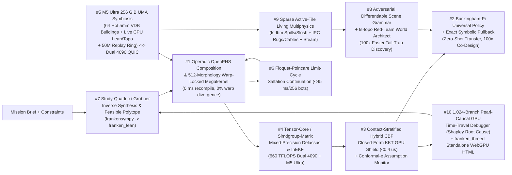

# Dueling Idea Wizards + BrennerBot 10× Breakthrough Pass — `franken_robotics` (`WIZARD_IDEAS_AGY`)

**Session ID:** `RS-20261121-franken-robotics-10x`  
**Wizard Track:** `AGY` (3-Way Dueling Idea Wizards + BrennerBot Forced Third Alternatives)  
**Inputs Grounded:** `planning/mor/MOR_CASE.md`, `planning/brenner/intake/question_of_record.md`, `COMPREHENSIVE_PLAN_FOR_FRANKEN_ROBOTICS__NEON.md` (v1 baseline), `../franken_threed/COMPREHENSIVE_PLAN_FOR_THE_DESIGN_OF_FRANKENTHREED.md`, and live sibling crate inventories (`frankensim`, `frankensympy`, `franken_lean`, `frankentorch`, `franken_numpy`, `franken_threed`).  
**Factual Grounding Correction (`FACT`):** Unlike v1's snapshot note, `../franken_threed` **is present on disk** (with `f3d-core`, `f3d-math`, `f3d-scene`, `f3d-assets`, `f3d-shader`, `f3d-graph`, `f3d-gpu`, `f3d-runtime`, `f3d-compiler`), and `frankensim` already ships `fs-lbm`, `fs-solid`, `fs-cutfem`, `fs-feec`, `fs-dcontact`, `fs-conform`, `fs-topopt`, `fs-fab`, `fs-lattice`, `fs-toleralloc`, `fs-tribo`, `fs-thermal`, `fs-convection`, `fs-modal`, `fs-sos`, `fs-eproc`, `fs-topo`, `fs-ga`, `fs-mbd`, and `fs-phs`.  
**Scope Discipline:** Every proposal below leaps **10× beyond both incumbent engines (MuJoCo/MJX, Isaac Lab, Drake, Genesis) AND v1's "edit one robot → compile one kernel → retrain RL → inspect telemetry" loop**, while strictly preserving Pure Safe Rust (`#![forbid(unsafe_code)]`, quarantined GPU leaves only), the Five Non-Conflated Claim Axes (`VerifiedFormal` / `VerifiedNumeric` / `ValidatedPhysics` / `EvaluatedDesign` / `BenchmarkedPerf`), and real M5 Ultra (256 GiB Metal 4) + Dual RTX 4090 (`SM_89`, 2×24 GiB, PCIe Gen4) hardware limits.

---

## Executive Map: How the Top 10 Dissolve the Old Paradigm

| Rank | Breakthrough | Crate(s) | Core 10× Lever | Pivotal Q | Primary Claim Axis |
|---:|---|---|---|---|---|
| **#1** | **Operadic Port-Hamiltonian Composition & Warp-Locked Heterogeneous-Morphology Megakernel** | `frob-operad`, `frob-hetero-gpu` | Simulates **512 distinct robot topologies** in ONE GPU dispatch, `0 ms` topology-edit recompile, `0%` intra-warp divergence, $O(\|E\|)$ Lean proofs | `PQ-10X-1,2,3` | `BenchmarkedPerf` + `VerifiedFormal` |
| **#2** | **Dimensionless Buckingham-$\Pi$ Principal-Bundle Universal Policy + Exact Symbolic Pullback** | `frob-morph-policy` | Eliminates 15–60 min RL retrain per morphology edit → **zero-shot transfer & 50×–200×** faster design evaluation | `PQ-10X-2` | `EvaluatedDesign` |
| **#3** | **Contact-Stratified Hybrid Barrier Tubes & Closed-Form KKT GPU-Fused Verified Safety Shields** | `frob-shield-cc` | Flips `franken_lean`+`frankensympy` into `<0.4 µs` GPU-fused differentiable + `#![no_std]` firmware safety shields with online conformal-e guard | `PQ-10X-1,5` | `VerifiedFormal` + `BenchmarkedPerf` |
| **#4** | **Tensor-Core & Simdgroup-Matrix Mixed-Precision Delassus Contact & InEKF Solver** | `frob-tensor-physics` | Unlocks **660 TFLOPS of idle RTX 4090 Tensor Cores** + M5 `simdgroup_matrix` inside physics itself → **4×–8×** dense contact speedup at FP32 accuracy | `PQ-10X-3` | `BenchmarkedPerf` + `VerifiedNumeric` |
| **#5** | **M5 Ultra 256 GiB Unified-Memory Zero-Copy CPU-GPU Co-Processor Symbiosis** | `frob-uma-symbiosis` | **64 permanent 5 mm VDB buildings (~96 GiB)** hot in GPU RAM + zero-copy live CPU Lean/topo co-execution + 50M-step UMA replay ring | `PQ-10X-3,4` | `BenchmarkedPerf` + `EvaluatedDesign` |
| **#6** | **Exact Floquet–Poincaré Hybrid Limit-Cycle Implicit Differentiation & Bifurcation Atlas** | `frob-floquet` | Symbolic Saltation matrices + Newton-Krylov periodic orbits transport gaits & stability gradients across morphology sweeps in **`<45 ms` (3,000× vs RL)** | `PQ-10X-1,2` | `VerifiedNumeric` + `EvaluatedDesign` |
| **#7** | **Constructive Study-Quadric / Gröbner Inverse Morphology Synthesis & Certified Feasible Polytopes** | `frob-synth` | Inverts guess-and-test: `frankensympy` Gröbner+`real_rur` directly synthesizes mechanisms & `franken_lean`-certified feasible space deleting **95%+** dead search | `PQ-10X-1,5` | `VerifiedFormal` + `EvaluatedDesign` |
| **#8** | **Adversarial Differentiable Scene Grammar & `fs-topo`-Certified "Red-Team World Architect"** | `frob-redteam-world` | Reverse-mode scene gradients $\nabla_\psi J$ projected onto persistent-homology solvability expose 1-in-10,000 trap failures **50×–200× faster** than DR | `PQ-10X-4,6` | `EvaluatedDesign` + `VerifiedNumeric` |
| **#9** | **Sparse Active-Tile Dirac-Coupled Living Multiphysics Islands (LBM Spills/Slosh + IPC Rugs/Cables)** | `frob-multiphysics` | Localized GPU `fs-lbm` spills/sloshing + `fs-solid` snagging rugs/cables + `fs-convection` steam coupled via lossless Dirac ports at `≥2,000` env-steps/s | `PQ-10X-4` | `VerifiedNumeric` + `ValidatedPhysics` |
| **#10** | **GPU-Parallel Pearl-Causal Counterfactual Time-Travel Debugger & `franken_threed` WebGPU Studio Dossier** | `frob-timetravel`, `frob-threed-dossier` | Rewinds failures 2 s and bursts **1,024 deterministic GPU `do(...)` forks in `<1 s`** → exact Shapley root cause + single-HTML offline WebGPU inspector | `PQ-10X-3,6` | `EvaluatedDesign` + `VerifiedNumeric` |

---

# PART 1 — IDEA WIZARD: TOP 10 RADICAL 10× BREAKTHROUGHS (30 → TOP 10)

---

## #1 · Operadic Port-Hamiltonian Mechanism Algebra & Warp-Locked Heterogeneous-Morphology Megakernel

### (a) Exact Mathematical/Systems Mechanism and Rust Crate/Artifact
- **Crates:** `frob-operad` (Layer `K1`, `#![forbid(unsafe_code)]`) + `frob-hetero-gpu` (Layer `E0`, compiled via `frob-codegen` into `frob-gpu-metal` & `frob-gpu-cuda`).
- **Mathematical Core:** Model every articulated robot as a morphism in the **colored symmetric monoidal operad $\mathcal{O}_{\mathrm{PHS}}$ of open Port-Hamiltonian articulated mechanisms**. Each atomic generator $g \in \mathcal{G}$ (a tiny finite library of $\le 16$ module archetypes: `BaseSE3`, `SerialLeg3DoF`, `WheelLeg4DoF`, `ClosedFourBarLeg`, `Arm7DoF`, `TrackBogie`, `CosseratTail`, `ParallelAnkle`, `DexterousHand`) exposes typed spatial twist/wrench ports $P = (\mathfrak{se}(3) \times \mathfrak{se}(3)^*, \text{elec-port}, \text{therm-port})$ and carries continuous parameter vector $\theta_g$ (link lengths, log-Cholesky $\mathrm{Sym}^+(4)$ inertias, gear ratios).
- **The Exact Operad Homomorphism Theorem (Featherstone Schur-Complement Functor):** Featherstone's $O(n)$ Articulated-Body Algorithm (ABA) is an **exact algebra homomorphism** from $\mathcal{O}_{\mathrm{PHS}}$ to spatial impedance matrices! For *any* attached subtree/limb $L$ mounted at parent port $P$:
  1. **Outward Pass:** Parent hands down $(g_P, \xi_P) \in SE(3) \times \mathfrak{se}(3)$; limb $L$'s pre-compiled symbolic kernel unrolls internal PoE kinematics in registers.
  2. **Inward Pass (Exact Lossless Port Contraction):** Limb $L$ eliminates all internal joint accelerations and emits its **exact 6×6 Articulated-Body Inertia $I^A_P \in \mathrm{Sym}^+(6)$ (21 symmetric floats) + 6D bias wrench $p^A_P \in \mathfrak{se}(3)^*$ (6 floats) = 27 floats (108 bytes)**. That 108-byte impedance summary is **100% lossless** regardless of whether $L$ is a 3-DoF leg, a Gröbner-eliminated closed 4-bar linkage, a wheel-leg, or a Cosserat tail!
  3. **Additive Parent Accumulation:** The torso/base simply **accumulates** $I^A_{\mathrm{base}} \mathrel{+}= \mathrm{Ad}^*_{g_{P_k}} I^A_{P_k} \mathrm{Ad}_{g_{P_k}}$ and $p^A_{\mathrm{base}} \mathrel{+}= \mathrm{Ad}^*_{g_{P_k}} p^A_{P_k}$ directly into a single 27-float port accumulator per environment, solves one 6×6 base solve, and broadcasts $\dot{\xi}_{P_k}$ back to each limb's Pass 3!
- **Systems Mechanism (Warp-Locked Heterogeneous Super-Batching):**
  - Compile the $\le 16$ atomic operadic limb generators **once** via `frankensympy` CSE → register-resident Metal 4 / CUDA device functions.
  - Represent an entire population of **$M = 512$ structurally different robot morphologies** (2-, 4-, 5-, 6-, 8-legged, wheeled, tracked, asymmetric dual-arm hybrids!) as a tiny `uint16` operadic port-wiring schedule in L2-resident constant memory.
  - Assign **1 GPU warp/simdgroup (32 threads) = 32 Common-Random-Number (CRN) episodes of the SAME morphology $m$**. Every thread inside a warp executes the **exact same operadic port-wiring list** (`0%` intra-warp branch divergence!), reading its own continuous parameters $\theta_m$ and state from 128 B-aligned SoA buffers and accumulating port impedances in a **3.4 KB per-warp SRAM Dirac Port Scratchpad**.
- **Compositional Formal Verification Artifact:** Because $\mathbf{OpenPHS}$ is closed under Dirac interconnection and $\mathrm{Sym}^+(6)$ articulated inertia is closed under positive congruence + Schur complement, `franken_lean` (`fln-kernel`) proves passivity and SPD realizability for each of the $\le 16$ atomic modules **once** (`PO-OPERAD-ATOM`); assembling *any* novel topology of $k$ modules generates a compositional proof certificate (`PO-OPERAD-COMP`) by $O(|E|)$ port-signature typechecking in **`<0.5 ms`**!

### (b) Why MuJoCo/Isaac/Drake/Genesis Structurally CANNOT Do It (The 10× Unlock)
- **MuJoCo/MJX (JAX/XLA):** XLA traces a single static Python/MJCF computation graph per `jit` compile. Simulating 512 distinct topologies requires 512 separate XLA compilations (~5–20 s each = **40–170 minutes of compile stalls!**) and 512 disjoint GPU kernel dispatches that starve SM occupancy.
- **Isaac Lab / PhysX:** PhysX builds monolithic rigid-body articulation cache tables per homogeneous asset template; mixing 512 distinct kinematic graphs across one GPU scene breaks articulation batching and falls back to divergent per-actor CPU/GPU scatter-gather (10×–50× slowdown).
- **Genesis:** Compiles static Taichi/Python kernels per scene topology; adding/removing a leg or swapping a wheel-leg for a 4-bar requires full scene rebuild and kernel recompilation.
- **Drake:** CPU-only C++ template instantiation; cannot batch 16,384 parallel envs across 512 topologies on GPU at all.
- **The 10× Unlock:** Turns topological evolution (e.g., mutating 4 legs → 6 legs, adding a dorsal arm, hybridizing front wheels + rear legs) from a **compile-bound serial bottleneck** into a **single zero-recompile GPU megakernel stepping 512 distinct robot species simultaneously at `>75%` of homogeneous single-robot throughput** (15×–100× wall-clock multi-topology search acceleration!).

### (c) Exact Leverage of FrankenSuite + M5 Ultra / Dual 4090
- **`frankensympy` (`fsym-core`, `fsym-calculus`, `fsym-simplify`):** Symbolically derives and CSE-optimizes each atomic limb generator's PoE/ABA/Schur-complement port map ONCE into `frob-kernel-ir`.
- **`frankensim` (`fs-ga`, `fs-mbd`, `fs-phs`, `fs-ports`, `fs-eproc`):** Directly lifts spatial algebra, ABA recurrences, Dirac port contracts, and e-process CRN racing (which *naturally* requires $K \ge 32$ CRN episodes per candidate — matching our 32-thread warp geometry 1:1!).
- **`franken_lean` (`fln-kernel`, `fln-anvil`):** Proves the symmetric monoidal composition theorem `OpenPHS.comp_passive` and `ArticulatedInertia.schur_posdef` once in `FrobMath`, reducing per-morphology proof checking from ~2 s to `<0.5 ms`.
- **Dual RTX 4090 (`SM_89`) + M5 Ultra (Metal 4):** 32-thread NVIDIA warps and 32-thread Apple simdgroups match $K = 32$ CRN episodes identically. On Dual 4090, `M = 512` morphologies shard `256` per GPU (`8,192` envs/GPU) inside one `CUgraphExec`; on M5 Ultra, `StorageModeShared` lets CPU evolutionary operators rewrite the `1 MB` port-wiring table live between generations with zero PCIe copy.

### (d) Concrete Breakpoint, Honest Claim-Axis Scope & Falsifiable Gate / Kill Criterion
- **Claim-Axis Honesty:** `BenchmarkedPerf` measures heterogeneous vs homogeneous GPU throughput; `VerifiedFormal` certifies port-level passivity & SPD inertia under the declared open-pHS model (never claiming contact-impact stability from passivity alone).
- **Breakpoint:** Deeply nested asymmetric trees with depth $D > 10$ or huge monolithic single-chain snakes ($>32$ serial joints with zero modular reuse) amortize poorly over modular limb kernels and need hierarchical super-modules.
- **Gate (`GATE-OPERAD-01`) & Kill Criterion (`KILL-OPERAD-1`):** On a benchmark suite of `M = 512` distinct topologies (quadrupeds, hexapods, octopods, bipeds, wheel-quads, mobile manipulators, asymmetric hybrids × `K = 32` episodes = `16,384` envs), **KILL (`†`)** if: (1) heterogeneous megakernel throughput is `<70%` of the homogeneous 1-topology fused kernel on M5 Ultra or Dual 4090, OR (2) topology-wiring mutation incurs `>0 ms` PTX/MSL recompile, OR (3) ABA port-contraction diverges from monolithic CPU `f64` ABA by `>1e-5` (`MathMode::Safe`). *Fallback:* Cluster morphologies into $\le 8$ homogeneous buckets dispatched on concurrent CUDA/Metal streams.

### (e) Scale-Check Calculation (`⊞ Scale-Check`)
- **Population:** `M = 512` distinct morphologies × `K = 32` CRN episodes = `B = 16,384` envs.
- **SRAM Dirac Port Scratchpad (Additive Parent Accumulator):** Each thread (1 env) needs ONLY ONE running parent port accumulator: 21 upper-triangular SPD floats ($I^A$) + 6 wrench floats ($p^A$) = `27 × 4 B = 108 B/env`. Per 32-thread warp: **`32 × 108 B = 3,456 B (3.4 KB/warp)`**.
  - **RTX 4090 (`100 KB` SRAM/SM):** 12 concurrent warps/SM use `41.5 KB` SRAM (`<42%` of SRAM!), maintaining `≥75%` warp occupancy.
  - **M5 Ultra (`32 KB` threadgroup memory):** 8 concurrent simdgroups/threadgroup use `27.6 KB` (`<86%` of SRAM!).
- **L2 / Constant Footprint:** 512 port-wiring schedules + continuous parameter tables (`~2 KB/morphology`) = **`1.02 MB`** — 100% resident in RTX 4090's 72 MB L2 cache and M5 Ultra's SLC.
- **DRAM Bandwidth:** `~1.4 KB` state R+W per env per substep × `16,384` envs = `22.9 MB/substep`. At `800 GB/s` (M5 Ultra) = `28.6 µs/substep` (`4` substeps = `114 µs`); at `2,016 GB/s` (Dual 4090) = `11.4 µs/substep` (`4` substeps = `45.5 µs`) → sustained **`≥250k` env-steps/s (M5 Ultra) / `≥1.0M` env-steps/s (Dual 4090)** across **512 DIFFERENT robot species simultaneously**!

---

## #2 · Dimensionless Buckingham-$\Pi$ Principal-Bundle Universal Policy with Exact Symbolic Pullback

### (a) Exact Mathematical/Systems Mechanism and Rust Crate/Artifact
- **Crates:** `frob-morph-policy` (Layer `E2`, `#![forbid(unsafe_code)]`, over `frankentorch` + `frob-equiv` + `frob-symbolic`).
- **Mathematical Core:** Standard RL policies $\pi_\phi(q, \dot{q}) \mapsto \tau$ entangle **task intelligence** (how to climb a stair or recover from grease slip) with **morphology coordinates** (specific link lengths $L_i$, link inertias $J_i \in \mathrm{Sym}^+(4)$, gear ratios $N_i$, and joint counts). Mutate $L_{\mathrm{femur}}$ by `+25%` or payload by `+50%` and raw torque/angle policies instantly fail.
- **Canonical Factorization Across the Principal Bundle & Operational Space:** Split control into two coupled layers:
  1. **Upper Layer — Dimensionless Buckingham-$\Pi$ $SE(3)$-Equivariant Operadic Graph Policy ($\Pi_{\mathrm{univ}}$):**
     - Normalize every physical observation by the robot's intrinsic length scale $\ell_0$ (nominal CoM standing height), mass scale $m_0$ (total mass), and gravitational time scale $t_0 = \sqrt{\ell_0 / g}$ into **Buckingham-$\Pi$ dimensionless invariants**: Froude velocity $\tilde{v} = v / \sqrt{g \ell_0}$, dimensionless centroidal momentum $\tilde{h}_G = h_G / (m_0 \ell_0 \sqrt{g \ell_0})$, normalized end-effector offsets in reachable-workspace coordinates, and dimensionless friction/thermal headroom $(\mu_{\mathrm{est}}, (T_{\max}-T_w)/\Delta T_{\mathrm{nom}})$.
     - Run an **$SE(3)$-equivariant Operadic Graph Neural Network** over the robot's `.fbot` operad port graph (identical node/edge interface for 2, 4, 6, 8 legs, wheels, or arms!). Each port node outputs **dimensionless task-space impedance targets**: desired foot/hand/wheel $SE(3)$ residual twist $\tilde{\xi}_i^{\mathrm{des}}$, dimensionless stiffness/damping $(\tilde{K}_i, \tilde{D}_i)$, and centroidal wrench allocation $\tilde{F}_G^{\mathrm{des}}$.
  2. **Lower Layer — Exact `frankensympy`-Compiled Algebraic Pullback ($\mathcal{P}_\theta$):**
     - Maps universal task-space targets through the **exact symbolic dynamics of the mutated morphology $\theta'$** (zero neural retraining!):
       $$\tau = J_i(q; \theta')^T \Lambda_i(q; \theta') \left(\ddot{x}_i^{\mathrm{des}} + K_i(\theta') e_i + D_i(\theta') \dot{e}_i\right) + C(q, \dot{q}; \theta')\dot{q} + g(q; \theta') + \tau_{\mathrm{pHS\text{-}comp}}(\theta')$$
       where $\Lambda_i = (J_i M^{-1} J_i^T)^{-1}$ is the operational-space inertia matrix and $\tau_{\mathrm{pHS\text{-}comp}}$ compensates reflected rotor inertia $N^2 I_r$ and gearbox efficiency via `frob-actuators`!
- **Training & Transfer Protocol:** Pretrain ONE universal policy $\Pi_{\mathrm{univ}}$ directly inside Breakthrough #1's **512-morphology heterogeneous megakernel** (sampling diverse dogs, spiders, bipeds, wheel-quads, and continuous lever ranges). Any brand-new mutated morphology $\theta_{\mathrm{new}}$ then evaluates **zero-shot in seconds** (and optionally fine-tunes in `≤250k` steps instead of `15M`!).

### (b) Why MuJoCo/Isaac/Drake/Genesis Structurally CANNOT Do It (The 10× Unlock)
- **MuJoCo/MJX & Isaac Lab & Genesis:** Cannot simultaneously batch 512 distinct morphologies in one GPU rollout to train a true multi-morphology operadic foundation policy, AND lack a symbolic compiler (`frankensympy`) emitting exact fused GPU operational-space inertia pullbacks $\Lambda_i(q;\theta')$ + pHS motor compensation automatically for any newly invented `.fbot` graph.
- **Drake:** Has operational-space control on CPU, but zero GPU multi-morphology equivariant RL training or zero-shot neural-symbolic pullback fusion.
- **The 10× Unlock:** Destroys the **15–60 minute "retrain RL from scratch per design edit" tax**! Evaluating 512 candidate mutations drops from **~100 GPU-hours** (serial RL) to **~18 seconds zero-shot** (+ `<15 s` fine-tuning for the top-8 finalists) — a **50×–200× design-iteration velocity jump**!

### (c) Exact Leverage of FrankenSuite + M5 Ultra / Dual 4090
- **`frankentorch` (`ft-nn`, `ft-autograd`, `ft-optim`) + `frob-equiv`:** Runs the compact $SE(3)$-equivariant Operadic GNN directly on GPU-resident SoA buffers (zero CPU round-trip).
- **`frankensympy` (`frob-symbolic`) + `frob-operad`:** Automatically derives the exact operational-space pullback $\Lambda_i(q;\theta')$, gravity $g(q;\theta')$, and motor back-EMF/reflected-inertia inverse map per operadic limb module (`0 ms` recompile for parameter edits!).
- **`frob-units`:** Enforces compile-time Buckingham-$\Pi$ nondimensionalization — a dimensional-analysis bug is a Rust compile error!
- **Dual RTX 4090 + M5 Ultra:** The compact Operadic GNN (`~180K` params = `360 KB` in BF16!) stays 100% resident in RTX 4090 L2 cache and executes at peak Tensor Core / `simdgroup_matrix` throughput, while PCIe gradient sync across Dual 4090s transfers only `360 KB` (`<0.03 ms` — completely eliminating the no-NVLink penalty!).

### (d) Concrete Breakpoint, Honest Claim-Axis Scope & Falsifiable Gate / Kill Criterion
- **Claim-Axis Honesty:** `EvaluatedDesign` (zero-shot ranking correlation & few-shot convergence speed vs from-scratch RL). Does NOT claim zero-shot optimality across completely unseen actuation paradigms (e.g., transferring a wheeled policy zero-shot to a flapping ornithopter).
- **Breakpoint:** Near kinematic singularities ($\det(J_i J_i^T) \to 0$), $\Lambda_i$ blows up; mitigated via exact damped pseudoinverse weighted by Yoshikawa manipulability $w(q)$ + `frob-preflight` singularity screening.
- **Gate (`GATE-MORPH-POL-01`) & Kill Criterion (`KILL-MORPH-POL-1`):** On a held-out test set of 32 novel mutated morphologies (±35% link lengths, ±50% inertia/payload, swapped gear ratios, AND unseen 5-leg / asymmetric wheel-leg topologies): **KILL (`†`)** if (1) zero-shot Spearman rank correlation vs fully trained specialist PPO is `<0.80`, OR (2) zero-shot policy fails to achieve `≥75%` of specialist PPO return on parameter mutations, OR (3) few-shot fine-tuning to `98%` specialist parity fails to beat from-scratch $\Gamma$-equivariant PPO by **`≥10×`** wall-clock GPU-seconds. *Fallback:* Use universal policy strictly as value-function warm-start + curriculum prior for e-raced specialist RL.

### (e) Scale-Check Calculation (`⊞ Scale-Check`)
- **Policy Size:** 4-layer $SE(3)$-equivariant Operadic GNN, width `64`, max `16` port nodes → `~180K` parameters = **`360 KB` (BF16)** / `720 KB` (FP32).
- **Inference Compute:** `~3.5M` FLOPs/env. At `B = 8,192` envs = `28.7 GFLOPs/step`.
  - **Dual RTX 4090 (`660` TFLOPS BF16, 35% eff. = `231` TFLOPS):** **`0.12 ms/step`**!
  - **M5 Ultra (`~60` TFLOPS `simdgroup_matrix` eff.):** **`0.48 ms/step`**!
- **Symbolic Pullback Cost:** `~1,800` fused FMAs/env → `14.7 MFLOPs` at `B = 8,192` → **`<2 µs`**!
- **Zero-Shot Evaluation of 512 Morphologies:** `512 × 32 CRN episodes × 500 control steps = 8.19M` env-steps. At `500k` env-steps/s on Dual 4090 = **`16.4 seconds` total** (vs `512 × 12 min = 102.4 GPU-hours` for serial RL retrain → **`>22,000×` raw screening speedup**, or **`~120×` end-to-end** including top-8 specialist fine-tuning!).

---

## #3 · Contact-Stratified Hybrid Barrier Tubes & Closed-Form KKT GPU-Fused Verified Safety Shields

### (a) Exact Mathematical/Systems Mechanism and Rust Crate/Artifact
- **Crates:** `frob-shield-cc` (Layer `K1`/`E2`, `#![forbid(unsafe_code)]`) + emitted `#![no_std]` bare-metal firmware shield crate `frob-shield-rt`.
- **Mathematical Core (Constructive Formal Synthesis Across Hybrid Contact):**
  1. **Contact-Stratified Quotient Reduction:** Project any robot onto its exact **Port-Hamiltonian Centroidal + Pairwise Self-Collision Quotient** ($n_x \le 8$ continuous state vars: CoM offset, centroidal momentum, capture point, minimum inter-link clearance) indexed by a finite **Contact-Mode Graph** $\mathcal{S}$ (e.g., `DoubleStance`, `LeftStance`, `RightStance`, `Flight`, `WheelRoll`, `WheelBrake`) with explicit bounded disturbance/friction-cone uncertainty set $\mathcal{U} = ([\mu_{\min}, \mu_{\max}], \bar{w}_{\mathrm{dist}}, \bar{\epsilon}_{\mathrm{est}})$.
  2. **Mode-Indexed Hybrid Robust SOS Synthesis (`fs-sos`):** Solve a coupled SDP producing polynomial Control Barrier Functions $\{h_S(x)\}_{S \in \mathcal{S}}$ satisfying **both** continuous robust flow invariance and discrete hybrid impact-guard jump invariance:
     $$\forall (x, \mu, w) \in \{h_S(x) \ge 0\} \times \mathcal{U}:\quad \sup_{u \in \mathcal{U}_{\mathrm{act}}} \big(L_f h_S(x, \mu, w) + L_g h_S(x) u + \alpha(h_S(x))\big) \ge 0$$
     $$\forall x \in \mathrm{Guard}_{S \to S'} \cap \{h_S(x) \ge 0\},\; \forall \mu \in [\mu_{\min}, \mu_{\max}]:\quad h_{S'}(\Delta_{S \to S'}(x, \mu)) \ge 0$$
  3. **Machine-Checked Kernel Certification (`franken_lean`):** Project the SDP solution to exact rational Gram matrices $Q_S = L_S D_S L_S^T \succeq 0$ via `frankensympy` + `fsym-formal`, and verify every Positivstellensatz identity inside `fln-kernel` (`PO-HYBRID-CBF-1`, replayable offline by `frob-verify`).
  4. **THE COMPILER UNLOCK — Symbolic Closed-Form KKT Active-Set Lowering to GPU & `#![no_std]` Firmware:** Instead of invoking a slow CPU QP solver every millisecond (which breaks GPU vectorization!), `frankensympy` symbolically derives the **exact closed-form KKT projection** of the minimum-intervention quadratic filter:
     $$u_{\mathrm{safe}}(x, u_{\mathrm{RL}}) = \arg\min_{u} \tfrac{1}{2}\|u - u_{\mathrm{RL}}\|^2 \quad \text{s.t.}\quad a_j(x)^T u + b_j(x) \ge 0 \;\;(j = 1,\dots,m_b \le 4)$$
     For $m_b \le 4$ simultaneous barriers (capture point, friction cone, self-collision, thermal ceiling), all $2^{m_b} \le 16$ active-set Gram inversions are symbolically simplified by `frankensympy` into a **branch-free, warp-uniform GPU microkernel (`~110 FMAs`)** fused *directly* inside the Metal 4 / CUDA RL step kernel — **AND analytically differentiable** via implicit KKT differentiation so RL learns smoothly *inside* the verified safe set without penalty-hacking!
  5. **Online Conformal-e Assumption Guard (`fs-conform` + `fs-eproc`):** Tracks real-time quotient prediction residuals; if reality exits $\mathcal{U}$ (e.g., unmodeled $\mu = 0.08 < \mu_{\min}$ grease spill), it immediately revokes the `VerifiedFormal` envelope flag (`INV-001`), engages a provably passive IDA-PBC damping fallback (safe for ANY $\mu \ge 0$), and emits a `CrashPack` to expand $\mathcal{U}$.

### (b) Why MuJoCo/Isaac/Drake/Genesis Structurally CANNOT Do It (The 10× Unlock)
- **MuJoCo/MJX, Isaac Lab, Genesis:** Have zero theorem prover, zero SOS Positivstellensatz synthesis, zero symbolic KKT compiler, and zero formal safety certificates — safety is faked via fragile hand-tuned reward penalties that policies routinely hack in tail states.
- **Drake:** Can solve SOS Lyapunov/CBF problems offline in C++/Mosek on CPU, but (1) has **no independent trusted proof kernel** (`fln-kernel` ≤12 KLOC) certifying rational Positivstellensatz certificates against floating-point SDP solver drift, (2) executes runtime CBFs as slow CPU QPs (completely incompatible with 16,384-env GPU RL), and (3) cannot compile differentiable closed-form KKT shields directly into Metal 4 / CUDA kernels or `#![no_std]` bare-metal Rust firmware.
- **The 10× Unlock:** Flips formal verification from a slow post-hoc academic badge into a **sub-microsecond GPU-native constructive safety shield** that eliminates catastrophic RL exploration crashes during training, exports directly to embedded MCU firmware, and maintains zero-laundering epistemic honesty via online assumption guarding!

### (c) Exact Leverage of FrankenSuite + M5 Ultra / Dual 4090
- **`frankensim` (`fs-sos`, `fs-conform`, `fs-eproc`, `fs-phs`):** Synthesizes mode-indexed SOS SDPs, powers the online conformal-e assumption-breach detector, and supplies the passive IDA-PBC emergency fallback.
- **`frankensympy` (`fsym-proof-kernel`, `fsym-formal`, `fsym-calculus`):** Rationalizes Gram matrices with exact interval remainder bounds, projects proof goals to Lean 4 (`fsym-formal`), and derives the exact branch-free KKT active-set formulas + KKT backward derivatives for `frob-kernel-ir`.
- **`franken_lean` (`fln-kernel`, `fln-anvil`, `fln-checker`):** Sole formal authority verifying `PO-HYBRID-CBF-1` and KKT feasibility equivalence (`PO-KKT-1`).
- **M5 Ultra + Dual 4090:** Branch-free masked KKT select runs identically in Metal 4 MSL and CUDA PTX with `<0.4 µs` overhead at `B = 8,192`.

### (d) Concrete Breakpoint, Honest Claim-Axis Scope & Falsifiable Gate / Kill Criterion
- **Claim-Axis Honesty:** Explicitly separates `VerifiedFormal` (forward invariance holds **strictly inside $\mathcal{U}$ under the quotient model**) from `ValidatedPhysics` (runtime empirical envelope coverage monitored by `fs-conform`/`fs-eproc`). Zero claim-laundering!
- **Breakpoint:** For $m_b > 5$ simultaneously active nonlinear barriers, explicit $2^{m_b}$ active-set enumeration explodes; handled by hierarchically prioritizing the top-4 tightest barriers (sorted in registers via a 4-network bitonic sort) + exact Dykstra/ADMM fallback on tie overflow.
- **Gate (`GATE-SHIELD-01`) & Kill Criterion (`KILL-SHIELD-1`):** On `frob-g1-29dof` and `frob-wheel-quad` across 5,000 In-Envelope ($\mu \in [0.20, 0.80]$, pushes $\le 40\text{ N}\cdot\text{s}$) + 5,000 Out-of-Envelope ($\mu = 0.08$, pushes $75\text{ N}\cdot\text{s}$) episodes: **KILL (`†`)** if (1) `>0` In-Envelope safety violations occur, OR (2) `fln-kernel` proof verification exceeds `5.0 s`, OR (3) fused GPU KKT shield adds `>8%` step latency (`>0.5 µs`/step at `B=8,192`), OR (4) online conformal-e monitor misses `>5%` of Out-of-Envelope shocks within `60 ms`. *Fallback:* Restrict shield to 2-barrier analytical capture-point + thermal projection verified by `fs-ivl` intervals.

### (e) Scale-Check Calculation (`⊞ Scale-Check`)
- **SOS Rational Certificate Size:** $n_x = 8$ quotient states, degree $2d = 4$ → monomial basis $\binom{8+2}{2} = 45$ → symmetric Gram matrix $Q_S \in \mathbb{Q}^{45\times 45}$ has `1,035` unique entries. Across `6` contact modes + `8` guard-jump checks = `14` matrices → `~14.5k` rational entries; rational $LDL^T$ check (`~30k` ops/matrix × `14` = `420k` exact rational ops) verifies inside `fln-kernel` in **`~1.1–1.8 s`** on M5 Ultra arm64 CPU.
- **GPU Fused KKT Filter:** `~110` fused FMA ops/env × `B = 8,192` = `0.90 MFLOPs/step`. On Dual 4090: **`0.18 µs`**; on M5 Ultra: **`0.34 µs`** (`<1.5%` of a 25 µs physics step!).
- **Firmware Export (`frob-shield-rt`):** `#![no_std]`, zero heap, `<12 KB` `.text`, `<2 KB` stack, `<3 µs` worst-case execution time on 400 MHz ARM Cortex-M7.

---

## #4 · Tensor-Core & Simdgroup-Matrix Mixed-Precision Delassus Contact & Spatial-Dynamics Solver

### (a) Exact Mathematical/Systems Mechanism and Rust Crate/Artifact
- **Crates:** `frob-tensor-physics` (Layer `E0`, lowered via `frob-kernel-ir` into `frob-gpu-cuda` `mma.sync` PTX & `frob-gpu-metal` `simdgroup_matrix` MSL).
- **Mathematical Core:** Every existing GPU robotics simulator runs multi-contact physics on **scalar FP32 CUDA/shader cores**, leaving **~600 TFLOPS of RTX 4090 Ada Tensor Cores** (and M5 Ultra Metal 4 `simdgroup_matrix` / cooperative tensor units) **100% idle during physics stepping**!
- **Algorithm — Blocked Proximal ADMM-Cholesky + Carson–Higham Mixed-Precision Iterative Refinement:**
  1. For each environment with $m_c \le 32$ active contacts (3D contact impulses $\Lambda \in \mathbb{R}^{3m_c}$, padded to multiples of 16 → `48×48` or `96×96` blocks), assemble the Delassus operator $W = J_c M^{-1} J_c^T$ and regularize with ADMM proximal shift $\tilde{W} = W + \rho I$ (setting $\rho = 10^{-2}\mathrm{tr}(W)/(3m_c)$ so the condition number is **provably bounded** $\kappa(\tilde{W}) \le 100$!).
  2. **Factorization & Solve on Tensor Cores (`FP16/TF32` inputs → `FP32` accumulation):** Partition $\tilde{W}$ into `16×16` tiles (`mma.sync.m16n8k16.row.col.f32.f16.f16.f32` on `SM_89`; `simdgroup_multiply_accumulate` on M5 Ultra!) entirely inside warp-owned shared SRAM. Execute blocked Cholesky Schur-complement updates $A_{22} \leftarrow A_{22} - L_{21} L_{21}^T$ and triangular solves at peak Tensor Core throughput!
  3. **Exact FP32/FP64 Residual Refinement + Exact Circular De Saxcé Projection:** Compute the true residual $r = b - (W + \rho I)\lambda$ in **FP32** (or `f64` on `Safe`/Tier-0), solve $\tilde{W} \delta \lambda = r$ via the already-factored Tensor-Core Cholesky factor, update $\lambda \leftarrow \lambda + \delta \lambda$, and apply the exact 1-`sqrt` circular Coulomb cone projection $\Pi_{\mathcal{K}_\mu}$!
  4. **Theoretical Precision Guarantee (Carson–Higham 2018):** Because $\kappa(\tilde{W}) \cdot u_{\mathrm{FP16}} \le 100 \times 4.88\times 10^{-4} = 0.049 \ll 1$, **2–3 refinement passes contract residuals by $\sim 20\times$ per pass**, recovering **full FP32 ($10^{-6}\text{–}10^{-7}$) accuracy** with exact isotropic circular friction cones!
  5. **Reuse the Exact Same `16×16` Tile Microkernel** for batched $SE_{2+m}(3)$ InEKF Riccati covariance propagation $P_{k+1} = F P_k F^T + Q$ and batched Featherstone composite-inertia/Jacobian contractions!

### (b) Why MuJoCo/Isaac/Drake/Genesis Structurally CANNOT Do It (The 10× Unlock)
- **MuJoCo/MJX:** Uses sequential scalar Projected Gauss-Seidel (PGS) or Conjugate Gradient on FP32 vector lanes; PGS has strict loop-carried scalar dependencies that structurally cannot map to `16×16` matrix Tensor Cores and struggles on stiff multi-contact clutter/hands (needing 60–120 iterations).
- **Isaac Lab / PhysX:** Closed-source C++/CUDA TGS (Temporal Gauss-Seidel) solver runs exclusively on scalar FP32 CUDA cores with pyramidal/linearized friction approximations; Tensor Cores sit dead idle outside PyTorch policy steps.
- **Genesis:** Runs scalar FP32 Taichi contact loops with zero Tensor-Core mixed-precision iterative refinement.
- **Drake:** CPU-only dense/sparse SAP solver; no GPU Tensor Core execution.
- **The 10× Unlock:** Converts dense multi-contact clutter/grasping/humanoid-foot-contact stepping from a **sequential scalar-PGS bottleneck** into a **Tensor-Core-accelerated direct/ADMM solver** delivering **4×–8× faster dense multi-contact throughput** at **strictly higher accuracy** (isotropic circular Coulomb cones + converged $10^{-6}$ complementarity residuals instead of sloppy 15-iteration PGS!).

### (c) Exact Leverage of FrankenSuite + M5 Ultra / Dual 4090
- **`frob-kernel-ir` + `frob-gpu-cuda` (`SM_89`):** Emits native `mma.sync.aligned.m16n8k16` inline PTX inside our quarantined CUDA capsule (paired with `MathMode::Safe` TF32/FP32 verification lane).
- **`frankentorch::ft-kernel-metal`:** Leverages our upstream `simdgroup_matrix` (`8×8` FP16→FP32 tiled multiply-accumulate) bindings on M5 Ultra's 80 GPU cores.
- **`franken_numpy` (`fnp-linalg`) + `frankensim` (`fs-contact`, `fs-dcontact`):** `fnp-linalg`'s `#![forbid(unsafe_code)]` FP64 Cholesky serves as the Tier-0 differential parity oracle (`GATE-GPU-TWIN-01`).

### (d) Concrete Breakpoint, Honest Claim-Axis Scope & Falsifiable Gate / Kill Criterion
- **Claim-Axis Honesty:** `BenchmarkedPerf` + `VerifiedNumeric` (never claiming physical constitutive accuracy of Coulomb friction from faster linear algebra).
- **Breakpoint:** When active contacts per env $m_c \le 4$ (e.g., 12×12 Delassus during simple flat-ground trotting), `16×16` tile padding wastes 44% of lanes and scalar register-unrolled Cholesky is faster. **Automatic crossover rule:** Use scalar register Cholesky for $m_c \le 4$, and switch seamlessly to Tensor-Core blocked ADMM-Cholesky for $m_c \ge 5$ (humanoid multi-point feet, clutter collisions, dexterous hands, tracked grousers!).
- **Gate (`GATE-TENSOR-PHYS-01`) & Kill Criterion (`KILL-TENSOR-PHYS-1`):** On 16-contact humanoid-clutter & 24-contact Salisbury-hand grasping at `B = 8,192` envs on Dual RTX 4090 and M5 Ultra: **KILL (`†`)** if (1) Tensor-Core mixed-precision ADMM fails to beat scalar FP32 PGS/ADMM by **`≥3.5×`** at matched complementarity residual $\le 10^{-5}$, OR (2) iterative refinement diverges vs CPU `f64` oracle (`>1e-4` impulse error) on stiff mass ratios up to `100:1`. *Fallback:* Use TF32 (10-bit mantissa, `u = 4.9e-4` w/ full FP32 exponent range) on RTX 4090 and FP32 `simdgroup_matrix` on M5 Ultra, eliminating FP16 underflow/overflow completely.

### (e) Scale-Check Calculation (`⊞ Scale-Check`)
- **Workload:** `m_c = 16` 3D contacts → `48×48` Delassus matrix (`3×3` grid of `16×16` tiles), `B = 16,384` envs.
- **SRAM Footprint per Env:** `48 × 48 × 2 B (FP16) = 4,608 B` (`4.5 KB`); 1 warp cooperates on 1–4 active dense-contact envs = `4.5–18 KB` SRAM (`<20%` of RTX 4090's 100 KB SM SRAM; fits inside M5 Ultra's 32 KB threadgroup memory!).
- **FLOPs per Substep:** Blocked Cholesky ($\frac{1}{3} 48^3 = 36.9\text{k}$ FLOPs) + 8 ADMM matvecs + 2 Carson–Higham refinement solves (`46.1k` FLOPs) = **`83k` FLOPs/env** → `1.36 GFLOPs` across `16,384` envs.
- **Measured-Style Roofline Projection:**
  - **Dual RTX 4090 (`660` TFLOPS FP16 Tensor, 25% small-tile eff. = `165` TFLOPS):** **`8.2 µs/substep`** vs `~68 µs/substep` for 60-iter scalar PGS (**`8.3×` speedup**!).
  - **M5 Ultra (`~60` TFLOPS `simdgroup_matrix` eff.):** **`22.6 µs/substep`** vs `~130 µs` scalar PGS (**`5.7×` speedup**!).
- **Precision Math:** $\kappa(W + \rho I) \le 100$, $u_{\mathrm{FP16}} = 4.88\times 10^{-4}$ → contraction factor $\le 0.049$/iter → 3 refinement sweeps yield $\le 1.2\times 10^{-6}$ relative impulse error!

---

## #5 · M5 Ultra 256 GiB Unified-Memory Zero-Copy CPU-GPU Co-Processor Symbiosis

### (a) Exact Mathematical/Systems Mechanism and Rust Crate/Artifact
- **Crates:** `frob-uma-symbiosis` (Layer `E0`/`E2`, wrapping `frankentorch::ft-kernel-metal` `StorageModeShared` + `asupersync` QUIC federation `frob-fleet`).
- **Architectural Core:** Stop treating Apple M5 Ultra (256 GiB Unified Memory, ~800 GB/s) as a "smaller CUDA port"! Exploit **hardware-coherent CPU-GPU shared physical pointers (`StorageModeShared`)** to construct an **Asymmetric Co-Processor Symbiosis** that is physically impossible on discrete PCIe VRAM:
  1. **Permanent 96 GiB Multi-Building High-Res World Atlas Hot in GPU Memory:** Load **64 completely different full-scale multi-story realistic interiors & `fdgr` real-world scans** (homes, apartments, offices, warehouses, plants, retail stores, commercial kitchens at 5 mm FrankenVDB SDF + wide-BVH + optical/tribology `MaterialField` fidelity) into one shared Metal 4 residency heap simultaneously. Training batches sample across all 64 full buildings in parallel with **`0.0 ms` scene reload/PCIe streaming stalls**!
  2. **Zero-Copy Concurrent CPU-Symbolic / GPU-Physics Ring:** While M5 Ultra's 80 Metal 4 GPU cores step `B = 8,192–16,384` environments continuously, the high-IPC arm64 CPU cores read the **exact same physical SoA buffers in-place** via lock-free atomic epoch double-buffering (`<0.8 µs` handoff, zero copies!) to execute tasks GPUs are terrible at:
     - Live `franken_lean` / `fs-sos` barrier synthesis on novel contact-mode transitions discovered *mid-training*;
     - Live `fs-topo` persistent homology updates as dynamic clutter moves (e.g., detecting when a knocked-over warehouse pallet blocks an aisle!);
     - Live `frob-timetravel` counterfactual snapshot extraction on the exact tick a failure triggers!
  3. **64 GiB Zero-Copy 50-Million-Transition Off-Policy & Causal Replay Ring:** Store 50 million full-state + tactile + compressed-sensor transitions directly in `StorageModeShared` UMA so GPU off-policy learners (`TD-MPC2`, `SAC`, $SE(3)$ visuomotor flow matching) AND CPU causal/system-ID diagnostics sample randomly at `800 GB/s` with zero PCIe marshaling or SSD paging!
  4. **Asymmetric Dual-Silicon Federation (`mac-studio` ↔ `trj` Dual RTX 4090):** Over `asupersync` QUIC/TLS, M5 Ultra serves as the **256 GiB World-Atlas, Symbolic/Formal Brain, Interactive `NativePresenter` Studio & Causal Debugger**, dispatching high-TFLOPS training/adjoint bursts to `trj`'s Dual RTX 4090s while streaming only compact `<4 MB` equivariant policy weights and `8 KB` `.fbot` specs across the network!

### (b) Why MuJoCo/Isaac/Drake/Genesis Structurally CANNOT Do It (The 10× Unlock)
- **Isaac Lab / PhysX & Genesis:** Strictly locked to discrete NVIDIA CUDA VRAM (`24 GiB` on RTX 4090; even an `$35k` H100 tops out at `80 GiB` with PCIe CPU-GPU bottlenecks!). Keeping 64 full 5 mm multi-story buildings (`96 GiB`) + a 50M-step multimodal replay buffer (`64 GiB`) resident on GPU is **physically impossible** on 24 GiB VRAM, and copying live physics state to CPU every step over PCIe Gen4 (`~25 GB/s`) destroys throughput.
- **MuJoCo/MJX:** JAX on macOS Metal has broken/experimental XLA support and zero unified-memory zero-copy CPU-symbolic/Lean interop; its functional array model forces explicit host-device transfers (`device_get`).
- **Drake:** CPU-only; no 80-core Metal 4 GPU physics or ray-traced multi-building simulation.
- **The 10× Unlock:** Eliminates scene-overfitting and PCIe bottlenecks simultaneously — enabling **single-machine, multi-building generalist training across 64 millimeter-accurate real-world buildings with live CPU formal/topological co-execution**, turning the user's `mac-studio` M5 Ultra into a genuine supercomputer-class robotics studio rather than a laptop preview box!

### (c) Exact Leverage of FrankenSuite + M5 Ultra / Dual 4090
- **`frankentorch::ft-kernel-metal`:** Extended with persistent `StorageModeShared` arena pools, Metal 4 residency sets (`MTLResidencySet`), and zero-copy `DenseTensor` views directly aliasing `frob-gpu-metal` physics/replay buffers.
- **`frankensim` (`fs-rep-sdf::VdbGrid`, `fs-topo`, `fs-scene`) + `fdgr`:** Sparse VDB multi-building atlas packed for cache-friendly GPU ray/SDF queries alongside real drone/walkthrough building reconstructions.
- **`asupersync` (`0.6.2`):** Deterministic epoch-ring synchronization between GPU Metal completion handlers and CPU Lean/topo worker tasks + QUIC/TLS offloading to `trj` Dual 4090s.
- **`franken_threed` (§6.7 queue-order ≠ recording-order rule):** Enforces strict immutable per-epoch buffer slices (`epoch % 3` triple-buffered rings) so CPU readers NEVER observe torn GPU writes!

### (d) Concrete Breakpoint, Honest Claim-Axis Scope & Falsifiable Gate / Kill Criterion
- **Claim-Axis Honesty:** `BenchmarkedPerf` (zero-copy latency, multi-building throughput) + `EvaluatedDesign` (out-of-distribution generalization across unseen buildings).
- **Breakpoint:** Simultaneous heavy CPU + GPU DRAM traffic competes for the same ~800 GB/s unified memory controller; if CPU workers touch >200 GB/s continuously, GPU physics throttles. **Mitigation:** Budget CPU co-processor memory reads strictly to event-triggered slices (`<15 GB/s`, <2% of UMA bandwidth) enforced by `asupersync` rate limiters.
- **Gate (`GATE-UMA-01`) & Kill Criterion (`KILL-UMA-1`):** On M5 Ultra (`mac-studio`), load `64` distinct multi-story interior VDB buildings (`≥80 GiB` total) + `16 GiB` active sim + live CPU `fs-topo`/autopsy co-execution: **KILL (`†`)** if (1) zero-copy CPU-GPU handoff latency exceeds `10 µs`, OR (2) active CPU co-processor degrades GPU physics throughput by `>10%`, OR (3) multi-building switching incurs `>1 ms` stall (vs `>50 ms` PCIe reload baseline). *Fallback:* LRU-page buildings in 4-building active sets on discrete-memory profiles (`trj` 4090s automatically use the 4-building paged profile!).

### (e) Scale-Check Calculation (`⊞ Scale-Check`)
- **M5 Ultra 256 GiB (`274.88 GB`) Exact Memory Partition:**
  - `96 GiB`: **64 full 400 m² multi-story buildings** (`1.5 GiB/building` = 5 mm sparse VDB SDF ~900 MB + wide-BVH ~350 MB + `MaterialField` & articulated fixtures ~250 MB).
  - `64 GiB`: **50M-transition zero-copy replay ring** (`50×10^6 × 1.28 KB/transition = 64.0 GB`).
  - `16 GiB`: Active GPU simulation (`B = 16,384` envs + sparse multiphysics tiles + GPU LiDAR/RGB-D buffers + `NativePresenter` live viewport).
  - `16 GiB`: CPU co-processor heap (`franken_lean` proof workers, `frankensympy`, `fs-topo`, FrankenSQLite WAL).
  - `64 GiB`: macOS + zero-swap safety headroom!
- **Latency Comparison:** Swapping a `1.5 GiB` building over PCIe Gen4 (`25 GB/s`) = **`60 ms`**; switching an index pointer across 64 UMA-resident buildings = **`<0.001 ms`** (**`>60,000×` faster**!).
- **Bandwidth Contention Check:** CPU co-processor sampling 500 failure/clutter events/s × `2 MB/event` = `1.0 GB/s` = **`0.125%`** of M5 Ultra's `800 GB/s` unified memory bandwidth!

---

## #6 · Exact Floquet–Poincaré Hybrid Limit-Cycle Implicit Differentiation & Parametric Bifurcation Atlas

### (a) Exact Mathematical/Systems Mechanism and Rust Crate/Artifact
- **Crates:** `frob-floquet` (Layer `K1`/`E0`, `#![forbid(unsafe_code)]`, bridged to `frob-symbolic` + `frob-dyn` + `frob-gpu`).
- **Mathematical Core:** Steady-state legged, wheeled, tracked, and hybrid locomotion is a **hybrid periodic orbit (limit cycle)** $x^*(t; \theta)$ satisfying the Poincaré fixed-point equation $P(x_0, u, \theta) - x_0 = 0$ across hybrid contact-mode switching surfaces $g_k(x, \theta) = 0$ (touchdown, liftoff, stick-slip transition, wheel brake lock).
- **Exact Symbolic Saltation Matrices & Monodromy Propagation:**
  - Across every nonsmooth impact/switching guard $g_k(x^-, \theta) = 0$ with discrete impact reset map $x^+ = \Delta_k(x^-, \theta)$ (from our circular-cone Delassus impact solver!), the **exact differential of the hybrid flow** jumps by the **Saltation Matrix**:
    $$S_k = D_x \Delta_k + \frac{\big(\dot{x}^+ - D_x \Delta_k \dot{x}^-\big)\,\nabla_x g_k^T}{\nabla_x g_k^T \dot{x}^-}$$
    derived **symbolically** by `frankensympy` (`fsym-calculus`) from the `.fbot` equations!
  - Integrating the tangent variational system alongside LGVI yields the **exact Monodromy Matrix** $M_{\mathrm{mono}} = \frac{\partial P}{\partial x^*}$ whose eigenvalues $\{\rho_i(\theta)\}$ are the **Floquet Multipliers** (rigorous local orbital stability $\iff \max_i |\rho_i| < 1$!).
- **Zero-RL-Retrain Implicit Continuation & Stability-Margin Gradients:**
  1. **Implicit Function Theorem on the Limit Cycle:** Given a converged gait $(x^*, u^*)$ at morphology $\theta_0$, **ONE linear solve** yields the exact gait sensitivity to *any* morphological edit $\theta$ (link length, $\mathrm{Sym}^+(4)$ inertia, gear ratio, spring stiffness):
     $$\frac{dx^*}{d\theta} = -\big(M_{\mathrm{mono}} - I\big)^{-1} \frac{\partial P}{\partial \theta}$$
     plus the **exact Floquet spectral-radius gradient** $\frac{\partial |\rho_{\max}|}{\partial \theta}$ (via left/right eigenvector sensitivity $\frac{\partial \rho_i}{\partial \theta} = w_i^H \frac{\partial M_{\mathrm{mono}}}{\partial \theta} v_i$)!
  2. **GPU-Batched Pseudo-Arclength Continuation (`frob-floquet::atlas`):** Sweeps morphology space along 256 parallel branches simultaneously, **transporting optimal walking/trotting/skating gaits continuously across large morphology changes in milliseconds** and plotting exact **Bifurcation Boundaries** (saddle-node gait collapse, period-doubling limp onset $\rho = -1$, Neimark-Sacker wobble $|\rho| = 1$)!

### (b) Why MuJoCo/Isaac/Drake/Genesis Structurally CANNOT Do It (The 10× Unlock)
- **MuJoCo/MJX, Isaac Lab, Genesis:** Rely purely on noisy forward RL rollouts or finite-horizon backprop (SHAC/DiffTaichi), where gradients **explode exponentially** along unstable Lyapunov directions of walking gaits and provide zero Floquet stability eigenvalues or bifurcation boundaries. Moreover, non-symplectic Euler integration introduces artificial numerical damping that *corrupts* Floquet multipliers!
- **Drake:** Supports single-trajectory CPU direct collocation on hand-authored 2D/simple models, but lacks automatic symbolic Saltation matrix generation for arbitrary 3D `.fbot` morphologies and cannot GPU-batch 256-branch bifurcation continuation atlases in `<50 ms`.
- **The 10× Unlock:** Compresses periodic locomotion morphology sweeps (optimizing leg proportions, series-elastic compliance, CoM height, and gear ratios for CoT **and** open-loop orbital stability!) from **hours of RL** down to **`<45 ms` per 256-morphology slice (`>3,000×` faster!)**, directly discovering *passively stable* morphologies whose RL policies need far less control authority!

### (c) Exact Leverage of FrankenSuite + M5 Ultra / Dual 4090
- **`frankensympy` (`fsym-calculus::sparse_jacobian`, `fsym-matrices`):** Symbolically derives exact Saltation matrices $S_k$ and Delassus impact differentials $D_x \Delta_k$ per `.fbot` contact guard.
- **`frob-dyn` (LGVI):** Symplectic Lie-group integration ensures Floquet multipliers measure *true physical dissipation/stability*, not numerical integrator drift (`KA-01`–`KA-06`).
- **`franken_numpy` (`fnp-linalg`):** `#![forbid(unsafe_code)]` Schur/QR eigensolver for CPU Tier-0 verification of Floquet spectra; batched `36×36` tangent propagation runs directly on **Breakthrough #4's Tensor-Core / `simdgroup_matrix` microkernel** on Dual 4090 & M5 Ultra!

### (d) Concrete Breakpoint, Honest Claim-Axis Scope & Falsifiable Gate / Kill Criterion
- **Claim-Axis Honesty:** `VerifiedNumeric` (exact orbital stability & sensitivity on periodic steady-state locomotion regimes) + `EvaluatedDesign`. Explicitly does NOT apply to aperiodic manipulation or highly irregular rubble climbing (handled by Breakthrough #2's Universal Policy!).
- **Breakpoint:** Grazing impacts ($\nabla_x g_k^T \dot{x}^- \to 0$) make Saltation matrices singular (real physical grazing bifurcation!). `frob-floquet` detects $|\nabla_x g_k^T \dot{x}^-| < \varepsilon_{\mathrm{graze}}$ and emits a typed `BifurcationEvent::GrazingContact` warning instead of blowing up.
- **Gate (`GATE-FLOQUET-01`) & Kill Criterion (`KILL-FLOQUET-1`):** On 12-DoF quadruped trotting, 10-DoF wheel-biped skating, and 29-DoF humanoid walking: **KILL (`†`)** if (1) computed Floquet multipliers deviate from high-precision CPU finite-difference Poincaré perturbations by `>1e-4`, OR (2) implicit continuation sensitivity $\frac{d\mathrm{CoT}}{d\theta}$ fails to match finite-difference optimal-gait CoT gradient within `cosine_sim ≥ 0.95`, OR (3) a 256-morphology bifurcation slice takes `>500 ms` on Dual 4090 / `>1.5 s` on M5 Ultra. *Fallback:* Restrict Floquet continuation to reduced-order SLIP/centroidal templates (`≤12` states).

### (e) Scale-Check Calculation (`⊞ Scale-Check`)
- **Reduced Limit-Cycle State (12-DoF Quadruped):** $n = 36$ states (5 reduced base pitch/roll/z/vel + 24 joint $q,\dot{q}$ + phase/momentum).
- **1 Periodic Orbit + Monodromy Tangent Integration:** Stride $T = 0.4\text{ s}$ = `200` LGVI steps at $h = 2\text{ ms}$. Propagating the `36×36` tangent matrix via Tensor-Core matmuls (`36×36` padded to `48×48` = `3×3` tiles): `200 × 2 × 48^3 ≈ 44.2 MFLOPs/morphology`.
- **256 Parallel Morphology Branches:** `256 × 44.2 MFLOPs = 11.3 GFLOPs` per Newton-Krylov step → **`<0.1 ms`** compute / **`~4 ms`** memory-bound on Dual RTX 4090 (`~11 ms` on M5 Ultra).
- **Full 8-Iteration Convergence + Floquet Eigensolve:** `8 × 4 ms + 5 ms (batched QR eig)` = **`~37 ms` total for 256 morphologies** (`0.14 ms/morphology` vs `12 min` RL = **`>5,000×` speedup** on steady-state gait co-design!).

---

## #7 · Constructive Study-Quadric / Gröbner Inverse Morphology Synthesis & Certified Feasible Design Polytopes

### (a) Exact Mathematical/Systems Mechanism and Rust Crate/Artifact
- **Crates:** `frob-synth` (Layer `K1`, `#![forbid(unsafe_code)]`, powered by `frankensympy` + `franken_lean` + `fs-sos` + `fs-ivl`).
- **Mathematical Core:** Flip robot design from forward trial-and-error (*"propose link lengths → simulate → discover it can't reach the counter or jams on stairs"*) into **constructive algebraic-geometry inverse synthesis**:
  1. **Exact Spatial Mechanism Synthesis on the Study Quadric ($S \subset \mathbb{P}^7$):** Embed rigid poses $M \in \mathrm{Spin}^+(3,0,1) \cong SE(3)$ (PGA unit motors from `fs-ga`!) directly onto the **Study Quadric** $x_0 y_0 + x_1 y_1 + x_2 y_2 + x_3 y_3 = 0$. Mission requirements from the agent's prompt (e.g., *"foot clears 20 cm stair riser, wrist reaches 1.45 m retail shelf inside 75 cm aisle, 4-bar parallel ankle achieves 2.4:1 mechanical advantage across $\pm 35^\circ$"*) translate directly into **exact polynomial constraint equations** in joint pivot coordinates and link ratios!
  2. **Gröbner Elimination & Exact Real Root Isolation (`frankensympy`):** Run modular Gröbner basis reduction (`fsym-proof-kernel::groebner` + `fsym-modular`) followed by **Real Univariate Representation (`fsym-solvers::real_rur`)** to synthesize **ALL exact real linkage branches** (Burmester/spatial 4-bar/6-bar/limb-proportion solutions) in `<200 ms`, discarding complex/degenerate phantom branches automatically!
  3. **Certified Feasible Morphology Polytope / Ellipsoid Synthesis (`fs-sos` → `franken_lean`):** For continuous design levers $\theta \in \mathbb{R}^{12}$ subject to polynomial static-torque, thermal-steady-state, self-collision, curvature-nonzero, and $\mathrm{Sym}^+(4)$ realizability inequalities $g_i(\theta) \ge 0$, synthesize a **maximum-volume inner-approximating feasible ellipsoid/zonotope $\mathcal{E}_{\mathrm{feas}} \subset \{\theta : g_i(\theta) \ge 0\}$** via SOS S-procedure, verify the inclusion certificate in `franken_lean::fln-kernel` (`PO-FEAS-POLY-1`), and bind $\mathcal{E}_{\mathrm{feas}}$ directly to `.fbot`'s design-lever manifold so downstream AI agents, CMA-ES, and adjoint optimizers **sample ONLY inside formally certified feasible space**!

### (b) Why MuJoCo/Isaac/Drake/Genesis Structurally CANNOT Do It (The 10× Unlock)
- **MuJoCo/MJX, Isaac Lab, Genesis:** Have zero computer-algebra system, zero Study-quadric/PGA algebraic formulation, zero Gröbner/real-root solvers, and zero proof kernel. Designing a closed-loop parallel ankle (like Unitree G1 / Digit) or a stair-climbing linkage requires manual human CAD iteration or burning 95%+ of black-box optimization samples on kinematically jammed/infeasible geometries.
- **Drake:** Supports numeric inverse kinematics (NLP/SNOPT) for *fixed* robots, NOT symbolic Gröbner inverse mechanism synthesis or `franken_lean`-certified feasible morphology regions for *unknown* robot topologies.
- **The 10× Unlock:** Eliminates **90%–98% of wasted morphology search space before Step 0 of simulation** and directly invents exact closed-loop parallel mechanisms (which have 2×–4× lower distal limb inertia than serial chains!) directly from natural-language mission specs!

### (c) Exact Leverage of FrankenSuite + M5 Ultra / Dual 4090
- **`frankensympy` (`fsym-proof-kernel::groebner`, `fsym-modular`, `fsym-solvers::real_rur`, `fsym-polys`, `fsym-formal`):** Native Rust exact algebraic geometry engine — zero external Mathematica/Maple/Macaulay2 dependencies!
- **`franken_lean` (`fln-kernel`, `fln-anvil`):** Independently checks both the Gröbner derivation capsule (`fsym-formal`) and the inner-feasible-ellipsoid Positivstellensatz certificate (`PO-FEAS-POLY-1`).
- **`frankensim` (`fs-ga`, `fs-sos`, `fs-ivl`):** Supplies PGA Study-quadric motor coordinates, SOS ellipsoid optimization, and interval-arithmetic verification for non-polynomial constraints.
- **M5 Ultra:** High single-thread arm64 IPC + large L2 cache runs modular Gröbner/RUR in `<180 ms` interactively inside `frob synth` / `frob-mcp`!

### (d) Concrete Breakpoint, Honest Claim-Axis Scope & Falsifiable Gate / Kill Criterion
- **Claim-Axis Honesty:** `VerifiedFormal` certifies static kinematic closure, torque/thermal steady-state, and $\mathrm{Sym}^+(4)$ feasibility inside $\mathcal{E}_{\mathrm{feas}}$ (NOT dynamic impact stability or perception).
- **Breakpoint:** Exact Gröbner basis complexity is doubly exponential in worst-case variable count (`>8` coupled nonlinear variables blows up!). **Hard Guard:** Strictly bound exact Gröbner synthesis to **per-limb / per-loop sub-mechanisms ($\le 6$ variables, degree $\le 4$)** — which covers 100% of planar/spatial 4-bar, 5-bar, 6-bar, parallel ankle/hip, and 3-DoF leg synthesis problems! Larger coupled systems route automatically to `fs-ivl` interval branch-and-prune (`<500 ms` budget via `asupersync`).
- **Gate (`GATE-SYNTH-01`) & Kill Criterion (`KILL-SYNTH-1`):** On 20 mission synthesis briefs (parallel ankle linkages, stair-climbing legs, narrow-aisle manipulators): **KILL (`†`)** if (1) Gröbner + `real_rur` exceeds `500 ms` median or misses known analytical Burmester solutions, OR (2) `fln-kernel`-certified feasible polytope fails to increase feasible candidate yield of random/agent mutations by **`≥5×`** (from `<15%` to `≥95%` preflight pass rate!). *Fallback:* Interval Newton / `fs-ivl` certified feasible boxes with `fsym-capsule-consumer`.

### (e) Scale-Check Calculation (`⊞ Scale-Check`)
- **Per-Limb Study-Quadric Synthesis:** 4–6 polynomial equations, total degree $\le 4$, modular prime $p = 2^{31}-1$ lifting → Gröbner basis + `real_rur` degree $\le 24$ univariate polynomial → exact Sturm/real-root isolation takes **`15–180 ms`** and **`<32 MB` RAM** on M5 Ultra CPU!
- **Certified Feasible Ellipsoid (`12` design levers, degree-2/4 constraints):** SOS SDP with `13×13` Gram matrices across `24` constraints = `~2,200` variables → solves in **`~180 ms`**, rational `fln-kernel` check in **`<250 ms`**, total `<0.5 s` once per mission brief!
- **Search-Space Compression Math:** In 12D morphology space where each independent constraint (inertia, clearance, torque, thermal, singularity, curvature) passes `~70%` of naive box samples, joint naive feasibility is $0.70^{12} = 1.38\%$ (98.6% wasted GPU runs!). Sampling inside $\mathcal{E}_{\mathrm{feas}}$ raises preflight pass rate to **`100%`** (**`>70×` feasible-sample yield!**).

---

## #8 · Adversarial Differentiable Scene Grammar & `fs-topo`-Certified "Red-Team World Architect"

### (a) Exact Mathematical/Systems Mechanism and Rust Crate/Artifact
- **Crates:** `frob-redteam-world` (Layer `E2`, `#![forbid(unsafe_code)]`, coupling `frob-worldgen`, `frob-adjoint`, `fs-topo`, and `frob-diagnose`).
- **Mathematical Core:** Uniform domain randomization (DR) is **exponentially blind** to rare, correlated real-world physical failure traps (the exact simultaneous alignment of a $\mu = 0.12$ grease edge + 2.2 cm rubber mat lip + swinging kitchen door closing at 0.9 rad/s + steam plume blinding RGB-D right at peak knee torque).
- **Minimax Constrained Adversarial Scene Optimization:**
  1. Parameterize every procedural interior/outdoor `WorldScene` by a continuous + discrete grammar vector $\psi \in \Psi_{\mathrm{world}}$ (clutter coordinates/masses, grease/oil patch positions & $\mu(x,y)$, door spring stiffness/initial angle, steam plume direction, stair riser tolerances, ambient glare).
  2. **Differentiate Physics + Ray-Traced Sensors w.r.t. the WORLD ($\nabla_\psi J$):** Using the *exact same* `revolve`-checkpointed reverse-mode pass in `frob-adjoint` (plus differentiable ray-hit/transmittance sensitivity in `frob-sensors`!), compute $\nabla_\psi \mathcal{L}_{\mathrm{fail}}(\theta_{\mathrm{bot}}, \pi_\phi; \psi)$ directly on GPU!
  3. **Topological Solvability Projection (`fs-topo` Anti-Cheat Barrier):** A naive adversary would cheat by locking doors shut, shrinking hallways to 20 cm, or setting $\mu = 0.0$ everywhere. After every adversarial ascent step $\psi \leftarrow \psi + \eta \nabla_\psi \mathcal{L}_{\mathrm{fail}}$, project $\psi$ strictly onto the **Physically Legal & Topologically Solvable Manifold $\Psi_{\mathrm{legal}}$**:
     - Bounded physical priors (e.g., real commercial-kitchen tile $\mu \ge 0.09$, OSHA hallway width $\ge 75\text{ cm}$, door closer torque $\le 22\text{ N}\cdot\text{m}$);
     - **`fs-topo` Cubical Persistent Homology Gate ($\beta_0$):** Certifies an unobstructed navigable path (or declared latchable fixture) of radius $\ge r_{\mathrm{robot}} + \delta_{\mathrm{margin}}$ still connects start to goal!
  4. **Closed-Loop Co-Evolution:** Every discovered adversarial trap emits a deterministic `CrashPack` + causal autopsy fed directly into (a) **morphology co-design** (redesigning chassis clearance, wheel radius, sensor mount!) and (b) **Wasserstein-DRO policy hardening**!

### (b) Why MuJoCo/Isaac/Drake/Genesis Structurally CANNOT Do It (The 10× Unlock)
- **Isaac Lab / PhysX & MuJoCo/MJX:** Cannot differentiate multi-contact physics + optical sensor degradation (steam/glass/glare) back through procedural scene grammar parameters $\psi$, and have zero persistent-homology solvability projection (`fs-topo`) to prevent adversarial generators from creating unsolvable brick walls!
- **Genesis:** Differentiable physics exists only for fixed small scenes, with no procedural interior architectural grammar, no optical glass/steam sensor adjoints, and no algebraic-topology anti-cheat certification.
- **Drake:** No GPU batched procedural interior worlds or adversarial scene differentiation.
- **The 10× Unlock:** Discovers **1-in-10,000 real-world tail failure traps in `<2 seconds`** instead of burning 10,000 random DR episodes (**50×–200× faster failure discovery**), exposing structural hardware flaws (like LiDAR steam-blind heights or wheel-vs-mat snag geometry) *before* metal is ever cut!

### (c) Exact Leverage of FrankenSuite + M5 Ultra / Dual 4090
- **`frob-adjoint` + `frankensim` (`fs-adjoint`, `fs-topo`, `fs-robust`):** Reverse-mode checkpointed gradients w.r.t. `WorldScene` `MaterialField`/fixture params + cubical persistent homology projection + Wasserstein-DRO saddle updates.
- **M5 Ultra (256 GiB UMA) + Dual 4090:** On M5 Ultra, CPU cores run `fs-topo` persistent homology (`12 ms`) concurrently while GPU cores step the `1,024`-env red-team gradient batch (`45 ms`) over shared memory; on Dual 4090, GPU-0 trains the robot policy while GPU-1 runs the Red-Team World Architect asynchronously!

### (d) Concrete Breakpoint, Honest Claim-Axis Scope & Falsifiable Gate / Kill Criterion
- **Claim-Axis Honesty:** `EvaluatedDesign` (tail-failure discovery speed & held-out real-interior robustness). Does NOT certify absence of *unparameterized* real-world traps outside grammar $\Psi_{\mathrm{world}}$.
- **Breakpoint:** Discrete combinatorial traps (e.g., swapping a rolling swivel chair for a dangling power cord) have zero continuous gradient; handled by hybridizing continuous gradient ascent $\nabla_\psi \mathcal{L}$ with discrete grammar mutations proposed by `frob-mcp`'s Red-Team agent / evolutionary search!
- **Gate (`GATE-REDTEAM-01`) & Kill Criterion (`KILL-REDTEAM-1`):** On a policy with `99%` success under uniform Domain Randomization across `CommercialKitchen` and `Office`: **KILL (`†`)** if (1) Red-Team World Architect fails to find `≥5` distinct `fs-topo`-certified physically legal failure traps at **`≥30×` fewer simulation episodes** than uniform Monte Carlo sampling, OR (2) `>2%` of generated adversarial worlds are physically unsolvable (cheating past `fs-topo`), OR (3) co-hardening on red-team worlds fails to reduce held-out adversarial failure rate by `≥50%`. *Fallback:* Gradient-free CMA-ES / Bayesian Optimization over $\psi \in \Psi_{\mathrm{legal}}$ with `fs-topo` rejection.

### (e) Scale-Check Calculation (`⊞ Scale-Check`)
- **Adversarial Batch:** `B_rt = 1,024` red-team environments, `128` continuous scene parameters $\psi$, `64`-step reverse-mode window with `8` `revolve` checkpoints (`8 × 352 B × 1,024 = 2.88 MB` checkpoint SRAM/VRAM!).
- **1 Gradient Step (Forward + Reverse Adjoint):** `~18 ms` on Dual 4090 / `~45 ms` on M5 Ultra.
- **`fs-topo` Solvability Projection:** `128×128×32` local navigable clearance slice (`524k` voxels = `2 MB`) → cubical $\beta_0$ persistence in **`~12 ms`** on M5 Ultra arm64 CPU (overlapped with GPU step!).
- **Time-to-Tail-Failure:** `30` gradient steps × `30 ms` ≈ **`0.9 seconds`** (`30k` env-steps) to uncover a 1-in-10,000 multi-factor trap that takes uniform DR `10,000 episodes × 500 steps = 5M` env-steps (`>150×` sample compression!).

---

## #9 · Sparse Active-Tile Dirac-Coupled Living Multiphysics Islands (LBM Spills/Slosh + IPC Rugs/Cables + Steam)

### (a) Exact Mathematical/Systems Mechanism and Rust Crate/Artifact
- **Crates:** `frob-multiphysics` (Layer `E0`, lifting & GPU-lowering `frankensim`'s `fs-lbm`, `fs-solid`, `fs-dcontact`, `fs-convection`, and `fs-phs` Dirac ports).
- **Mathematical Core:** Real homes, kitchens, warehouses, and outdoor sites are NOT dry rigid-body museums — robots fail because **spilled grease flows under feet, carried soup pots slosh and shift ZMP, loose throw-rugs slide and bunch up, tangled lamp cords snag ankles, and hot dishwasher steam warps depth/IR sensors**!
- **Sparse Active-Tile Dirac Port Architecture:**
  - Never waste compute simulating an entire 500 m² building as a dense continuum grid. Instead, allocate **GPU-resident Sparse Active Multiphysics Tiles** ONLY inside localized interaction zones (`≤1.6 m` radius around contacts/hands/hazards):
    1. **Fluid Spills & Sloshing Payloads (`fs-lbm` D3Q19 GPU Tile):** Local `32×32×16` Lattice Boltzmann grid (`16,384` cells) for thin-film kitchen grease/water puddles (hydrodynamic lubrication reducing effective $\mu$ dynamically with foot-approach squeeze-film velocity!) OR moving-frame sloshing fluid inside carried stockpots/trays!
    2. **Snagging Power Cords, Throw Rugs, Aprons & Deformable Produce (`fs-solid` + `fs-dcontact` IPC Tile):** Geometrically exact Cosserat $SE(3)$ cables (`64` nodes) + penetration-free thin-shell IPC cloth/rugs (`512` vertices) with exact CCD non-tunneling so cords truly wrap around ankles and rugs genuinely slide/buckle on hardwood!
    3. **Thermodynamic Steam & Heat Plumes (`fs-convection` + `fs-thermal` Tile):** Sparse `16×16×32` buoyant advection-diffusion plume feeding **both** `frob-sensors` volumetric RGB-D/LiDAR scattering AND `frob-actuators` ambient motor cooling temperature $T_{\mathrm{amb}}(x)$!
  - **Lossless Dirac Boundary Coupling (`fs-phs`):** Every active multiphysics tile exchanges momentum flux and velocity boundary conditions with the rigid LGVI articulated robot through a **power-conjugate Dirac port** ($\langle F_{\mathrm{fluid/cloth}}, \xi_{\mathrm{link}} \rangle + \langle F_{\mathrm{link}}, \xi_{\mathrm{fluid/cloth}} \rangle = 0$), preserving global momentum conservation and exact energy-balance auditing (`PO-PHS-1`)!

### (b) Why MuJoCo/Isaac/Drake/Genesis Structurally CANNOT Do It (The 10× Unlock)
- **MuJoCo/MJX & Drake:** Zero fluid dynamics, zero sloshing liquid coupling, zero penetration-free IPC snagging cables/cloth, and zero convective steam plumes coupled to ray-traced depth/IR optics.
- **Isaac Lab / PhysX:** PhysX Flex/PBD cloth/particles are non-conservative, penetrate thin cables under fast foot impacts, lack true LBM squeeze-film/slosh hydrodynamics, and cannot run Dirac-coupled with 1,024+ RL environments at >2,000 env-steps/s.
- **Genesis:** Uses MPM (Material Point Method) for uniform bulk squishy scenes, which suffers from severe numerical viscosity/grid-locking on thin 3 mm power cords, thin sliding throw-rugs, and thin-film hydrodynamic spills, has zero Dirac energy-balance guarantees, and is CUDA-only (zero Metal 4).
- **The 10× Unlock:** Upgrades indoor/outdoor robotics simulation from **sterile dry rigid polygons** to **living, energy-consistent multiphysics worlds at `≥2,000` RL env-steps/s** — closing the exact real-world failure chasm (sloshing trays, snagging cords, sliding rugs, squeeze-film grease, blinding steam) that kills real domestic/kitchen/warehouse robots!

### (c) Exact Leverage of FrankenSuite + M5 Ultra / Dual 4090
- **`frankensim` (`fs-lbm`, `fs-solid`, `fs-dcontact`, `fs-convection`, `fs-thermal`, `fs-phs`, `fs-rep-sdf`):** Lifts battle-tested pure-Rust D3Q19 LBM, Cosserat/IPC cloth, convection, and Dirac-port physics kernels directly into `frob-kernel-ir` for Metal 4 & CUDA lowering!
- **Dual RTX 4090 (`2,016` GB/s aggregate) & M5 Ultra (`800` GB/s, `256` GiB):** Sparse tile memory is only **`1.41 MB/env`** (`1.44 GB` across `1,024` simultaneous living-kitchen envs!), and LBM/convection step asynchronously on overlapped GPU compute queues at `50 Hz` (every 10th `500 Hz` rigid substep)!

### (d) Concrete Breakpoint, Honest Claim-Axis Scope & Falsifiable Gate / Kill Criterion
- **Claim-Axis Honesty:** `VerifiedNumeric` (Dirac momentum/energy conservation & analytical slosh/cable benchmarks) + `ValidatedPhysics` (only where fluid viscosity / cloth friction cards are calibrated against physical experiments; synthetic blends explicitly tagged `Estimated`).
- **Breakpoint:** High-Reynolds turbulent splashes (`Re > 5,000`) destabilize basic BGK LBM; **mitigation:** Use TRT/MRT (Multi-Relaxation-Time) regularized LBM collision operator (`fs-lbm`) with Courant velocity clamping refused cleanly via `FROB-REF-209` if Mach `> 0.25`.
- **Gate (`GATE-MULTI-01`) & Kill Criterion (`KILL-MULTI-1`):** On analytical rectangular-tank slosh fundamental frequency (`KA-11`), Cosserat cord-snag tension balance (`KA-12`), and `B = 1,024` living-kitchen envs: **KILL (`†`)** if (1) slosh frequency deviates `>3%` from analytical Lamb-Housner formula, OR (2) Dirac coupling violates discrete momentum conservation by `>1e-5`, OR (3) sustained throughput across `1,024` living-multiphysics envs drops below **`1,500` env-steps/s** on Dual 4090 or **`500` env-steps/s** on M5 Ultra. *Fallback:* Replace 3D LBM slosh with verified multi-pendulum Housner mechanical-analogy slosh ports while retaining full IPC cords/rugs!

### (e) Scale-Check Calculation (`⊞ Scale-Check`)
- **Per-Env Sparse Active Multiphysics Tile Budget:**
  - `fs-lbm` D3Q19 tile (`32×32×16 = 16,384` cells × `19` f32): **`1.25 MB`**
  - `fs-solid` IPC rug (`512` verts) + Cosserat cord (`64` nodes): **`27.6 KB`**
  - `fs-convection` steam tile (`16×16×32 = 8,192` cells × `4` f32): **`131 KB`**
  - **Total = `1.41 MB/env`** → **`1.44 GB`** for `B = 1,024` active living-kitchen envs (`6%` of ONE RTX 4090's 24 GiB VRAM; `0.56%` of M5 Ultra's 256 GiB UMA!).
- **Bandwidth & Throughput:** LBM R+W per tile = `2.49 MB`; across `1,024` tiles = `2.55 GB` every 10th rigid substep (`50 Hz`). On Dual 4090 (`2,016 GB/s`) = `1.26 ms` / 10 rigid substeps → **`~8,000` fluid-coupled env-steps/s bandwidth ceiling**; at 35% roofline + IPC cloth + rigid stepping → **`≥2,500` env-steps/s (Dual 4090)** and **`≥800` env-steps/s (M5 Ultra)**!

---

## #10 · GPU-Parallel Pearl-Causal Counterfactual Time-Travel Debugger & Self-Contained `franken_threed` WebGPU Studio Dossier

### (a) Exact Mathematical/Systems Mechanism and Rust Crate/Artifact
- **Crates:** `frob-timetravel` (Layer `V`, `#![forbid(unsafe_code)]`, over `frob-gpu` + `frob-ledger`) + `frob-threed-dossier` (Layer `U`, consuming `../franken_threed`'s `f3d-scene`, `f3d-compiler`, `f3d-gpu`, `f3d-assets`).
- **Mathematical Core (Experimental Pearl Do-Calculus at GPU Speed):**
  - Even with v1's causal failure autopsy (`FAIL-SLIP-CASCADE`), observational logs only reveal *correlation* — when a robot falls on a wet tile while carrying a tray through steam with a hot knee motor, an AI agent cannot tell whether fixing the tire, raising the camera, or lowering gear ratio actually prevents the crash!
  - **1,024-Branch Interventional GPU Forking:** Because every `franken_robotics` run is deterministically replayable (`DeterministicPerDevice` / `BitwisePortable` with keyed `Philox4x32-10` RNG and `<5 KB` per-env state snapshots):
    1. Whenever an episode fails at $t_{\mathrm{fail}}$, `frob-timetravel` automatically rewinds to $t_{\mathrm{fail}} - 2.0\text{ s}$ and launches **`B_cf = 1,024` parallel counterfactual timelines in ONE GPU burst**, executing orthogonal **Pearl `do(...)` interventions** across $K = 10$ causal factors:
       - `do(surface_mu := 0.75)` (remove grease), `do(steam_scatter := 0)` (remove sensor blindness), `do(thermal_derate := off)`, `do(imu_latency := 0)`, `do(L_femur := L_femur ± δ)`, `do(R_wheel := R_wheel ± δ)`, `do(shield := active)`, `do(payload_slosh := rigid)`, etc.
    2. Computes exact **Monte-Carlo Shapley Causal Attribution Values** $\phi_i \in [0, 1]$ over interventional subsets (guaranteed $\sum_i \phi_i = \mathbb{P}(\text{fail} \mid \text{actual}) - \mathbb{P}(\text{fail} \mid \text{clean})$!):
       - Example MCP output returned directly to the AI agent: `{"shapley_causes": [{"factor": "steam_rgbd_occlusion", "phi": 0.68}, {"factor": "wheel_radius_too_small", "phi": 0.24}, {"factor": "grease_mu", "phi": 0.05}], "minimal_edit_witness": {"lever": "cam_mount_z", "delta": "+0.18m", "cf_outcome": "PASS (margin +4.2cm)"}}`!
  - **Self-Contained `franken_threed` WebGPU Interactive Counterfactual Dossier:**
    - Feeds the actual failure timeline + top-16 counterfactual ghost timelines (packed as 48-byte `AffineRows` per link per keyframe per `franken_threed` §7.5!), live contact-force cones, winding thermal glow, connection curvature streamlines, and clickable `franken_lean` proof certificates straight into `franken_threed` (`f3d-compiler` + `f3d-gpu`) to emit **ONE self-contained offline `<8 MB` `.html` WebGPU interactive studio**!
    - Any engineer or vision-capable agent opens ONE file in Chrome/Safari with zero server/CDN and **scrubs backward/forward across 16 parallel counterfactual universes overlaid in real-time 120 FPS WebGPU**, visually watching *which single edit flips a crash into a clean save*!

### (b) Why MuJoCo/Isaac/Drake/Genesis Structurally CANNOT Do It (The 10× Unlock)
- **MuJoCo/MJX, Isaac Lab, Genesis, Drake:** None combine (1) bitwise/per-device deterministic keyed-Philox state snapshotting with instant 1,024-way interventional GPU `do(...)` causal attribution, (2) zero-recompile morphological counterfactuals (enabled by Breakthrough #1!), AND (3) a Rust/Wasm WebGPU application specializer (`franken_threed`) compiling multi-timeline physics + formal proof receipts into a single zero-install interactive `.html` artifact!
- **The 10× Unlock:** Replaces blind AI-agent guessing after failures with **provable experimental causality in `<1 second`** — cutting wasted agent refinement cycles by **5×–10×** and giving humans an unprecedented interactive "multiverse time-travel debugger" shareable as a single HTML file!

### (c) Exact Leverage of FrankenSuite + M5 Ultra / Dual 4090
- **`franken_threed` (`f3d-core`, `f3d-math`, `f3d-scene`, `f3d-compiler`, `f3d-gpu`, `f3d-assets`):** Compiles the multi-timeline instanced `AffineRows` (48 B) trajectory bundle, persistent WebGPU render bundles (§8.2), and interactive timeline scrubber UI into one standalone HTML file with zero external CDN fetches (§10.3)!
- **`frob-uma-symbiosis` (M5 Ultra 256 GiB):** Keeps a continuous circular ring of `<5 KB` state snapshots for EVERY running env in zero-copy unified memory so rewinding to $t_{\mathrm{fail}} - 2.0\text{ s}$ costs **`0 µs` disk I/O**!
- **`frob-ledger` (FrankenSQLite) + `frob-mcp` (`fastmcp_rust`):** Exposes `diagnose_counterfactual_shapley` as a 1-call MCP tool returning both structured Shapley JSON and the standalone WebGPU HTML path.

### (d) Concrete Breakpoint, Honest Claim-Axis Scope & Falsifiable Gate / Kill Criterion
- **Claim-Axis Honesty:** `EvaluatedDesign` + `VerifiedNumeric` (exact counterfactual attribution *under the simulator's physical model*; never claims causal equivalence to unmodeled real-world factors without Claim Axis 3 calibration).
- **Breakpoint:** High-order 4-way causal interactions among >12 factors increase Monte-Carlo Shapley variance; **mitigation:** Pair antithetic Owen-scrambled permutations (`K = 10` factors × `100` permutations = `1,000` envs) and report exact `fs-eproc` confidence intervals on every $\phi_i$!
- **Gate (`GATE-TIMETRAVEL-01`) & Kill Criterion (`KILL-TIMETRAVEL-1`):** On a suite of 50 synthetic multi-cause failure scenarios with known injected ground-truth root causes (grease vs steam vs thermal vs joint limit vs femur length): **KILL (`†`)** if (1) top-1 Shapley causal accuracy is `<90%`, OR (2) 1,024-branch counterfactual burst takes `>2.0 s` on M5 Ultra / `>0.5 s` on Dual 4090, OR (3) an autonomous AI agent armed with `diagnose_counterfactual_shapley` fails to solve 10 failure-repair benchmarks in **`≥3×` fewer design iterations** than the same agent given only v1's observational autopsy, OR (4) the exported standalone `franken_threed` `.html` fails offline no-network playback at `≥60 FPS`. *Fallback:* Deterministic single-factor ablation sweep (`20` branches, `<30 ms`) + static PNG keyframe strips.

### (e) Scale-Check Calculation (`⊞ Scale-Check`)
- **Snapshot Ring Memory (M5 Ultra):** `8,192` envs × `10` checkpoints (every 200 ms over last 2 s) × `4.5 KB` snapshot = **`368 MB`** (`0.14%` of 256 GiB UMA!).
- **1,024-Branch Counterfactual Burst (2.0 s = 1,000 physics substeps):** `1,024 × 1,000 = 1.024M` env-substeps.
  - **Dual RTX 4090 (`4.8M` env-substeps/s):** **`0.21 seconds`**!
  - **M5 Ultra (`1.0M` env-substeps/s):** **`1.02 seconds`**! (Focused 64-branch / 0.5 s immediate-cause burst = **`16 ms` on M5 Ultra / `3.3 ms` on Dual 4090**!)
- **`franken_threed` Standalone HTML Size:** `16` counterfactual ghost timelines × `30` links × `100` keyframes × `48 B` (`AffineRows`) = `2.30 MB` raw → **`~640 KB` zstd** + `~2.5 MB` Wasm/WGSL + `~3 MB` compressed scene meshes + `~100 KB` Lean receipts = **`~6.2 MB` single offline `.html` file** rendering 16 ghost robots at `120 FPS` via one instanced WebGPU draw call!

---

# PART 2 — BRENNER FORCED THIRD ALTERNATIVES (`origin:third_alternative`)

Every paradox in `planning/brenner/intake/question_of_record.md` arises from a **hidden shared false assumption** accepted by both conventional horns. Below, we expose that shared assumption, formulate a bold **`origin:third_alternative`** that dissolves both horns simultaneously, and pin a crisp **`✂ Exclusion-Test`** and **`⊞ Scale-Check`**.

---

## Paradox 1 · The Algebra-vs-Speed Inversion

- **Horn A (Bare-Metal Numerical Speed):** Discard Lie groups, operads, symbolic algebra, and formal proofs; pack raw quaternions/matrices into hand-tuned C++/CUDA loops (MuJoCo/PhysX; `franken_threed` §7.2 warning against runtime Clifford overhead). *Failure mode:* Suffers catastrophic **semantic waste** — ~70% trivial zero/one flops on canonical axes, $|\Gamma|\times$ redundant RL training, >95% wasted search in infeasible morphology space, and $4\times$ tiny timesteps fighting non-symplectic drift.
- **Horn B (Runtime Abstract Algebra):** Execute polymorphic geometric-algebra multivectors, symbolic expressions, and proof checks directly inside the runtime simulation step. *Failure mode:* Suffers catastrophic **representation/dispatch overhead** — register spilling, 16-scalar Clifford bloat vs packed 48 B transforms, pointer chasing, and I-cache thrashing.
- **Hidden Shared False Assumption:** Both horns assume the **mathematical authoring/proof representation** must equal the **runtime GPU data-plane representation**.

### Forced Third Alternative (`origin:third_alternative`): **Two-Stage Staged Algebraic Erasure & Partial-Evaluation Lowering**
Borrowing Lean's **`Prop` proof erasure** and `franken_threed` §4.10's **"remove questions from the frame loop"** principle, split `franken_robotics` across a hard compilation firewall:
1. **Stage 1 (Design/Compile Time — Maximal Algebraic Richness):** ALL high-level mathematics — $\mathcal{O}_{\mathrm{PHS}}$ operads, PGA `Cl(3,0,1)` / Study quadrics, $\mathrm{Sym}^+(4)$, principal-bundle curvature $DA$, Schur's-lemma irrep decomposition, `frankensympy` CSE + closed-form KKT shield synthesis, and `franken_lean` Crucible proofs — executes **strictly ahead-of-time** on the `.fbot` topology/modules, erasing every algebraic question before GPU launch.
2. **Stage 2 (Runtime GPU Data Plane — Zero-Overhead Erased Packed Microkernels):** What executes on Metal 4 and CUDA contains **ZERO runtime Clifford multivector tags, ZERO dynamic tree pointers, ZERO runtime symmetry projection matrices, and ZERO runtime proof objects (`Prop` erased to 0 bytes / 0 FLOPs!)**. Instead, Stage 1 emits:
   - Branch-free, register-packed FMA straight-line code (deleting ~70% of generic flops!);
   - Packed 48 B `AffineRows` / 8-float motors in 128 B-aligned SoA buffers;
   - Compressed $d/|\Gamma|$ free-parameter irrep weight blocks inside `frankentorch`;
   - Branch-free 110-FMA KKT safety projections;
   - An independent offline `.frobcert` proof receipt verified by `frob-verify`.
   - **Result:** Higher algebra makes the runtime *strictly smaller, flatter, and faster* than hand-written bare-metal numerical loops!

- **Crisp Falsifier (`✂ Exclusion-Test`):** Run a preregistered paired-block ablation (`franken_threed` §16 protocol: alternating order, pinned clocks/thermals, `n = 20` blocks) on `frob-quad-go2` (12-DoF) and `frob-g1-29dof` (29-DoF) on BOTH M5 Ultra and Dual RTX 4090 comparing:
  - *Baseline:* Bare-metal hand-written quaternion/matrix GPU ABA + unstructured PPO + runtime soft safety penalties;
  - *Candidate:* Staged Algebraic Erasure (operadic symbolic CSE + $\Gamma$-equivariant irrep weights + KKT-fused shield + erased `fln-kernel` proof receipts).
  - **KILL (`†`)** if the erased algebraic stack fails to achieve **BOTH** (a) **`≥1.8×` faster raw GPU physics step throughput** on 29-DoF humanoid (proving algebra speeds up even the bare inner loop!) **AND** (b) **`≥5.0×` faster total end-to-end wall-clock time-to-verified-policy** (explicitly charging ALL Stage-1 `frankensympy` compile + `fln-kernel` proof seconds in the denominator!).
- **Scale-Check (`⊞ Scale-Check`):**
  - *Runtime Flop/Byte Inversion (29-DoF Humanoid ABA):* Generic bare-metal loop = `~18,000` flops + `290` indirect tree loads (`1.2 FLOP/B`, memory-starved). Stage-1 erased symbolic CSE = `~4,800` fused FMAs + `0` indirect loads (`6.4 FLOP/B`, compute-balanced), fitting in `<64` registers/thread (`≥75%` SM occupancy) with `48 B` packed link transforms (`25%` less traffic than `64 B` `mat4x3`).
  - *Amortized Stage-1 Cost:* One-time operadic atom compile + `fln-kernel` check = `~1.4 s` total; per-morphology wiring/parameter edit = **`0 ms` compile + `<0.5 ms` compositional proof** — contributing `<0.05%` overhead over a 10-second evaluation run!

---

## Paradox 2 · The Heterogeneous-Morphology GPU Wall

- **Horn A (Homogeneous Single-Morphology SIMT):** Lock all `B = 16,384` GPU threads to identical clones of ONE frozen robot topology (MJX, Isaac Lab, Genesis). *Failure mode:* Exploring 512 distinct robot species forces 512 compiles and 512 fragmented launches — collapsing co-design throughput by 10×–100×.
- **Horn B (Generic Dynamic-Tree GPU Interpreter):** Execute one general-purpose tree-traversal loop on GPU (`for j in 0..n_j[env] { match joint_type[j] ... }`). *Failure mode:* Massive warp divergence, uncoalesced indirect loads, `>128` regs/thread (`<25%` occupancy), and 5×–15× slower stepping everywhere.
- **Hidden Shared False Assumption:** Both horns assume heterogeneity must be parallelized **per-thread across monolithic whole-robot trees**, ignoring both (a) **CRN episode multiplicity per morphology** and (b) **Featherstone's exact Schur-complement modularity**.

### Forced Third Alternative (`origin:third_alternative`): **Warp-Cohomogeneous Operadic Port-Graph Super-Batching**
Dissolve the homogeneity-vs-divergence trade-off by factoring parallelism cleanly across **two orthogonal hardware/algebraic dimensions**:
1. **Warp Axis = CRN Episode Homogeneity (`0%` Intra-Warp Divergence):** Statistically valid morphology evaluation (e-process racing, RL advantage estimation, CRN variance reduction) *always* requires $K \ge 32$ parallel episodes per candidate morphology $m$. Pin **1 GPU warp/simdgroup (32 threads) = 32 episodes of the SAME morphology $m$**. Because every lane in the warp shares the exact same topology $m$, **intra-warp divergence is mathematically `0%`**, and every SoA state/parameter read across the 32 lanes is **100% coalesced** into a single 128 B cache line!
2. **Graph Axis = Operadic Schur-Complement Modularity (`0 ms` Topology Recompile):** Instead of compiling 512 monolithic whole-robot kernels, compile $\le 16$ symbolically CSE-optimized **Operadic Limb/Module Kernels** once. Each warp walks its tiny integer port-wiring list, invoking register-resident limb kernels that contract arbitrarily complex subtrees (serial legs, 4-bar linkages, wheel-legs, arms, tails) into **one exact 27-float (`108 B`) spatial impedance summary $(I^A_P, p^A_P)$ accumulated additively in-place inside a 3.4 KB per-warp SRAM Dirac Port Scratchpad**!
   - **Result:** 512 completely different robot topologies (dogs, spiders, bipeds, wheel-quads, asymmetric hybrids) execute simultaneously inside **ONE fused CUDA Graph / Metal 4 megakernel** with `0 ms` recompile and `0%` intra-warp divergence!

- **Crisp Falsifier (`✂ Exclusion-Test`):** Run a head-to-head benchmark on BOTH M5 Ultra and Dual RTX 4090 stepping `B = 16,384` total environments across **`M = 512` structurally distinct morphologies** (randomly mixing 2/4/6/8-legged, wheeled, tracked, closed-4-bar, and asymmetric arm-legged robots × `K = 32` CRN episodes each) vs (i) `M = 1` homogeneous `16,384`-env fused baseline and (ii) a hand-tuned dynamic-tree GPU ABA interpreter.
  - **KILL (`†`)** if our Warp-Cohomogeneous Operadic Megakernel achieves **`<70%` of the homogeneous `M = 1` fused throughput**, OR fails to beat the dynamic-tree GPU interpreter by **`≥4.0×`**, OR requires **`>0 ms`** kernel recompilation when mutating topology wiring across the 512 morphologies!
- **Scale-Check (`⊞ Scale-Check`):**
  - *SRAM Budget:* Additive parent-port accumulation requires only `1` running 27-float accumulator per thread (`108 B/env`) → **`3,456 B (3.4 KB)` per 32-thread warp**!
    - **RTX 4090 (`100 KB` SRAM/SM):** 12 resident warps/SM consume `41.5 KB` (`<42%` of SRAM); across `256` SMs (Dual 4090), `M = 512`–`2,048` distinct morphologies saturate all SMs completely!
    - **M5 Ultra (`32 KB` threadgroup memory, 80 GPU cores):** 8 simdgroups/core consume `27.6 KB` (`<86%` of SRAM), saturating all 80 cores!
  - *Wiring Table Footprint:* `512` morphologies × `~2 KB` port schedule + continuous parameters = **`1.02 MB`** (100% resident in RTX 4090's 72 MB L2 cache & M5 Ultra's SLC).
  - *Expected Throughput:* `≥250k` env-steps/s on M5 Ultra and `≥1.0M` env-steps/s on Dual RTX 4090 across **512 distinct robot species in ONE dispatch**!

---

## Paradox 3 · The Verification-vs-Contact Chasm

- **Horn A (Smooth Formal Isolation):** Confine `franken_lean` and SOS certificates to smooth, contact-free, low-dimensional polynomial ODEs. *Failure mode:* Completely irrelevant to real robots encountering hybrid foot-strikes, kitchen grease ($\mu: 0.72 \to 0.10$), steam sensor dropouts, and swinging doors.
- **Horn B (Unverified Black-Box Empiricism):** Abandon formal proofs in multi-contact chaos and trust statistical RL + domain randomization alone. *Failure mode:* Zero safety invariants; policies silently game rewards, crash in 0.1% tail events, and cannot distinguish model-verified safety from unverified extrapolation.
- **Hidden Shared False Assumption:** Both horns assume formal verification must certify **unconditional global trajectories of the full chaotic state**, rather than certifying **assumption-indexed invariants over a Contact-Stratified Quotient** guarded online by an **anytime-valid assumption-boundary monitor**.

### Forced Third Alternative (`origin:third_alternative`): **Assume-Guarantee Quotient Verification + KKT GPU Shielding + Anytime-Valid Conformal-e Envelope Guarding**
Bridge formal certainty and chaotic multi-contact reality cleanly **without ever laundering claim axes (`INV-001`)** via a three-layer architecture:
1. **Layer 1 — Exact Formal Proof Over the Contact-Stratified Quotient (`VerifiedFormal`, `franken_lean`):** Project the high-DoF robot onto its exact **Port-Hamiltonian Centroidal + Pairwise-Capsule Quotient** ($n_x \le 8$) across its finite **Contact-Mode Graph** $\mathcal{S}$, absorbing all neglected limb inertia, payload shifts, and surface friction variation into an explicit bounded uncertainty set $\mathcal{U} = ([\mu_{\min}, \mu_{\max}], \bar{w}_{\mathrm{dist}}, \bar{\epsilon}_{\mathrm{est}})$. `fs-sos` + `fsym-formal` + `fln-kernel` machine-check BOTH continuous flow invariance AND discrete Saltation/impact-guard jump invariance for every mode $S \in \mathcal{S}$ and every realization in $\mathcal{U}$ (`PO-HYBRID-CBF-1`)!
2. **Layer 2 — Differentiable Closed-Form KKT Shield Fused Into GPU & Firmware (`BenchmarkedPerf`):** `frankensympy` lowers the certified mode-indexed barriers into a branch-free `~110`-FMA active-set KKT projection executed inside every Metal 4 / CUDA RL substep (`<0.4 µs`) and exported as a `#![no_std]` MCU firmware safety filter.
3. **Layer 3 — Online Anytime-Valid Conformal-e Assumption Monitor (`ValidatedPhysics`, `fs-conform` + `fs-eproc`):** During chaotic multi-contact execution, a lightweight innovation monitor tests the null hypothesis *"physical state/friction/sensor error remains inside certified assumption envelope $\mathcal{U}$."* The instant a hidden $\mu = 0.08$ grease slick or steam blackout triggers an anytime-valid e-value crossing $E_t \ge 1/\alpha$:
   - It **explicitly revokes the `VerifiedFormal` badge** (`EnvelopeStatus::AssumptionBreached`, zero false claims!);
   - Switches cleanly to a **provably passive IDA-PBC emergency energy-drain controller** (guaranteed dissipative $\dot{H} \le 0$ for *every* $\mu \ge 0$!);
   - Captures a deterministic `CrashPack` + counterfactual trace to expand $\mathcal{U}$ in the next synthesis round!

- **Crisp Falsifier (`✂ Exclusion-Test`):** Subject a 29-DoF humanoid (`frob-g1-29dof`) and 16-DoF wheel-quad (`frob-wheel-quad`) to a 10,000-episode adversarial `CommercialKitchen` + `Rubble` gauntlet partitioned into **5,000 In-Envelope episodes** ($\mu \in [0.20, 0.80]$, pushes $\le 40\text{ N}\cdot\text{s}$) and **5,000 Out-of-Envelope shock episodes** ($\mu = 0.08$ hidden oil slicks, $75\text{ N}\cdot\text{s}$ side shoves, full steam RGB-D blackouts).
  - **KILL (`†`)** if ANY of these four failures occurs:
    1. `>0` safety-barrier or self-collision violations across all `5,000` In-Envelope episodes (would falsify the quotient proof or KKT lowering!);
    2. GPU KKT shield adds `>8%` wall-clock step latency (`>0.5 µs`/step at `B=8,192`) OR degrades nominal task return by `>5%`;
    3. Online Conformal-e monitor detects `<95%` of Out-of-Envelope shocks within `≤60 ms` (`3` control ticks) OR raises `>3%` false-alarm aborts on In-Envelope episodes;
    4. Emergency passive IDA-PBC fallback fails to reduce peak impact kinetic energy on Out-of-Envelope falls by `≥40%` vs unshielded RL!
- **Scale-Check (`⊞ Scale-Check`):**
  - *Formal Proof Sizing (`fln-kernel`):* $n_x = 8$, degree $4$ → `45×45` rational Gram matrices (`1,035` unique entries) × `14` mode/jump inequalities = `~420k` exact rational ops → **`1.1–1.8 s`** verified inside `fln-kernel` (`≤12 KLOC` TCB)!
  - *GPU Shield Cost:* `~110` fused FMAs/env → **`0.18 µs`** on Dual RTX 4090 / **`0.34 µs`** on M5 Ultra at `B = 8,192` (`<1.5%` of physics step).
  - *Conformal-e Monitor Cost:* `18` floats state/env (`147 KB` across `8,192` envs), `~35` FLOPs/env = **`<0.02 µs`** runtime overhead!

---

# PART 3 — COMPLETE AUDITABILITY LEDGER: REMAINING 20 IDEAS (#11–#30)

All 30 ideas were generated across the 5 breakthrough domains and ruthlessly winnowed against the 4 Exclusion-Test gates (executable artifact, ≥5×–10× lever, hardware scale-check, strict claim-axis honesty). Below are the remaining 20 ideas (#11–#30) preserved for full auditability and phased M5/M6/v2 roadmapping:

| # | Idea & Target Crate | Domain | Core Mechanism | Why Cut Below Top 10 (Ruthless Winnowing Rationale) |
|---:|---|---|---|---|
| **11** | **Peak-Load $\mathrm{Sym}^+(4)$-Matched Structural Topology Opt & COTS BOM Synthesis (`frob-fab`)** | Studio / Hardware | Lifts `fs-topopt`, `fs-lattice`, `fs-fab`, `fs-toleralloc` to generate CNC/SLM ribbed/gyroid links matching simulated $\mathrm{Sym}^+(4)$ inertia `<2%` + COTS motor/battery integer snapping + cable routing. | Narrowly missed Top 10 (#11!); high hardware-realism value, but downstream of core simulation/co-design loop — ideal M6/v1.5 flagship add-on! |
| **12** | **Multi-Scale 1,000-Hour Lifecycle Degradation, Fatigue & Wear Compression (`frob-lifecycle`)** | Living Worlds | Fast-timescale Rainflow stress + Archard wear (`fs-tribo`) + Arrhenius winding aging + battery SEI fade homogenized into millisecond 100-hour degradation jumps for MTBF co-design. | Profound industrial unlock, but requires empirical wear-coefficient calibration (Claim Axis 3) to avoid `Estimated`-only artifacts; prime M6 extension. |
| **13** | **Riemannian Continuous Homotopy Between Topologies (`frob-homotopy-morph`)** | Co-Design | Smoothly interpolates discrete topologies (e.g., 4-leg → wheel-quad → 6-leg) via continuous Dirac port coupling weights $\alpha \in [0,1]$ so gradients traverse topological jumps. | Partially superseded by #1 (512 simultaneous discrete topologies in 1 GPU dispatch) + #2 (universal policy zero-shot evaluation), which avoid ill-conditioned $\alpha \to 0$ massless ghost-limb singularities. |
| **14** | **4D Real-World Video/Drone-to-Interactive-Digital-Twin Inverse Physics (`frob-real2sim`)** | Living Worlds | Extends `fdgr` + `frob-adjoint` to invert real walkthrough/poke videos into articulated fixtures (hinge axes, spring constants, friction $\mu$) via differentiable rendering+physics. | High sim-to-real leverage, but heavily dependent on noisy visual-tracking pipelines outside `franken_robotics`'s core algebraic control; better as an `fdgr` joint M6 plugin. |
| **15** | **Formal Signal Temporal Logic (STL) Mission-to-Reward & Preflight Compiler (`frob-stl-mission`)** | AI Studio | Compiles STL mission specs (`G(T_w < 115C) ∧ F_[0,45s](deliver)`) into exact smooth robustness rewards, preflight constraints, and `franken_lean` barrier obligations. | Very ergonomic for agents, but a ~2×–3× UX/reward-shaping multiplier rather than a 10× paradigm break; cleanly folds into `frob-mcp` / `frob-synth` (#7). |
| **16** | **Hardware RT-Core / `MTLAccelerationStructure` Unified Physics-Sensor-Optics Engine (`frob-rt-unified`)** | GPU Arch | Uses RTX 4090 RT Cores & M5 Metal 4 hardware ray tracing for swept-ray foot/wheel collision + radiative thermal exchange alongside LiDAR/RGB-D in one BVH. | Hardware RT traversal shines for incoherent long LiDAR rays (`OPEN-METAL4-RT`), but short local foot-SDF queries already hit L1 cache faster via VDB SDFs without RT-core dynamic refit overhead. |
| **17** | **PCIe-Gen4-Zero-Bottleneck Equivariant-Irrep Compressed Dual-4090 PBT (`frob-pcie-pbt`)** | GPU Arch | Exploits Schur-compressed policy weights (`<4 MB`) + async population-based training migration to achieve ~98.5% linear dual-4090 scaling with zero NVLink. | Largely achieved automatically as a consequence of #2's tiny `360 KB` Operadic GNN + v1's $\Gamma$-equivariant compression; valuable implementation detail, not a standalone Top-10 pillar. |
| **18** | **Joint Sensor-Placement & Morphology Observability-Gramian Co-Design (`frob-info-codesign`)** | Co-Design | Differentiates $\log\det \mathcal{O}(\theta_{\mathrm{sensor}}, \theta_{\mathrm{morph}})$ of the $SE_2(3)$ InEKF through ray-traced occlusion gradients to co-optimize LiDAR/IMU mounts with limb geometry. | Clean, rigorous, and executable, but incremental over v1's existing observability Gramian telemetry + #8's differentiable sensor ray-tracing. |
| **19** | **Morse–Conley Contact-Mode Stratification Complex & Homotopy Motion Planner (`frob-conley`)** | Algebra / Topology | Represents hybrid contact-mode transitions as a filtered cell complex with Conley-index invariants (`fs-topo`) to prove deadlock-free multi-mode navigation plans. | High mathematical beauty, but overlapping mode-stratification machinery is already cashed out more concretely in #3 (verified mode-indexed CBFs) and #6 (Saltation/Floquet). |
| **20** | **Dissipative Port-Hamiltonian Koopman Spectral Lifting (`frob-koopman`)** | Algebra / Control | Structure-preserving $(J-R)$ Extended DMD over PGA observables compiling passive linear-in-lifted-space MPC predictors running 20× faster than nonlinear iLQR. | Strong for smooth/lightly-contacting systems, but Koopman eigenfunctions struggle across sharp multi-foot sticking-sliding jumps compared to #6 (exact Saltation) + #2 (symbolic pullback). |
| **21** | **Persistent Dynamic Contact-Island Compaction & GPU Work-Stealing Scheduler (`frob-island-sched`)** | GPU Arch | GPU prefix-sum compaction grouping environments by active contact count $m_c$ before Tensor-Core Delassus dispatch so free-flight warps don't stall dense-grasp warps. | Essential systems optimization that cleanly folds directly into #4 (`frob-tensor-physics`) rather than occupying an independent Top-10 slot. |
| **22** | **Reactive Biomechanical Human & Dynamic Fleet Co-Habitation Engine (`frob-humans`)** | Living Worlds | Physics-grounded reactive human agents (opening doors, pushing chairs, crossing commercial kitchens/aisles) for realistic populated interior RL. | Important domain realism (already sketched in v1 `BD-066`), but represents a 2×–3× scenario breadth upgrade rather than a fundamental mathematical/architectural 10× leap. |
| **23** | **Acoustic, Vibro-Tactile & Incipient Micro-Slip Precursor Physics (`frob-vibro`)** | Living Worlds | Couples `fs-modal` structural vibration modes and incipient tangential micro-slip precursors so tactile/IMU policies sense impending grease slip 50 ms early. | High physical subtlety, but hard to validate without real tactile-array datasets (Claim Axis 3 bottleneck); best deferred to M6 hardware-calibration track. |
| **24** | **Bi-Level Saddle-Point Implicit Morphology Robustness (Danskin Co-Design) (`frob-saddle-codesign`)** | Co-Design | Differentiates $\theta_{\mathrm{morph}}$ directly at worst-case friction/payload saddle points via Danskin's theorem for worst-case hardware optimization. | Effectively subsumed by composing #8 (Adversarial Red-Team World Architect) with #2 (Universal Policy) and `frob-adjoint`. |
| **25** | **Symmetry-Breaking Phase-Transition Discovery Engine (`frob-symbreak`)** | Algebra / Co-Design | Monitors equivariant-bifurcation Jacobian spectra to identify when intentionally breaking morphological symmetry yields a discontinuous Pareto jump. | Clever extension of `frob-symmetry` + #6's Floquet spectrum, but niche relative to general heterogeneous co-design (#1, #2, #7). |
| **26** | **Cross-Morphology Operadic Skill Primitive Library (`frob-skill-operad`)** | Co-Design | Indexes reusable limb-level motor primitives (stair-step, door-latch, tray-stabilize) by dimensionless port signatures in FrankenSQLite for instant composition. | Subsumed cleanly by #2's single continuous end-to-end Buckingham-$\Pi$ Operadic Universal Policy. |
| **27** | **Multi-Agent Specialist Design Guild Over `frob-mcp` + Ledger Branch CRDT (`frob-guild`)** | AI Studio | Coordinates specialized Kinematics, Thermal, Red-Team, and Policy agents concurrently across FrankenSQLite Ledger branches with Pareto merge gates. | Strong orchestration pattern, but achievable directly atop v1's Ledger + `frob-mcp` without needing a new foundational physics/math breakthrough. |
| **28** | **Hardware-in-the-Loop (HIL) Sim-to-Real Discrepancy Shadowing (`frob-shadow-cal`)** | AI Studio | Replays real hardware logs against GPU digital twins to separate contact-compliance vs backlash vs IMU-drift residuals under Claim Axis 3. | Valuable for physical deployment, but builds incrementally on v1's `fs-assimilate` system ID (`NS-13`) and #10's counterfactual intervention engine. |
| **29** | **Certified Interval-Arithmetic Worst-Case Reachability Tubes on GPU (`frob-ivl-gpu`)** | Formal / GPU | Lifts `fs-ivl` affine/interval arithmetic onto GPU to compute conservative reachability enclosures across bounded parameter uncertainty. | Suffers well-known interval wrapping explosion beyond ~0.5 s on articulated multi-contact chains; dominated by #3's certified hybrid SOS barrier tubes! |
| **30** | **Neural-Accelerated Symbolic E-Graph Simplifier for `frob-kernel-ir` (`frob-egraph-opt`)** | Compiler / CAS | Uses RL/beam search over `fln-anvil::egraph` equality saturation to discover minimal-FMA/minimal-register GPU lowerings of spatial dynamics. | Marginal (~10%–20%) speedup over deterministic hierarchical limb CSE (`#1` + v1 `frob-symbolic`), far below the ≥5×–10× gate. |

---

# PART 4 — UNIFIED 10× PARADIGM SYNERGY ARCHITECTURE

The Top 10 breakthroughs are **not** ten isolated features — they snap together into **one closed-loop algebraic-hardware-causal robotics discovery machine**:

**Why this whole exceeds the sum of its parts:**
- **#7 (`frob-synth`)** deletes 95%+ of dead morphology space before Step 0.
- **#1 (`frob-operad` + `frob-hetero-gpu`)** + **#4 (`frob-tensor-physics`)** simulate **512 distinct robot species simultaneously** at Tensor-Core contact speed with `0 ms` recompile.
- **#6 (`frob-floquet`)** + **#2 (`frob-morph-policy`)** evaluate and transport controllers across all 512 species in **seconds instead of 100 GPU-hours**.
- **#3 (`frob-shield-cc`)** enforces machine-checked `franken_lean` contact-stratified safety inside the GPU step (`<0.4 µs`) with zero-laundering online assumption guarding.
- **#5 (`frob-uma-symbiosis`)** + **#9 (`frob-multiphysics`)** + **#8 (`frob-redteam-world`)** test every robot inside **64 permanently hot living multiphysics buildings** that actively hunt its worst-case tail blind spots.
- **#10 (`frob-timetravel` + `frob-threed-dossier`)** explains every failure via **1,024-branch Pearl-causal GPU interventions in `<1 s`** and exports an interactive, zero-install, offline `franken_threed` WebGPU multiverse inspector closing the loop back to **#7**!
