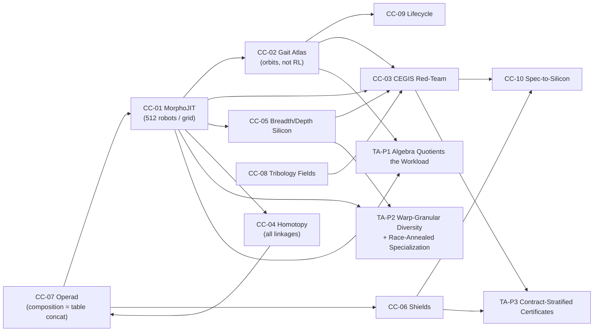

# WIZARD_IDEAS_CC.md — Dueling Idea Wizards (Lane `CC`) + BrennerBot Forced Third Alternatives

| Field | Value |
|---|---|
| **Run / Session** | MOR `r1-20261121` · Brenner `RS-20261121-franken-robotics-10x` · Question of Record `Q-001` |
| **Wizard lane** | `CC` (Claude Code, Opus 5.5) — one of three duelling lanes |
| **Date** | `2026-11-21` |
| **Inputs read in full** | `planning/mor/MOR_CASE.md` (E001–E012, PQ-10X-1..6); `planning/brenner/intake/question_of_record.md` (Q-001, Paradoxes 1–3, Exclusion Tests ✂1–4); `COMPREHENSIVE_PLAN_FOR_FRANKEN_ROBOTICS__NEON.md` v1.0 (all 1,726 lines) |
| **Skimmed** | `../franken_threed/COMPREHENSIVE_PLAN_FOR_THE_DESIGN_OF_FRANKENTHREED.md` §1, §4.3–§4.10, §6.7, §7 |
| **Target plan** | **Not edited.** Everything below is a proposal for the duel judge. |
| **Labels** | Same as NEON §0.1: `FACT` / `DESIGN` / `HYPOTHESIS` / `TARGET` / `OPEN`; ambition tags `[S]` `[F]` `[M]`; claim axes 1–5 per NEON §0.4 (never conflated) |
| **Idea IDs** | `CC-01`…`CC-30` (ranked Top 10 = `CC-01`…`CC-10`); Brenner alternatives `TA-P1`, `TA-P2`, `TA-P3` (`origin:third_alternative`) |

## Grounding Notes (spot checks made for this pass, local working trees on `2026-11-21`, not SHA-pinned)

- **G-1 (`FACT`).** `franken_threed` **exists** at `../franken_threed` (MOR `E008` @ `bf7abe1`). NEON's §0 "Honesty Note", `FD-14`, `RISK-09`, and `OPEN-SCENE-THREED` say it is absent — they are **out of date**. It is a Three.js-compatible Rust/WebGPU *application specializer*, not a physics engine. This pass uses it twice: (a) as a **design pattern** (guarded specialization with safe deoptimization §4.5; "remove questions from the frame loop" §4.10; per-use data versions §6.7; `AffineRows` layout §7.5; the Amdahl bound $S = 1/((1-p)+p/k+h)$ §1.2); (b) as the **compiler for the Studio's self-contained interactive inspection packages** (§10 single-file packaging).
- **G-2 (`FACT`).** `frankensympy` ships Gröbner machinery including finite-field variants (`fsym-polys/src/{groebner,finite_field_groebner,fglm,syzygy,ideal_quotient}.rs`), `real_rur`, and `polysys`, but **no homotopy-continuation solver** (a grep for "homotopy" over `fsym-*/src` finds nothing). `CC-04` therefore needs a new crate.
- **G-3 (`FACT`).** `frankentorch/crates/ft-kernel-metal/src/fused.rs` already contains a `simdgroup_matrix` GEMM, so policy inference on the M5 Ultra has a native matrix path today.
- **G-4 (`FACT`).** `frankensim` has crates that NEON never uses but this pass relies on: `fs-ports`, `fs-system`, `fs-couple` (Dirac-structure composition kernel); `fs-tilelang` (one restricted kernel body lowered to a scalar reference plus a lane-shaped variant); `fs-race` (e-racing with kill handles); `fs-voi` (value of information); `fs-surrogate` (certified validity bands); `fs-shapeprog` (shape-grammar program synthesis with rewrite canonicalization); `fs-motion` (`CertifiedMotorTube` Taylor models); `fs-regime`; `fs-recompute`; `fs-roofline`; `fs-soa`; `fs-lbm` (D3Q19/D3Q27); `fs-solid`; `fs-tribo`; `fs-thermal`; `fs-material`; `fs-uq`; `fs-robust`; `fs-rep-neural` (Lipschitz-certified neural SDFs); `fs-tropical`. There is **no** `fs-koopman`, `fs-cloth`, `fs-cosserat`, `fs-fatigue`, `fs-wear`, `fs-mpm`, or `fs-sph`.
- **G-5 (`HYPOTHESIS`; check with `nvidia-smi topo -p2p r` on `trj`).** GeForce RTX 4090s do not officially expose PCIe peer-to-peer. NEON §17.2's "PCIe P2P" all-reduce should assume transfers staged through host memory.
- **G-6 (`FACT`).** Apple GPUs have no native FP64 (MSL has no `double`). Any kernel that needs FP64 (the `CC-04` endgames) must use double-float emulation or run on the CPU on the M5 Ultra.
- **G-7 (`HYPOTHESIS`).** Every structural claim about rivals below stays `HYPOTHESIS` until a pinned-version audit, **`GATE-RIVAL-AUDIT`**, confirms it. The audit covers MuJoCo 3.x + `mjSpec`, MJX, MuJoCo Warp, Isaac Lab 2.x / PhysX 5, Drake, and Genesis. Claims are stated conservatively and each rival's real partial capabilities are named.

---

## 0. The Thesis in One Paragraph

NEON v1 makes the *existing* loop (one frozen robot → simulate → RL from scratch → scalar reward) cleaner and roughly 2–3× faster. The 10× does not come from a faster simulator. It comes from **changing the unit of work**: from "one robot, trained from scratch" to **populations of morphologies** that are:

1. **simulated together** on one GPU grid, with morphology treated as data rather than code (`CC-01`, `CC-05`);
2. **analyzed as dynamical and algebraic objects** — symmetry types, limit cycles, bifurcations, complete solution sets — rather than retrained (`CC-02`, `CC-04`, `CC-07`);
3. **falsified adversarially** in worlds that are certified solvable and physically alive (`CC-03`, `CC-08`, `CC-09`);
4. **certified as typed product claims** that cross from the formal axis to the statistical axis without laundering (`CC-06`, `TA-P3`);
5. **compiled end to end**, from mission spec to firmware, from one IR with equivalence witnesses (`CC-10`).

Every Top-10 idea names its crate, its mechanism, its baseline, its kill gate, and a scale check that fits the M5 Ultra (256 GiB unified, Metal 4) and the dual RTX 4090 (2× 24 GiB, `SM_89`, PCIe Gen4).

### 0.1 Ranked Top 10 at a Glance

| # | ID | Breakthrough | 10× lever (metric vs. baseline) | Family | Gate / Kill | Tag | Score /50 |
|---:|---|---|---|---|---|---|---:|
| **1** | `CC-01` | **MorphoJIT** — morphology-as-data screw-bytecode superkernel with Futamura-tiered guarded specialization | ≥10× DoF-normalized throughput vs. per-morphology launches when per-morphology budget ≤2,048 envs; 512 distinct robots in **one** grid | Heterogeneous GPU | `GATE-MORPHVM-01` / `KILL-MORPHVM-1` | `[F]` | **48.5** |
| **2** | `CC-02` | **Equivariant Gait Atlas** — H/K-theorem gait enumeration + saltation-exact Floquet limit-cycle continuation over morphology | ~100× fewer GPU-hours than per-morphology RL for locomotion screening; ≥5× RL warm start; gait-level design gradients at one adjoint solve | Lie / representation theory / dynamical systems; zero-shot transfer | `GATE-ATLAS-01` / `KILL-ATLAS-1` | `[F/M]` | **45.0** |
| **3** | `CC-03` | **Falsify → Shrink → Attribute → Repair** — CEGIS design loop with certified-solvable red-team worlds and counterfactual batch autopsy | ≥10× fewer episodes to find rare failures; ~1 min per falsify-shrink-attribute cycle vs. hours of manual debugging | Living worlds + Agent Studio | `GATE-REDTEAM-01` / `KILL-REDTEAM-1` | `[F]` | **43.5** |
| **4** | `CC-04` | **Complete-Solution Mechanism Synthesis** — GPU polyhedral/parameter homotopy continuation + α-certified roots | *Previously impossible:* **all** isolated solutions (e.g. 4,326 nine-point four-bars), ≤2 s per re-query; rivals: zero | Symbolic-formal constructive synthesis | `GATE-HOMOTOPY-01` / `KILL-HOMOTOPY-1` | `[F]` | **42.0** |
| **5** | `CC-05` | **Breadth/Depth Dual Silicon** — M5 Ultra as world-and-morphology bank, dual 4090 as specialist foundries, max-plus scheduled, *seed-not-voxels* | ~8–10× more distinct resident worlds per batch; ≥1.7× campaign wall-clock vs. the best single machine | Heterogeneous hardware | `GATE-FLEET-01` / `KILL-FLEET-1` | `[S/F]` | **41.25** |
| **6** | `CC-06` | **Proof-Carrying Kernel-Fused Shields** — closed-form robust CBF-QP filters compiled into env-step kernels and firmware with Lean-checked equivalence | 0 model-level barrier violations during RL exploration at ≤5% overhead; ≥100× fewer unsafe events in the full model | Formal methods ⇄ contact | `GATE-SHIELD-01` / `KILL-SHIELD-1` | `[F]` | **39.25** |
| **7** | `CC-07` | **Operadic Robot Algebra** — robots as wiring diagrams of open port-Hamiltonian mechanisms; functorial compile / prove / symmetry | ≥20× certified designs per hour in modular design spaces; wreath-product equivariance for composite robots | Category theory | `GATE-OPERAD-01` / `KILL-OPERAD-1` | `[F/M]` | **38.5** |
| **8** | `CC-08` | **Causal Tribology Fields & LOD Living Multiphysics** — thin-film lubrication PDE friction fields that robots spread, dry, and slip on | *New capability*; ≥3× fewer failures on causal-spill suites; ≤15% step overhead | Living 3D interiors | `GATE-TRIBO-01` / `KILL-TRIBO-1` | `[F]` | **38.75** |
| **9** | `CC-09` | **Lifecycle Compression** — two-timescale (HMM) averaging of wear, fatigue, thermal, and battery aging over Floquet steady states | 1,000-hour lifecycles: ≥100× (projected ~1,800×) faster at ≤5% error vs. brute force | Living worlds / physical realism | `GATE-LIFE-01` / `KILL-LIFE-1` | `[F/M]` | **37.25** |
| **10** | `CC-10` | **Spec-to-Silicon** — mission → typed STL contract → tropical robustness kernels → co-design → certified `no_std` firmware + BOM + harness + WebGPU dossier | Unattended mission → verified package in ≤2 h for 8/10 missions; reward is the spec's own semantics | AI-agent Robot Design Studio | `GATE-S2S-01` / `KILL-S2S-1` | `[S/F]` | **36.0** |

*Ranking note.* Scores within 0.5 points count as a tie, and a tie goes to the idea that enables more of the other Top-10 ideas in §0.2. That is why `CC-08` (38.75) ranks below `CC-07` (38.5): `CC-07` feeds `CC-01` and `CC-06`, while `CC-08` feeds only `CC-03`. The per-criterion scores are in §13.

### 0.2 Synergy Graph (why the ten compose into one paradigm, not ten features)

---

## 1. Method (Generation → Screening → Ranking)

1. **Generate 30** across the five required families (≥5 per family): algebra / Lie / category / topology / symbolic-formal; heterogeneous GPU (M5 Ultra + dual 4090); living multiphysics worlds and interiors; zero-shot morphological transfer and co-design; AI-agent Robot Design Studio. Each idea was thought through for mechanism, rival gap, artifact, failure modes, and numbers.
2. **Screen 1 — the QoR Exclusion Tests (✂1–4) applied literally.** An idea with no named artifact is cut. An idea without a ≥5× lever against a named baseline (or a previously impossible capability) is cut or folded into another. An idea that fails the scale check is cut; `CC-16` (tensor-core physics) and `CC-25` (parareal) died here. An idea that conflates claim axes is rewritten (this happened to `CC-06` and `CC-30`).
3. **Screen 2 — weighted rubric (max 50).** Lever magnitude ×3 · structural uniqueness vs. the four rivals ×2 · executability on today's FrankenSuite ×2 · confidence ×1.5 · synergy (enables other ideas) ×1.5. Each criterion is scored 1–5 in half-point steps, so totals are multiples of 0.25.
4. **Brenner pass.** For each paradox, build *forced third alternatives* that fit neither conventional horn, then design an exclusion experiment whose outcome excludes at least one hypothesis whichever way it falls (§14–§18).

---

# PART A — THE TOP 10 RADICAL 10× BREAKTHROUGHS (Ranked #1 → #10)

Each idea gives the five requested items: **(a)** exact mechanism and Rust crate or artifact; **(b)** why MuJoCo/MJX, Isaac Lab, Drake, and Genesis structurally cannot do it; **(c)** how it uses FrankenSuite and the hardware; **(d)** breakpoint and falsifiable gate / kill criterion; **(e)** scale-check calculation.

---

## 2. #1 — `CC-01` · **MorphoJIT**: Morphology-as-Data Screw-Bytecode Superkernel with Futamura-Tiered Guarded Specialization `[F]`

> **One line:** stop compiling robots into code; compile *one* kernel that interprets robots as data, pack warps so that divergence costs nothing, and treat per-topology symbolic specialization as a **cache** promoted by population share — never as the architecture.

### (a) Mechanism and artifact

1. **Screw normal form.** Every joint is a product of exponentials of Lie-subgroup generators. A 1-DoF joint is $\exp(\hat\xi\, q)$ with $\xi = (\omega, v) \in \mathfrak{se}(3)$ stored as **data**: revolute $\xi = (\omega, -\omega\times p)$, prismatic $\xi = (0, v)$, helical $\xi = (\omega, -\omega\times p + h\,\omega)$. The joint "type" collapses into six floats, so **one branch-free code path executes every 1-DoF joint** in every robot. The other opcodes are `ROOT_SE3` (floating base), `BALL_SO3` (exp-map ball joint, no gimbal lock), `PFAFF` (one nonholonomic rolling row), `LOOP` (one loop-closure row), and `FIXED` (folded away when the table is built). **Six opcodes are the entire "screw bytecode."**
2. **MorphoTable (`FMT-MORPH-1`).** One SoA row per body: `parent:u16`, `opcode:u8`, $\xi$ (6×f32), tree motor $X$ (PGA, 8×f32), log-Cholesky inertia $\eta$ (10×f32, so $\mathrm{Sym}^+(4)$ holds by construction), limits/damping/armature (4×f32), actuator class and gear (2×f32). That is about 124 B, padded to **128 B per body**. Each morphology also stores its topological order, level offsets, and a **canonical topology hash** (`franken_networkx` color refinement + canonical labeling), so isomorphic robots share a class.
3. **Tier 0 (the interpreter *is* the semantics).** One ABA/RNEA/CRBA + LGVI (or Lie-midpoint, per `KILL-LGVI-1`) kernel interprets MorphoTables. It is written once in `fs-tilelang`'s restricted kernel DSL (`FACT`: one body yields a scalar reference plus a lane variant) and lowered through `frob-kernel-ir` to MSL and PTX.
4. **Warp-coherent morphology packing.** The batch is laid out so that every warp (CUDA) or simdgroup (Metal) holds 32 envs of **one** morphology, and, with `CC-05`, one world. Opcode branches are therefore warp-uniform, so there is no divergence, and the morphology rows are broadcast loads (one L2 line serves 32 lanes). Each morphology is padded with ≤31 ghost envs. There are two size classes: **S** (≤18 DoF, thread-per-env) and **L** (19–64 DoF, simdgroup-per-env with level-synchronous lane-per-body sweeps). A heterogeneous batch of 512 robots is **2 dispatches**, not 512.
5. **Tier 1 = specialization as a cache.** `frob-codegen` *partially evaluates* Tier 0 against one topology class's table. This is the first Futamura projection: specializing an interpreter on its program yields a compiled program. Numeric parameters stay in uniform buffers, which keeps NEON's 0-ms recompile for parameter sweeps. Compilation runs asynchronously on CPU cores. Warps switch to Tier 1 at a substep boundary behind a **guard** (the topology hash), following franken_threed §4.5: a topological mutation sends that warp back to Tier 0 **instantly**, and the batch never stalls. **Promotion rule:** promote class $c$ iff $\widehat{T}^{\,\mathrm{remaining}}_c\,(1 - s_c^{-1}) > C_{\mathrm{compile}}$, where $s_c$ is the Tier-1 speedup measured by `fs-roofline`.
6. **Equivalence.** Tier 1 ≡ Tier 0 ≡ the CPU `f64` oracle within `GATE-GPU-TWIN-01` tolerance. The e-graph extraction (`fln-anvil::egraph`, `FACT`) that produced Tier 1 emits the `PO-CODEGEN-1` witness as a by-product, so specialization pays in speed **and** proof (see `TA-P1`).

**Artifacts:** new crate `frob-morphvm` (layer `E0`, ~9 kLOC `TARGET`); format `FMT-MORPH-1` in `frob-core`. It changes `frob-codegen` (Tier 1 becomes a Futamura specializer rather than the default path) and `frob-gpu` (packer + tier manager). **De-risking side effect:** NEON's `RISK-01`/`PF-2` (symbolic expression swell on >25-DoF humanoids) stops being schedule-critical, because the generic kernel is now the primary path and the `KILL-CODEGEN-1` fallback becomes the default rather than the failure mode.

### (b) Why the rivals structurally cannot do this (`HYPOTHESIS` → `GATE-RIVAL-AUDIT`)

| Rival | Structural barrier | Honest partial capability |
|---|---|---|
| **MuJoCo / MJX / MuJoCo Warp** | A compiled `mjModel` fixes the topology (`body_parentid`, DoF addresses). MJX traces static shapes under `jit` and `vmap`s over `Data` and same-shape `Model` fields, so different kinematic trees need separate compiled functions — or a "superset robot" with locked, massless limbs that charges every env the cost of the largest morphology. | `mjSpec` (3.2+) edits and recompiles models quickly on the CPU; per-world numeric parameter variation. |
| **Isaac Lab (PhysX 5)** | GPU articulation views batch *structurally identical* articulations; distinct topologies need separate views or assets, and the stack is CUDA-only. | Multi-asset spawning (strongest for rigid objects). |
| **Genesis** | `scene.build(n_envs=B)` replicates one built scene. | Multi-solver GPU backends, including Metal. |
| **Drake** | `MultibodyPlant` steps on the CPU; there is no batched GPU stepping. | Exact multibody dynamics for any topology, one plant at a time. |

**Net:** a co-design population on a rival GPU stack is **serialized over morphologies**. Small per-morphology budgets — the regime of evolution, e-racing, counterfactual morphology interventions, and universal-policy training — leave the GPU almost empty.

### (c) FrankenSuite and hardware leverage

- `fs-mbd::articulated` (`FACT`) defines Tier-0 semantics and serves as the CPU oracle. `fs-tilelang` writes the kernel once. `fs-soa` provides layout. `fs-roofline` measures the promotion constants. `franken_networkx` provides canonical topology hashes. `frankensympy` + `fln-anvil::egraph` produce Tier 1 and its witness. `ft-kernel-metal::Gateway::batch` issues 2 dispatches per command buffer. `frob-gpu-cuda` issues 2 kernel nodes per CUDA Graph. The pattern is franken_threed §4.3–§4.5 and §4.10.
- **M5 Ultra:** all MorphoTables plus up to ~65k heterogeneous envs stay resident in `StorageModeShared` while CPU cores compile Tier-1 kernels **zero-copy against live tables**.
- **RTX 4090:** a 72 MB L2 holds every table for 512 morphologies (2.4 MB), so the morphology "program" is effectively on-chip.

### (d) Breakpoint and falsifiable gate

- **`GATE-MORPHVM-01`** (workload **H512**): 512 distinct morphologies drawn from the 9 catalog families with randomized topology mutations (6–36 DoF), 32 envs each (B = 16,384), on flat ground and stairs. The metric is **DoF-normalized substeps/s** ($\sum \mathrm{DoF}\cdot$substeps/s). It must pass on **both** the M5 Ultra and the dual 4090:
  1. Tier 0 ≥ **0.33×** a homogeneous Tier-1 batch at equal $\sum$DoF;
  2. ≥ **10×** the per-morphology baseline (512 separate graphs or streams);
  3. Tier 0 ↔ Tier 1 ↔ CPU `f64` within $10^{-5}$ (`Safe`);
  4. promotion or deoptimization never stalls a substep by more than 1 ms.
- **Breakpoint (honest):** once a single morphology gets ≥ ~16k envs, homogeneous Tier 1 is optimal and MorphoJIT adds nothing. The lever lives specifically in the **$n_m \le 2{,}048$ regime** (see `TA-P2`).
- **`KILL-MORPHVM-1`:** criterion 1 < 0.15× **or** criterion 2 < 4×. Fall back to ≤16 superset templates with masked limbs (bucketed batches), and document the diversity loss.

### (e) Scale check

| Quantity | Calculation | Result | Envelope |
|---|---|---|---|
| Table memory | 512 morph × 36 bodies × 128 B | **2.36 MB** | 4090 L2 = 72 MB ✓; M5 SLC ✓ |
| Per-env working set (worst, 36 DoF) | state 86 f32 (344 B) + ABA scratch 26 f32 × 37 bodies (3.8 KB) + ≤16 contacts × 64 B (1 KB) | **≈5.2 KB** (mean ≈3 KB) | B = 16,384 → ≤85 MB ✓ |
| Bandwidth at NEON's 12-DoF target | 1.2M env-steps/s × 4 substeps × 10.4 KB (worst-case full spill r+w) | **≈50 GB/s** | 2.5% of the dual-4090 2 TB/s → *not bandwidth-bound* |
| Compute | ≈400 flop/body × 20 + 8 contacts × 10 PGS iters × 150 ≈ 20k flop/substep × 4.8M substeps/s | **≈0.1 TFLOP/s** | <0.1% of 165 TFLOPS FP32 → **latency/occupancy-bound** |
| Per-morphology baseline occupancy | ≤128 concurrent kernels (Ada) × 1 warp vs. 128 SM × 48 = 6,144 warp slots; plus 512 kernel nodes × ~2–4 µs ≈ 1–2 ms/substep vs. ~50–100 µs compute | **≤2% occupancy, launch-dominated** | → superkernel ≈8–20× vs. CUDA-Graph nodes, ≈14–39× vs. stream launches (derivation in §16.5); gate set at ≥10× |
| Tier-1 promotion economics | compile 1.5 s; Tier-0 penalty 2–3×; class consuming ≥5% of a 10-min campaign (30 s) saves ≥18 s | promote ✓ | async on CPU, no stall |

Because the regime is latency/occupancy-bound, the generic interpreter's 2–3× flop penalty costs far less than launch fragmentation does. That is the quantitative core of the unlock.

---

## 3. #2 — `CC-02` · **Equivariant Gait Atlas**: H/K-Theorem Gait Enumeration × Saltation-Exact Floquet Continuation over Morphology `[F/M]`

> **One line:** when an agent lengthens a femur by 10% or adds a fifth leg, do not retrain RL for 15 minutes. **Continue** the gait as a limit cycle through morphology space in milliseconds, enumerate every symmetric gait the new body admits by group theory, and read design gradients off a single adjoint solve.

### (a) Mechanism and artifact

1. **Two groups, two jobs (never conflated).**
   - **Mechanical symmetry** $\Gamma$ (`frob-symmetry`). For a commanded velocity $v$, only the isotropy subgroup $\Gamma_v = \{\gamma\in\Gamma : \gamma\cdot v = v\}$ is a symmetry of the moving dynamics. Example: sagittal $\mathbb{Z}_2$ for a dog trotting forward, even though the standing dog has $V_4$. $\Gamma_v$ is used for **exact dynamical reduction** and equivariant networks.
   - **Combinatorial leg-permutation group** $\Sigma$ of the leg graph (e.g. $\mathbb{Z}_4\times\mathbb{Z}_2$ for a quadruped, $\mathbb{Z}_6\times\mathbb{Z}_2$ or $D_6$ for a hexapod). $\Sigma$ is a symmetry of the **phase template**, following Golubitsky–Stewart CPG theory, *not* of the mechanics.
2. **H/K enumeration of phase patterns.** For $\Sigma\times S^1$ acting on phase templates, the H/K theorem (Buono–Golubitsky) admits spatio-temporal symmetry pairs $K \trianglelefteq H \le \Sigma$ with $H/K$ cyclic, subject to isotropy and $\dim \mathrm{Fix}(K)$ conditions. Those dimensions come straight from characters: $\dim\mathrm{Fix}(K) = \frac{1}{|K|}\sum_{k\in K}\chi(k)$. The output is the **complete list of symmetric phase patterns** (pronk, bound, pace, trot, walk, jump, …; tripod, ripple, metachronal wave, …) for *any* morphology. A never-before-seen 5-legged robot gets its own catalog in milliseconds. The enumeration is a finite computation and therefore checkable in `fln-kernel` by `decide` (**`PO-GAITENUM-1`**).
3. **Symmetry-reduced hybrid shooting.** Each pattern seeds a periodic-orbit problem. If $H/K \cong \mathbb{Z}_m$ is generated by $h$ with time shift $T/m$, solve on $[0, T/m]$ with the twisted boundary condition $x(T/m) = h\cdot x(0)$. When $K \subseteq \Gamma_v$, also restrict $x(0) \in \mathrm{Fix}(K)$. Time drops by a factor of $m$ and dimension by a factor of $n/\dim\mathrm{Fix}(K)$. Newton uses a bordered system (phase condition) because $M - I$ is singular along the flow direction.
4. **Saltation-exact monodromy.** Forward sensitivities run through *event-located* LGVI. At each guard $g(x) = 0$ with reset $R$ (touchdown, liftoff, stick↔slip), the Jacobian jumps by the **saltation matrix**
   $$\Xi = D_xR + \frac{\big(f^+ - D_xR\,f^-\big)\,D_xg}{D_xg\,f^-},\qquad M = \Xi_k\Phi_k\cdots\Xi_1\Phi_1 .$$
   The Floquet multipliers $\mathrm{eig}(M)$ classify orbital stability. Enclosing $M$ with `fs-ivl` / `fs-motion` Taylor models produces a **`VerifiedNumeric` stability receipt** (**`PO-FLOQUET-1`**).
5. **Continuation over morphology and command.** Pseudo-arclength continuation on $F(x,\theta) = P(x;\theta) - x = 0$ runs across levers $\theta$ (femur length, gear ratio, stance width, payload) and commanded speed. It detects folds ($\lambda\to+1$), period doubling ($\lambda\to-1$), Neimark–Sacker pairs, and **symmetry-breaking pitchforks** (equivariant branching lemma), which are the *gait transitions* (trot→gallop as speed rises). Grazing (a new contact appearing) is detected and the branch restarts with a new mode sequence.
6. **Outputs.**
   - **Zero-RL controllers:** periodic LQR (periodic Riccati along each orbit) stabilizes every branch.
   - **RL warm starts:** the orbit plus TVLQR is behavior-cloned as the initial policy or used as a residual base.
   - **Gait-level design gradients from one adjoint solve:** $\lambda^\top \partial_x F = \partial_x J$, then $\frac{dJ}{d\theta} = \partial_\theta J - \lambda^\top \partial_\theta F$. The cost is independent of the number of levers.
   - **Envelope theorem for co-design:** when the policy is optimized too, $\frac{d}{d\theta}\max_\phi J(\theta,\phi) = \partial_\theta J(\theta,\phi^\star)$ at an interior optimum, so there is **no differentiation through training**. The error is $O(\|\nabla_\phi J\|)$ and is reported.

**Artifacts:** new crate `frob-gaitatlas` (`E2`, ~10 kLOC). It extends `frob-symmetry` (subgroup lattice, characters, $\mathrm{Fix}(K)$ projectors), `frob-dyn` (event location), `frob-adjoint` (saltation, batched forward sensitivities), and `frob-proof` (`PO-GAITENUM-1`, `PO-FLOQUET-1`).

### (b) Why the rivals structurally cannot do this

| Rival | Structural barrier | Honest partial capability |
|---|---|---|
| **MuJoCo / MJX** | Soft, convex, *event-free* contact means there are no guard/reset semantics and therefore no saltation. MuJoCo offers finite-difference transition derivatives through stiff contact; MJX autodiffs through smoothed contact (biased). Neither has a symmetry object, a continuation/bifurcation engine, or morphology-heterogeneous batching. | FD Jacobians are good enough for MPC on one model. |
| **Isaac Lab** | PhysX exposes no analytic derivatives. | Massive RL throughput for one structure. |
| **Genesis** | Differentiability targets mainly soft-body solvers; there are no event-located hybrid Jacobians for rigid multi-contact (`HYPOTHESIS`). | Batched multi-physics. |
| **Drake** | Closest rival: hybrid systems with witness functions + `AutoDiffXd` make *single-orbit* analysis possible for small models (Underactuated's compass gait). But `MultibodyPlant` contact is time-stepping, so full multibody contact has no event-based saltation, and there is no symmetry-derived gait enumeration and no GPU-batched continuation across morphology populations. | Rigorous small-model limit-cycle analysis on the CPU. |

### (c) FrankenSuite and hardware leverage

- `frob-symmetry` / `fs-symmetry` supply groups. `fs-ad` duals and `fs-adjoint` checkpointing supply sensitivities. `fs-ivl` + `fs-motion` supply validated enclosures. `fsym-calculus` produces symbolic guard and reset Jacobians. `fln-kernel` `decide` checks the enumeration.
- **`CC-01`** puts every orbit for 512 morphologies, plus their tangent lanes, in one grid.
- **Dual 4090:** batched monodromy lanes (≤36 tangent lanes per orbit). **M5 Ultra:** the interactive atlas browser and the CPU-side Newton/continuation logic sit co-resident with the GPU orbit buffers, zero-copy.

### (d) Breakpoint and falsifiable gate

- **`GATE-ATLAS-01`:**
  1. **Known answers:** rimless wheel (analytic fixed point and multiplier); compass gait (Goswami et al. 1998), with period-1 multipliers vs. FD-of-Poincaré within $10^{-6}$ relative and the period-doubling slope within 1% of the literature.
  2. **Enumeration:** recovers the classical phase-pattern catalogs ($\mathbb{Z}_4\times\mathbb{Z}_2$ quadruped primary gaits; hexapod tripod/ripple/wave), Lean-checked.
  3. **Continuation:** the catalog quadruped's trot is tracked over femur length 0.18 → 0.34 m (±30%) with ≤6 Newton iterations per step and residual ≤$10^{-9}$, with folds detected.
  4. **Bootstrap:** on held-out morphologies (5-legged $D_5$, asymmetric hexapod), atlas + periodic LQR walks on flat ground at ≥0.6× the RL-trained speed with **0 RL steps**, and RL warm-started from the atlas reaches 90% of scratch-RL final return with **≥5× fewer env-steps**.
  5. **Gradients:** cosine ≥0.95 between $dJ/d\theta$ and central FD of the converged-orbit $J$.
- **Breakpoint (honest):** the atlas covers **periodic locomotion on regular terrain** (flat ground, constant slopes, regular stairs). Clutter, manipulation, and perception-gated behavior stay with RL; there the atlas is a warm start and a fast co-design *screening fidelity*.
- **`KILL-ATLAS-1`:** criterion 4 below 2×, or criterion 3 failing on ≥50% of catalog morphologies (mode-sequence churn along branches). Demote to a seed-and-diagnostic tool.

### (e) Scale check

- **Quadruped tangent dimension:** $\mathfrak{se}(3)$ (6) + shape (12) + momenta (6 + 12) = 36, minus 1 for the section, leaves 35. **Trot** has $H/K\cong\mathbb{Z}_2$, so the shooting horizon is $T/2 = 0.25$ s at $h = 1$ ms, i.e. 250 steps.
- **Per Newton iteration:** 36 lanes × 250 = 9,000 lane-steps. 5 iterations give **45,000 lane-steps per orbit**.
- **Atlas for a full population:** 512 morphologies × 8 phase patterns × 50 continuation points = 204,800 orbit solves, i.e. **9.2 × 10⁹ lane-steps**. At NEON's dual-4090 rate of 4.8 × 10⁶ substeps/s (counting each lane-step as one substep, conservatively) this takes **≈32 min** on the pair ≈ **1.1 GPU-h**.
- **RL baseline:** 512 morphologies × 15 GPU-min (NEON Appendix D) = **128 GPU-h**, for one policy per morphology and no stability classification or gradients. The ratio is **≈120× in GPU-hours** for the locomotion-screening stage.
- **Symmetric patterns with $K\subseteq\Gamma_v$** (bound, pronk) roughly halve the lane count through the $\mathrm{Fix}(K)$ restriction, so the true ratio is higher.

---

## 4. #3 — `CC-03` · **Falsify → Shrink → Attribute → Repair**: CEGIS Robot Design with Certified-Solvable Red-Team Worlds and Counterfactual Batch Autopsy `[F]`

> **One line:** make the world the adversary. The world is a typed grammar that may push to — but never past — the robot's own declared capability envelope. Every failure is shrunk to a minimal counterexample world, attributed causally by thousands of exact counterfactual forks, repaired, and stored as a regression test that the world remembers.

### (a) Mechanism and artifact

1. **World grammar as a search space.** A `frob-worldgen` interior is a seeded derivation in a typed grammar with parameter space $\Omega$ = continuous parameters (rug-lip height, friction patches, `CC-08` spill sources, steam density, door-spring stiffness, clutter poses, lighting) × discrete production choices.
2. **Solvability certificate $\mathrm{Solv}(\omega)$** — the thing that keeps an adversarial generator from "winning" with impossible worlds, a known pathology of unsupervised environment design. It is the conjunction of:
   - `fs-topo` $\beta_0$ connectivity of start and goal at the robot's clearance radius;
   - every obstacle inside the robot's **capability envelope**, derived from its own preflight (max riser from leg kinematics, max gap, required traction $\mu \ge a_{\mathrm{req}}/g$, max door torque vs. actuator envelope);
   - a **witness**: a privileged reference planner or oracle robot succeeds.

   The adversary may approach the envelope boundary but never cross it, which separates *design flaws* from *impossible worlds*.
3. **Falsification search.** Maximize $\widehat{P}_{\mathrm{fail}}(\theta,\pi\,|\,\omega)$ over $\Omega_{\mathrm{solv}}$ with the cross-entropy method for rare events plus CMA-ES over continuous parameters, using common random numbers. With `CC-01`/`CC-05` every env in the batch can hold a **different** $\omega$. A failure is **confirmed** when an anytime-valid e-value for "$P_{\mathrm{fail}}(\omega) > p_0$" crosses $1/\alpha$ (`fs-eproc`).
4. **Shrinking (delta debugging).** $\omega$ is represented as an edit list relative to a nominal scene. `ddmin` (Zeller–Hildebrandt) finds a 1-minimal failing subset, and continuous edits are bisected toward nominal to find the **failure-boundary distance**. The output is a **Minimal Counterexample World (MCW)**, typically ≤3 edits ("2.6 cm rug lip + $\mu = 0.11$ film within 0.3 m of a swinging door").
5. **Counterfactual batch autopsy.** From the MCW `CrashPack` at $t_{\mathrm{fail}} - \Delta$, fork **4,096 exact branches** (`DeterministicPerDevice`) under structured interventions over factor set $\mathcal{F}$: world edits, friction field, sensor dropout, latency, controller gains, and **morphology levers** (possible only because `CC-01` allows morphology changes inside one batch). From these, estimate interventional effects and Shapley attributions with CRN, then report minimal *sufficient* and *necessary* cause sets in the six-axis telemetry vocabulary of NEON §19.
6. **Repair and regression.** Candidate repairs come from (i) adjoint sensitivities of a differentiable *failure margin* (friction-cone slip margin, ZMP margin) at the MCW, (ii) the `CC-02` gait atlas, and (iii) a `CC-06` shield. A repair is accepted only if it beats the **entire counterexample corpus** (regression) with no nominal-suite regression, judged by e-process with CRN.
7. **Living memory.** The corpus is content-addressed in the FrankenSQLite Design Ledger. Over a campaign it becomes a design-specific adversarial benchmark: *the worlds remember how robots failed.*

Formally this is **CEGIS** (counterexample-guided inductive synthesis): synthesize $\theta,\pi$ → the verifier (falsification search) returns $\omega^\ast$ → add it to the corpus → resynthesize. Termination is not guaranteed on infinite $\Omega$; convergence is *measured* (§d).

**Artifacts:** new crate `frob-redteam` (`V`, ~9 kLOC), new format `FMT-MCW-1` (minimal counterexample world + witness + CrashPack). Extends `frob-diagnose` (counterfactual fork engine) and `frob-worldgen` (edit-list representation, solvability certificate). Adds MCP verbs `redteam_falsify`, `redteam_shrink`, `autopsy_counterfactual`, `repair_validate`.

### (b) Why the rivals structurally cannot do this

| Rival | Structural barrier | Honest partial capability |
|---|---|---|
| **MuJoCo / MJX** | A scene is a static MJCF asset: there is no typed grammar, no notion of a *minimal edit*, and no solvability semantics. MJX can `vmap` counterfactual *state/parameter* perturbations for one model, but not morphology interventions in the same batch. | Deterministic CPU replay; cheap state save/restore. |
| **Isaac Lab** | Scenes are USD prims; procedural generation and domain randomization are user code with no solvability certificate. GPU determinism for exact forks is limited and configuration-dependent (`HYPOTHESIS`). | Strong domain-randomization APIs. |
| **Genesis** | Replicated single scene per build; no grammar or solvability layer. | Fast batched rollouts. |
| **Drake** | No world generation; CPU-only falsification. | Determinism; falsification of small systems is possible. |

UED research systems (POET, PAIRED, ACCEL) are algorithms that run *on top of* simulators. None ships a certified-solvable world grammar, minimal-counterexample shrinking, and exact morphology counterfactuals inside the simulator.

### (c) FrankenSuite and hardware leverage

- `frob-worldgen` + `fs-topo` (cubical persistent homology) provide the grammar and the solvability certificate. `fs-eproc` / `fs-race` handle confirmation and racing. **`fs-voi`** picks the next falsification experiment that could *flip the design ranking*, not merely the most uncertain one. `frob-ledger` (FrankenSQLite) stores the corpus. `franken_threed` renders each MCW as a **self-contained, scrubbable WebGPU HTML** with counterfactual branches overlaid, readable by humans and vision agents.
- **M5 Ultra** holds hundreds of candidate worlds resident (`CC-05`). **Dual 4090** runs the massive falsification and autopsy batches.

### (d) Breakpoint and falsifiable gate

- **`GATE-REDTEAM-01`**, on a **planted-weakness corpus** of 20 (design, weakness) pairs with known failure-region ground truth (e.g. a glass-door blind spot + low μ; a thermal cliff on a ramp with payload; a door spring + narrow galley):
  1. finds the planted failure with **≥10× fewer episodes** than uniform domain randomization when the planted region has $p \le 3\times10^{-5}$;
  2. ≥90% of counterexamples are certified solvable **and** reproduce on fresh seeds ($e \ge 20$);
  3. median MCW ≤3 edits;
  4. the autopsy ranks the planted cause top-1 in ≥85% of cases;
  5. CEGIS-repaired designs cut failure ≥3× on a *held-out* adversarial suite with no nominal regression.
- **Breakpoint:** when failures are *not* rare ($p \gtrsim 10^{-2}$), uniform randomization already finds them, so the lever is shrinking and attribution, not search.
- **`KILL-REDTEAM-1`:** criterion 1 below 3×, or criterion 2 below 70% (the adversary is producing false alarms). Revert to curated adversarial suites plus autopsy only.

### (e) Scale check

- **Search cost.** Uniform domain randomization needs ≈ $\ln(1/\alpha)/p = 3/(3\times10^{-5}) = 10^5$ episodes to detect the failure with 95% probability. The cross-entropy method needs ⌈log(1/p)/log(1/ρ)⌉ = 5 levels (ρ = 0.1) × 1,000 episodes, plus 1,000 for confirmation = **6,000 episodes → ≈16×**.
- **Episode cost.** 20 s at 50 Hz = 1,000 env-steps. Uniform therefore costs 10⁸ env-steps (≈83 s at 1.2M/s) vs. 6 × 10⁶ (≈5 s).
- **Shrink.** `ddmin` on 12 edits is worst case O(n²) = 144 tests × 64 CRN replicates × 1,000 env-steps = 9.2 × 10⁶ env-steps ≈ **8 s**.
- **Autopsy.** 4,096 branches × 100 control steps = 4.1 × 10⁵ env-steps → **<1 s**. Storage: 4,096 × ~3 KB state snapshots = 12 MB.
- **Total:** ≈ **15–60 s per falsify → shrink → attribute cycle** on dual 4090, against hours of manual log reading.

---

## 5. #4 — `CC-04` · **Complete-Solution Mechanism Synthesis**: GPU Polyhedral/Parameter Homotopy Continuation with α-Certified Roots `[F]`

> **One line:** for the parts of robot design that are *algebraic* — leg linkages, finger paths, parallel ankles, Stewart platforms, IK branches, singularity loci — stop sampling. Compute **every isolated solution**, certify each one, and hand all of them to the batched simulator.

### (a) Mechanism and artifact

1. **Problem classes, generated symbolically by `frankensympy`** (`fsym-polys` polynomial systems in isotropic or Study coordinates):
   - planar 4-bar and 6-bar (Watt/Stephenson) **path synthesis**, e.g. a foot trajectory for a walking leg or a fingertip path for a gripper;
   - **motion generation** (Burmester: 5 poses → ≤4 dyads);
   - **spatial kinematics**: general 6R inverse kinematics (16 solutions), Stewart–Gough forward kinematics (40), parallel ankle and knee mechanisms;
   - **singularity varieties** $\{\det J(q)=0\}$ and workspace boundaries, as witness sets of positive-dimensional components.
2. **Homotopies.** Total-degree / multihomogeneous / polyhedral (BKK mixed-volume) start systems for ab-initio solves, plus **monodromy solving** (parameter loops that populate the solution set from one seed solution). Then **parameter homotopy forever after**: solve one *generic complex instance* once (minutes), and every new design spec is a parameter homotopy from that instance, tracking only $N_{\mathrm{sol}}$ paths (4,326 instead of 286,720 for the 9-point four-bar). That turns synthesis into an **interactive, sub-second Studio verb**.
3. **Path tracking on GPU, one path per thread.** RK4 predictor on the Davidenko ODE $\dot x = -H_x^{-1}H_t$, Newton corrector, adaptive step, the **γ-trick** (random complex γ), so that with probability 1 paths avoid singularities before $t = 0$, and Cauchy or power-series endgames for singular endpoints. **Precision policy:** double-float (FP32 pairs) on both GPUs by default. The 4090 has native FP64 only at 1/64 rate (≈1.3 TFLOPS); Apple GPUs have none (G-6). Endgames escalate to CPU `f64` or double-double.
4. **α-certification (Smale).** A point $x$ is a certified approximate zero if
   $$\alpha(F,x) = \beta\,\gamma < \tfrac{13-3\sqrt{17}}{4} \approx 0.1577,\quad \beta = \|DF(x)^{-1}F(x)\|,\quad \gamma = \sup_{k\ge2}\Big\|DF(x)^{-1}\tfrac{D^kF(x)}{k!}\Big\|^{\frac{1}{k-1}}.$$
   $\gamma$ is bounded for polynomial systems as in alphaCertified (Hauenstein–Sottile). The check runs in exact rationals / `fs-ivl` intervals and certifies **distinctness and real vs. non-real** status of every root. The rational inequalities project through `fsym-formal` to `fln-kernel` (`norm_num`) as **`PO-ALPHA-1`**.
5. **Completeness accounting (claim discipline).** Every reported solution is certified. Completeness is claimed **only** when one of three things holds: (i) the root count matches an exact count from a **modular Gröbner basis** (`FACT`: `fsym-polys` finite-field Gröbner + FGLM; feasible for Burmester, 6R IK, and Stewart FK — Faugère–Lazard computed the Stewart 40 this way); (ii) the trace test closes a monodromy witness set; or (iii) a proven root bound is attained. Otherwise the result is reported as "certified lower bound on #solutions" — `VerifiedFormal` for each root, `VerifiedNumeric` for completeness.
6. **Mechanism filtering, then dynamics.** Real roots → branch, order, and circuit (Grashof) defect filters → transmission-angle and link-bound constraints → self-collision. The survivors become `CC-07` components and are simulated **all at once** as distinct closed-loop morphologies in one `CC-01` batch (`LOOP` opcode), ranked by dynamic CoT, peak torque, and foot-trajectory tracking.

**Artifacts:** new crate `frob-homotopy` (`K1`, ~12 kLOC; upstream candidate `fsym-homotopy`). Kernels go through `frob-kernel-ir` (complex double-float op set). New verbs: `synth_linkage_path`, `synth_burmester`, `synth_parallel_ankle`, `analyze_singularity_variety`.

### (b) Why the rivals structurally cannot do this

All four rivals are **simulators of given designs**. None has a polynomial-system front end, numerical algebraic geometry, or root certification. Drake's `MathematicalProgram` can solve nonconvex polynomial programs **locally** and run SOS relaxations, but it cannot *enumerate all isolated solutions*. MuJoCo, Isaac, and Genesis design loops are sample → simulate → keep the best: a local search that, by construction, cannot report "these are all 4,326 four-bars through your nine points." *(Specialist CPU tools — Bertini, HomotopyContinuation.jl — do the algebra but are not simulators, provers, or design studios.)*

### (c) FrankenSuite and hardware leverage

- `fsym-polys` / `fsym-solvers` (system generation, `real_rur` for small exact cases, finite-field Gröbner + FGLM for exact root counts), `fs-ivl` (interval α-tests), `fsym-formal` → `fln-kernel` (rational certificate check), and `CC-01` + `CC-07` (synthesized mechanisms become simulated components).
- **Dual 4090:** ~286k concurrent paths per ab-initio solve. **M5 Ultra:** α-certification and Gröbner cross-checks run on the CPU cores against GPU path results that are already in unified memory, with zero copies.

### (d) Breakpoint and falsifiable gate

- **`GATE-HOMOTOPY-01`** — reproduce the known counts:
  1. 9-point four-bar path synthesis: **4,326** nondegenerate solutions in **1,442** Roberts-cognate triples (Wampler–Morgan–Sommese 1992);
  2. Stewart–Gough forward kinematics: **40**;
  3. general 6R inverse kinematics: **16**;
  4. Burmester 5-pose dyads: **≤4**.

  Pass: 100% of known counts recovered, ≥99.9% of roots α-certified, modular-Gröbner counts agree wherever Gröbner is feasible, a parameter-homotopy re-solve of a new 9-point spec in **≤2 s** on one 4090, and ab initio in **≤10 min**.
- **Breakpoint:** systems whose mixed volume exceeds ~10⁸ paths, or whose components are positive-dimensional with huge degree, fall back to monodromy plus local optimization, with completeness explicitly *not* claimed.
- **`KILL-HOMOTOPY-1`:** >0.1% of paths unrecoverable after re-tracking with fresh γ, or an unresolved disagreement between the Gröbner count and the homotopy count. Ship local synthesis only.

### (e) Scale check

- **Per predictor–corrector step** (9-point four-bar, 8 equations in 8 unknowns): one $F$ + $J$ evaluation via a straight-line program ≈ 2–5 × 10³ complex ops; an 8×8 complex LU ≈ 0.7 × 10³; RK4 (4 evaluations) + 2 Newton steps ≈ 3 × 10⁴ complex ops ≈ **1.2 × 10⁵ real flops**.
- **Parameter homotopy:** 4,326 paths × 150 steps × 1.2 × 10⁵ = **7.8 × 10¹⁰ flops**. Double-float on a 4090 costs ~15 FP32 ops per DF op, so 82.6/15 ≈ 5.5 DF-TFLOPS peak; at 10% efficiency (0.55 TF) this is **≈0.14 s** ✓ (gate 2 s).
- **Ab initio** (2-homogeneous, 286,720 paths × 300 steps): **1.0 × 10¹³ flops** → ≈19 s on one 4090 (≈10 s on two). Native FP64 at 10% of 1.3 TF ≈ 77 s. M5 Ultra double-float (≈35 TFLOPS FP32 *estimate*, to be fingerprinted) ≈ 45 s. All under 10 min ✓.
- **Memory:** ≈3.2 KB per path (8 complex DF unknowns + 8×8 Jacobian + RK workspace) × 286,720 = **0.9 GB** ✓.
- **Certification:** ~10⁵ interval ops per root × 4,326 roots = 4.3 × 10⁸ → ~1–2 s on M5 Ultra CPU cores. Lean checks only the real, defect-free survivors (tens to hundreds) → seconds.

---

## 6. #5 — `CC-05` · **Breadth/Depth Dual Silicon**: M5 Ultra as World-and-Morphology Bank, Dual 4090 as Specialist Foundries — Max-Plus Scheduled, *Seed-Not-Voxels* `[S/F]`

> **One line:** keep *numerical* parity between the machines (the hardware-twin gate stays) but abandon *role* parity. Each pole does what its memory architecture makes structurally unique: 256 GiB of unified memory buys **breadth** (worlds × morphologies × co-resident symbolic and proof tooling); 2 × 1 TB/s of GDDR6X plus tensor cores buys **depth** (long homogeneous specialist training).

### (a) Mechanism and artifact

1. **M5 Ultra — "Atelier Host" (breadth).**
   - **World Bank:** 500–1,000 resident interior and terrain scenes (VDB narrow-band SDF + wide BVH + `MaterialField` + `CC-08` tribology templates) in `StorageModeShared`.
   - **Heterogeneous exploration population:** `CC-01` Tier 0, warps morphology- *and* world-coherent.
   - **CPU co-residency:** `frankensympy`, `fln-kernel`, `frob-preflight`, `fs-topo` solvability checks, `CC-04` certification, and the agent tools read live GPU buffers with **zero PCIe marshaling** — e.g. the CPU certifies the solvability of freshly generated worlds while the GPU simulates.
   - The interactive Studio (`NativePresenter`) on live state.
2. **Dual 4090 — "Foundries" (depth).** `CC-01` Tier-1 specialists promoted from the population; long homogeneous RL with FP16/BF16 tensor-core policies (FP32 accumulate); `CC-04` path tracking; red-team rollouts for finalists on **world shards** (≈100 scenes per GPU).
3. **Data-movement law, "move the small things."** Ship MorphoTables (KB), policies (MB), and **world seeds and grammar parameters (bytes)**. **Never ship voxels (GB).** Every world is regenerated deterministically on the foundry from its seed: procedural generation is in the `BitwisePortable` class (NEON §23), and each shard's world digest is checked against the bank's.
4. **Max-plus scheduler (`frob-fleet`).** A campaign is a cyclic task graph: generate → preflight → explore/eval (M5) → promote → train (4090) → red-team (both) → ledger. Write its timing matrix $A$ in the max-plus semiring. The **tropical eigenvalue** $\lambda(A)$ (maximum cycle mean, Karp's algorithm in `fs-tropical`, `FACT`) is the steady-state cycle time, and its **critical circuit** names the bottleneck resource. Work splits (e.g. the red-team share per pole) are rebalanced until both poles sit on the critical circuit.
   - *Example:* explore $E = 6$ min on M5, train $R = 10$ min on 4090, red-team $X$ split $(x, X-x)$. Choose $x$ so that $E + x = R + (X - x)$, which minimizes $\lambda$.
5. **Parity kept where it matters.** `GATE-GPU-TWIN-01` still verifies kernels across CPU/Metal/CUDA. Only *scheduling roles* are asymmetric.

**Artifacts:** new crate `frob-fleet` (`E0`, ~7 kLOC; `asupersync` QUIC/TLS worker lane per NEON `BD-067`); format `FMT-WORLDSEED-1` (grammar + seed + digest).

### (b) Why the rivals structurally cannot do this

| Rival | Structural barrier |
|---|---|
| **Isaac Lab** | CUDA-only, so it cannot use Apple Silicon at all; one scene per stage replicated across envs; worlds limited by 24 GiB VRAM. |
| **MuJoCo / MJX / MJWarp** | MJX's GPU path is CUDA/TPU-oriented (JAX-Metal experimental); one model per batch; no world-bank abstraction. |
| **Genesis** | Runs on Metal (`HYPOTHESIS`), but `scene.build(n_envs)` replicates **one** scene, so it does not convert 256 GiB into world diversity. |
| **Drake** | CPU; no batched GPU and no cross-machine scheduler. |

None has a deterministic seed-not-voxels protocol that lets two heterogeneous machines agree bit-for-bit on *which* world every env saw.

### (c) FrankenSuite and hardware leverage

`ft-kernel-metal` (`StorageModeShared`, `Gateway::batch`), `frob-gpu-cuda` (CUDA Graphs), `asupersync` (structured remote regions, cancellation), `fs-tropical` (Karp), `fs-rep-sdf::VdbGrid`, `fs-topo`, `frob-ledger` (digests), `fs-roofline` (measured stage times feed $A$).

### (d) Breakpoint and falsifiable gate

- **`GATE-FLEET-01`:**
  1. **Diversity matters:** at equal env-steps, policies trained against the 1,000-world bank (M5) beat 100-world training (single 4090) on **held-out worlds** by ≥10 points of success rate, or halve the generalization gap (`EvaluatedDesign`, CRN, e-value ≥ 20). This is the Procgen lesson, re-tested for robotics.
  2. Campaign wall-clock using both machines ≥ **1.7×** faster than the best single machine.
  3. Cross-machine traffic ≤ 1 GB per campaign-hour (the seed-not-voxels law holds).
  4. Idle fraction on each pole ≤ 20%.
  5. 100% world-digest agreement between bank and shards.
- **Breakpoint:** if world diversity beyond ~100 scenes yields no held-out gain for the task family, the breadth role is irrelevant. Revert to symmetric data-parallel use of both machines.
- **`KILL-FLEET-1`:** criterion 1 fails **and** criterion 2 is below 1.3×.

### (e) Scale check

| Item | Calculation | Result |
|---|---|---|
| One interior scene | ~1,000 m² surface at 2 cm voxels → 2.5 × 10⁶ surface voxels × 6-voxel band = 1.5 × 10⁷ voxels × 2 B (f16) = 30 MB, +30% VDB topology = 40 MB; material IDs 15 MB; BVH 1.5M tris × ~50 B = 75 MB; tribology template 6 MB | **≈140 MB** |
| M5 Ultra bank | 1,000 × 140 MB = 140 GB; + sims/policies/Lean/sympy/agent tools/OS ≈ 40–60 GB | **≈200 GB ≤ 256 GiB (274.9 GB)** ✓ |
| One 4090 shard | 24 GB − (sim 2–4 + policy/optimizer/rollouts 4–8) GB ≈ 14 GB ÷ 140 MB | **≈100 scenes** |
| Diversity ratio | 1,000 / 100 | **≈10× per device** (≈5× vs. both 4090s sharded by world ID) |
| Seed traffic | 64-candidate generation: 64 MorphoTables × 4.6 KB + 2 policies × 20 MB + 1,000 seeds × 64 B | **≈40 MB per generation** ✓ |
| Locality cost | 1,000 worlds thrash caches unless warps are world-coherent: 16,384 envs / 1,000 worlds ≈ 16 envs per world → pack 2 worlds per warp | divergence-free BVH traversal per half-warp |

---

## 7. #6 — `CC-06` · **Proof-Carrying Kernel-Fused Shields**: Closed-Form Robust CBF-QP Filters Compiled into GPU Env-Step Kernels and Firmware with Lean-Checked Equivalence `[F]`

> **One line:** safety is neither a reward-penalty term nor a Python wrapper. It is a **closed-form, branch-free filter**, derived symbolically, proved robust over an *assumption set* that includes contact uncertainty, proved **equal** to the kernel that runs it, fused into every GPU env-step so RL explores inside it, and lowered *unchanged* to firmware.

### (a) Mechanism and artifact

1. **Spec.** Barrier functions $h_i(x)$ on a reduced-order **template** (centroidal/capture-point balance, joint-limit barriers, self-collision capsule distances, `HazardZone` keep-outs). Robust barrier condition:
   $$\sup_{u\in U}\ \inf_{w\in W,\ \lambda\in\mathcal{K}(\mu_{\min})}\Big[L_fh + L_gh\,u + L_wh\,w + \alpha\big(h(x)\big)\Big] \ \ge\ 0 .$$
   **Friction monotonicity:** $\mathcal{K}(\mu) \supseteq \mathcal{K}(\mu_{\min})$ for all $\mu \ge \mu_{\min}$. Robustness to every friction coefficient above $\mu_{\min}$ therefore costs **no extra variable**: the proof simply uses the smallest cone.
2. **Filter.** $u_{\mathrm{safe}} = \arg\min_u \|u - u_{\pi}\|^2_{R}$ s.t. $a_i(x)^\top u \ge b_i(x)$ ($i \le m$, with $m \le 6$) and box limits.
   - **Closed form for $m = 1$:** $u^\star = u_\pi + \max\!\big(0,\,\tfrac{b - a^\top u_\pi}{a^\top R^{-1}a}\big)R^{-1}a$.
   - **For $m \le 6$:** explicit active-set enumeration ($\le 2^6 = 64$ candidate sets, each a ≤6×6 solve plus a KKT sign check), evaluated branch-free across lanes.
3. **Compatibility certificate.** A robust SOS proof (S-procedure + Farkas) that $\{u : Au \ge b\} \cap U \ne \emptyset$ for all $x$ in the safe set. Without it the filter can become infeasible exactly when needed, which is the classic silent failure of CBF-QPs.
4. **Floating-point-aware margin.** `fs-ivl` rounding analysis bounds the f32 kernel's error $\varepsilon_{\mathrm{fp}}$, and the certificate is proved for $h \ge \varepsilon_{\mathrm{fp}}$, so boundary rounding cannot break invariance.
5. **Proof obligations.**
   - **`PO-SHIELD-SOS-1`** (robust barrier validity + compatibility, rational Gram certificates via `fs-sos` → `fsym-formal` → `fln-kernel`).
   - **`PO-SHIELD-EQ-1`** (the emitted `frob-kernel-ir` filter equals the KKT-defined spec, via an `fln-anvil::egraph` equivalence witness).
   - **`PO-SHIELD-FP-1`** (the rounding bound holds).
6. **RL inside the shield.** The filter is fused into the env-step kernel, so the policy's actions are filtered before physics. Gradients use a differentiable-QP layer or straight-through, with the choice logged. Exploration produces **zero model-level violations by construction**.
7. **Runtime contract monitors** check the assumption set $A$ online — friction lower bound from the slip estimator, estimation error from the InEKF covariance, disturbance bound — and switch to a **verified fallback** (passivity-certified IDA-PBC crouch or stop, `PO-PASSIVITY-2`). This is the executable half of `TA-P3`.

**Claim (exact wording):** "The `u_safe` kernel (digest H) computes the QP defined by spec S, and S renders C forward-invariant for template model M under assumption set A and disturbance set W (`fln-kernel` digest K)." **Not claimed:** real-world collision immunity (`INV-001`).

**Artifacts:** new crate `frob-shield` (`K1`, ~8 kLOC); shield lowering added to `frob-codegen`; `FMT-SHIELD-1` certificate bundle replayable in `frob-verify`.

### (b) Why the rivals structurally cannot do this

| Rival | Structural barrier |
|---|---|
| **Isaac Lab / MuJoCo / Genesis** | Safety filters are user Python or JAX code. There is no trusted proof kernel, no equivalence witness between the analyzed filter and the executed kernel, and no single IR spanning the training-time GPU kernel *and* deployed firmware. |
| **Drake** | Can compute SOS barrier and Lyapunov certificates (via external SDP solvers), but these are *floating-point SDP solutions*, not exact rational certificates checked by a small kernel. It has no proof that the executed controller equals the certified one, and no GPU-fused training. |

*Honest prior art:* shielded RL (Alshiekh et al. 2018) and CBF-QP safety filters (Ames et al.) are established ideas. The unlock here is the **proof-carrying compilation pipeline** (spec ≡ kernel ≡ firmware), not the idea of filtering.

### (c) FrankenSuite and hardware leverage

`fs-sos`, `frankensympy` (symbolic Lie derivatives $L_fh$, $L_gh$ and rational projection), `fsym-formal` → `fln-kernel` + `fln-checker`, `fln-anvil::egraph`, `fs-ivl`, `frob-control` (fallback IDA-PBC), `frob-codegen` → MSL / PTX / `no_std` (`CC-10`). On GPU the shield lives in registers next to the state, so it adds no memory traffic.

### (d) Breakpoint and falsifiable gate

- **`GATE-SHIELD-01`:**
  1. **0** barrier violations beyond $\varepsilon_{\mathrm{fp}}$ in 10⁷ env-steps of *adversarial* RL exploration on the template model;
  2. shield overhead ≤5% of env-step time;
  3. RL inside the shield reaches ≥95% of unshielded final return on nominal tasks while cutting unsafe events in the **full (anchor) model** ≥100×;
  4. Lean check ≤5 s per shield;
  5. certificates replay offline in `frob-verify`.
- **Breakpoint:** templates beyond ~8 states (or degree > 4 barriers) exceed exact-rational SOS budgets (`RISK-08`). Compose pairwise capsule and centroidal shields instead of one monolithic shield.
- **`KILL-SHIELD-1`:** criterion 3 return below 85% (the shield is too conservative to be useful), or any violation in criterion 1. In the latter case the shield class is revoked until root-caused.

### (e) Scale check

- **Runtime:** $m = 4$, $n_u = 12$ → 16 active sets × (4×4 solve ≈ 100 flops + 12×4 products ≈ 100) ≈ **4k flops per env-step**, vs. 20–100k flops of physics → ≤10% of flops and ~0 extra bytes (gradient of $h$ computed from register-resident state).
- **SOS sizing:** template of 6 states + 2 disturbance variables = 8 variables at degree 4 → half-degree basis $\binom{8+2}{2} = 45$ → Gram 45×45 (1,035 unknowns) + ≤4 multiplier blocks ≤28×28. NEON `GB-11` sizes a 28×28 check at <0.8 s; scaling by $(45/28)^3 \approx 4.2$ gives **≈3–4 s** ✓ against the 5-s gate.
- **Firmware:** ≈4k flops ≈ 8–15 µs on a 480-MHz Cortex-M7 ✓.

---

## 8. #7 — `CC-07` · **Operadic Robot Algebra**: Robots as Wiring Diagrams of Open Port-Hamiltonian Mechanisms with Functorial Compile / Prove / Symmetry `[F/M]`

> **One line:** a robot is a *term* in an operad of wiring diagrams whose boxes are open port-Hamiltonian mechanisms. Compilation, certification, symmetry, and Jacobian sparsity are all **structure-preserving maps out of that term**. Certify components once; certify each of a million compositions in milliseconds.

### (a) Mechanism and artifact

1. **Objects (interface types).** Typed ports with units and frames: mechanical (wrench, twist) at a frame, with power pairing $\langle F,\xi\rangle$; electrical $(V, I)$; thermal $(T, \dot S)$; signal. **Boxes:** open pHS components $(\mathcal{D}, H, \mathcal{R})$ with Dirac structure $\mathcal{D}$ (legs, hubs, grippers, actuators, batteries, harnesses, the `CC-04` linkages). **Morphisms:** wiring diagrams (Spivak's operad of wiring diagrams), interpreted as **Dirac compositions** through shared ports:
   $$\mathcal{D}_1 \circ \mathcal{D}_2 = \{(f_1,e_1,f_3,e_3)\mid \exists (f_2,e_2):(f_1,e_1,f_2,e_2)\in\mathcal{D}_1,\ (-f_2,e_2,f_3,e_3)\in\mathcal{D}_2\},$$
   which is again Dirac (Cervera–van der Schaft–Baños 2007). Base types already exist in `fs-ports` / `fs-system` / `fs-couple` (`FACT`).
2. **Functors (structure-preserving maps) out of a robot term:**
   - $F_{\mathrm{kin}}$: kinematic assembly → **`CC-01` MorphoTable rows**. Composition is append + reindex, $O(\Delta)$.
   - $F_{\mathrm{cert}}$: per-component certificates (passivity `PO-PASSIVITY-1`, inertia `PO-INERTIA-1`, unit and frame typing) + one theorem proved once in `FrobMath`, **`PO-COMP-1`**: *power-conserving Dirac interconnection of passive open systems is passive, and typed interface matching preserves dimensional homogeneity* ⇒ the composite certificate is an instantiation of `PO-COMP-1` that references component lemmas. Check cost is $O(\#\text{interfaces})$.
   - $F_{\mathrm{sym}}$: $\mathrm{Aut}(\text{composite}) \supseteq \mathrm{Aut}(\text{component}) \wr_X H$, the **wreath product** of a component's symmetry with the hub's slot symmetry $H$ acting on slot set $X$. Irreps come from Clifford theory for small groups, giving **compositional equivariance**: limb-shared weights *and* hub-symmetric mixing, extending `frob-equiv` beyond single finite groups to heterogeneous-limb robots (2 arms + 4 legs: $(S_2)\times(V_4)$ blocks with exact sharing).
   - $F_{\mathrm{code}}$: hierarchical per-component CSE (NEON's `PF-2` mitigation, here *structurally* aligned to the term).
   - $F_{\mathrm{jac}}$: block-sparsity of the Jacobian and Delassus matrix read off the diagram, giving solver preconditioner structure.
3. **The non-compositional residue is flagged, not hidden.** Kinematic loops spanning components need the global Gröbner closure step (NEON §8.4). Such terms carry a `NonCompositional(loop)` tag and pay full cost.
4. **Design-space counting.** Enumerate terms up to isomorphism (canonical labeling). **Burnside/Pólya counting** reports the *true* number of distinct designs to the agent, so the agent never evaluates two isomorphic robots.
5. **Ledger.** Components, composites, and lemmas are content-addressed (BLAKE3). Lean environments (`fln-env`) cache component lemmas across the whole campaign.

**Artifacts:** new crate `frob-operad` (`K2`, ~9 kLOC); `FMT-TERM-1` (robot-as-term s-expression; `.fbot` becomes a *pretty-printing* of a term); MCP verbs `compose`, `swap_component`, `replicate(slot_group, component)`, `count_designs`.

### (b) Why the rivals structurally cannot do this (stated honestly — composition is not absent elsewhere)

| Rival | What exists | What is structurally missing |
|---|---|---|
| **MuJoCo** | `mjSpec` (3.2+) enables programmatic attach and recompile; MJCF `include`. | The compiled model is monolithic; composition carries no proof, symmetry, or codegen semantics; recompilation is whole-model. |
| **Isaac Lab** | USD's composition arcs (references, payloads, variants) are genuinely compositional *as description*. | Physics semantics, certificates, and equivariance are not functorial over USD composition. |
| **Drake** | The Systems framework's `Diagram` is a true compositional block-diagram language. | `MultibodyPlant` is a monolith inside the diagram; diagrams carry no certificates, wreath-product symmetries, or kernel codegen. |
| **Genesis** | Entity-based scene assembly. | No algebraic composition semantics. |

### (c) FrankenSuite and hardware leverage

`fs-ports`, `fs-system`, `fs-couple` (Dirac kernel), `fs-phs`, `franken_lean` (`fln-env` lemma cache, `fln-kernel`), `franken_networkx` (canonical labeling, automorphisms), `frob-symmetry` (wreath irreps), `frankensympy` (per-component derivations), `frob-ledger`. **M5 Ultra CPU cores** check composite certificates in parallel (embarrassingly parallel per composite).

### (d) Breakpoint and falsifiable gate

- **`GATE-OPERAD-01`:**
  1. **Functoriality:** for 200 random composites, compositional verdicts equal monolithic re-check verdicts (100%); $F_{\mathrm{kin}}$ tables are bitwise-equal to monolithic `.fbot` compilation; $F_{\mathrm{sym}}$ recovers the same $\Gamma$ as monolithic discovery.
  2. **Certified-design throughput** in a modular space (10 legs × 6 hubs × 5 arms × 4 actuator classes) is ≥ **20×** monolithic certification (target ≤50 ms vs. ≤2 s per design).
  3. Wreath-equivariant policies on heterogeneous-limb robots reach ≥1.5× sample efficiency vs. non-shared baselines.
- **Breakpoint:** designs dominated by cross-component loops (parallel mechanisms spanning hub and limbs) lose most of the benefit.
- **`KILL-OPERAD-1`:** criterion 2 below 5×, or ≥20% of composites forced onto the non-compositional fallback.

### (e) Scale check

- **Space size:** a 6-slot hub over 10 leg types gives 10⁶ assignments; up to $D_6$ that is ≈ 10⁶/12 ≈ **8.3 × 10⁴ distinct designs** (exact Burnside count reported).
- **Monolithic:** 8.3 × 10⁴ × 2 s = **46 h** single-core (~2 h on 24 cores).
- **Compositional:** component lemmas ≈ 50 × 1 s = 50 s once; each composite ≈ 6–10 interface skewness/unit checks ≈ **30 ms** → 8.3 × 10⁴ × 30 ms = 42 min single-core ≈ **2 min on 24 cores** → **≈40–60×**.
- **Memory:** a cached lemma environment of ~10⁴ lemmas × ~50 KB = 500 MB ✓ in unified memory.

---

## 9. #8 — `CC-08` · **Causal Tribology Fields & LOD Living Multiphysics Interiors** `[F]`

> **One line:** in v1, kitchen grease is a static number. Here it is a **film** that a robot's own wheels and feet spread across the floor and that dries over time, where friction follows lubrication physics (Stribeck/Hersey), so the world causally responds to the robot. Full multiphysics (LBM fluids, FEM deformables) switches on only where and when a contact needs it.

### (a) Mechanism and artifact

1. **Training lane: 2.5D thin-film fields per floor patch** (GPU, per env). State per cell: film thickness $h$, contaminant class $c$ (water, oil, flour slurry), temperature $T$. Dynamics (thin-film lubrication with gravity, no surface tension in the training lane):
   $$\partial_t h = \nabla\!\cdot\!\Big(\tfrac{\rho g\,h^3}{3\,\eta(T,c)}\nabla h\Big) + S(x,t) - E(h,T) - \nabla\!\cdot\!\big(h\,\bar v_{\mathrm{contact}}\big)\,\mathbb{1}_{\mathrm{contact}} .$$
   The terms are: spill sources $S$ (dishwasher pass, mop bucket, dropped tray); evaporation $E$; and **transport by robot contacts** (tread or foot advection with the contact-patch slip velocity). That last term is the *causal* part: the robot tracks grease into the next aisle.
2. **Friction law driven by the film.** The film-thickness ratio $\Lambda = h/\sigma_{\mathrm{rough}}$ selects the lubrication regime — boundary ($\Lambda<1$: $\mu\approx\mu_b$ of the dry pair), mixed ($1\le\Lambda\le3$: blended through the Hersey number $\eta v/p$), hydrodynamic ($\Lambda>3$). The result feeds the **De Saxcé circular cone** of each contact as a *per-contact, per-step* $\mu$, without touching the solver. Wheel hydroplaning becomes a derived risk at speed.
3. **Coupled fields.** Hot surfaces affect viscosity $\eta(T)$ (oils thin when warm). Steam plumes are advected scalars (coarse advection–diffusion in the training lane) that set a Beer–Lambert extinction coefficient for LiDAR/depth in `frob-sensors`. "Lived-in" fixtures (rug slip state, door wear) persist across episodes (`CC-22`).
4. **LOD multiphysics (evaluation / red-team lane).** Inside a region of influence $r_{\mathrm{act}}$ around active contacts, `fs-lbm` D3Q19 (free-surface spill, splash) and `fs-solid` (deformable mats, bags) activate. Couplings go through **Dirac ports** (`fs-couple`), so the coupling is lossless by construction. Everything outside stays frozen or reduced. This lane runs on the M5 Ultra (unified memory) at small batch and carries its own claim tags.
5. **Fidelity-ladder discipline.** Design *rankings* from the training lane must agree with the evaluation lane (Kendall-τ e-test, `CC-23`). If they disagree, the training lane is wrong for that task family and is refused for it (`fs-regime`-style typed refusal).

**Artifacts:** new crate `frob-tribofield` (`K2` model + `E0` kernels, ~7 kLOC). Extends `MaterialField` (NEON §15.1) from static cards to **time-evolving fields**; extends `fs-tribo` with film-dependent friction; `ModelCard`s carry `Estimated` vs. `ValidatedPhysics` status.

### (b) Why the rivals structurally cannot do this (`HYPOTHESIS`)

| Rival | Structural barrier | Honest partial capability |
|---|---|---|
| **MuJoCo / MJX** | Friction is a per-geom-pair parameter. Users can mutate it between steps, but there is no spatial field inside a geom, no transport, and no lubrication semantics. | Fast, stable soft contact. |
| **Isaac Lab** | Physics materials are bound per prim and static within a material. | Material randomization at reset. |
| **Genesis** | Particle-based multiphysics (SPH/MPM/PBD) can simulate liquids, but at particle resolution and cost. It offers no reduced 2.5D tribology field coupled into the rigid friction law at RL batch scale. | Genuine liquids for evaluation. |
| **Drake** | Hydroelastic contact with per-geometry friction; no fields. | Rich contact-patch geometry. |

### (c) FrankenSuite and hardware leverage

`fs-tribo` (Stribeck), `fs-lbm`, `fs-solid`, `fs-couple`, `fs-thermal`, `fs-material` / `fs-matdb` (viscosities, roughness), `fs-regime`, `frob-world` `MaterialField`. **M5 Ultra:** LBM evaluation lane plus field templates for 1,000 worlds (`CC-05`). **4090:** per-env training fields at 4k–8k envs.

### (d) Breakpoint and falsifiable gate

- **`GATE-TRIBO-01`:**
  1. **Known answer:** an axisymmetric constant-volume viscous gravity current spreads as $r_N \propto t^{1/8}$ (Huppert 1982). Exponent within ±2%, prefactor vs. the similarity solution within 5%.
  2. **Friction:** the film-friction model matches at least one published wet-tile/rubber friction dataset to earn `ValidatedPhysics`; otherwise it is tagged `Estimated`.
  3. **Decision relevance (`fs-voi` principle):** switching static-μ maps → causal fields changes the winner in ≥20% of kitchen co-design pairs, **and** policies trained with causal fields fail ≥3× less on a held-out *causal-spill* suite.
  4. Step overhead ≤15%.
- **Breakpoint:** tasks with no liquid or particulate contamination (offices, dry warehouses) gain nothing. Fields stay off there.
- **`KILL-TRIBO-1`:** criterion 3 fails (the fields never change a decision — decorative realism) **or** criterion 4 exceeds 25%.

### (e) Scale check

- **Field size:** 6 m × 6 m kitchen at 2 cm = 300 × 300 = 9 × 10⁴ cells × $(h, c, T)$ in f16 (6 B) = **540 KB per env**. 8,192 envs = **4.4 GB** (✓ split over 2 × 24 GB; ✓ M5).
- **Stability:** for a 1 mm water film, $D = \rho g h^3/3\eta = 1000\cdot 9.81\cdot 10^{-9}/(3\cdot10^{-3}) = 3.3\times10^{-3}$ m²/s, so the 2D explicit limit is $\Delta t \le \Delta x^2/4D = 4\times10^{-4}/0.013 \approx 0.03$ s. Updating at 20 Hz (0.05 s) therefore needs 2 subcycles for water films ≥1 mm (3 mm puddles: $D\times27$ → local ADI). Oil ($\eta \approx 0.05$ Pa·s) is 50× slower and trivially stable.
- **Compute:** 9 × 10⁴ cells × ~25 flops × 20 Hz × 8,192 envs = 3.7 × 10¹¹ flop/s ≈ **0.2% of each 4090's FP32 peak**.
- **Bandwidth:** 4.4 GB × 2 (r+w) × 20 Hz = 177 GB/s ≈ 9% of 2 TB/s. With *sparse activation* (only cells with $h > h_{\min}$ or within $r_{\mathrm{act}}$; typically <10% of the floor) this falls to **<1%**.
- **LBM evaluation lane:** a 1 m³ influence box at 5 mm = 8 × 10⁶ cells × 19 × 4 B = 608 MB per env → 64–128 concurrent envs on M5 Ultra (39–78 GB) ✓, and *not* on a 24 GB 4090 at useful batch — hence the lane assignment.

---

## 10. #9 — `CC-09` · **Lifecycle Compression**: Two-Timescale Averaging (HMM) of Wear, Fatigue, Thermal and Battery Aging over Floquet Steady States `[F/M]`

> **One line:** answer "will the 800-hour robot still climb the kitchen ramp?" in minutes. The answer comes from integrating slow damage variables with large macro-steps whose rates are measured on short fast-dynamics windows — not from simulating 3.6 × 10⁹ substeps.

### (a) Mechanism and artifact

1. **Slow state $z$ (damage, wear, aging)** with standard constitutive laws, each behind a `ModelCard`:
   - gear-tooth and foot-pad/tread wear: **Archard**, $V = K F_N s / H$;
   - bearing and link-root fatigue: rainflow counting → **Basquin** S–N, $\sigma_a = \sigma_f'(2N)^b$ → **Miner**, $D = \sum n_i/N_i$;
   - winding-insulation thermal aging: **Arrhenius / Montsinger** (life halves per ~10 °C);
   - battery capacity fade: calendar + cycle, SEI growth ∝ $\sqrt t$, plus Ah throughput and temperature;
   - backlash growth from gear wear, which **feeds back into the fast dynamics**.
2. **Two-timescale system:** $\dot x = f(x, z, u)$, $\dot z = \varepsilon\, g(x, z)$, with $\varepsilon \ll 1$. **Averaging:** $\dot z \approx \varepsilon\,\bar g(z)$, where $\bar g(z) = \frac1T\oint g(x^\star(t;z), z)\,dt$ is taken over the **`CC-02` limit cycle at the current damage state**. For aperiodic missions it is instead taken over a CRN Monte Carlo *mission mix* (stationary episode distribution).
3. **Heterogeneous Multiscale Method (E–Engquist).** The macro-solver integrates $z$ with adaptive steps $\Delta t_{\mathrm{macro}}$ (minutes to hours of robot life). At each macro-step the micro-solver re-estimates $\bar g(z)$ from a short window (≈20 gait cycles, or a batch of mission episodes) with confidence intervals. Error control uses step doubling (Richardson). **Regime-change detection:** if Floquet multipliers approach the unit circle (aging-induced gait bifurcation) or slip margins collapse, the macro-step shrinks to zero and the solver falls back to direct simulation across the transition.
4. **Outputs:** time-to-first-failure distribution per component; maintenance schedule; lifetime sensitivities $\partial(\text{life})/\partial\theta$ (adjoint through the averaged ODE, plus the `CC-02` envelope gradient); a **mass vs. lifetime** Pareto front; and **aged-robot variants** — the 200-, 500-, and 800-hour MorphoTables with increased backlash, winding resistance, and battery sag — fed back into `CC-03` red-teaming.

**Artifacts:** new crate `frob-lifecycle` (`E2`, ~7 kLOC); damage `ModelCard`s in `frob-actuators` / `fs-material`; the `FAIL-WEAROUT` autopsy class.

### (b) Why the rivals structurally cannot do this

No rival carries damage or aging state, an averaging or multiscale integrator, or limit-cycle machinery to define $\bar g$. Episode horizons are seconds to minutes, so 1,000 hours means brute force, which is infeasible per design. Drake *could* host slow states inside a Diagram, but it lacks averaging, a GPU batch for mission mixes, and morphology-population batching.

### (c) FrankenSuite and hardware leverage

`frob-actuators` (pHS winding thermal), `fs-thermal`, `fs-material` / `fs-matdb` (S–N and wear coefficients where available), `fs-uq` (parameter uncertainty), `fs-surrogate` (certified surrogate for $\bar g(z)$ inside its validity band), `fs-eproc` (confidence on $\bar g$), `CC-02` (orbits), `CC-01` (512 designs × 64 mission mixes in one batch). The M5 Ultra holds long rainflow histories and damage trajectories resident.

### (d) Breakpoint and falsifiable gate

- **`GATE-LIFE-01`:**
  1. **Known answer:** linear wear under periodic load vs. brute-force simulation of 10⁶ cycles — lifetime error ≤2% at ≥500× compression.
  2. **Catalog quadruped, 100-h horizon:** HMM vs. direct simulation (feasible at 100 h; see (e)) gives component wear within 5%, at ≥100× speedup.
  3. **Regime test:** a planted aging-induced gait bifurcation (backlash growth destabilizing trot) is detected in the same macro-interval as brute force.
  4. At least one published actuator, gearbox, or battery aging dataset is matched to earn `ValidatedPhysics`; otherwise results stay `Estimated`.
- **Breakpoint:** when damage changes the fast dynamics within a single macro-step (sudden fracture, catastrophic thermal runaway), averaging is invalid and the solver must fall back to direct simulation.
- **`KILL-LIFE-1`:** compression below 50× at 5% error, or criterion 3 missed.

### (e) Scale check

- **Brute force:** 1,000 h × 3,600 s × 1,000 substeps/s = **3.6 × 10⁹ substeps per robot-scenario**. A single env runs at roughly 3 × 10⁴ substeps/s (latency-bound serial chain), so that is ≈ 1.2 × 10⁵ s ≈ **33 h per robot per scenario**.
- **HMM:** ~200 adaptive macro-steps × 20 cycles × 0.5 s × 1,000 substeps/s = **2 × 10⁶ substeps** ≈ 67 s serial. That is a **≈1,800× compression**, and the work batches across designs: 512 designs × 64 mission mixes = 32,768 envs in one `CC-01` grid.
- **Validation run:** a 100-h brute-force reference = 3.6 × 10⁸ substeps ≈ 3.3 h single-env, run as 64 parallel envs for statistics on one 4090 ✓.
- **Storage:** rainflow histograms ≈ 64 bins × 20 components × 4 B per env = 5 KB per env ✓.

---

## 11. #10 — `CC-10` · **Spec-to-Silicon**: Mission → Typed STL Contract → Tropical Robustness Kernels → Co-Design → Certified `no_std` Firmware + BOM + Harness + WebGPU Dossier `[S/F]`

> **One line:** the Studio's output is not a reward curve. It is a **package**: a typed mission contract whose own semantics *is* the reward, a controller compiled from the same IR into firmware with an equivalence certificate, a bill of materials, a routed wiring harness, and a self-contained browser dossier — all carrying five-axis claims and hard-wired `execution_authorized: false`.

### (a) Mechanism and artifact

1. **Mission → typed contract.** An agent drafts a `.fmission` from the prompt. It contains **Signal Temporal Logic** formulas over typed signals (units via `frob-units`, frames via the frame groupoid), resource constraints (mass ≤18 kg, $\bar P \le$ 120 W), and the world family (`CommercialKitchen` Tier 3). Example: $\square_{[0,600]}(\text{tray\_tilt} < 8^\circ) \wedge \square(\text{dist\_to\_human} > 0.4\,\mathrm{m}) \wedge \lozenge_{[0,90]}\text{at\_pass}$. A type error is a typed refusal.
2. **Robustness kernels.** STL quantitative semantics is a **max/min lattice expression**: $\rho(\square_{[a,b]}\varphi,t) = \min_{t'\in[t+a,t+b]}\rho(\varphi,t')$, $\lozenge$ ↦ max, ∧ ↦ min, ∨ ↦ max (Donzé–Maler). It compiles through `frob-kernel-ir` into **streaming sliding-window min/max** (Lemire: ≤3 comparisons per sample per node) fused into the env-step telemetry. Exact robustness is used for evaluation; log-sum-exp smooth robustness supplies gradients for `CC-02` / `frob-adjoint` co-design.
3. **Reward = spec semantics.** Training maximizes robustness (optionally shaped), so a high reward *implies* the spec holds, modulo **spec gaps** — which `CC-03` red-teams specifically. Invariance fragments ($\square$ safe) are routed to `CC-06` shields; liveness fragments get e-value-certified success rates.
4. **Package compiler (`frob-export`):**
   1. **Firmware:** policy (equivariant MLP) + shield + $SE_2(3)$ InEKF + STL runtime monitors, lowered from `frob-kernel-ir` to `no_std` Rust for Cortex-M7/H7 or RISC-V (or a Linux SBC) with f32 semantics identical to the GPU `Safe` lane (no FMA contraction unless both sides use it). Certificate **`PO-CODEGEN-FW-1`** (`fln-anvil::egraph`). Because the code is branch-free, a static **WCET** bound is computed from instruction counts.
   2. **BOM:** actuator, battery, and sensor catalog roll-up of mass, cost, and lead time.
   3. **Wiring harness:** Steiner-tree routing on the kinematic graph, with per-joint bend-radius and twist budgets checked by a Cosserat cable fatigue model across the joint range of motion. Gauge comes from current and $I^2R$ thermal limits, plus a connector count.
   4. **Geometry:** links as `fs-shapeprog` SDF programs → meshes/3MF for printing. Mass properties come from geometry + density and agree with $\mathrm{Sym}^+(4)$ (STEP export is out of scope).
   5. URDF/MJCF exports.
   6. **`franken_threed` dossier:** the Three.js scene + telemetry + `CC-03` counterfactual branches compiled into a **self-contained single-file WebGPU HTML** (franken_threed §10), so a human or vision agent can scrub time and branches with no server.
   7. A `.frobcert` bundle replayable by `frob-verify`.

**Artifacts:** new crates `frob-spec` (`K2`, ~6 kLOC: STL AST, typing, robustness IR) and `frob-export` (`V`, ~12 kLOC); formats `FMT-MISSION-1` and `FMT-PACKAGE-1`.

### (b) Why the rivals structurally cannot do this

| Rival | Structural barrier |
|---|---|
| **MuJoCo / Isaac / Genesis** | They stop at simulation. Policy export to ONNX is common, but there is no equivalence certificate between the simulated controller and the deployed firmware, no typed spec whose semantics *is* the reward, and no harness or BOM synthesis. |
| **Drake** | No embedded codegen or package pipeline. |

*Honest prior art:* MATLAB/Simulink Embedded Coder + Design Verifier do model-to-firmware for control laws. None of them integrates GPU RL training, proof-checked equivalence, red-teamed specs, and morphology co-design in one IR.

### (c) FrankenSuite and hardware leverage

`frob-kernel-ir` / `frob-codegen` (one more target), `fln-anvil::egraph` + `fln-kernel`, `fs-shapeprog`, `frob-actuators` catalog, Cosserat cable model (lifted `fs-solid` rods, NEON §8.5), `franken_threed` packaging, `frob-report` (`franken_markdown`), `fastmcp_rust` verbs (`mission_compile`, `export_package`). STL kernels run on both GPUs; packaging and certificate checks run on the M5 Ultra CPU cores.

### (d) Breakpoint and falsifiable gate

- **`GATE-S2S-01`:**
  1. Firmware output is bitwise-equal to the GPU `Safe` lane (or ≤1 ulp where FMA policy differs and is declared) on 10⁶ recorded observation vectors, on a real MCU or a cycle-accurate emulator.
  2. WCET ≤ the control period (1 kHz).
  3. STL robustness kernels match an independent CPU reference monitor in `frob-bench` to $10^{-6}$.
  4. **Fresh-agent benchmark:** mission prompt → green package in ≤2 h unattended for **8/10** missions.
  5. **Reward-hacking audit:** "high reward but spec-violating" episodes ≤0.1%, vs. a hand-shaped-reward baseline measured on the same tasks.
- **Breakpoint:** missions whose success criteria are not expressible as STL over observable signals (aesthetic or social goals) need a learned judge, which is tagged as such and excluded from certificates.
- **`KILL-S2S-1`:** criterion 4 below 5/10, or any criterion-1 mismatch that cannot be explained by a declared FMA policy.

### (e) Scale check

- **STL cost:** ~20 nodes × ≤3 comparisons = 60 operations per env-step ≈ 0.1% of physics.
- **Firmware budget (Cortex-M7 @ 480 MHz, sustained ~0.3–0.5 GFLOP/s f32):**
  - equivariant MLP 48→256→256→12 with $|\Gamma| = 4$ weight sharing: ≈ 2 × (48·256 + 256² + 256·12) ≈ 1.6 × 10⁵ dense flops (sharing cuts parameters, not dense flops);
  - InEKF ($21\times21$ covariance) ≈ 3 × 10⁴;
  - shield ≈ 4 × 10³;
  - STL ≈ 10².

  Total ≈ 1.9 × 10⁵ flops → **≈0.4–0.65 ms** ≤ 1 ms ✓. A 128-wide network halves this, and a Linux SBC is trivially sufficient.
- **Harness:** a Steiner tree over ≤40 nodes is exact via Dreyfus–Wagner for ≤10 terminals (≤3¹⁰ ≈ 5.9 × 10⁴ states), otherwise a 2-approximation → ms.
- **Dossier:** a 60-s replay at 60 fps × 40 bodies × 48 B (`AffineRows`, franken_threed §7.5) ≈ 7 MB of transforms + meshes ≈ **≤50 MB single file** ✓.

---

## 12. Top-10 Exclusion-Test Audit (QoR ✂1–4) and Claim-Axis Map

Claim axes follow NEON §0.4: **1** `VerifiedFormal` · **2** `VerifiedNumeric` · **3** `ValidatedPhysics` · **4** `EvaluatedDesign` · **5** `BenchmarkedPerf`. Each gate certifies only the axes listed for it. A result is never promoted from one axis to another.

| ID | ✂1 Executable artifact | ✂2 Lever vs. named baseline | ✂3 Scale envelope (from (e)) | ✂4 Axes its gate certifies | What is new beyond NEON v1 (answers E012's "2–3× only") |
|---|---|---|---|---|---|
| `CC-01` | `frob-morphvm`, `FMT-MORPH-1` | ≥10× DoF-normalized substeps/s vs. per-morphology graphs, for budgets ≤2,048 envs per morphology | 2.4 MB tables; ≤85 MB state at B = 16,384 | 5 (speed); 2 (Tier 0/1/CPU twin); 1 (Tier-1 witness) | v1 compiles each topology and batches identical copies. Here morphology is data; specialization is a cache. |
| `CC-02` | `frob-gaitatlas`, `PO-GAITENUM-1`, `PO-FLOQUET-1` | ≈120× GPU-h vs. per-morphology RL for locomotion screening; ≥5× warm start | 1.1 GPU-h for 512 morphs × 8 patterns × 50 points | 1 (enumeration); 2 (Floquet enclosure); 4 (bootstrap success) | v1 has Γ-equivariant RL and height-function gaits. New: H/K enumeration, saltation-exact monodromy, continuation, envelope-theorem gradients. |
| `CC-03` | `frob-redteam`, `FMT-MCW-1` | ≥10× fewer episodes for $p \le 3\times10^{-5}$ failures | 15–60 s per cycle | 4 only (e-values); never 1 | v1 has CrashPack autopsy and DRO. New: certified-solvable adversary, `ddmin` shrinking, morphology counterfactual forks, CEGIS loop. |
| `CC-04` | `frob-homotopy`, `PO-ALPHA-1` | Complete solution sets (no rival offers this); ≤2 s re-query | 0.9 GB; ≤19 s ab initio per 4090 | 1 (each root); completeness is 1 only with a matching Gröbner count, else 2 | v1 uses Gröbner for loop closure only. New: complete mechanism synthesis. |
| `CC-05` | `frob-fleet`, `FMT-WORLDSEED-1` | ≈10× resident worlds per device; ≥1.7× campaign wall-clock | 200 GB ≤ 256 GiB | 4 (held-out generalization); 5 (wall-clock) | v1 treats the two machines symmetrically. New: role asymmetry, seed-not-voxels, max-plus critical-circuit scheduling. |
| `CC-06` | `frob-shield`, `FMT-SHIELD-1`, 3 POs | 0 template violations at ≤5% overhead; ≥100× fewer full-model unsafe events | ≈4k flop/step; 45×45 Gram ≈3–4 s | 1 (template + equivalence + FP margin); 4 (full-model event rate), reported as a typed product | v1 has WBC-QP+CBF and `PO-SAFETY-SOS`. New: kernel fusion, spec ≡ kernel ≡ firmware, rounding margin, compatibility proof. |
| `CC-07` | `frob-operad`, `FMT-TERM-1`, `PO-COMP-1` | ≥20× certified designs per hour | ≈2 min for 8.3 × 10⁴ designs on 24 cores | 1 (composed certificates); 4 (wreath-equivariance efficiency) | v1 uses monolithic `.fbot` and never touches `fs-couple`. New: functorial compile, prove, and symmetry; Burnside counting. |
| `CC-08` | `frob-tribofield` | New capability; ≥3× fewer failures on causal-spill suites; ≤15% overhead | 4.4 GB / 8,192 envs; <1% bandwidth when sparse | 3 only after a dataset match (else `Estimated`); 4 | v1 `MaterialField` is static. New: causal, time-evolving films coupled into the friction cone. |
| `CC-09` | `frob-lifecycle` | ≥100× (projected ≈1,800×) at ≤5% error | 2 × 10⁶ vs. 3.6 × 10⁹ substeps | 2 (vs. brute-force reference); 3 after a dataset match | v1 has no damage or aging state. |
| `CC-10` | `frob-spec`, `frob-export`, `FMT-MISSION-1`, `FMT-PACKAGE-1` | 8/10 missions unattended in ≤2 h; reward-hacking ≤0.1% | 0.4–0.65 ms firmware loop | 1 (codegen equivalence); 2 (bitwise firmware); 4 (mission success) | v1 stops at the MCP and reports. New: spec semantics as reward, firmware, BOM, harness, dossier. |

All ten pass ✂1–✂4 *as designs*. Whether they pass *as results* is exactly what their gates decide.

## 13. Scoring Ledger (Top 10)

Weights: L lever ×3 · U uniqueness ×2 · E executability ×2 · C confidence ×1.5 · S synergy ×1.5. Maximum 50.

| # | ID | L | U | E | C | S | Total | One-line justification of the weakest score |
|---:|---|---:|---:|---:|---:|---:|---:|---|
| 1 | `CC-01` | 5 | 5 | 5 | 4 | 5 | **48.50** | C: the Tier-0 interpretive penalty (2–3×) is an estimate until `fs-roofline` measures it. |
| 2 | `CC-02` | 5 | 5 | 4 | 3.5 | 4.5 | **45.00** | C: mode-sequence churn along continuation branches could make it fail on many morphologies. |
| 3 | `CC-03` | 4.5 | 4.5 | 4.5 | 4 | 4 | **43.50** | L: no gain when failures are not rare. |
| 4 | `CC-04` | 4.5 | 5 | 4 | 4 | 3 | **42.00** | S: helps only the algebraic sub-problems (linkages, inverse kinematics, singularities). |
| 5 | `CC-05` | 4 | 4.5 | 4.5 | 3.5 | 4 | **41.25** | C: the benefit of world diversity is a Procgen-style analogy until tested in robotics. |
| 6 | `CC-06` | 4 | 4 | 4 | 3.5 | 4 | **39.25** | C: a shield may be too conservative for agile gaits (`KILL-SHIELD-1`). |
| 7 | `CC-07` | 3.5 | 4 | 4 | 3 | 5 | **38.50** | C: designs that close loops across components fall back to non-compositional checking. |
| 8 | `CC-08` | 3.5 | 4.5 | 4 | 4 | 3.5 | **38.75** | L: matters only for contaminated floors. |
| 9 | `CC-09` | 4 | 4 | 3 | 3.5 | 4 | **37.25** | E: damage constitutive data is sparse; mostly `Estimated` at first. |
| 10 | `CC-10` | 3.5 | 4 | 3.5 | 3 | 4 | **36.00** | C: the fresh-agent 8/10 benchmark depends on agent capability as well as tooling. |

The 20 ideas outside the Top 10, with their scores, are in the Appendix. The best of them is `CC-20` at 35.75.

---

# PART B — BRENNER FORCED THIRD ALTERNATIVES (`origin:third_alternative`)

## 14. Protocol Used

For each paradox in `planning/brenner/intake/question_of_record.md`, these six steps were applied in order:

1. **Name the two horns** as competing hypotheses **H1** and **H2**.
2. **Find the hidden premise the horns share.** A paradox usually survives because both "solutions" quietly accept the same unexamined assumption.
3. **Force a third alternative**, **H3** (`origin:third_alternative`), that rejects that shared premise and still fits the hard constraints: pure Rust, dual silicon, FrankenSuite reuse.
4. **Design an exclusion test (`XT-P*`)**: a decision table in which every possible outcome kills at least one hypothesis, *including H3*.
5. **Potency check.** Add a positive control so that a null result means something rather than reflecting an instrument that could not see the effect.
6. **Scale check** before running, then a **QoR ✂1–4 self-audit**.

| Paradox | Horn H1 | Horn H2 | Hidden premise both horns share | Forced third alternative H3 |
|---|---|---|---|---|
| **P1** Algebra vs. Speed | Keep deep algebra out of the hot loop; it becomes decoration | QoR's own resolution hypothesis: algebra only at compile/synthesis time, emitting specialized kernels | Algebra's value is measured **per simulated step** | **`TA-P1` Algebra quotients the workload.** It deletes simulations, is the data format at runtime, and caches specialization speculatively |
| **P2** Heterogeneous-morphology GPU wall | Homogeneous batches, recompiled per morphology | One superset template with masked limbs, globally or per family | Homogeneity must hold across the **batch**, and the population is **static** during a campaign | **`TA-P2` Warp-granular diversity + race-annealed specialization** |
| **P3** Verification vs. contact | Formally verify full contact dynamics | Give up on formal; test statistically end to end | A guarantee is **one monolithic object on one claim axis** about the dynamics | **`TA-P3` Contract-stratified certificates.** Prove the interface, monitor the assumption, bound the residual statistically, as a typed product |

---

## 15. `TA-P1` · Paradox 1 (Algebra vs. Speed) → **Algebra Quotients the Workload** · `origin:third_alternative`

### 15.1 Why the QoR's own resolution hypothesis (H2) is not enough

"Algebra at compile time, never at runtime" produces a **per-step constant factor**. NEON's own `GB-05` shows CSE cutting ~18k flops to ~5k (≈3.6× in flops). But the `CC-01` scale check shows the env-step is **latency- and occupancy-bound**, using under 0.1% of FP32 peak. Flop reductions therefore turn into roughly 2–3× wall-clock gain at best. That is the same 2–3× ceiling that MOR `E012` criticizes.

Per-topology compilation also *re-creates Paradox 2* (one kernel per robot) and *inherits `RISK-01`* (symbolic expression swell on >25-DoF humanoids). H2 is correct as an engineering tactic, but it is the wrong place to look for 10×.

### 15.2 The third alternative

The 10× from algebra comes from **not running simulations at all**. Algebra acts on the **campaign** (which simulations exist), not on the **step** (how fast each one runs). It plays three roles, and none of them costs anything in the hot loop:

| Role | When | Mechanism | Ideas |
|---|---|---|---|
| **Quotient** — deletes work | Campaign time | Burnside dedup of isomorphic designs. Symmetry-reduced periodic orbits: twisted boundary condition gives an $m$-fold time cut; $\mathrm{Fix}(K)$ gives a dimension cut. H/K enumeration replaces discovering gaits with RL. Complete homotopy solution sets replace sampling. Compositional certificates replace re-verification. Envelope-theorem gradients replace differentiating through training. | `CC-02`, `CC-04`, `CC-07` |
| **Representation** — free at runtime | Every step | Lie-algebra elements *are* the interpreter's operands: screw bytecode $\xi\in\mathfrak{se}(3)$, log-Cholesky $\eta \leftrightarrow \mathrm{Sym}^+(4)$, PGA motors. Algebra sits in the hot loop as **data layout**, not symbol manipulation (franken_threed §7.3: "data layout beats notation"). | `CC-01` |
| **Speculative cache + witness** — never blocks | Background | Tier-1 Futamura specialization through e-graph extraction. It is asynchronous and guarded, deoptimizes safely, and emits `PO-CODEGEN-1` as a by-product. | `CC-01`, `CC-06` |

**Bold claim:** the QoR's dichotomy "algebra at compile time vs. at runtime" is a false binary. Algebra's main domain is a **third time, campaign time**. Its effect there is multiplicative across the whole design search, not a constant factor per step.

### 15.3 Exclusion-Test Falsifier `XT-P1`

- **Fixed question Q\*:** rank **128 distinct** quadruped and hexapod compositions (already deduplicated, so no arm benefits from Burnside) by cost of transport on stairs at 0.8 m/s. Output the top 8 with e-value ≥20 against the 9th.
- **Hardware for all arms:** dual 4090 plus M5 Ultra CPU cores.
- **Arms:**
  - **A0** — generic Tier-0 kernel, no algebra: RL every design (15 GPU-min each), then rank.
  - **A1** — H2: Tier-1 specialized kernels per topology, still RL every design.
  - **A2** — H3 without specialization: Tier-0 kernel plus workload quotient. The `CC-02` atlas screens all 128 designs, RL confirms only the top 12, and `CC-07` composes the certificates.
  - **A3** — A1 + A2 together.
- **Reference answer:** A0's ranking, checked by a 64-design stratified audit using 3× RL seeds.
- **Quality bar for every arm:** top-8 overlap with the reference ≥6/8, and the planted dominant design (see the potency check) must be ranked #1.

| Observed outcome | Excluded | Consequence |
|---|---|---|
| A2/A0 speedup ≥5×, A2 > A1, quality bar met | **H1** (algebra costs speed) and **H2 as *the* resolution** (it is a constant factor) | Adopt `TA-P1`. Algebra investment goes into the campaign-time quotient first. |
| A1/A0 ≥ A2/A0 | **H3 as the primary lever** | Demote `TA-P1`. Specialization is where the speed is. Invest in `CC-01` Tier 1 and the `RISK-01` mitigations. |
| A2/A0 < 3× | **H3** | Kill `TA-P1`. `CC-02` becomes a warm-start-only tool. |
| A2 is fast but fails the quality bar | **H3** (speed bought with wrong answers) | Kill `TA-P1` regardless of speed. |
| A0 is fastest at equal quality | **H2 and H3** | Algebra is decoration for this question class. Record it in the ledger, an honest negative. |

- **Potency check (positive controls):**
  1. A **planted dominant design** — catalog quadruped with analytically optimal gear ratio and leg length for the speed — must be ranked #1 by every arm. If it is not, the arm's pipeline is broken, not refuted.
  2. A0 must pass `KA-01..10`.
  3. A1 and A2 kernels must pass `GATE-GPU-TWIN-01`, so that speed differences are not bugs.
- **Predicted (`HYPOTHESIS`):** A1 ≈ 2.5×, A2 ≈ 10×, A3 ≈ 24× over A0.

### 15.4 Scale check

| Arm | Calculation | GPU-hours | Speedup vs. A0 |
|---|---|---:|---:|
| A0 | 128 × 15 GPU-min | 32.0 | 1× |
| A1 | 32 / 2.5 (Tier-1 per-step factor); compiling 128 × 1.5 s ≈ 3.2 CPU-min runs asynchronously | 12.8 | 2.5× |
| A2 | Atlas: 128 × 8 patterns × 50 points × 45,000 lane-steps = 2.3 × 10⁹ lane-steps ≈ 8 min on the pair (0.27 GPU-h). RL confirm: 12 × 15 min = 3.0 GPU-h. Certificates: 128 × 30 ms on CPU. | 3.3 | ≈ 9.7× |
| A3 | 0.27 / 2.5 + 3.0 / 2.5 | 1.3 | ≈ 24× |
| **Whole experiment** | 32 + 12.8 + 3.3 + 1.3 | **≈ 50 GPU-h ≈ 25 h wall on dual 4090** | one weekend ✓ |

**✂ self-audit:**
- ✂1: artifacts are `frob-gaitatlas`, `frob-operad`, `frob-morphvm`.
- ✂2: ≥5× threshold set against named baseline A0.
- ✂3: 50 GPU-h fits the envelope.
- ✂4: speed is reported as axis 5, ranking quality as axis 4, and the atlas's formal enumeration as axis 1. The three are never merged.

---

## 16. `TA-P2` · Paradox 2 (Heterogeneous-Morphology GPU Wall) → **Warp-Granular Diversity + Race-Annealed Specialization** · `origin:third_alternative`

### 16.1 The hidden premise, made explicit

SIMT hardware requires uniform control flow **within 32 lanes**: a CUDA warp, or an Apple simdgroup, which is also 32 lanes. It does **not** require uniformity across a batch. Both horns implicitly treat "the batch" as the unit of homogeneity:
- **H1** gives every morphology its own batch, graph, and compile.
- **H2** makes the batch uniform by padding every robot up to a template.

Both horns also assume the population is **frozen** for the whole campaign. A co-design campaign is not: evolution and racing kill most candidates.

### 16.2 The third alternative

1. **Diversity at warp granularity.** ≤1 morphology per warp, via `CC-01` screw bytecode (morphology rows are broadcast loads, and opcode branches are warp-uniform). ≤2 worlds per warp, via `CC-05`. *Any* number of distinct morphologies per batch, in **2 dispatches**.
2. **Latin-square world rotation** for the QoR's "512 morphologies × 64 worlds" case. At epoch $e$, warp $k$ runs morphology $m_k$ in world $w = (m_k + e\,g) \bmod 64$, with $g$ odd so it is coprime to 64. Three properties follow:
   - for a fixed epoch, each world hosts exactly 8 morphologies (balanced BVH and VDB cache load);
   - for a fixed morphology, $e \mapsto w$ is a bijection on $\mathbb{Z}_{64}$, so every morphology sees every world exactly once in 64 epochs;
   - seeds are shared per (world, epoch), so all cross-morphology comparisons are **paired**, using common random numbers.

   Only 64 × 140 MB ≈ 9 GB of worlds need to be resident, which fits one 4090 next to the simulation state.
3. **Race annealing.** `fs-race` runs successive halving with anytime-valid kill handles, holding B = 16,384 constant: 512 × 32 → 256 × 64 → 128 × 128 → 64 × 256 → 32 × 512 → 16 × 1,024 → 8 × 2,048 (morphologies × envs). When a class reaches ≥5% of the batch (round 6: 16 classes at 6.25% each), it is promoted to a Tier-1 specialized kernel. Compilation is asynchronous: 16 × 1.5 s spread over ≥16 CPU cores takes ≈1.5 s, and warp guards swap kernels at a substep boundary.

   **A diverse campaign therefore turns into a homogeneous one automatically, with no stall and no human decision.** Diversity and homogeneity become *phases* of one campaign instead of a static choice made per batch.
4. **Crossover control.** The scheduler measures the throughput curve $T(n_m)$ online (`fs-roofline`). It keeps a class in Tier 0 while $n_m$ is below the measured crossover $n_m^\ast$ and promotes it above.

**Bold claim:** the "GPU wall" is not a property of GPUs. It is a property of **batch-granular, compile-time-frozen** simulators. At warp granularity with annealing, the wall turns into a *measured crossover point* that the scheduler targets.

### 16.3 Honest competitor analysis (this changes what the falsifier tests)

- **H2a, a universal superset** of the union of all 9 families (≈60 DoF), costs ≈3.3 $T_w$ per substep, where $T_w$ is the Tier-1 per-warp substep time. That is slower than `TA-P2`'s Tier 0 (≈2.5 $T_w$).
- **H2b, per-family supersets** (9 bucketed templates), costs ≈1.5–2 $T_w$. That is **faster than `TA-P2` Tier 0 in raw throughput**. H2b is the strongest conventional competitor, and it is exactly the `KILL-MORPHVM-1` fallback.

`TA-P2`'s advantage over H2b is therefore **not raw early-round throughput**. It is three things:
1. **Coverage:** cross-family and novel topologies, such as a fifth leg, wheel-legs on a hexapod hub, or `CC-04` closed-loop legs, which no fixed template anticipates.
2. A **stall-free path** to Tier 1, which reaches ≈1 $T_w$ in late rounds versus 1.5–2 $T_w$ for H2b.
3. **Exact action and observation dimensionality** per robot, with no masked phantom DoF for the policy to learn to ignore.

The falsifier is designed so that H2b *can win*.

### 16.4 Exclusion-Test Falsifier `XT-P2`

**Sweep.** Hold B = 16,384 and vary envs per morphology $n_m \in \{32, 128, 512, 2048, 16384\}$, i.e. 512, 128, 32, 8, and 1 morphologies. Run on both the dual 4090 and the M5 Ultra.

**Arms:**
- **H1:** per-morphology homogeneous batches (CUDA Graph nodes; on Metal, one dispatch per morphology in one command buffer).
- **H2a** and **H2b**, as defined in §16.3.
- **H3 = `TA-P2`.**

**Metrics:**
- DoF-normalized substeps/s;
- **campaign-integrated** throughput over the full annealing schedule;
- **coverage**: the fraction of a real agent campaign's proposed mutations (from a `CC-07`/`CC-03` mutation log) that each arm can represent.

**Sub-test:** world-coherent vs. world-random warp assignment on the LiDAR-heavy humanoid.

| Observed outcome | Excluded | Consequence |
|---|---|---|
| H1 at $n_m$ = 32 reaches ≥0.25× homogeneous Tier-1 throughput | **The paradox's premise** (no 10–100× wall on this hardware) | `CC-01` is demoted to a coverage feature. Graphs and streams suffice. |
| H2b coverage ≥95% of proposals **and** H2b campaign-integrated throughput ≥ `TA-P2` | **H3** | Adopt bucketing (`KILL-MORPHVM-1` path). Record that agents rarely leave family templates. |
| `TA-P2` ≥10× H1 and ≥2× H2a at $n_m$ ≤128; H2b coverage <80%; crossover $n_m^\ast$ ∈ [2k, 16k] | **H1 and H2** as strategies for small budgets | Adopt `TA-P2`. Publish $n_m^\ast$ per platform as a `BenchmarkedPerf` constant. |
| `TA-P2` <4× H1 at $n_m$ = 32 | **H3's mechanism** | `KILL-MORPHVM-1` fires. |
| World-random warps are ≤1.2× slower than world-coherent warps | **The world-coherence clause** of H3 | Drop the Latin-square rotation constraint and keep only the balancing. |

**Potency check (positive controls):**
1. A homogeneous Tier-1 batch must hit the measured NEON target of ≥1.2M env-steps/s for the 12-DoF quadruped at B = 32,768 on the dual 4090.
2. A **planted divergence control** — a random morphology in every lane, so warps are deliberately mixed — must show the expected ≥5× slowdown. This proves the instrument can see divergence.
3. Twin equivalence must pass across all arms.

### 16.5 Scale check

Let $T_w$ be the Tier-1 per-warp substep time. The `TARGET` estimate is 20–30 µs for 12–36 DoF, latency-bound; `fs-roofline` will fingerprint the real value.

| Arm (512 morphologies × 32 envs) | Model | Per substep | vs. `TA-P2` |
|---|---|---|---|
| **H1, graph nodes** (≈1–2 µs per node) | ≤128 concurrent kernels → ≥4 waves × $T_w$ + 512 × (1–2 µs) | 0.59–1.14 ms | `TA-P2` is **≈8–20× faster** |
| **H1, streams** (≈2–4 µs per launch) | 4 $T_w$ + 512 × (2–4 µs) | 1.1–2.2 ms | `TA-P2` is **≈14–39× faster** |
| **H2a, universal superset** | ≈60/18 body ratio → ≈3.3 $T_w$; 50–70% of lanes do phantom DoF | 66–99 µs | `TA-P2` ≈1.3× faster, with full coverage |
| **H2b, per-family supersets** | 9 dispatches × ≈1.5–2 $T_w$ (concurrent) | 30–60 µs | H2b ≈1.3–1.7× faster in round 1; coverage limited to within-family mutations |
| **`TA-P2` Tier 0, round 1** | 512 warps resident (4 per SM) → 1 wave × 2.5 $T_w$ + 2 launches | 55–80 µs | — |
| **`TA-P2` Tier 1, rounds 6–7** | 8–16 promoted classes, ≈1 $T_w$ | 20–35 µs | Beats H2b by ≈1.5–2× in late rounds |

**Memory:**
- MorphoTables: 512 × 36 × 128 B = 2.4 MB, resident in L2.
- 64 worlds × 140 MB = 9 GB, plus ≤85 MB of state. Fits one 24 GB 4090 ✓, and the M5 Ultra trivially.
- Annealing compile: 16 classes × 1.5 s on ≥16 cores ≈ 1.5 s wall, asynchronous ✓.

**✂ self-audit:**
- ✂1: `frob-morphvm`, `frob-fleet`, `fs-race`.
- ✂2: ≥10× vs. H1 with the baseline named; vs. H2b the lever is honestly *coverage plus late-round speed*, not 10×.
- ✂3 ✓.
- ✂4: throughput is axis 5 only; coverage is a measured design-space statistic, axis 4.

---

## 17. `TA-P3` · Paradox 3 (Verification vs. Contact Chasm) → **Contract-Stratified Certificates** · `origin:third_alternative`

### 17.1 The hidden premise, made explicit

Both horns treat "the guarantee" as **one object, on one claim axis, about the full dynamics**:
- **H1** tries to prove it formally, and hybrid, non-smooth, 36-dimensional contact reachability explodes.
- **H2** gives up and samples it statistically. That gives no explanation, misses rare events, and the bound **does not transfer** when the world distribution shifts.

### 17.2 The third alternative

Split the guarantee at **assume-guarantee interfaces**. Put each piece on the axis where it is strong, and compose the pieces as a **typed product** that can never be promoted to `VerifiedFormal`.

1. **Stratify by contact mode.** The strata $S_\sigma$ are indexed by stance pattern $\sigma \subseteq$ legs and by a stick/slip flag. Symmetry reduces them: by Burnside, the 16 stance patterns of a quadruped under $V_4$ fall into $(16+4+4+4)/4 = 7$ orbits.
2. **Per-stratum contract** $C_\sigma = (A_\sigma, G_\sigma)$:
   - **Assumptions** $A_\sigma$: $\mu \ge \mu_{\min}$; estimation error $\|e\| \le \varepsilon$ (from InEKF covariance); disturbance $\|w\|\le\bar w$; template–anchor tracking error $\le \delta$; state in $S_\sigma$.
   - **Guarantees** $G_\sigma$: forward invariance of the template safe set (`CC-06` barriers), plus **transition lemmas** on the mode graph. Each lemma says: on the guard surface $\sigma\to\sigma'$, the reset state lies in the safe set of $\sigma'$. This is where `CC-12` (Morse–Conley stratification) was folded in: as checkable SOS lemmas on guard surfaces, without needing a full Conley-index computation.
3. **Formal piece (axis 1):** $A_\sigma \Rightarrow G_\sigma$ for every stratum and every transition lemma. Proved on low-dimensional templates with `fs-sos` → `fsym-formal` → `fln-kernel`, robust to friction through cone monotonicity (§7 (a)).
4. **Monitor piece (runtime, executable):** every assumption in $A_\sigma$ is checked **online** by kernel-fused monitors — the slip estimator for $\mu$, covariance bounds, tracking error — during GPU training *and* in firmware (`CC-10`). A violation triggers the verified passivity-based fallback.
5. **Statistical piece (axis 4, or axis 3 only with real-hardware data):**
   - $\delta_1$ = P(an assumption is violated **and** the monitor stays silent), estimated **per breach event**;
   - $\delta_2$ = P(fallback fails | alarm);
   - $\delta_3$ = P(the template–anchor gap exceeds $\delta$).

   All three are estimated with `fs-eproc` e-processes over `CC-03` red-team corpora.
6. **Composition rule (the claim actually issued):**
   $$P(\text{violation per episode}) \le r_{\text{breach}}\,\delta_1 + r_{\text{alarm}}\,\delta_2 + \delta_3 ,$$
   where $r_{\text{breach}}$ and $r_{\text{alarm}}$ are per-episode rates that the deployed monitors **log for themselves**, so the bound re-calibrates online.

   In Rust this is `ClaimProduct<VerifiedFormal, EvaluatedDesign>`, with **no** `From`/`Into` impl to `VerifiedFormal`. The type system enforces ✂4 at compile time.

**Why this is a genuine third option and not a compromise.** Assumption breaches (a foot slipping on grease, an estimator transient) are **orders of magnitude more frequent than falls**, and the monitor observes them directly. So $\delta_1$ is estimated from *every breach event*, not from rare consequences. And because monitors check the assumptions **pointwise**, the formal piece transfers to *any* world in which the assumptions hold, including shifted distributions on which a statistical-only P(fall) bound is silently invalid.

**Bold claim:** the "chasm" is a typing error. Contact makes the *dynamics* unverifiable at scale, but it leaves the **interfaces** verifiable. Contact-rich safety becomes a product claim whose formal factor survives distribution shift and whose statistical factor is cheap because it estimates precursors rather than catastrophes.

### 17.3 Exclusion-Test Falsifier `XT-P3`

**Suite.** 25 planted scenarios on the 12-DoF quadruped (stairs, kitchen):
- **20 "breach-caused" scenarios** with fall rates $p \in [10^{-5}, 10^{-3}]$: a μ patch below $\mu_{\min}$; an estimator bias step; toe-stubbing on a stair nosing, which is an unmodeled mode.
- **5 "in-assumption" scenarios:** a planted template–anchor modeling bug that causes falls while *every assumption holds*. These test whether H3 can be falsified.

Training uses the nominal world distribution. Evaluation uses a **shifted** distribution: new kitchens from the grammar, and a different spill-source mix.

**Arms:**
- **H1:** full-model formal reachability for the 36-dimensional hybrid state over 1 s, using `fs-motion` Taylor models / `fs-ivl`, with a 24-hour budget.
- **H2:** statistical only. Estimate P(fall) on the nominal distribution with e-values, then apply that bound on the shifted distribution.
- **H3:** `TA-P3`, with the same GPU budget as H2.

| Observed outcome | Excluded | Consequence |
|---|---|---|
| H1 returns a non-vacuous certificate within 24 h | **H3 as *necessary*** for this robot class | Use full verification here, and record the dimension and horizon at which it stops working. |
| H1 times out, or its enclosure grows to the whole state box | **H1** at this scale (expected) | — |
| On shifted worlds, H2's bound is violated (observed fall rate > bound at e ≥ 20) while H3's composed bound holds | **H2** as a safety argument | Adopt `TA-P3`. |
| H2's bound is as tight (≤2× H3's) **and** remains valid on shifted worlds | **H3's extra machinery** as unnecessary | Statistics suffice for this class; keep shields only for exploration (`CC-06`). |
| In-assumption scenarios produce falls with all monitors silent beyond the $\delta_3$ budget, **or** H3's composed bound is violated anywhere | **H3** (formal/abstraction link unsound) | Revoke the affected certificate class (`INV-001` discipline) and root-cause the template–anchor gap. |
| Monitor false alarms drive the fallback for >5% of nominal time | **H3's utility** | Retune $\varepsilon$, $\mu_{\min}$; kill if unrecoverable. |

**Potency check (positive controls):**
1. The 5 in-assumption scenarios *must* be detectable through $\delta_3$ estimation. If H3 cannot fail on them, the experiment is not testing H3.
2. The H2 arm must detect the planted $p = 10^{-3}$ scenarios on nominal worlds, which shows the statistical instrument works.
3. Each monitor must fire on synthetic assumption breaches injected at known times, with detection latency ≤ one control period.

### 17.4 Scale check

| Piece | Calculation | Result |
|---|---|---|
| Stratum certificates | 7 orbits × 2 (stick/slip boundary) = 14 SOS problems; template with 6 states + 2 disturbance variables at degree 4 → 45×45 Gram (§7 (e)) ≈ 3–4 s each | ≈1 min on M5 Ultra |
| Transition lemmas | ≤24 physically adjacent orbit transitions (one foot changes state) × 3–4 s, plus Lean checks ≤5 s each for all 38 | ≈4–5 min total ✓ |
| Monitors | μ-slip residual + covariance trace + tracking error ≈ 200 flop per env-step | <1% of the step; negligible in firmware ✓ |
| $\delta_1 \le 10^{-3}$ per breach | Rule of three: ≥3,000 correctly flagged breach events. At ≈0.1 breaches per red-team episode → 3 × 10⁴ episodes × 1,000 steps = 3 × 10⁷ env-steps | **≈25 s** at 1.2M env-steps/s ✓ |
| H2 comparison: P(fall) ≤ 10⁻⁵ per episode | Zero falls in 3 × 10⁵ episodes = 3 × 10⁸ env-steps | ≈4.2 min — cheap, but **valid only on the sampled distribution**. The test is about *transfer*, not cost. |
| H1 | 36-dimensional hybrid Taylor-model reachability, 1-s horizon, ~hundreds of mode switches | 24-hour budget; expected vacuous (`HYPOTHESIS`) |
| Example composed bound | $r_{\text{breach}} = 0.1$, $\delta_1 = 10^{-3}$; $r_{\text{alarm}} = 0.1$, $\delta_2 = 10^{-3}$; $\delta_3 = 10^{-5}$ | ≈2 × 10⁻⁴ per episode. Conservative, tightening linearly with samples, and **valid under shift** while the monitors report $A$ satisfied. |

**✂ self-audit:**
- ✂1: `frob-shield`, `frob-redteam`, `ClaimProduct` type, `FMT-SHIELD-1`.
- ✂2: the lever is **bound validity under distribution shift** (H2's bound fails there by construction) plus ≥100× fewer unsafe events vs. unshielded training (`GATE-SHIELD-01`).
- ✂3: about 5 min of proofs and seconds of GPU time ✓.
- ✂4: enforced **by the type system**.

---

## 18. Crux Ordering — Which Experiment to Run First

| Order | Experiment | Why first | Cost | Ideas whose fate it decides |
|---:|---|---|---|---|
| 1 | **`XT-P2` / `GATE-MORPHVM-01`** microbenchmark (Tier-0 screw-bytecode interpreter for `REVOLUTE`/`PRISMATIC`/`ROOT_SE3` only, H1/H2b/H3 at $n_m$ ∈ {32, 2048}) | `CC-01` is upstream of 7 of the 10 ideas and of all three alternatives. It is the cheapest decisive read. | ≈2–3 engineer-weeks (`fs-tilelang` kernel + CUDA/Metal lowering) + 1 GPU-day | `CC-01`, `CC-02`, `CC-03`, `CC-04` (batch step), `CC-05`, `CC-09`, `TA-P1`, `TA-P2` |
| 2 | **`GATE-RIVAL-AUDIT`** (pinned-version doc and code audit of MuJoCo 3.x/`mjSpec`/MJX/MJWarp, Isaac Lab 2.x, Drake, Genesis) | Every "(b)" claim above is `HYPOTHESIS` until audited. Runs in parallel on CPU only. | ≈3 agent-days | The uniqueness column of all 10 |
| 3 | **`XT-P1`** | Needs a Tier-0 kernel plus a minimal `CC-02` atlas (event-located shooting for flat-ground trot). | ≈25 h on dual 4090 + ≈6 engineer-weeks for the atlas | `TA-P1`, `CC-02`, `CC-07` |
| 4 | **`XT-P3`** | Needs `CC-06` shields and `CC-03` corpora. | ≈1 week including the 24-h H1 attempt | `TA-P3`, `CC-06`, `CC-10` safety half |

---

# PART C — ADOPTION DELTA (Proposal Only; `COMPREHENSIVE_PLAN_FOR_FRANKEN_ROBOTICS__NEON.md` NOT edited)

## 19. What NEON Would Change If the Judge Adopts This Lane

**New crates.** ≈96 kLOC `TARGET` in total:

| Crate | Layer | kLOC | Idea |
|---|---|---:|---|
| `frob-morphvm` | E0 | 9 | `CC-01` |
| `frob-gaitatlas` | E2 | 10 | `CC-02` |
| `frob-redteam` | V | 9 | `CC-03` |
| `frob-homotopy` | K1 | 12 | `CC-04`; upstream candidate `fsym-homotopy` |
| `frob-fleet` | E0 | 7 | `CC-05` |
| `frob-shield` | K1 | 8 | `CC-06` |
| `frob-operad` | K2 | 9 | `CC-07` |
| `frob-tribofield` | K2/E0 | 7 | `CC-08` |
| `frob-lifecycle` | E2 | 7 | `CC-09` |
| `frob-spec` | K2 | 6 | `CC-10` |
| `frob-export` | V | 12 | `CC-10` |

**New formats:** `FMT-MORPH-1`, `FMT-MCW-1`, `FMT-WORLDSEED-1`, `FMT-SHIELD-1`, `FMT-TERM-1`, `FMT-MISSION-1`, `FMT-PACKAGE-1`.

**New proof obligations:** `PO-GAITENUM-1`, `PO-FLOQUET-1`, `PO-ALPHA-1`, `PO-SHIELD-SOS-1`, `PO-SHIELD-EQ-1`, `PO-SHIELD-FP-1`, `PO-COMP-1`, `PO-CODEGEN-FW-1`.

**New gates and kills:** `GATE-MORPHVM-01`, `GATE-ATLAS-01`, `GATE-REDTEAM-01`, `GATE-HOMOTOPY-01`, `GATE-FLEET-01`, `GATE-SHIELD-01`, `GATE-OPERAD-01`, `GATE-TRIBO-01`, `GATE-LIFE-01`, `GATE-S2S-01`, `GATE-RIVAL-AUDIT`, the matching `KILL-*`, and the exclusion tests `XT-P1`, `XT-P2`, `XT-P3`.

**Changes to existing NEON decisions:**
1. **§0 Honesty Note, `FD-14`, `RISK-09`, `OPEN-SCENE-THREED`:** `franken_threed` exists (G-1), so these should be corrected.
2. **`frob-codegen`:** per-topology symbolic codegen moves from *default path* to *Tier-1 cache*. `RISK-01`/`PF-2` drop from schedule-critical to performance-only.
3. **§17.2 all-reduce:** assume host-staged transfers unless P2P is verified on `trj` (G-5).
4. **Dual-silicon parity:** keep *numerical* parity (`GATE-GPU-TWIN-01`) but make *roles* asymmetric (`CC-05`).
5. **Claim taxonomy:** add `ClaimProduct<A, B>` as a first-class type with no promotion impls (`TA-P3`).
6. **Milestones:**
   - `XT-P2` slots into M1, ahead of the existing throughput gates;
   - `CC-04`, `CC-06`, and `CC-07` fit M2–M3 beside the existing proof work;
   - `CC-02`, `CC-03`, and `CC-05` fit M3–M4;
   - `CC-08`, `CC-09`, and `CC-10` fit M5–M6.

   New beads would start at `BD-069`.

## 20. What This Pass Did Not Verify (`OPEN`)

- **Rival capability claims** (all "(b)" sections) are `HYPOTHESIS` until `GATE-RIVAL-AUDIT`. MuJoCo Warp, Isaac Lab, and Genesis move quickly, and some gaps may have narrowed since mid-2026.
- **Hardware constants not yet fingerprinted:** M5 Ultra FP32 throughput (≈35 TFLOPS is an *estimate*), $T_w$, the Tier-0 interpretive penalty, CUDA Graph per-node cost on Ada, Metal dispatch cost, and 4090 P2P availability.
- **Sibling capabilities checked only by file listing and grep, not by running code:**
  - whether `fs-tilelang` can express an ABA sweep with data-dependent parent indexing;
  - whether `fln-anvil::egraph` scales to codegen-witness size;
  - whether `fs-couple` Dirac composition covers mechanical wrench/twist ports with frames.
- **Literature constants recalled from memory, to be cross-checked before gates are frozen:**
  - 4,326 / 1,442 nine-point four-bars (Wampler–Morgan–Sommese 1992);
  - 40 Stewart–Gough forward-kinematics solutions;
  - 16 for general 6R inverse kinematics;
  - Huppert's $t^{1/8}$ axisymmetric spreading;
  - α-theory constant $(13-3\sqrt{17})/4$;
  - the Buono–Golubitsky H/K conditions;
  - Lemire's ≤3 comparisons per sample.

---

# APPENDIX — The Remaining 20 Ideas (`CC-11` … `CC-30`), for Auditability

Verdict codes:
- **FOLDED → X**: the useful core was absorbed into Top-10 idea X.
- **DEMOTED**: kept as a later bead or probe.
- **KILLED ✂n**: failed QoR exclusion test n.
- **REWRITTEN**: the original version conflated claim axes.

Scores use the same rubric (L·U·E·C·S → /50).

**Family A — Algebra, Lie theory, category theory, topology, symbolic-formal**

- **`CC-11` Koopman / Lie-operator lifting** — 29.50 — **DEMOTED (✂2).** Equivariant EDMD dictionaries on $SE(3)$ lift dynamics to a linear operator so MPC becomes batched GEMM on tensor cores or `simdgroup_matrix`. *Why cut:* contact-rich hybrid flows have no finite-dimensional invariant Koopman subspace beyond trivial cases, so PQ-10X-1's "exact Koopman" is not available honestly, and the `CC-02` orbit + periodic LQR route dominates for locomotion. Kept as a probe for smooth sub-systems (arms in free space, `CC-08` film fields).
- **`CC-12` Morse–Conley contact-mode stratification** — 28.75 — **FOLDED → `TA-P3`.** Mode graph as a Conley-index decomposition, certifying basins and connecting orbits. *Why folded:* computing a full Conley index for 36-dimensional hybrid flows fails ✂3. Its executable core — per-stratum certificates plus transition lemmas on guard surfaces — became `TA-P3` §17.2.
- **`CC-13` Tropical and semi-algebraic reachability** — 28.75 — **FOLDED → `CC-05`/`CC-10`; rest KILLED ✂3.** Max-plus timing for gait and task schedules; cylindrical algebraic decomposition for exact reachable sets. *Why:* the max-plus part is genuinely useful (the `CC-05` scheduler and the `CC-10` STL robustness lattice), but CAD is doubly exponential and breaks beyond ~4–5 variables.
- **`CC-15` Certified feasible-design boxes** — 34.50 — **FOLDED → `CC-07`, `CC-04`.** Interval branch-and-prune plus SOS inner approximations of lever space where every preflight constraint (torque, stability margin, workspace) provably holds, so agents search only certified-feasible regions (PQ-10X-5 "certified design polytopes"). *Why folded:* it is most valuable composed per component (`CC-07`) and for algebraic constraints (`CC-04`). On its own the lever is roughly 3× fewer wasted evaluations.

**Family B — Heterogeneous GPU (M5 Ultra + dual RTX 4090)**

- **`CC-16` Tensor-core / `simdgroup_matrix` physics** — 18.25 — **KILLED ✂3 (Amdahl).** Recast ABA and Delassus assembly as batched FP16/BF16/TF32 small GEMMs. *Why killed:* the `CC-01` scale check shows the env-step uses <0.1% of FP32 peak because it is latency-bound, so faster flops cannot help. TF32's 10-bit mantissa also breaks the `GATE-GPU-TWIN-01` 10⁻⁵ tolerance for contact. Tensor cores stay assigned to **policies** (`CC-05`), where they belong.
- **`CC-17` Persistent device-side megakernel scheduler** — 32.50 — **FOLDED → `CC-01`.** Persistent threads pull env work items from device-side queues; masked resets happen on the GPU with no host round trip. *Why folded:* it is an implementation detail of the `CC-01` tier manager, with no independent 5× lever.
- **`CC-18` 200 GB unified-memory replay and world-model bank** — 33.00 — **FOLDED → `CC-05`.** Prioritized replay of millions of trajectories across morphologies, resident on the M5 Ultra, for off-policy and world-model learning. *Why folded:* it is the "breadth" half of `CC-05`, and its value depends on `CC-20` succeeding.
- **`CC-25` Parareal / time-parallel rollouts** — 19.00 — **KILLED ✂2/✂3.** Coarse/fine propagators parallelize long-horizon integration in time. *Why killed:* contact makes coarse and fine propagators disagree, so the iteration count approaches the number of slices. Ensemble parallelism already saturates both GPUs, so time-parallelism has nothing left to use. The useful long-horizon idea is `CC-09` averaging, not parareal.

**Family C — Living multiphysics 3D worlds and interiors**

- **`CC-21` `fdgr` scan-to-sim of real interiors** — 29.75 — **DEMOTED (M5+ bead).** Phone video → `fdgr` Gaussian splats → SDF + `MaterialField` estimates with uncertainty → Wasserstein-DRO training. *Why cut:* inferring physical material (friction, compliance) from appearance is unvalidated, so the lever has no baseline (✂2). It returns once `CC-08` provides validated friction cards to calibrate against.
- **`CC-22` Lived-in persistent world state** — 34.00 — **FOLDED → `CC-08`.** Worlds carry state across episodes: rug slip state, door wear, clutter drift, and spill memory, so environments age with use. *Why folded:* the persistence mechanism is the same as `CC-08`'s time-evolving fields.
- **`CC-24` Simulated human co-inhabitants** — 24.25 — **KILLED ✂4.** Social-force crowds and scripted daily-living activity agents in hospitals and kitchens. *Why killed:* human behavior realism cannot be validated in this program, so any performance claim about humans would conflate `EvaluatedDesign` with `ValidatedPhysics`. Kept as a scenario feature with "scripted" provenance only.
- **`CC-26` Cloth, cable, and food deformables at RL scale** — 24.00 — **KILLED ✂4 (no structural uniqueness).** XPBD/IPC cloth, cables, and soft food. *Why killed:* Genesis and Isaac already ship PBD-family deformables, so there is no 10× here. It stays a normal feature via NEON's IPC lane and Cosserat rods.

**Family D — Zero-shot morphological transfer and co-design**

- **`CC-14` Sheaf-Laplacian morphology embeddings** — 29.00 — **FOLDED → `CC-20`.** Cellular-sheaf neural networks over the morphology graph, with harmonic extension to give a new limb a zero-shot initialization. *Why folded:* it is a candidate backbone for `CC-20`, with no lever of its own until `CC-20`'s gate is read.
- **`CC-20` Universal morphology foundation policy** — **35.75 (rank #11; first to be promoted)** — **DEMOTED pending `GATE-MORPHVM-01`.** A graph transformer over `FMT-MORPH-1` tokens with `CC-07` wreath-product weight sharing, trained on 512 morphologies per batch (`CC-01`), then adapted to unseen bodies with ≤5% fine-tuning. *Why not Top 10:* published universal-morphology policies (MetaMorph, ModuMorph lineage) show only partial zero-shot transfer, which lowers confidence. Its main bottleneck — *diverse-morphology throughput* — is exactly `CC-01`. If `CC-01` passes, `CC-20` is the first consumer.
- **`CC-27` Lamarckian policy transplant across morphology edits** — 32.00 — **FOLDED → `CC-07`, `CC-20`.** When an agent edits a robot term, carry policy weights through the term map (limb-level weight reuse, zero-initialized new ports). *Why folded:* it is a functor out of the `CC-07` operad, and its effect is measured inside `CC-20`.
- **`CC-29` Gait-load topology optimization** — 30.25 — **FOLDED → `CC-10`, `CC-09`.** `fs-topopt` link geometry under the load spectra of `CC-02` limit cycles, trading mass against fatigue life. *Why folded:* it is the geometry stage of `CC-10` and the load source of `CC-09`.

**Family E — AI-agent Robot Design Studio**

- **`CC-19` Merkle-DAG time-travel debugger** — 35.25 — **FOLDED → `CC-03`.** `fs-recompute` tracks a Merkle DAG of inputs, so after any edit only the subgraph downstream of the first divergence is re-simulated; agents "rewind" to any substep. *Why folded:* the counterfactual fork engine of `CC-03` *is* this mechanism, plus causal attribution.
- **`CC-23` Value-of-information fidelity ladder** — 35.25 — **FOLDED → `CC-03`, `CC-08` (cross-cutting discipline).** Combine `fs-voi`, `fs-surrogate` validity bands, and `fs-regime` refusals: escalate fidelity only when it could *flip a design ranking*, then certify rank agreement with a Kendall-τ e-test. *Why not standalone:* it multiplies other levers rather than providing its own, so the 10× is double-counted if it is ranked separately.
- **`CC-28` Agent design tournaments / design market** — 25.50 — **KILLED ✂2.** Many design agents compete under e-racing with Elo-rated proposals. *Why killed:* there is no named baseline for a ≥5× lever, and agent orchestration belongs to NTM, not to the simulator. The useful part — e-racing — already lives in `fs-race` and `TA-P2`.
- **`CC-30` Sim-to-real contract** — 33.50 — **REWRITTEN → `TA-P3`.** The original draft promised a "formally proved real-world success rate" — a ✂4 violation that promoted statistical and physical evidence to `VerifiedFormal`. Rewritten as `TA-P3`'s typed `ClaimProduct`: formal template contracts × monitor-checked assumptions × e-value-certified residuals. Real-hardware data upgrades only the statistical factor to `ValidatedPhysics`.

**Family coverage check (primary family per idea):**

| Family | Ideas | Count |
|---|---|---:|
| A — Algebra / Lie / category / topology / symbolic-formal | `CC-04`, `CC-06`, `CC-07`, `CC-11`, `CC-12`, `CC-13`, `CC-15` | 7 |
| B — Heterogeneous GPU | `CC-01`, `CC-05`, `CC-16`, `CC-17`, `CC-18`, `CC-25` | 6 |
| C — Living worlds and interiors | `CC-08`, `CC-09`, `CC-21`, `CC-22`, `CC-24`, `CC-26` | 6 |
| D — Zero-shot morphology and co-design | `CC-02`, `CC-14`, `CC-20`, `CC-27`, `CC-29` | 5 |
| E — Agent Studio | `CC-03`, `CC-10`, `CC-19`, `CC-23`, `CC-28`, `CC-30` | 6 |
| **Total** | | **30** ✓ (each family ≥5) |

*End of lane `CC`.*
